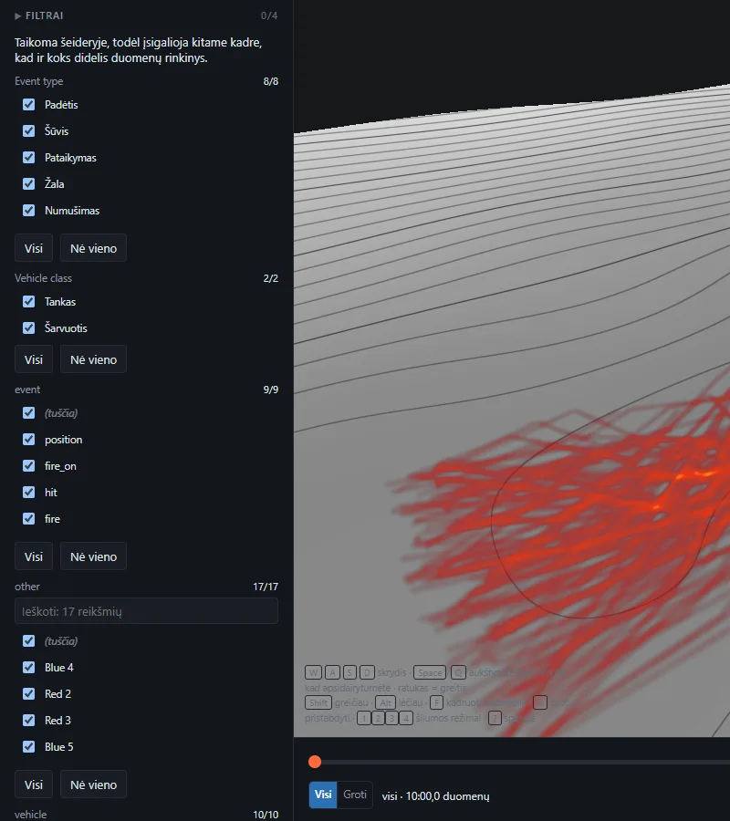
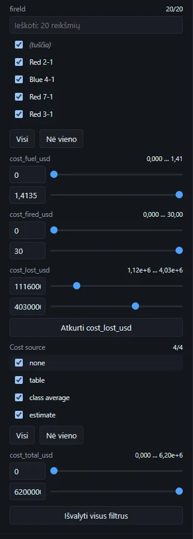

# Filtrai

**Filtrai** paslepia eilutes, kurių jums nereikia, pavyzdžiui vieną transporto klasę ar vieną įvykio rūšį, ir paveikslėlis iškart atsinaujina. Skiltyje išvardijami stulpeliai, paliekami įkeliant skiltyje *Išsaugoti filtravimui* ([Stulpelių priskyrimas](column-mapping.md)), ir *Šaltinio failas*, kai įkelta keli failai.

## Išbandykite {#try-it}

1. Įkelkite duomenų rinkinį ir šoninėje juostoje atidarykite **Filtrai**.
2. Skiltyje **Transporto klasė** nuimkite *Tankas* žymę. Paveikslėlis iškart pasikeičia.
3. Paspauskite **Išvalyti visus filtrus**, kad grįžtumėte.

Pirmos eilutės yra peržiūros programos stulpeliai (žemiau). Po jų ateinančios eilutės yra iš jūsų failo.

## Stulpeliai, kuriuos prideda peržiūros programa {#columns-the-viewer-adds}

Įkėlimo metu peržiūros programa išsiaiškina keturis savo stulpelius ir išvardija juos **pirmiausia**, su pavadinimais ir reikšmėmis jūsų kalba, todėl tas pats filtras veikia visiems žaidimams ir duomenų šaltiniams:

| Stulpelis | Reikšmės | Kaip apskaičiuojama |
|---|---|---|
| **Įvykio tipas** | 23 rūšys: Pozicija, Šūvis, Paleidimas (raketa, bomba), Pataikymas, Praleidimas (ginklas baigėsi be taikinio netoli), Sprogimas, Žala, Nužudymas, Mirtis, Sunaikinta, Avarija, Iššokimas / išsiskleidimas, Atsiradimas, Dingimas, Pakilimas, Nusileidimas, Sąlytis su žeme, Sustojimas ant žemės, Perkrovimas / degalų pildymas, Užėmimas / tikslas, Klaida, Žinutė, Kita | stulpelis `event`, `events`, `event_type` arba `event_name`; kiekvieno žaidimo žodžiai (`shot`, `burst`, `fired`, `struck`, `flare`, `plant` ...) susiejami su šiomis rūšimis. Visa lentelė: [Įvykių tipai ir klasės](ref-event-types.md). |
| **Žaidėjas ar DI** | Žaidėjas, DI | stulpelis `ai`, `is_ai`, `bot` arba `actor`; kitaip `is_player` / `human`; kitaip paskyros ID (`user_id`, `steam_id`; tuščias arba 0 reiškia DI); Tacview įrašams – ar objektas turi pilotą |
| **Transporto klasė** | 17 klasių: Naikintuvas, Puolamasis lėktuvas, Bombonešis, Kitas lėktuvas, Sraigtasparnis, Tankas, Šarvuotas automobilis, Oro gynyba, Artilerija, Sunkvežimis / automobilis, Laivas, Povandeninis laivas, Pėstininkai, Ginklas, Klaida, Statinys, Kita | technikos ar vieneto pavadinimas (lyginamas su [figūrų katalogu](figures.md)) ir tipo stulpeliai |
| **Taikinio klasė** | tos pačios klasės | kitos pusės technika (`other_vehicle`, `target_vehicle`, `victim_type` ...) |

Rodomos tik pasitaikančios rūšys. Vertės stulpeliai (`cost_*`, `earn_*`, `net_*` ir *Kainos šaltinis*, žr. [Vertės svorinimas](value-weighting.md)) filtruojami kaip bet kuris skaitinis stulpelis: pavyzdžiui, *Kainos šaltinyje* nuimkite *estimate* žymę, kad liktų tik įkainotos eilutės.

Kategorijų sąrašas su daugiau nei 12 reikšmių gauna paieškos laukelį (*Ieškoti n reikšmių*) ir mygtuką **Tik šie**, kuris leidžia tiksliai tas reikšmes, kurios atitinka.

Kuriuos stulpelius galima filtruoti, nusprendžiama įkėlimo metu, nes tuomet juos reikia perskaityti. Jei neišsaugota nė vieno stulpelio, skiltis apie tai praneša ir nukreipia į *Išsaugoti filtravimui*.

## Skaitiniai stulpeliai (intervalas) {#numeric-columns-range}

| Dalis | Reiškia |
|---|---|
| Pavadinimas ir `min ... max` | Stulpelis ir dabartinis intervalas (visas stulpelio intervalas, kol filtras nenustatytas). |
| Pirma eilutė: skaičių langelis ir slankiklis | Apatinė riba. Tempiant slankiklį virš viršutinės ribos, ji stumia viršutinę ribą kartu. |
| Antra eilutė: skaičių langelis ir slankiklis | Viršutinė riba. Tempiant žemiau apatinės ribos, ji stumia ir ją. |
| **Atkurti *stulpelį*** | Pašalina šį filtrą. |

Slankikliai apima stulpelio mažiausią ir didžiausią reikšmes per 1 000 žingsnių; skaičių langeliai priima bet kokią reikšmę. Eilutė praeina, kai jos reikšmė yra intervale, įskaitant abu galus. Didelės reikšmės rodomos eksponentine forma (`1.23e6`).

## Kategorijų stulpeliai {#category-columns}

| Dalis | Reiškia |
|---|---|
| Pavadinimas ir `leidžiama/iš viso` | Stulpelis ir kiek jo reikšmių leidžiama. |
| Reikšmių sąrašas | Žymės langelis kiekvienai reikšmei; tuščia reikšmė rodoma kaip *(tuščia)*. |
| **Visi** / **Nė vieno** | Leisti visas reikšmes / nė vienos. |

Leidus visas reikšmes, filtras pašalinamas.

## Taisyklės {#rules}

- **Keturi filtrai vienu metu.** Antraštėje rodoma `aktyvūs/4`. Penktas filtras netaikomas, ir skiltis apie tai praneša. Pasirinkimas [Objektuose](entities.md) (arba Rungtynių skirtuko žaidėjo fokusas) taip pat naudoja vieną iš keturių. Filtras, apimantis visą stulpelį, nenaudoja nė vieno.
- **Kategorijų stulpelyje – daugiausia 4 096 reikšmės**; platesnis stulpelis įkėlimo metu neišsaugomas.
- **Filtrai jungiami IR** ir su komandų matomumu, skirtumo skaidymu, laiko langu, atstumo atrinkimu bei [pjūviu](slice.md).
- **Pakeitus filtrą, kaupimas pradedamas iš naujo ir po kelių kadrų ekspozicija išmatuojama iš naujo**, nes filtravimas gali labai pakeisti tankį ([Spalva ir ekspozicija](colour-and-exposure.md#auto-exposure)).
- **Išvalyti visus filtrus** pašalina visus stulpelių filtrus. Komandų matomumas ir kitur nustatyti žaidėjų pasirinkimai išlieka.
- Stulpelių filtrai keičia šilumos režimus. Jie nekeičia [figūrų pakartojimo](box-replay.md) figūrų, kurios seka komandų matomumą ir Objektų pasirinkimą. Objektų pasirinkimas keičia abu.
- [Linijų šilumoje](line-heat.md) filtras tikrinamas pagal eilutę, kurioje baigiasi kiekvienas segmentas.
- Įkėlus naujus duomenis, visi filtrai išvalomi.

## Kūrėjams {#for-developers}

**Lizdai.** Kiekvienas aktyvus filtras užima vieną iš keturių GPU lizdų ([`MAX_FILTER_SLOTS`](https://github.com/Holdi601/3DHeat/blob/main/src/render/types.ts)), tekstūrą po 4 baitus eilutei. Lizdai skiriami filtrams pagal tai, kada jie paskutinį kartą pakeisti ([`filterSlots`](https://github.com/Holdi601/3DHeat/blob/main/src/render/filterTables.ts), bendras šešėliuotuvui ir abiem skydeliams). Daugiau nei keturi – klaida sako *Taikomi tik pirmi 4 filtrai. Išvalykite vieną – likusieji ignoruojami, o ne tyliai sujungiami*, o papildomų filtrų pavadinimai rodomi kaip *stulpelis (netaikoma)*. Filtrai vykdomi kiekvienai eilutei viršūnių šešėliuotuve, todėl slenksčio keitimui nereikia iš naujo analizuoti ar įkelti.

**Filtrai, kurių skydelis nerodo.** Programos būsenoje yra dar du tipai ([`FilterSpec`](https://github.com/Holdi601/3DHeat/blob/main/src/state/types.ts)):

- **grupių** filtras, nustatomas Rungtynių skirtuko, kai jis fokusuoja vieną pusę. Jis paslepia kitas grupes visuose režimuose, įskaitant skirtumą, skaidomą pagal stulpelį.
- **asmenų** filtras, nustatomas [Objektų](entities.md) skydelio ir Rungtynių skirtuko, kai jis fokusuoja vieną žaidėją. Jis riboja figūrų pakartojimą ir šilumos režimus. Šilumoje tai kategorijų filtras pagal asmenų ID ir užima vieną iš keturių lizdų. Jo kaukėje telpa 65 536 ID ([`FILTER_MASK_CAPACITY`](https://github.com/Holdi601/3DHeat/blob/main/src/render/types.ts)); asmuo už šios ribos aktyvaus filtro metu šilumoje nepiešiamas, net jei pasirinktas. Figūrų pakartojimas juos vis dar rodo.
