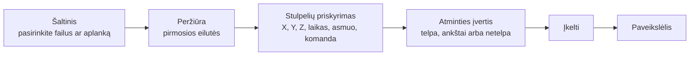

# Duomenų įkėlimas

Prieš 3DHeat ką nors nupiešdamas jam reikia lentelės: kiekvienoje eilutėje nurodyta, kur kas buvo, ir, jei turite, kada ir kas tai buvo. Šis skyrius parodo, kaip failas virsta paveikslėliu. Dar neturite duomenų? Išbandykite [demonstracinius duomenis](demo-data.md).

**Atlikite dabar:**

1. Šilumos žemėlapio šoninėje juostoje atidarykite **Šaltinis** ir paspauskite **Failai…** (arba nuleiskite failą ar aplanką ant nuleidimo srities).
2. Pažiūrėkite į **Stulpelių priskyrimas**: langeliai dažniausiai jau užpildyti.
3. Patikrinkite, ar **Atminties įvertis** sako *telpa*.
4. Paspauskite **Įkelti**.

Viskas, ką rodo Šilumos žemėlapio skirtukas, ateina iš vieno **duomenų rinkinio**: eilučių lentelės, kurios kiekviena turi poziciją ir, neprivalomai, laiką, asmenį, grupę, sesiją, žvilgsnio kryptį bei bet kiek papildomų stulpelių filtravimui. Šis skyrius paaiškina, kaip sukuriamas duomenų rinkinys.

## Kelias nuo failų iki paveikslėlio {#the-path-from-files-to-picture}

1. **Pasirinkite failus** skiltyje **Šaltinis** – vieną, kelis, aplankų medį arba nuleisdami juos. Priimami Parquet, CSV, Tacview, GPS takeliai ir daugiau; visas sąrašas yra [Duomenų formatuose](data-formats.md#files). Žr. [Failų įkėlimas](loading-files.md).
2. **Peržiūra.** Atidaromas pirmasis pasirinktas failas: jo stulpelių pavadinimai, pirmosios 50 eilučių, kurie stulpeliai atrodo skaitiniai, o (Parquet atveju) kiekvieno stulpelio loginis tipas ir paties failo skaitymo nurodymai – `heat3d` metaduomenų įrašas.
3. **Automatinis priskyrimas.** Stulpeliai priskiriami vaidmenims – X, Y, Z, laikas, asmuo, sesija, grupė, žvilgsnio kryptis – o keletas paliekama filtravimui. Kiekvienas spėjimas rodomas skiltyje **Stulpelių priskyrimas** ir gali būti pakeistas. Žr. [Stulpelių priskyrimas](column-mapping.md) ir [Ašys, vienetai ir laikas](axes-units-and-time.md).
4. **Skaičiavimas.** Perskaičiuojamas kiekvieno failo eilučių skaičius (tiksliai iš Parquet poraštių, įvertinamas CSV), todėl skiltis gali pasakyti, kiek atminties reikės įkėlimui ir ar ji telpa, dar prieš įkeliant ką nors. Jei netelpa, siūloma įkelti kas *N*-tą eilutę. Žr. [Atmintis ir biudžetai](memory-and-budgets.md).
5. **Įkėlimas.** Fono darbuotojas išskaido tik priskirtus kiekvieno failo stulpelius – kelis failus vienu metu, iki [skaitytuvo gijų](memory-and-budgets.md#parser-threads) biudžeto – ir sujungia juos pagal pasirinkimo tvarką į vieną duomenų rinkinį: vieną bendrą asmenų, grupių ir sesijų žodyną visiems failams, vieną bendrą laiko pradžią ir visas eilutes, surikiuotas pagal laiką. Žr. [Sesijos, asmenys ir grupės](sessions-persons-groups.md).
6. **Įkėlimas į GPU.** Pagrindinė gija vienam kadrui praneša „Į GPU įkeliama N eilučių“, tada eilutes sudeda į GPU atmintį pagal GPU biudžetą. Žr. [GPU atminties laikymas](gpu-memory.md).
7. **Pirmas paveikslėlis.** Kamera įrėmina duomenis, spraito spindulys ir įsotinimas nustatomi pagal duomenų apimtį ir eilučių skaičių, o po 8 nupieštų kadrų įsotinimas išmatuojamas pagal patį paveikslėlį ([Spalva ir ekspozicija](colour-and-exposure.md)).

## Reikalavimai, tikrinami prieš įkėlimą {#requirements-checked-before-a-load}

| Reikia | Kas nutinka be jo |
|---|---|
| **Bent du iš X / Y / Z** | Įkėlimas atmetamas. Su tiksliai dviem trečioji ašis yra 0, o duomenys piešiami kaip plokščias paviršius 3D scenoje – tai ir reikia žemėlapio šilumai iš viršaus. |
| Laiko stulpelis | Neprivalomas. Be jo laiko juosta išjungiama, vaizdas lieka režime **Visi**, o šoninėje juostoje tai nurodoma. |
| Asmens stulpelis | Neprivalomas. Reikalingas [figūrų sutapdinimui](box-replay.md) (kiekvieno asmens figūra), [linijų šilumai](line-heat.md) (kiekvieno asmens nueitas kelias), interpoliacijai, pėdsakams ir **Gyvavimo trukmė** istorijai. |
| Grupės stulpelis | Neprivalomas. Reikalingas [komandų šilumai](team-heat.md) ir [skirtumo](difference.md) režimui (bent dvi grupės). |

Režimas, kurio įkelti duomenys nepalaiko, režimų juostoje yra užpilkintas; užvedus pelę ant jo, nurodoma priežastis.

## Be jūsų duomenų {#without-your-own-data}

Skiltyje **Duomenų rinkinys** (po **Šaltinis**) yra [sintetinis generatorius](synthetic-generator.md), kuris sukuria bet kokio dydžio duomenų rinkinį battle royale formos – tinka peržiūros programai išbandyti ir patikrinti, ką kompiuteris gali atlaikyti.

## Šio skyriaus puslapiai {#pages-in-this-section}

- [Failų įkėlimas](loading-files.md) – pasirinkėjai, aplankai, nuleidimas ir tempimas, kelių failų sujungimas, judėjimo failo taisyklė, eiga ir atšaukimas
- [Stulpelių priskyrimas](column-mapping.md) – kiekvienas priskyrimo skilties laukas, kaip automatinis priskyrimas spėja, `heat3d` užuominos
- [Ašys, vienetai ir laikas](axes-units-and-time.md) – aukštoji ašis, apvertimai, vienetų mastelis, laiko vienetai, žvilgsnio kryptis
- [Sesijos, asmenys ir grupės](sessions-persons-groups.md) – kas kiekvienas daro, ribos, bendri pavadinimai, objekto dydis, Duomenų rinkinio skiltis
- [Sintetinis generatorius](synthetic-generator.md)
- [Atmintis ir biudžetai](memory-and-budgets.md) – atminties modelis, tikrinimas, retinimas, rikiavimo riba, išteklių biudžetai
