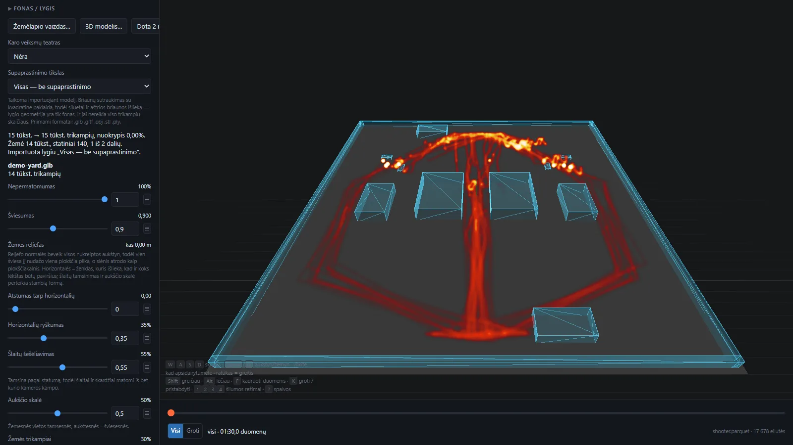
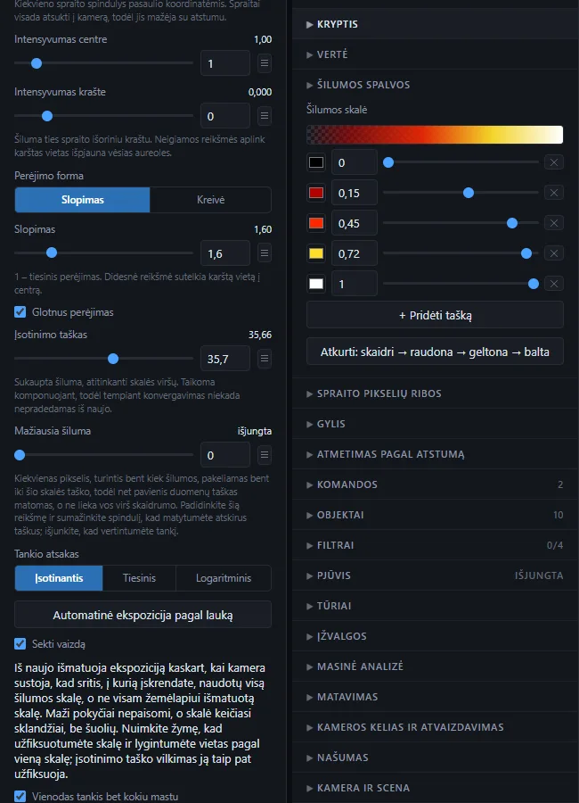

# Šiluma

Šiluma nudažo vietas, kur įvyko daug dalykų: raudona, kur įvyko šiek tiek, baltai karšta, kur įvyko daug. Ji atsako į klausimą „kur tai vyksta ir kiek“.

**Šiluma** (klavišas 1) yra numatytasis režimas. Kiekviena matoma [eilutė](glossary.md) prideda į kamerą nukreiptą apvalų [spraitą](glossary.md); persidengiantys spraitai susideda į slankiojo kablelio buferį; suma perleidžiama per spalvų skalę – pagal numatymą skaidri → raudona → geltona → balta – ir nupiešiama virš scenos.

Paveikslėlyje – šaulio raundo šiluma lygyje su pastatais: karštos vietos yra kambariuose ir laiptuose, o ne tik ant žemės.

## Kaip naudoti {#how-to-use-it}

1. Įkelkite duomenis ir paspauskite `1` (arba pasirinkite **Šiluma** režimų juostoje).
2. Jei viskas balta ar tuščia, skyriuje **Šilumos forma** paspauskite **Automatinė ekspozicija pagal lauką**.
3. Keiskite **Spraito spindulį**, kol kaimyniniai taškai susilies į juostas: mažesnis rodo atskiras vietas, didesnis – plotus.
4. Atidarykite **Šilumos spalvos**, kad pakeistumėte spalvas, arba **Gylis**, kad kalvos ir sienos slėptų šilumą už savęs.

Tie patys skydeliai formuoja [Skirtumą](difference.md), [Komandų šilumą](team-heat.md) ir [Linijų šilumą](line-heat.md); jie skiriasi tuo, ką prideda (su ženklu, spalvotai ar išilgai linijų), o ne tuo, kaip tai daroma.

## Skydeliai ir jų numatytosios reikšmės {#the-panels-and-their-defaults}

Kiekvienas valdiklis paaiškintas savame puslapyje; stulpelis Išsamiau nurodo į jį. Slankikliai turi šalia įvedimo laukelį ir vilkimo rankenėlę (mažą rankenėlę dešinėje: vilkite aukštyn ar žemyn, toliau – greičiau, `Shift` – tiksliai); kai slankiklio takelis baigiasi anksčiau nei tikra riba, rankenėlė gali pastumti jį iki čia nurodytos *vilkimo ribos*. Reikšmės, pažymėtos *įkėlus*, perskaičiuojamos kiekvienam naujam duomenų rinkiniui.

### Šilumos forma (atidaryta) {#heat-shape-open}

| Valdiklis | Numatytoji | Intervalas (vilkimo riba) | Išsamiau |
|---|---|---|---|
| **Spraito spindulys** | 6 m; įkėlus plotis / 120 | 0,05–2000 m, logaritminis (50 000) | [Spraito forma](sprite-shape.md#sprite-radius) |
| **Intensyvumas centre** | 1 | 0–10 (1000) | [Spraito forma](sprite-shape.md#centre-and-edge-intensity) |
| **Intensyvumas krašte** | 0 | -2–10 (1000) | [Spraito forma](sprite-shape.md#centre-and-edge-intensity) |
| **Skalės forma** | *Nuslopimas* | *Nuslopimas* / *Kreivė* | [Spraito forma](sprite-shape.md#ramp-shape-falloff-or-curve) |
| **Nuslopimas** (tik Nuslopimas) | 1,6 | 0,1–8 (64) | [Spraito forma](sprite-shape.md#falloff) |
| **Glotni skalė** (tik Nuslopimas) | įjungta | | [Spraito forma](sprite-shape.md#falloff) |
| Kreivės redaktorius (tik Kreivė) | išankstinis nustatymas *Glotni* | | [Spraito forma](sprite-shape.md#the-curve-editor) |
| **Įsotinimo taškas** | 24; įkėlus įvertinimas, po to išmatuota | 0,1–4000, logaritminis (10 000 000) | [Spalva ir ekspozicija](colour-and-exposure.md#saturation-point) |
| **Mažiausia šiluma** | išjungta (0) | 0–100 % | [Spalva ir ekspozicija](colour-and-exposure.md#minimum-heat) |
| **Tankio atsakas** | *Įsotinantis* | *Įsotinantis* / *Tiesinė* / *Logaritminė* | [Spalva ir ekspozicija](colour-and-exposure.md#density-response) |
| **Automatinė ekspozicija pagal lauką** | | mygtukas | [Spalva ir ekspozicija](colour-and-exposure.md#auto-exposure) |
| **Sekti vaizdą** | įjungta | | Kiekvieną kartą, kai kamera sustoja, ekspozicija išmatuojama iš naujo, todėl regionas, į kurį įskrendate, naudoja visą spalvų skalę. Maži pokyčiai ignoruojami, o mastelis slysta. Išjunkite arba vilkite **Įsotinimo tašką**, kad užfiksuotumėte mastelį ir palygintumėte vietas viename mastelyje. [Spalva ir ekspozicija](colour-and-exposure.md#follow-the-view) |
| **Vienodas tankis bet kokiu mastu** | įjungta | | Spalva reiškia tą patį eilučių skaičių ploto vienetui, kad ir kaip arti būtumėte. Spraitas, kurį pikselių ribos padidina (toli) arba sumažina (arti), išlaiko tokį šilumos kiekį, koks būtų jo tikrasis dydis, todėl vaizdas, ekspozuotas iš toli, neblanksta, kai į jį įskrendate. Išjungus, ribojamas spraitas prideda visą savo svorį ribotu dydžiu. [Spraito forma](sprite-shape.md#pixel-clamps) |
| **Suploti į žemės plokštumą** | išjungta | | [Spraito forma](sprite-shape.md#flatten-onto-ground-plane) |

### Šilumos spalvos (uždaryta) {#heat-colours-closed}

| Valdiklis | Numatytoji | Išsamiau |
|---|---|---|
| Grupių spalvų pavyzdžiai ir **Spalvų atskyrimas** (tik Komandų šiluma) | 1,4 | [Komandų šiluma](team-heat.md) |
| **Šilumos skalė** redaktorius (*Teigiama (sudedančios komandos)* Skirtume, *Nepermatomumo skalė* Komandų šilumoje) | nuo skaidrios iki raudonos, geltonos ir baltos | [Spalva ir ekspozicija](colour-and-exposure.md#the-ramp-editor) |
| **Atkurti: skaidri → raudona → geltona → balta** | | |
| **Neigiama (atimančios komandos)** skalė (tik Skirtumas) | nuo skaidrios iki žalios, mėlynos ir violetinės | [Skirtumas](difference.md#colours) |

### Spraito pikselių ribos (uždaryta) {#sprite-pixel-clamps-closed}

| Valdiklis | Numatytoji | Intervalas (vilkimo riba) | Išsamiau |
|---|---|---|---|
| **Mažiausias pikselių spindulys** | 1 px | 0–16 (512) | [Spraito forma](sprite-shape.md#pixel-clamps) |
| **Didžiausias pikselių spindulys** | 96 px | 2–1024, logaritminis (8192) | [Spraito forma](sprite-shape.md#pixel-clamps) |

### Gylis (atidaryta) {#depth-open}

| Valdiklis | Numatytoji | Išsamiau |
|---|---|---|
| **Slėpti už reljefo** | įjungta | [Gylis ir atrinkimas](depth-and-culling.md#hide-behind-terrain) |
| **Paslėpta už geometrijos** | 0,8 (*80 % tamsesnė*) | [Gylis ir atrinkimas](depth-and-culling.md#hidden-behind-geometry) |

### Atrinkimas pagal atstumą (uždaryta) {#distance-culling-closed}

| Valdiklis | Numatytoji | Intervalas (vilkimo riba) | Išsamiau |
|---|---|---|---|
| **Artima** | išjungta (0) | 0,5–5000 m, logaritminis, takelio apačia = išjungta (200 000) | [Gylis ir atrinkimas](depth-and-culling.md#distance-culling) |
| **Tolima** | išjungta (0) | 1–200 000 m, logaritminis, apačia = išjungta (10 000 000) | [Gylis ir atrinkimas](depth-and-culling.md#distance-culling) |
| **Pjauti plokštuma** | įjungta | | [Gylis ir atrinkimas](depth-and-culling.md#distance-culling) |
| **Pjauti ir lygį** | įjungta | | [Gylis ir atrinkimas](depth-and-culling.md#distance-culling) |

Klavišai: `[` ir `]` stumia tolimąją ribą į vidų ir į išorę, `\` ją perjungia ([Gylis ir atrinkimas](depth-and-culling.md#keyboard)).

### Kryptis ir Reikšmė {#direction-and-value}

Dar du skyriai yra žemiau Šilumos formos. **Kryptis** piešia kiekvieną eilutę kaip pleištą ir prideda rodyklių: žr. [Krypties šiluma](directional-heat.md). **Reikšmė** sveria šilumą pagal tai, kiek kiekviena eilutė kainavo ar uždirbo: žr. [Vertės svorinimas](value-weighting.md).

## Kas išsaugoma {#what-is-saved}

Aukščiau esantys šilumos nustatymai tarp sesijų neišsaugomi: perkrovus puslapį atkuriamos numatytosios reikšmės. Naršyklėje išsaugomi du dalykai: paskutinis grojimo greitis (`heat3d.speed`, žr. [Laiko juosta](timeline.md)) ir toli esančių figūrų nustatymai [figūrų sutapdinime](box-replay.md) (ženklo stilius, dydis, pataikymų žymos ir pan.). Taip pat išsaugoma kalba, [apversta pasaulio ašis](camera.md#invert-world-axis), lenktynių skirtuko prisimintų automobilių pavadinimai ir [lygių biblioteka](level-library.md). Pilnas sąrašas – [Išsaugoti nustatymai](ref-settings-storage.md).
