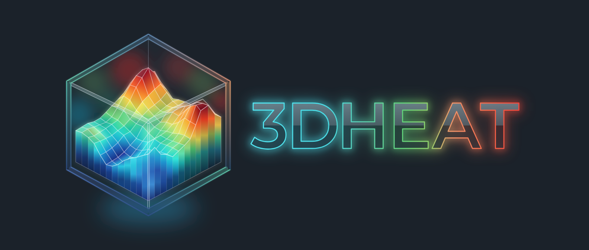
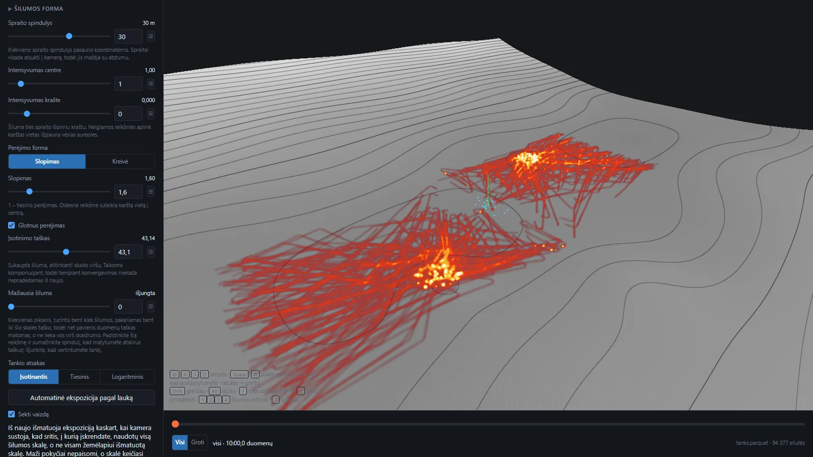
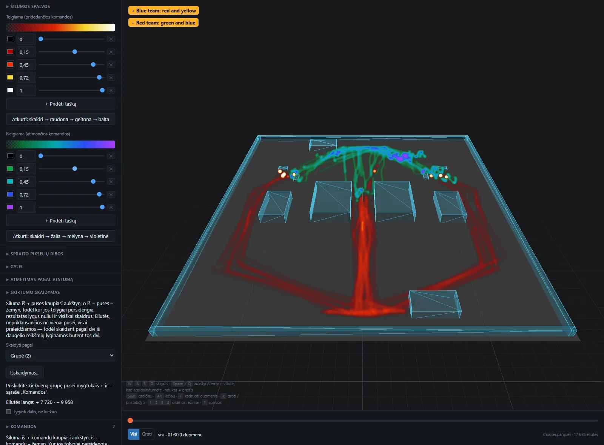
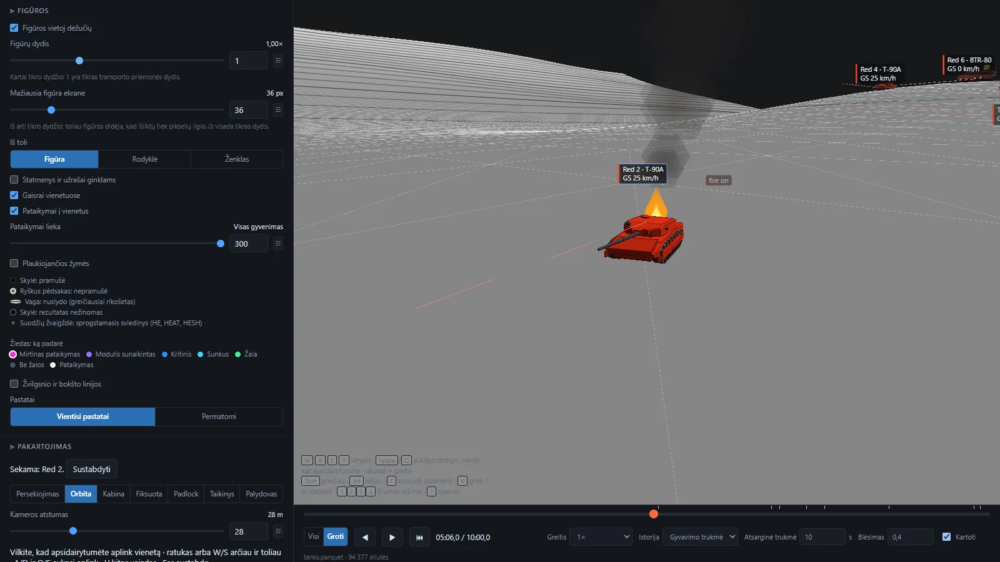
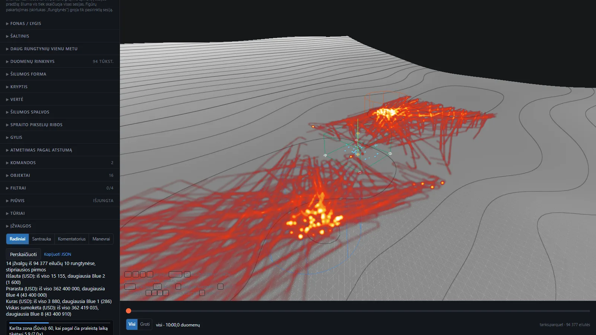
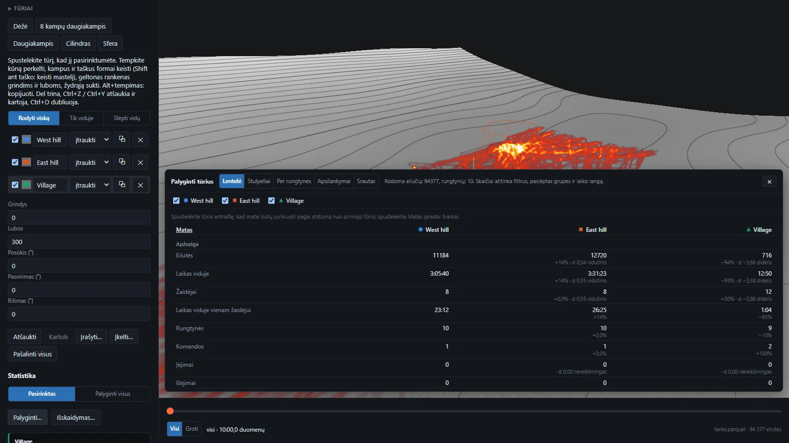
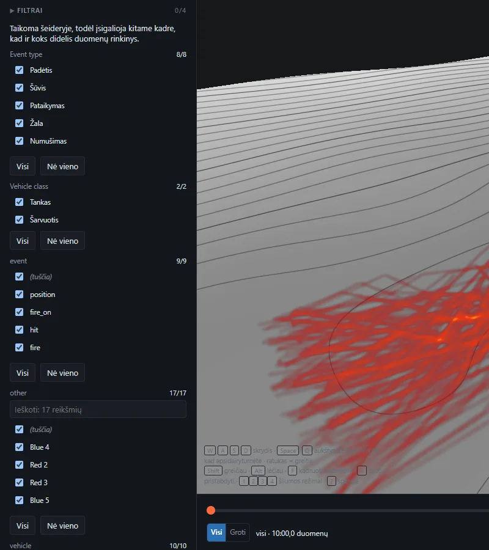
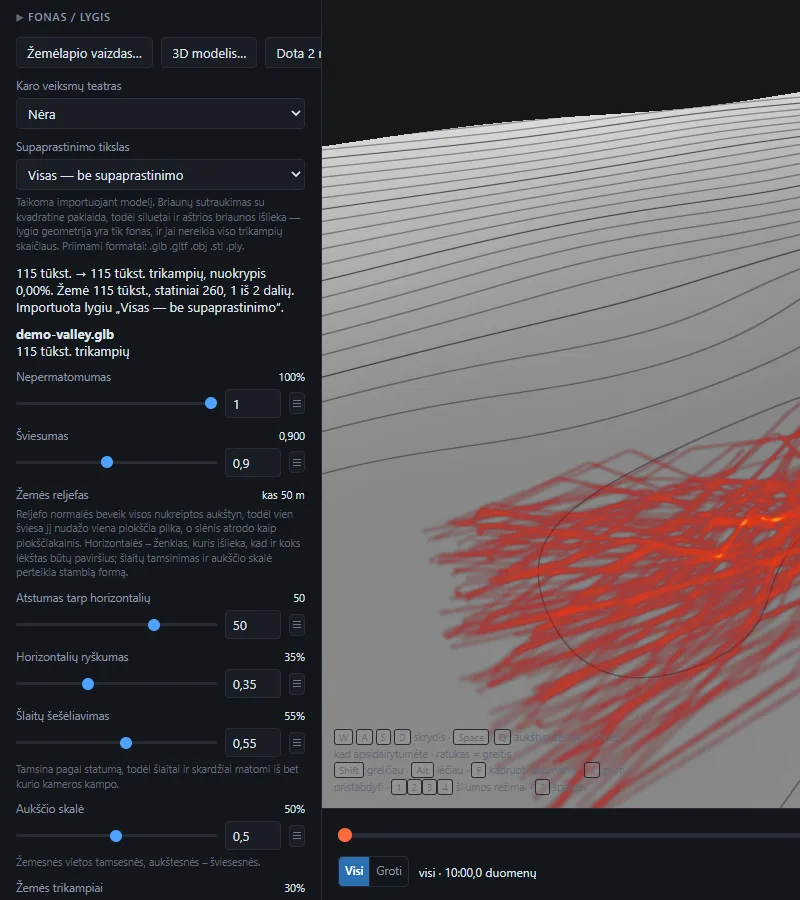

{: width="720" }

# 3DHeat

3DHeat parodo, kur žaidime kas vyko – kur judėjo žaidėjai, kur kovojo ir kur žuvo – kaip spindinčias spalvas, per kurias galima skristi, arba kaip mažas 3D figūras, kurios pakartoja rungtynes.

Įkelkite pozicijas – CSV, Parquet, Tacview įrašus, konvertuotus pakartojimus, vieną failą, aplanką ar tūkstančius rungtynių – ir pamatykite jas kaip **šilumos žemėlapį, per kurį galima skristi**, kaip **figūras, kurios pakartoja rungtynes**, kaip linijas išilgai maršrutų, kuriais ėjo žmonės, arba kaip vienos populiacijos palyginimą su kita. Programa pati suranda, kas išsiskiria, ir veikia visiškai jūsų naršyklėje: niekas niekur neįkeliamas. 3DHeat ir visi jo įrankiai yra nemokami ir atviro kodo pagal [MIT licenciją](https://github.com/Holdi601/3DHeat/blob/main/LICENSE).



**Esate čia pirmas kartas?** Sukurkite [demonstracinius duomenis](demo-data.md) ir sekite jų septynis žingsnius. Visi šios svetainės paveikslėliai padaryti su jais.

## Ką tai daro {#what-it-does}

| | |
|---|---|
|  | **[Šilumos režimai](heat-modes.md)** – šiluma, [skirtumas](difference.md) (raudona, kur viena pusė buvo daugiau, žalsvai mėlyna, kur buvo daugiau kita), [komandų šiluma](team-heat.md), [linijų šiluma](line-heat.md); [krypties šiluma](directional-heat.md) su sektoriais, krypčių laukais ir poliarinėmis diagramomis; šiluma, [sverta pagal vertę](value-weighting.md): kiek kainuoja ginklai, technika ir kuras. |
|  | **[Rungtynių pakartojimas](match-replay.md)** – kiekvienas vienetas kaip [figūra](figures.md) to, kuo jis yra, NATO ar rusiški ženklai toli, raketos ir trasuojantys šūviai, pataikymų žymės, griuvėsiai, gaisrai, bokštai, tikslai, Tacview stiliaus kameros ir taktinis vaizdas; [daug rungtynių vienu metu](many-matches.md). |
|  | **[Įžvalgos](insights.md)** – stiprios pozicijos, pavojinga vietovė, atsiradimo spąstai, siauros vietos ir išsiskiriantys žaidėjai, surasti ir surikiuoti su įrodymais; rašytinė santrauka, pasirinktinai su jūsų pasirinktu DI; komentatorius vienoms rungtynėms; [žinių lęšis](knowledge.md). |
|  | **[Tūriai](volumes.md)** – braižykite dėžes, prizmes, cilindrus ir sferas, filtruokite pagal juos, skaičiuokite, kas vyksta viduje, eksportuokite ir lyginkite vietas šalia viena kitos; [išskaidymas](breakdown.md), kas ir ką geriausiai daro vietoje. |
|  | **[Filtrai](filters.md)** – pagal įvykio tipą, žaidėją ar DI, transporto klasę, vertę, bet kurį stulpelį – vaizdo plokštėje, prie bet kokio duomenų dydžio. |
|  | **[Lygiai](levels.md)** – žemėlapio vaizdai, 3D lygiai, padaryti su [duomenų įrankiais](#related-repositories), supaprastinimas, [pasaulio fonas](world-backdrop.md) su tikru reljefu skrydžio duomenims. |

Be to: [Lenktynių analizės](race-analysis.md) skirtukas lenktynių žaidimų ratams, [Rungtynių](match-analysis.md) skirtukas Counter-Strike 2 santraukoms, [Taktikos lenta](tactics-board.md) planams ant lygio, [pataikymų analizė](hit-analysis.md) pagal techniką, [masinė analizė](mass-analysis.md) tūkstančiams rungtynių, [kameros keliai ir vaizdo įrašai](camera-path-and-video.md), [40 kalbų](languages.md), [metriniai arba imperiniai vienetai](settings.md).

## Skirtukai {#the-tabs}

Skirtukai yra viršuje šoninės juostos, po pavadinimu, vienetais ir kalbos meniu.

| Skirtukas | Kam skirtas |
|---|---|
| **Šilumos žemėlapis** | Bet kuri pozicijų lentelė: šilumos režimai, figūrų sutapdinimas, filtrai, tūriai, įžvalgos, lygiai, matavimas ir vaizdo įrašai. |
| **Lenktynių analizė** | Du ar daugiau ratų vienoje trasoje: kur prarandamas laikas, kodėl ir ką keisti. |
| **Rungtynės** | Rungtynių figūrų pakartojimas ir Counter-Strike 2 rungtynių santraukos. |
| **Taktika** | Planai ant lygio: figūros, maršrutai, mestos priemonės, sritys ir pastabos žingsniais, kuriuos galima paleisti. |
| **Technika** | Kur kiekvienas vienetas buvo pataikytas, kas pataikė ir kuo. |

## Įdiegimas ir paleidimas {#install-and-run}

3DHeat galima laisvai naudoti, keisti ir dalytis (MIT licencija), taip pat kiekvienu įrankiu, išvardytu [Susijusios saugyklos](#related-repositories) skyriuje.

### Windows, paprastas būdas {#windows-the-easy-way}

Saugyklos šaknyje yra trys paketinio failo (`.bat`).

| Failas | Ką daro |
|---|---|
| `start.bat` | Paleidžia peržiūros programą. Randa Node.js, net jei jo nėra `PATH` (ieško `%ProgramFiles%\nodejs`, `%ProgramFiles(x86)%\nodejs` ir `%LOCALAPPDATA%\Programs\nodejs`), o jei Node.js nėra, siūlo įdiegti LTS versiją su `winget install -e --id OpenJS.NodeJS.LTS`. Pirmą kartą prieš atsisiunčiant priklausomybes klausia (apie 300 MB į aplanko viduje esantį `node_modules\`, nieko visoje sistemoje). Jei port 5273 jau kas nors klauso, nepaleidžia ir nukreipia į `restart.bat`. Jei aplankas yra git kopija be vietinių pakeitimų ir yra naujesnė versija, klausia, ar atnaujinti (Y/N; jei per 60 s neatsakoma, lieka ši versija; žr. [Atnaujinimai](updates.md)). Tada paleidžia kūrimo serverį `http://127.0.0.1:5273/` ir atidaro naršyklę. **Langas yra serveris**: palikite jį atidarytą; uždarykite arba spauskite Ctrl+C, kad sustabdytumėte. |
| `restart.bat` | Paleidžia `stop.bat quiet`, tada `start.bat`. Reikia tik pakeitus `vite.config.ts`, pridėjus priklausomybę arba kai serveris užstrigo – šaltinio kodo pakeitimai perkraunami automatiškai. |
| `stop.bat` | Sustabdo visa, kas klauso port 5273, pagal proceso numerį, rastą per `netstat`, niekada pagal programos pavadinimą, todėl kiti Node.js procesai kompiuteryje lieka nepaliesti. Palaukia apie dvi sekundes, kol atlaisvinamas lizdas. Su argumentu `quiet` nesustoja pabaigoje. |

### Rankiniu būdu (bet kuri OS) {#by-hand-any-os}


```bash
git clone --recursive https://github.com/Holdi601/3DHeat.git
cd 3DHeat
npm install
npm run dev      # http://127.0.0.1:5273
```

Aplanke `exporters/` yra atskiri duomenų įrankiai kaip git submoduliai, kiekvienas – savo saugykla; po paprasto klonavimo paleiskite `git submodule update --init`. Pati peržiūros programa jiems nereikia, kad veiktų. Aplanke `exporters/ext/` yra pasirinktiniai konverteriai (War Thunder, World of Tanks, World of Warships, Squad pakartojimai; DCS ir IL-2 žemėlapiai), kiekvienas yra atskiras projektas.

Jokie žaidimų duomenys su šiuo įrankiu nepateikiami: lygiai, žemėlapiai ir įrašai padaromi jūsų kompiuteryje įrankiais, iš žaidimų, kuriuos turite.

### npm scenarijai {#npm-scripts}

| Scenarijus | Ką paleidžia |
|---|---|
| `npm run dev` | Vite kūrimo serveris prie port 5273, susietas su `127.0.0.1`. |
| `npm run build` | Tipų tikrinimas (`tsc --noEmit`) ir produkcinis paketas į `dist/`. |
| `npm run preview` | Rodo produkcinį paketą. |
| `npm run typecheck` | Tik tipų tikrinimas. |
| `npm test` / `npm run test:watch` | Vienetų ir integracijos testai (vitest). |
| `npm run smoke` | Valdo tikrą programą nematomame Chromium ir tikrina, ar drobėje yra duomenų spalvų taškų; ekrano nuotraukos eina į `tools/.smoke/`. Tikisi, kad kūrimo serveris veikia. |
| `npm run smoke:f16` | Tas pats rinkinys su `?heat=f16`, priverčiant pusiau tikslųjį kaupimo kelią (žr. [Pusiau tikslusis kaupimas](half-float-accumulation.md)). |
| `npm run bench` | Įkėlimo našumo testas, rašo `tools/.smoke/ingest-bench.json`. |
| `npm run test:heavy` | Testai, kuriems reikia didelių tikrų duomenų failų; jei failų nėra, jie patys praleidžiami. |
| `npm run inspect -- <file.parquet>` | Išspausdina Parquet failo schemą ir kelias eilutes (`tools/inspect-parquet.mjs`). |

### Ką prideda kūrimo serveris {#what-the-dev-server-adds}

Peržiūros programa yra statinis tinklalapis, bet kūrimo serveris (žr. `vite.config.ts`) prideda du vietinius kelius, kurių statinis `dist/` diegimas neturi:

- `/__host/memory` praneša kompiuterio įdiegtą ir laisvą RAM, o kur gali nuskaityti – vaizdo plokštės atmintį (iš `nvidia-smi`, arba Windows sistemoje iš ekrano adapterio registro įrašo). Tai leidžia [atminties biudžetams](memory-and-budgets.md) naudoti tikrus skaičius, o ne naršyklės apribotus spėjimus.
- `/__heat3d/update` tikrina, ar kopija atsilikusi, ir gali ją greitai atnaujinti ([Atnaujinimai](updates.md)).

Serveris klauso tik `127.0.0.1`, todėl nei vienas maršrutas nepasiekiamas per tinklą. Atverkite jį kaip `http://127.0.0.1:5273`: `localhost` gali būti išspręstas į IPv6 kilpą `::1`, kur niekas neklauso. Jis nesiunčia tarpsritinės izoliacijos antraščių (COOP/COEP): peržiūros programoje nieko nenaudojama `SharedArrayBuffer`, o darbuotojai duomenis perduoda perkėlimu, kuriam to nereikia.

## Naršyklės ir GPU reikalavimai {#browser-and-gpu-requirements}

- **Naršyklė su WebGPU arba WebGL2.** Pirmiausia bandomas WebGPU (Chrome ir Edge jį turi); jei jo nėra, naudojamas WebGL2 variklis. WebGL2 turi palaikyti `EXT_color_buffer_float` (atvaizdavimą į slankiojo kablelio tekstūras), kitaip peržiūros programa rodo „Nepavyko inicijuoti atvaizdavimo variklio.“ Žr. [Abu varikliai](backends.md). Peržiūros programa kuriama ir testuojama Chromium; kitos naršyklės nepatikrintos.
- **Įjungtas aparatinis spartinimas.** Kai naršyklė piešia procesoriumi (SwiftShader, llvmpipe, Microsoft Basic Render Driver ir panašiai), šoninės juostos viršuje rodoma raudona juosta, kuri tai pasako ir nurodo, kaip ištaisyti. Žr. [Programinio atvaizdavimo aptikimas](software-rendering.md).
- **Atskira GPU padeda, bet nėra būtina.** Abu varikliai prašo didelio našumo adapterio. Kiek duomenų galima laikyti GPU, yra biudžetas, kurį matote ir galite keisti ([Atmintis ir biudžetai](memory-and-budgets.md)).
- **Pasirinktinės funkcijos** naudoja papildomas naršyklės API: vaizdo atvaizdavimui reikia WebCodecs `VideoEncoder` su VP9 arba VP8 ([Kameros kelias ir vaizdo įrašas](camera-path-and-video.md)); lygių tinklo supaprastinimui reikia WebAssembly; aplankų nuleidimui naudojamas File and Directory Entries API; lygių bibliotekoje naudojama IndexedDB; žaidimų pultams – Gamepad API.

## Dokumentacijos žemėlapis {#documentation-map}

**Pradžia**: [Demonstraciniai duomenys](demo-data.md) · [Duomenų įkėlimas](getting-data-in.md) ([failų įkėlimas](loading-files.md), [stulpelių priskyrimas](column-mapping.md), [ašys, vienetai ir laikas](axes-units-and-time.md), [sesijos, asmenys ir grupės](sessions-persons-groups.md), [Tacview](tacview-acmi.md), [konverteriai](converters.md), [.3dheat](container.md), [atmintis ir biudžetai](memory-and-budgets.md))

**Žiūrėti**: [Šilumos režimai](heat-modes.md) ([šiluma](heat.md), [spraito forma](sprite-shape.md), [spalva ir ekspozicija](colour-and-exposure.md), [gylis ir atrinkimas](depth-and-culling.md), [skirtumas](difference.md), [komandų šiluma](team-heat.md), [linijų šiluma](line-heat.md), [dėžės pakartojimas](box-replay.md), [krypties šiluma](directional-heat.md), [vertės svorinimas](value-weighting.md)) · [Laiko juosta](timeline.md) · [Lygiai](levels.md) ([žemėlapio vaizdai](map-images.md), [3D lygiai](model-levels.md), [išvaizda](level-appearance.md), [biblioteka](level-library.md), [pasaulio fonas](world-backdrop.md), [jo šaltiniai](world-backdrop-sources.md)) · [Kamera](camera.md) ([žaidimų pultas](gamepad.md), [klavišai](keyboard-reference.md)) · [Kameros kelias ir vaizdo įrašas](camera-path-and-video.md)

**Analizuoti**: [Filtrai ir įrankiai](filters-and-tools.md) ([filtrai](filters.md), [komandos](teams-list.md), [objektai](entities.md), [pjūvis](slice.md), [matavimas](measure.md), [tūriai](volumes.md), [išskaidymas](breakdown.md)) · [Įžvalgos](insights.md) ([žinių lęšis](knowledge.md)) · [Masinė analizė](mass-analysis.md)

**Pakartojimas**: [Rungtynių pakartojimas](match-replay.md) · [Daug rungtynių vienu metu](many-matches.md) · [Figūros](figures.md) ([figūrų sutapdinime](figure-replay.md), [šaltiniai](figure-credits.md)) · [Tacview paritetas](tacview-parity.md) · [Pataikymų analizė](hit-analysis.md)

**Kiti skirtukai**: [Lenktynių analizė](race-analysis.md) ([metodas](race-analytics.md), [kiti žaidimai](other-games.md)) · [Rungtynių analizė](match-analysis.md) · [Taktikos lenta](tactics-board.md) ([greičiai](tactics-speeds.md))

**Peržiūros programa**: [Žodynėlis](glossary.md) · [Nustatymai, vienetai ir klavišai](settings.md) · [Kalbos](languages.md) · [Atnaujinimai](updates.md) · [Atvaizdavimo vidus](rendering-internals.md) ([varikliai](backends.md), [kaupimas](accumulation.md), [imtis ir biudžetai](sampling-and-budgets.md), [pusiau tikslusis](half-float-accumulation.md), [GPU atmintis](gpu-memory.md), [programinis atvaizdavimas](software-rendering.md), [našumas ir statistika](performance-and-stats.md)) · [Duomenų formatai](data-formats.md) · [Nuoroda](reference.md) · [Dokumentacijos priežiūra](maintaining.md)

## Susiję saugyklos {#related-repositories}

Peržiūros programa skaito duomenis; šie įrankiai juos sukuria. Kiekviena yra atskira viešoji saugykla (MIT) su savo dokumentacija. Nė vienas iš jų nepateikia žaidimo duomenų: lygiai, žemėlapiai ir įrašai daromi jūsų kompiuteryje, iš žaidimų, kuriuos turite. Kiekviena žaidimo skaityklė yra atskiras nedidelis projektas su savo licencijos failu, leidimais ir problemų sekimo sistema, todėl ją galima įdiegti, atnaujinti, prižiūrėti – arba teisių turėtojo prašymu pašalinti – atskirai, nepaveikiant peržiūros programos ir kitų įrankių.

| Saugykla | Ką daro | Naudinga | Dokumentacija |
|---|---|---|---|
| [3DHeat-GameFiles](https://github.com/Holdi601/3DHeat-GameFiles) | Iš archyvų, kuriuos žaidimai pateikia (Forza Horizon, BeamNG, Assetto Corsa Rally; Unreal, Unity, Frostbite ir Source 2 skaitytojai), išskaito trasas ir lygius kaip glTF | 3D lygis po jūsų šiluma ar pakartojimu | [svetainė](https://holdi601.github.io/3DHeat-GameFiles/) |
| [3DHeat-GameCapture](https://github.com/Holdi601/3DHeat-GameCapture) | Įrašo ratų telemetriją iš sąsajų, kurias lenktynių žaidimai skelbia, ir atkuria lygius iš žaidimo vaizdo įrašų | ratai Lenktynių analizei; lygis, kai failų skaityti neįmanoma | [svetainė](https://holdi601.github.io/3DHeat-GameCapture/) |
| [3DHeat-UnrealExporter](https://github.com/Holdi601/3DHeat-UnrealExporter) | Unreal Editor įskiepis, eksportuojantis lygį kaip vieną glTF failą | jūsų Unreal projektų lygiai | [svetainė](https://holdi601.github.io/3DHeat-UnrealExporter/) |
| [3DHeat-CS2](https://github.com/Holdi601/3DHeat-CS2) | Counter-Strike 2 demonstracijos į šilumos lenteles ir rungtynių santraukas, CS2 žemėlapiai į geometriją | CS2 šiluma, pakartojimai ir Rungtynių skirtukas | [svetainė](https://holdi601.github.io/3DHeat-CS2/) |
| [3DHeat-Watcher](https://github.com/Holdi601/3DHeat-Watcher) | Fone įrašo jūsų žaidimą pagal tai, ką žaidimai skelbia: telemetriją, žaidimo būsenos integracijas, žurnalus, pakartojimus | jūsų statistika be rankinio darbo | [svetainė](https://holdi601.github.io/3DHeat-Watcher/) |
| [3DHeat-Ext-WarThunder](https://github.com/Holdi601/3DHeat-Ext-WarThunder) | War Thunder pakartojimai (`.wrpl`) į lenteles: oro ir sausumos trajektorijos, šūviai, pataikymai, nužudymai, bokštai, tikslai | War Thunder pakartojimai, pataikymų žymės ir įžvalgos | [svetainė](https://holdi601.github.io/3DHeat-Ext-WarThunder/) |
| [3DHeat-Ext-WoT](https://github.com/Holdi601/3DHeat-Ext-WoT) | World of Tanks pakartojimai į lenteles: kiekvienos technikos pozicija, mirtys ir nužudymai | World of Tanks šiluma ir pakartojimai | [svetainė](https://holdi601.github.io/3DHeat-Ext-WoT/) |
| [3DHeat-Ext-WoWs](https://github.com/Holdi601/3DHeat-Ext-WoWs) | World of Warships pakartojimai į lenteles: kiekvieno laivo pozicija ir nuskandinimai | World of Warships šiluma ir pakartojimai | [svetainė](https://holdi601.github.io/3DHeat-Ext-WoWs/) |
| [3DHeat-Ext-Squad](https://github.com/Holdi601/3DHeat-Ext-Squad) | Squad serverių demonstracijos į lenteles: kiekvieno žaidėjo pozicija, komanda ir būrys | Squad šiluma ir pakartojimai | [svetainė](https://holdi601.github.io/3DHeat-Ext-Squad/) |
| [3DHeat-Ext-DCS](https://github.com/Holdi601/3DHeat-Ext-DCS) | DCS World reljefai iš jūsų diegimo į lygius: žemė, keliai, miestai, aerodromai, laukai, vanduo | DCS ir Tacview įrašai jų tikrame reljefe | [svetainė](https://holdi601.github.io/3DHeat-Ext-DCS/) |
| [3DHeat-Ext-IL2](https://github.com/Holdi601/3DHeat-Ext-IL2) | IL-2 Great Battles žemėlapiai į lygius | IL-2 įrašai jų žemėlapyje | [svetainė](https://holdi601.github.io/3DHeat-Ext-IL2/) |

## Šaltinio kodo struktūra trumpai {#source-layout-briefly}

| Aplankas | Turinys |
|---|---|
| [`src/data/`](https://github.com/Holdi601/3DHeat/tree/main/src/data) | Failų pasirinkimas, CSV ir Parquet įkėlimas, automatinis priskyrimas, tikrinimas, atminties modelis, duomenų rinkinio kūrėjas, modelių skaitymas, klasifikavimas, supaprastinimas, lygių biblioteka |
| [`src/render/`](https://github.com/Holdi601/3DHeat/tree/main/src/render) | Kadrų ciklas (`engine.ts`), imtis, abu varikliai, kamera, žaidimų pultas, matavimas, kameros kelias, vaizdo įrašų įrašymas |
| [`src/state/`](https://github.com/Holdi601/3DHeat/tree/main/src/state) | Programos būsena (`store.ts`) su visomis numatytosiomis reikšmėmis, domeno tipai (`types.ts`), spraito kreivė |
| [`src/ui/`](https://github.com/Holdi601/3DHeat/tree/main/src/ui) | Šoninės juostos skydeliai, laiko juosta, perdangos |
| [`src/race/`](https://github.com/Holdi601/3DHeat/tree/main/src/race), [`src/match/`](https://github.com/Holdi601/3DHeat/tree/main/src/match) | Lenktynių analizės ir Rungtynių skirtukai |
| [`src/i18n/`](https://github.com/Holdi601/3DHeat/tree/main/src/i18n) | Vertimai |
| [`src/insights/`](https://github.com/Holdi601/3DHeat/tree/main/src/insights) | Įžvalgos: detektoriai, santrauka, komentatorius, DI teikėjai, žinių lęšis |
| [`src/mass/`](https://github.com/Holdi601/3DHeat/tree/main/src/mass) | Masinė analizė daugybei rungtynių |
| [`src/volumes/`](https://github.com/Holdi601/3DHeat/tree/main/src/volumes) | Tūriai, jų statistika, eksportas ir palyginimas |
| [`src/breakdown/`](https://github.com/Holdi601/3DHeat/tree/main/src/breakdown) | Išskaidymas ir veiksniai |
| [`src/overlay/`](https://github.com/Holdi601/3DHeat/tree/main/src/overlay) | Daugelio rungtynių perdanga |
| [`src/figures/`](https://github.com/Holdi601/3DHeat/tree/main/src/figures) | Figūrų katalogas ir jo kūrėjas |
| [`src/vehicle/`](https://github.com/Holdi601/3DHeat/tree/main/src/vehicle) | Pataikymų analizė (Technikos skirtukas) |
| [`src/tactics/`](https://github.com/Holdi601/3DHeat/tree/main/src/tactics) | Taktikos lenta |
| [`src/world/`](https://github.com/Holdi601/3DHeat/tree/main/src/world) | Pasaulio fonas |
| [`src/units/`](https://github.com/Holdi601/3DHeat/tree/main/src/units) | Matavimo vienetai |
