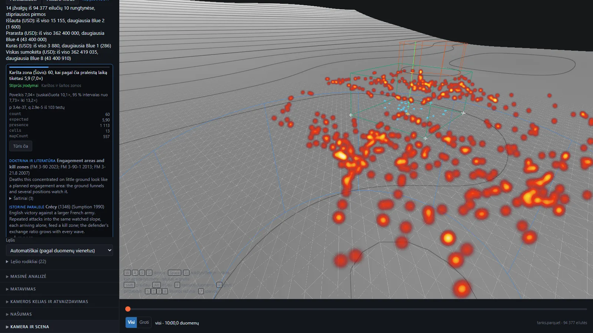
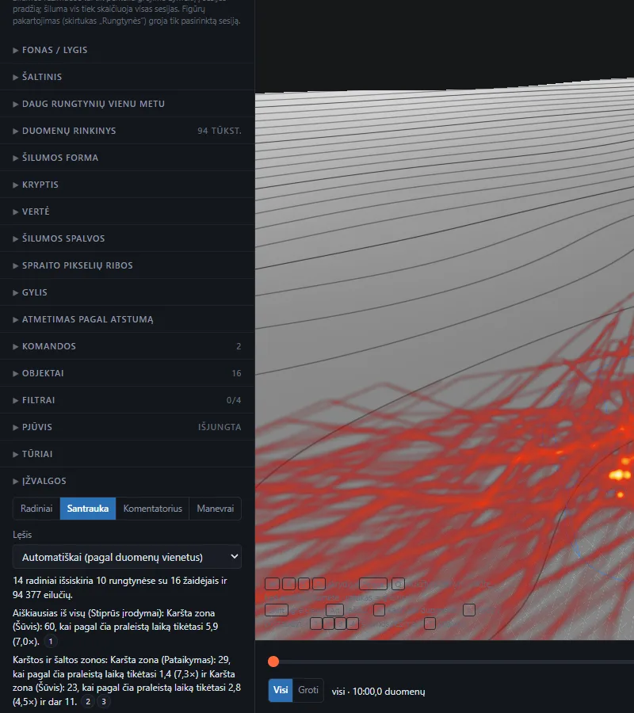

# Įžvalgos

**Įžvalgos** peržiūri įkeltus duomenis ieškodamos to, kas išsiskiria – stiprių pozicijų, pavojingos vietovės, atsiradimo spąstų, siaurų vietų, žaidėjų, labai pranokstančių savo bendraamžius – ir praneša apie tai, stipriausius pirma, su įrodymais. Su jomis per minutę sužinosite, kur rungtynės buvo laimėtos arba pralaimėtos. Vėliau jos gali parašyti santrauką, o vienose rungtynėse gali veikti kaip komentatorius, kuris peršoka prie didelių akimirkų.

Viskas skaičiuojama jūsų naršyklėje. Niekas nepalieka jūsų kompiuterio, nebent įjungsite išorinį DI (žr. [Išorinis DI](#external-ai)).

Skiltis **Įžvalgos** yra Šilumos žemėlapio ir Rungtynių skirtukų šoninėje juostoje. Ji turi tris skirtukus: **Radiniai**, **Santrauka** ir **Komentatorius**.

## Radiniai {#findings}

1. Įkelkite duomenis ir atidarykite **Įžvalgos**. Paspauskite **Rasti įžvalgų** (rodoma „Skaičiuojama… n%“, kad matytumėte eigą).
2. Perskaitykite sąrašą. Kiekvienas radinys turi stiprumo juostą, sakinį, kokie įrodymai (*Stiprūs įrodymai*, *Geri įrodymai* arba *Šiek tiek įrodymų*), kuris detektorius jį rado ir transporto klasę, kai tai svarbu.
3. **Spustelėkite radinį**: peržiūros programa pritaiko jo filtrus, nuskrenda kamera į vietą, peršoka į laiką ir atidaro detales: efektą su 95 % intervalu, p ir q reikšmes, suskaičiuotus įrodymus bei **Tūris čia**, kuris nubrėžia [tūrį](volumes.md) aplink vietą.
4. **Atkurti filtrus** grąžina jūsų filtrus. **Kopijuoti JSON** nukopijuoja visą ataskaitą.

Skaičiavimas naudoja dabartinius filtrus, paslėptas grupes ir pasirinktas rungtynes per visą laiko intervalą. Jei vėliau pakeisite filtrus, pranešimas tai nurodys; paspauskite **Perskaičiuoti**.

Sąrašo viršuje esančios eilutės (pavyzdžiui, pinigų sumos) apibendrina visus duomenis prieš radinius.

### Detektoriai {#the-detectors}

| Detektorius | Ką randa | Reikia duomenyse |
|---|---|---|
| **Galios pozicijos** | Vietas, kur nužudymų ir mirčių santykis daug geresnis nei kitur žemėlapyje, ir *saugią vietą*, kur per praleistą laiką žūsta mažai | nužudymų ir mirčių įvykių |
| **Karštos ir šaltos zonos** | Vietas, kur įvykių rūšis (šūviai, pataikymai, užėmimai ...) pasitaiko daug dažniau arba rečiau, nei prognozuoja ten praleistas laikas | įvykių stulpelio |
| **Atvira vieta ir priedanga** | Mirtys atvirai prieš arti esančią lygio geometriją ir lėtai prieš greitą judėjimą | mirčių; 3D lygio geometrijos daliai |
| **Atsiradimo taškai** | Stiprūs atsiradimo taškai, atsiradimo spąstai, saugūs atsiradimo taškai, laikas iki pirmo kontakto | laiko ir asmenų |
| **Klasė pagal vietą** | Transporto klasė arba žaidėjai prieš DI, daug geriau ar blogiau veikiantys srityje | nužudymų ir transporto klasės arba žaidėjo/DI stulpelio |
| **Žaidėjai** | Žaidėjai, kurie nužudo arba žūsta daug dažniau ar rečiau nei kiti tos pačios klasės žaidėjai | asmenų ir nužudymų |
| **Siauros vietos ir flangai** | Siauros vietos (daug daugiau perėjimų nei aplinkiniame plote) ir flangų maršrutai (retai naudojami, bet veda į nužudymus) | asmenų |
| **Vertė** | *Brangi vietovė* ir *Uždirbanti vietovė* | [vertės stulpelių](value-weighting.md) |

Detektoriai, kurie negali veikti su duomenimis, išvardyti apačioje su priežastimi.

### Kaip radiniai surikiuojami {#how-findings-are-ranked}

Kiekviena vieta arba grupė tikrinama palyginus su likusiu žemėlapiu (tiksli binominė arba dažnio analizė). Klaidingų atradimų dažnis laikomas 5 % (Benjamini-Hochberg). Atsitiktinumas gali atrodyti kaip dėsningumas; tai padeda mažinti klaidingus signalus: tarp rodomų radinių apytiksliai vienas iš dvidešimties tikėtinai yra atsitiktinumas. Efektai, paremti nedideliu įvykių skaičiumi, prieš rikiavimą traukiami link „jokio efekto“. Rodoma ne daugiau kaip 60 radinių, ir kiekvienas detektorius gauna keletą vietų viršuje.

## Santrauka {#debrief}

Skirtuke **Santrauka** radiniai surašomi į trumpą tekstą: įvadas, aiškiausias radinys, vienas taktikai, vienas balansavimui, likusieji sugrupuoti pagal detektorių ir kiek jų remiasi silpnesniais įrodymais. Kiekviena pastraipa turi numeruotus mygtukus, rodančius jos radinius. **Kopijuoti tekstą** jį nukopijuoja.

Įmontuotas pasakotojas veikia neprisijungęs, jūsų kalba. Virš jo esantis **Lęšis** parinkiklis (žr. [Žinių lęšis](knowledge.md)) nusprendžia, kokią literatūrą pastraipos cituoja.

### Išorinis DI {#external-ai}

**DI nustatymai** leidžia santrauką parašyti pasirinktam DI modeliui:

| Nustatymas | Reiškia |
|---|---|
| **Teikėjas** | Anthropic (Claude), OpenAI (ChatGPT), OpenRouter, Ollama (vietinis), LM Studio (vietinis), llama.cpp serveris (vietinis) arba bet koks OpenAI suderinamas galinis taškas |
| **Bazinis URL**, **Modelis** | Užpildo teikėjas; **Rodyti modelius** klausia serverio |
| **API raktas** | Siunčiamas tik į bazinį URL. Niekada neįrašomas į žurnalą, neišsaugomas rodiniuose, eksportuose ar `.3dheat` failuose. Dauguma vietinių serverių jo nereikalauja. |
| **Prisiminti raktą šioje naršyklėje** | Pagal numatymą išjungta: raktas pamirštamas uždarius puslapį |
| **Naudoti išorinį DI** | Pagal numatymą išjungta |
| **Siųsti žaidėjų vardus** | Pagal numatymą išjungta: žaidėjai siunčiami kaip P1, P2 ... |

Tada įveskite neprivalomą klausimą ir paspauskite **Rašyti su DI**. Siunčiami tik radiniai ir jų skaičiai – niekada jūsų duomenų eilutės. Atsakymas rodomas palaipsniui; paminėti radiniai tampa mygtukais.

## Komentatorius {#caster}

**Vienoms rungtynėms** (jei įkelta keletas, pasirinkite vieną) **Komentatorius** randa akimirkas, vertas stebėti: pirmąjį kraujo praliejimą, kelis nužudymus vienu metu, keitimus, paskutinius kovotojus, tikslų pasikeitimus, sugrįžimus, išsiskiriančius žaidėjus, tolimus šūvius.

- Spustelėkite akimirką: rodinys persijungia į pakartojimą, peršoka prieš ją, nuskrenda į vietą ir seka žaidėją.
- **Paleisti akimirkas** paleidžia kiekvieną iki pabaigos ir eina toliau; **Ankstesnė** / **Kita** persijungia tarp jų.
- Įjungus išorinį DI, **DI komentaras** parašo komentarą pagal akimirkų sąrašą (rūšis, laikai, vardai arba pseudonimai, komandos, klasės, atstumai).

Jam reikia asmenų ir nužudymo / mirties (arba užėmimo) įvykių; `other` / `victim` stulpelis leidžia atpažinti keitimus ir tolimus šūvius.

## Žinių lęšis {#knowledge-lens}

Radinį galima skaityti per **lęšį** – įsitvirtinusių žinių: karinės doktrinos, oro ir jūrų kovos, miesto operacijų, žaidimų dizaino ir kibersporto (arba *Auto*, pasirenka duomenų vienetai). Atidarytas radinys tada rodo artimiausią **doktrinos ir literatūros** įrašą bei **istorinę paralelę** su nuorodomis, o **Lęšio rodikliai** iš tos literatūros apskaičiuoja matus duomenims (Lanchesterio modelių pritaikymas, mainų santykiai, jėgų santykiai, ugnies sektoriai, pagrindinis reljefas, keitimai, iniciatyva). Santrauka ir DI užklausa jus įtraukia. Viskas apie tai: [Žinių lęšis](knowledge.md).

Lęšio rodikliai taip pat matuoja, kaip žaidėjai elgiasi kaip minia ir kaip grupė – suderinimą ir sukimąsi, maršrutų vedimą, eisenas ir takus, susigrūdimą, lyderius ir sekėjus, atsiliekančius, lūžio tašką po nuostolių, riziką po prarastos gyvybės, serijas, sutarimą dėl pirkimų ir reakciją į gaunamą ugnį – kiekvieną pagal savo nulinį modelį: [Kolektyvinis elgesys](collective-behaviour.md).

## Duomenys, kurie įgalina įžvalgas {#data-that-makes-insights-work}

- pozicijos su **laiku**, **asmens** ir **komandos** stulpeliais;
- **įvykių** stulpelis su nužudymais ir mirtimis (`kill`, `death`) bei kitais (`hit`, `fire`, `capture` ...);
- **kitos pusės** stulpelis (`other`, `victim`) keitimams ir kryptims;
- **technikos** arba **tipo** stulpelis klasėms; `ai` stulpelis žaidėjams prieš DI;
- **sesijos** / **rungtynių** / **raundo** stulpelis, kai yra kelios rungtynės.

[Demonstraciniai duomenys](demo-data.md) turi visus šiuos stulpelius.
