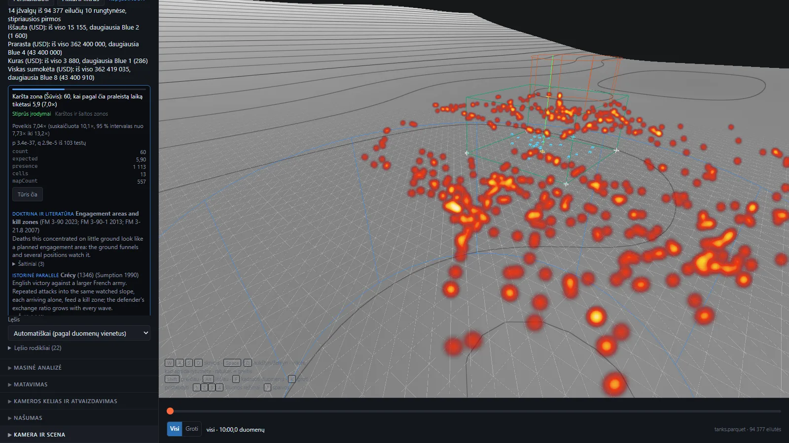

# Žinių lęšis

Kai [Įžvalgos](insights.md) ką nors suranda, ši dalis tai paaiškina idėjomis iš karinės istorijos, žaidimų dizaino ir sporto analizės ir nurodo knygą ar straipsnį, iš kurio jos kilusios. Naudokite ją, kad suprastumėte *kodėl* šablonas svarbus, o ne tik tai, kad jis yra.

## Išbandykite {#try-it}

1. Įkelkite duomenis ir atidarykite **Įžvalgos**, tada spauskite **Rasti įžvalgų**.
2. Spustelėkite radinį, kad jį atidarytumėte.
3. Perskaitykite **Doktrina ir literatūra** ir **Istorinė paralelė**; pilnos nuorodos sulankstytos žemiau.
4. Pakeiskite **Lęšis** (pavyzdžiui, į *Karinė doktrina*), kad tą patį radinį perskaitytumėte per kitą literatūros dalį.

## Kaip tai veikia {#how-it-works}

Įžvalgų skydelis savo radinius vertina taip, kaip profesionalus analitikas: per karinę doktriną ir operacijų tyrimus, istorinius mūšius bei žaidimų dizaino, lygių dizaino ir analitikos literatūrą. Tai daroma neprisijungus, iš kuruotos žinių bazės peržiūroje, ir tą pačią medžiagą perduoda išorinei modeliui, kai jis rašo santrauką.

## Ką rodo skydelis {#what-the-panel-shows}

- **Lęšis** parenka literatūros dalį, per kurią skaitomi radiniai: *Auto* (parenkama pagal duomenyse esančių vienetų tipus: lėktuvai, laivai, sausumos transporto priemonės, pėstininkai), *Karinė doktrina*, *Oro kova*, *Jūrų mūšis*, *Miesto kova*, *Žaidimų dizainas ir balansas*, *E. sportas*. Įrašai už pasirinkto lęšio ribų paliekami.
- Kiekvienas atidarytas radinys rodo artimiausią **doktrinos ir literatūros** įrašą ir artimiausią **istorinę paralelę**, o pilnos nuorodos sulankstytos žemiau.
- **Lęšio rodikliai** išvardija operacijų analizės matus, apskaičiuotus pagal tas pačias eilutes (žemiau), kiekvieną su tuo, ką jis reiškia, ir jo literatūra.
- **Santrauka** prideda eilutes pagrindiniams radiniams ir lęšio rodikliams: „Doktrina ir literatūra: ..." ir „Istorinė paralelė: ...", kiekvienai su autorių-metų citatomis ir po ja sulankstytomis nuorodomis.
- **Rašyti su DI** siunčia svarbiausius įrašus (santrauką, pamoką, su jais susijusius radinius, pilnas nuorodas) kartu su ataskaita ir prašo modelio juos cituoti pagal id - `{concept.lanchester-square}` - ir nenaudoti jokių kitų šaltinių.

Etiketės išverstos; pati žinių bazė angliška.

## Lęšio rodikliai {#lens-metrics}

Apskaičiuojama įžvalgų darbuotojuje, tame pačiame eilučių perėjime kaip ir detektoriai (`src/insights/lensMetrics.ts`). Kiekvienas paliekamas, kai duomenys jo nepalaiko.

| Rodiklis | Ką matuoja | Reikia |
|---|---|---|
| Lanchester'io atitikimas | Kiekvienos pusės nuostoliai per 20 s, regresuoti pagal abiejų pusių gyvas jėgas (Puasono, kvazi-tikėtinumo paklaidos); eksponentai pagal priešo ir savo jėgą, patikrinti prieš kvadrato dėsnį (taiklioji ugnis) ir tiesinį dėsnį (zoninė ugnis) | laikas, komandos, nužudymai ir mirtys |
| Mainų santykis | Nužudymai vienai mirčiai pagal pusę ir vietą; mirčių dalis žudžiausioje sausumos vietoje, kurioje yra 5% praleisto laiko, palyginta su dalimi, kurią duotų vien tiek mirčių tikimybė; mirčių Gini koeficientas pagal laiką; mirties dažnių Moran'o I | nužudymai ir mirtys |
| Vietinis jėgų santykis | Draugiški ir priešo vienetai, gyvi kiekvieno nužudymo kovos nuotolyje (nuotolis nustatomas iš duomenų: du kartus didesnis už medianą atstumo iki artimiausio priešo); nužudymų dalis, kurią padaro vietinį pranašumą turinti pusė, ir jos perviršis, palyginti su tuo, ką prognozuoja vien skaičiai | laikas, komandos, asmenys |
| Ugnies laukai | Kertamų matomumo zonų vaizdai populiariausiose nužudymo vietose 2,5D kliūčių paviršiuje (lygio geometrija iki sienos aukščio arba išvaikščiota žemė), palyginti su vidutine vieta, ir matymo bei nužudymų dalies rangų koreliacija | pozicijos; įkeltas lygis padaro tikslesnį; ne oro |
| Energijos būsena | Savitoji energija (aukštis plius aukštis, kurį galėtų nupirkti greitis) oro žudikų ir oro aukų, palyginta pagal Mann-Whitney statistiką | orlaivių klasės, laikas, aukštis |
| Raktinis reljefas | Kaip dažnai kiekviena vieta patenka į tris populiariausias rungtynių nužudymo vietas | kelios rungtynės |
| Abipusė parama (mainai) | Mirtys, į kurias atsako bendražaidžio nužudymas kovos nuotolyje ir per 5 s | laikas, komandos |
| Pirmas smūgis | Susirėmimai - nužudymai, sugrupuoti pagal rungtynes, pagal 20 s ramybės ir pagal tris kovos nuotolius - laimi pusė, pirmoji pelniusi tašką | laikas, komandos |
| Salvų modelis | Hughes'o salvų lygtis, pritaikyta 20 s laikotarpiams, kai laivai yra kontakte: laivai, išjungti iš veiksmo vienam puolančiam laivui, ir išgelbėti vienam gynėjui laivui; Lanchester'io atitikimas vien laivams | laivų klasės, laikas, komandos |
| Kovos efektyvumas | Nužudymai vienam vienetui-valandai veiksmo metu kiekvienai pusei ir dviejų didžiausių santykis (kovos efektyvumo vertė Dupuy prasme) su 95% intervalu, ir kiekvienos pusės nužudymų dalis lygiu vietiniu skaičiumi | laikas, komandos |
| Kovos nuotoliai | Atstumas iki artimiausio priešo nužudymų, paleidimų ir pirmojo kiekvieno gyvenimo šūvio metu (aptikimas iki kontakto), pagal vienetų rūšį | laikas, komandos; paleidimai, kai duomenys jų turi |
| Naikinimo grandinė | Sekundės nuo žudiko paskutinio paleidimo iki nužudymo ir nuo jo pirmojo kovos šūvio iki nužudymo | laikas; paleidimai ar šūvių įvykiai |
| Koncentracija ar išsklaidymas | Kiekvieno 20 s laikotarpio metu dviejų didžiausių pusių išsibarstymas ir dalis nužudymų, kuriuos paėmė tankesnė | laikas, komandos |
| Skrydžiai | Kiekvienai pusei: skrydžiai (pakilimai arba orlaivių atsiradimai), nusileidimai, prarasti orlaiviai ir nužudymai orlaiviais; nuostolių dažnis ir nužudymai vienam skrydžiui | orlaivių klasės; pakilimai ar atsiradimai |

Duomenys su raundais prideda artimos kovos ir esporto matus - raundo laimėjimo tikimybę, veiksmų vertę, pradinius dvikovius, mainus, žaidėjo-prieš-laikytoją, taikymą, kryžminę ugnį, pagalbines priemones, žmonių persvarą, „clutch" situacijas, pasirengimus, po sprogdinimo, mirtinas piltuves ir žaidėjo įtaką: žr. [Artima kova ir raundai](close-quarters.md).

Takeliai ir komandos prideda kolektyvinio elgesio matus iš minios mokslo, kolektyvinio judėjimo, elgesio ekonomikos ir karinės psichologijos - suderinimą ir sukimąsi, maršrutų ganymą, juostas ir pėdsakus, susigrūdimą, lyderius ir sekėjus, atsilikusius, lūžio tašką, riziką po nuostolių, serijas, pirkimo sutarimą ir slopinimą, kiekvieną su savo nuliniu modeliu: žr. [Kolektyvinis elgesys](collective-behaviour.md).

Ginklai, masalai ir pastatai nelaikomi vienetais. Kai ginklų eilutės nurodo savo paleidžiantį vienetą (`Shooter` arba `Launcher` stulpelis, kaip turi Tacview kilę duomenys), paleidimas priskiriamas tam vienetui, susiejant pagal jo pavadinimą ar objekto id.

## Kaip radiniai susitinka su literatūra {#how-findings-meet-the-literature}

Įrašai ir radiniai susitinka per **šablonų taksonomiją** (`src/insights/knowledge/patterns.ts`): koncentracija, vietinis pranašumas, taikioji ir zoninė ugnis, kliūtys, nužudymo zonos, ugnies laukai, atvirkštinis šlaitas, šonų dengimas, abipusė parama, energijos pranašumas, atgimimo spaudimas, balansas ir t. t. Kiekvienas detektoriaus tipas ir kiekvienas lęšio rodiklis nurodo, kuriuos šablonus rodo jo skaičiai (`src/insights/lens.ts`); kiekvienas žinių įrašas nurodo, kuriuos šablonus jis liečia, su svoriu. Įrašo tinkamumas radiniui yra svertinis sutapimas, pagal tai, kaip gerai įrašo sritis (sausuma, oras, jūra, miestas) atitinka duomenis, ir pagal paties radinio stiprumą. Rodomas pagrindimas - radinio skaičiai vienu sakiniu, po jo įrašo pamoka.

## Katalogas {#catalogue}

Kiekvienas šablonas, sąvoka, metodas, istorinis atvejis, dizaino principas ir tyrimas su bibliografija: žr. [Žinių katalogas](knowledge-catalogue.md).

## Kūrėjams {#for-developers}

### Įrašų pridėjimas {#adding-entries}

1. Pasirinkite failą pagal tipą: `concepts.ts` ir `concepts-more.ts`, `methods.ts`, `cases.ts`, `cases-land.ts`, `cases-air-sea.ts`, `cases-esports.ts`, `design.ts` (dizaino principai) arba `studies.ts` kataloge `src/insights/knowledge/`.
2. Duokite naują id `<tipas>.<slug>` (niekada nenaudokite pakartotinai), jo lęšius, sritis ir šablonus, į kuriuos jis atsižvelgia, su svoriais 0..1. Pridėkite šabloną į `patterns.ts` tik tada, kai radinys gali jį parodyti, ir susiekite jį su radiniu ar rodikliu `lens.ts`.
3. Parašykite santrauką ir pamoką **savais žodžiais**. Citatos - tik iš viešojo domeno kūrinių (`pd: true` nuorodoje) ir trumpos.
4. Cituokite: pridėkite bet kokį naują darbą į `refs.ts` su autoriais, metais, pavadinimu ir leidėju (žurnalas su tomu ir puslapiais); URL ar DOI, kai yra viešas įrašas.
5. Paleiskite `npx vitest run src/insights/lens.test.ts` (unikalūs id, žinomi šablonai, išsprendžiamos nuorodos, viešojo domeno citatos, atvejai su data ir rezultatu) ir `node tools/knowledge-doc.mjs`, kad atnaujintumėte [katalogą](knowledge-catalogue.md).

