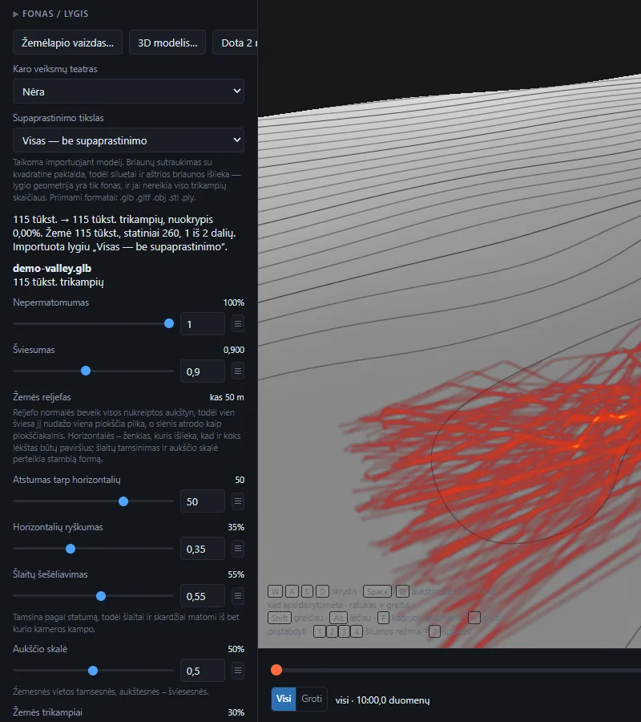

# Lygiai ir fono geometrija

Lygis yra 3D vieta, kurioje vyko žaidimas – žemėlapis, miestas, trasa. Padėję jį už savo duomenų, galite matyti, *kur* yra šiluma. Skydelis **Fonas / lygis** (žr. [Žodynėlis](glossary.md) dėl „lygio“) suteikia tris konteksto rūšis:

- **žemėlapio vaizdas**, georeferencinis pagal du inkarus – žr. [Žemėlapio vaizdai](map-images.md);
- **3D lygis** – `.glb`, `.gltf`, `.obj`, `.stl` arba `.ply` – suskaidytas į žemę, statinius ir vandenį ir supaprastintas importuojant – žr. [3D lygiai](model-levels.md) ir [Lygio išvaizda](level-appearance.md).
- **pasaulio fonas** – įrašui, kuris nurodo, kur žemėje jis vyko (Tacview ACMI failas), tikrasis reljefas, keliai, vanduo, aerodromai ir pastatai, atsisiųsti iš atvirų duomenų – žr. [Pasaulio fonas](world-backdrop.md).

Nieko neįkėlus, scena yra tamsi, su tinkleliu ir spalvotomis ašimis (**Tinklelis** ir **Ašys** skiltyje [Kamera ir scena](camera.md)), o skydelis rodo *Nieko neįkelta – scenoje matomas tinklelis ir ašys. Pridėkite žemėlapio vaizdą ar lygio tinklą, kad šiluma turėtų kontekstą.*

Lygis bendras visiems trims skirtukams: trasa, įkelta skirtuke Lenktynių analizė, yra tas pats lygis, kurį rodo šilumos žemėlapis.

## Padėkite lygį už savo duomenų {#put-a-level-behind-your-data}

1. Pirmiausia įkelkite duomenis ([Duomenų įkėlimas](getting-data-in.md)), kad lygis būtų pritaikytas prie jų.
2. Šoninėje juostoje atidarykite **Fonas / lygis**.
3. Paspauskite **Žemėlapio vaizdas…** paveikslėliui arba **3D modelis…** 3D lygiui ir pasirinkite failą. Realaus pasaulio įrašui naudokite **Pasaulio fonas** arba **Teatras**.
4. Palaukite, kol baigsis progreso eilutė. Didelis modelis pirmiausia supaprastinamas (žr. žemiau **Supaprastinimo tikslas**).
5. Paspauskite **F** vaizde, kad viską įrėmintumėte. Naudokite **Nepermatomumas** ir **Šviesumas**, kol šiluma išsiskirs iš lygio.
6. Paspauskite **Įrašyti į biblioteką**, jei lygį naudosite dar kartą ([Lygių biblioteka](level-library.md)).

## Ką lygis daro šilumai {#what-a-level-does-for-the-heat}

- Jis **užstoja**: duomenų taškai už jo nuslopinami pagal paviršių, o duomenų taškai už reljefo paslepiami ([Gylis ir atrinkimas](depth-and-culling.md)). Be lygio užstojimo nėra.
- Jį **pjauna** [Pjūvis](slice.md) ir, su *Pjauti ir lygį*, [atrinkimas pagal atstumą](depth-and-culling.md#distance-culling) kartu su šiluma.
- Tai vienintelis dalykas, kurį [lauko gylis](camera.md#depth-of-field) sulieja, be tinklelio ir dėžučių.
- 3D lygis **išplečia kameros tolimąją plokštumą**, kai jis didesnis nei duomenys: artima ir tolima plokštumos kalibruojamos pagal duomenų rinkinį, o eksportuotas žemėlapis, kelių kilometrų pločio, kitaip visiškai atsidurtų už tolimosios plokštumos ir paliktų tuščią vaizdą. Tolimoji plokštuma tampa 3 × lygio horizontaliu plotu, kai tai didesnė, artimoji plokštuma juda kartu su ja (bent tolima / 100 000), kad išliktų gylio tikslumas, nuo kurio priklauso užstojimas, o skrydžio greitis padidinamas bent iki plotis / 12. Ji tik plečiama, niekada nesiaurinama.

## Skydelis iš viršaus į apačią {#the-panel-top-to-bottom}

| Dalis | Detalės |
|---|---|
| **Žemėlapio vaizdas…**, **3D modelis…** | Įkelti vieną; jis pakeičia dabartinį lygį. |
| **Pasaulio fonas**, **Pamiršti žemėlapio plyteles** | Tik duomenų rinkiniui su geografine nuoroda: sukurti po juo tikrą vietą kaip lygį arba ištrinti atsisiųstas plyteles. [Pasaulio fonas](world-backdrop.md) |
| **Supaprastinimo tikslas** | Trikampių biudžetas kitam modelio importui: *Pilnas – be supaprastinimo* (numatytasis), *Aukštas – 8M*, *Vidutinis – 3M*, *Žemas – 800k*, *Siluetas – 100k*. [3D lygiai](model-levels.md#simplification) |
| Progresas ir **Atšaukti** | Dekoduojant ar importuojant. |
| Importo pastaba | Trikampiai prieš ir po, žemės / statinių / vandens skaidymas, naudotas detalumo lygis. |
| Pavadinimas ir dydis | `plotis×aukštis px · x × z m/px` paveikslėliui, `N trikampių (iš M)` modeliui. |
| **Nepermatomumas**, **Šviesumas** | Abiem rūšims. |
| Paveikslėlio valdikliai | **Nubluktinti**, **Apversti šiaurę / pietus**, **Išdėstymas** (du inkarai), **Pritaikyti prie duomenų ribų**, **Aukštis**. [Žemėlapio vaizdai](map-images.md) |
| Modelio valdikliai | Žemės reljefas, vanduo, žemės trikampiai, karkasas, tekstūra, užfiksuota spalva, statiniai, dalių klasifikacija. [Lygio išvaizda](level-appearance.md) |
| **Įrašyti į biblioteką**, **Pašalinti** | [Lygių biblioteka](level-library.md); Pašalinti iškrauna lygį. |
| **Biblioteka** | Šioje naršyklėje saugomi lygiai. [Lygių biblioteka](level-library.md) |

## Šio skyriaus puslapiai {#pages-in-this-section}

- [Žemėlapio vaizdai](map-images.md)
- [3D lygiai](model-levels.md) – formatai, dalys, klasifikacija, supaprastinimas, tekstūros
- [Lygio išvaizda](level-appearance.md) – kiekvienas 3D lygio valdiklis
- [Lygių biblioteka](level-library.md)
- [Pasaulio fonas](world-backdrop.md) – tikrasis pasaulis po įrašu, iš atvirų duomenų

Kaip gauti lygius iš žaidimų ir variklių, rūpinasi atskiri eksporto įrankiai (žr. saugyklos [README](https://github.com/Holdi601/3DHeat/blob/main/README.md)); sutartis, į kurią jie rašo, apibendrinta [3D lygiai](model-levels.md#the-exporter-contract) puslapyje.
