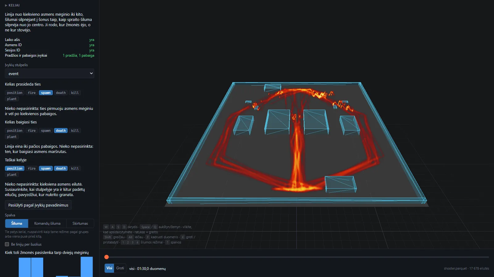

# Linijų šiluma

Šiluma rodo, kur žmonės stovėjo. Linijos rodo kelius, kuriais jie ėjo.

**Linijos** (klavišas 4) yra linijų šiluma: linija nuo kiekvieno [asmens](glossary.md) mėginio iki jo kito mėginio,
išbarstyta tuo pačiu silpimu, kokį turi [taškas](glossary.md) - per liniją, o ne aplink tašką. Ji rodo, kur žmonės
*ėjo*, o ne kur stovėjo: koridorius, perbėgtas vieną kartą, matosi taip pat, kaip kambarys, kuriame stovėta, o greito
žaidėjo reti mėginiai sujungiami į vientisą kelią, o ne į taškuotą pėdsaką. Jai reikia asmens stulpelio ir laiko stulpelio.

## Kaip naudoti {#how-to-use-it}

1. Spauskite `4` (arba pasirinkite **Linijos** režimų juostoje).
2. Atidarykite **Keliai** ir patikrinkite žalią sąrašą: laiko ašis ir asmens id turi būti.
3. Spauskite **Pasiūlyti pagal įvykių pavadinimus**, kad užpildytumėte, kur keliai prasideda ir baigiasi.
4. Perskaitykite statistikos eilutę: „N kelių, M iš jų pasiekia galą".
5. Jei linijos šokinėja per žemėlapį, sureguliuokite **Ilgiausias žingsnis** (žr. [Šuolio riba](#the-jump-limit)).

Linija turi prasmę tik tarp pradžios ir pabaigos, todėl skydelis **Keliai** parodo, kas riboja kelią. Viskas nuo
[Kelio taisyklių](#the-rules-of-a-route) yra detalės, kurių galite praleisti.

## Keliai skydelis {#the-routes-panel}

Rodomas virš šiluma skydelių linijų režime.

### Ką turi duomenys {#what-the-data-has}

Sąrašas su varnelėmis: žalia, kai yra, gintaro spalva, kai nėra:

| Eilutė | Būsenos |
|---|---|
| **Laiko ašis** | *yra* / *trūksta - reikia* |
| **Asmens id** | *yra* / *trūksta - reikia* |
| **Sesijos id** | *yra* / *nėra - visos eilutės yra viena sesija* |
| **Pradžios ir pabaigos įvykiai** | *N pradžių, M pabaigų* / *nepasirinkta - visi takeliai* (žalia tik su įvykių stulpeliu ir bent viena pradžia bei viena pabaiga) |

### Valdikliai {#controls}

| Valdiklis | Reikšmė |
|---|---|
| **Įvykių stulpelis** | Kategorijų stulpelis, kurio reikšmės yra įvykiai (atsiradimas, mirtis, pozicija, ...). *Nėra - visi takeliai*: kiekvieno asmens takelis kiekvienoje sesijoje yra vienas kelias, nutrūkstantis ten, kur takelyje yra tarpas. Siūlomi tik stulpeliai, paliekami filtravimui įkeliant. |
| **Kelias prasideda ties** | Įvykių reikšmės, kurios pradeda kelią (atsiradimas, prisikėlimas, išsilaipinimas). Nieko nepasirinkta: kelias prasideda nuo pirmo asmens mėginio ir vėl po kiekvienos pabaigos. |
| **Kelias baigiasi ties** | Įvykių reikšmės, kurios baigia kelią (mirtis, evakuacija, teleportacija). Linija eina iki pačios pabaigos eilutės. Nieko nepasirinkta: kelias baigiasi ten, kur baigiasi asmens takelis. |
| **Taškai kelyje** | Įvykių reikšmės, kurių eilutės guli išilgai kelio. Nieko nepasirinkta: kiekviena asmens eilutė. Susiaurinkite, kai stulpelyje yra ir eilučių, padėtų kitur, pavyzdžiui, kur nukrito granata. |
| **Pasiūlyti pagal įvykių pavadinimus** | Užpildo tris sąrašus pagal reikšmių pavadinimus (žemiau). |
| **Spalva** | *Šiluma*, *Komandų šiluma* arba *Skirtumas*. Tie patys keliai to režimo spalvomis: kiekviena grupė savo atspalviu arba viena pusė prieš kitą, su grupių sąrašu, skaidymu ir skalėmis, veikiančiomis kaip tuose režimuose. Numatytoji - *Šiluma*. Komandų šiluma ir skirtumas reikalauja grupės stulpelio. |
| **Be linijų per šuolius** / **Ilgiausias žingsnis** | Kitas asmens mėginys, toliau nei tai, yra atgimimas, teleportacija ar nukritimas, o ne vieta, kur jis ėjo, todėl tarp jų nejungiama jokia linija. Užpildoma įkeliant, kai duomenys rodo aiškų tarpą (žemiau), ir išjungiama, kai jo nėra. Veikia su įvykių stulpeliu ir be jo. |
| Statistikos eilutė | `N kelių, M iš jų pasiekia galą, K atkarpų`, atnaujinama kelis kartus per sekundę. |

Kiekvienas sąrašas yra mygtukų eilutė, po vieną kiekvienai reikšmei, dažniausios pirmiau; užvedus pelę ant mygtuko
rodoma jo eilučių skaičius. Siūloma ne daugiau kaip 120 reikšmių (*dar N reikšmių nerodoma*).

Pasirinkus kitą įvykių stulpelį, pasiūlymas taikomas, jei jis pasiūlo tą patį stulpelį, o kitu atveju prasideda su tuščiais sąrašais.

### Pasiūlymas {#the-suggestion}

Kiekvieno įkėlimo metu ir spaudžiant **Pasiūlyti pagal įvykių pavadinimus** ([`suggestLineSettings`](https://github.com/Holdi601/3DHeat/blob/main/src/data/lines.ts)):

- **Įvykių stulpelis:** pirmas išlaikytas kategorijų stulpelis pavadinimu `event`, `eventname` arba `eventtype`; kitu atveju `kind`, `type` arba `action`; kitu atveju bet kuris, kurio pavadinime yra *event*, *kind*, *action* ar *type*.
- **Pradžios:** reikšmės, kuriose yra *spawn, deploy, join, enter, start, begin, respawn, revive, land/landed/landing, drop* - nebent jos taip pat atitinka pabaigos žodį.
- **Pabaigos:** reikšmės, kuriose yra *death, died, dead, kill/killed, eliminat…, extract, evac, teleport, leave, left, disconnect, quit, exit, end, finish, downed* - išskyrus reikšmes `kill` ir `kills` (nužudymas yra tai, ką daro žudikas, o ne jo kelio pabaiga).
- **Taškai:** reikšmės, kurios tiksliai yra *position, location, player location, move, movement, tick, sample* arba *pos*; kai rasta bent viena, pradžios ir pabaigos taip pat pridedamos prie taškų. Kai nerasta nė vienos, taškai lieka tušti (kiekviena eilutė).

### Šuolio riba {#the-jump-limit}

Ten, kur žmonės šoka, žingsnių ilgiai patenka į dvi grupes, tarp kurių beveik nieko nėra: tai, kiek asmuo nueina tarp
dviejų mėginių, ir žemėlapio plotis. Įkeliant ([`suggestMaxJump`](https://github.com/Holdi601/3DHeat/blob/main/src/data/lines.ts))
žingsniai skaičiuojami pagal kiekvieną jų kvadrato ilgio dvigubėjimą, iki 16 milijonų jų, o riba dedama pirmo diapazono,
viršijančio medianą, viduryje - diapazono, kuris bent vieną ilgio dvigubėjimą platus, kuriame kiekviename intervale yra
mažiau nei 0,02% žingsnių ir kuris turi žingsnių už savęs. Jei tokio diapazono nėra, nieko nekerpama, nes šuolio nebūtų
galima atskirti nuo greito automobilio; tada riba, įjungta ranka, prasideda nuo dešimtosios duomenų įstrižainės dalies.

Diagrama virš ribos rodo, kokie ilgi žingsniai iš tikrųjų yra, su linija ties riba: stulpeliai į dešinę nuo jos nenubrėžiami.
Abi ašys logaritminės, nes šuoliai gali būti šimtoji žingsnių dalis ir tūkstantį kartų ilgesni. Užveskite pelę ant stulpelio,
kad pamatytumėte jo diapazoną ir dalį; spustelėkite diagramą, kad ribą nustatytumėte ten. Po ja - dalis žingsnių viršijančių ribą.

## Kelio taisyklės {#the-rules-of-a-route}

Eilutės einamos laiko tvarka, kiekvienam asmeniui ([`buildLines`](https://github.com/Holdi601/3DHeat/blob/main/src/data/lines.ts)):

1. [Bendro pavadinimo](sessions-persons-groups.md#names-worn-by-several-things-at-once) eilutės praleidžiamos visiškai.
2. Pasirinkus taškus, eilutė, kuri nėra nei pradžia, nei pabaiga, nei taškas, praleidžiama.
3. Eilutės einamos pagal asmenį ir sesiją, todėl asmuo, kurio sesijos laiko tvarka persidengia, turi po vieną kelią kiekvienoje. Kelias uždaromas, kai ankstesnė eilutė neturėjo tęsinio (jos [gyvavimo trukmė](sessions-persons-groups.md#person) yra „nėra") - kelias niekada nekerta sesijos ribos ar tarpo, kurį įkėlimas nusprendė neturint kito mėginio. Kuriame kelyje yra eilutė, apskaičiuojama vieną kartą ir išlaikoma: 4 baitai eilutei, todėl pakeitus ilgiausią žingsnį ta dalis nekartojama.
4. **Pradžios** eilutė uždaro bet kurį atidarytą kelią ir ten atidaro naują.
5. Pasirinkus pradžias, eilutė už kelio ribų ignoruojama. Be pradžių bet kuri ne pabaigos eilutė už kelio ribų atidaro vieną.
6. Bet kuri kita eilutė kelyje prideda **atkarpą** nuo ankstesnės kelio eilutės iki šios.
7. **Pabaigos** eilutė, kuri pratęsia kelią, uždaro jį po savo atkarpos; šis kelias skaičiuojamas kaip *pasiekiantis galą*.
8. Žingsnis ilgesnis nei **Ilgiausias žingsnis** uždaro kelią ten, kur jis buvo, o naujas kelias prasideda tolimame gale, nebent ta eilutė yra pabaiga. Per ją nenubrėžiama linija, o statistikos eilutė ją suskaičiuoja.

Kiekviena atkarpa saugoma savo *pabaigos* eilutėje, todėl atkarpos išlieka laiko tvarka, o [laiko juosta](timeline.md) langas, mėginiklis, [filtrai](filters.md), grupių matomumas ir skirtumo ženklas su jomis veikia kaip su taškais. Filtras todėl taikomas eilutei, kurioje atkarpa baigiasi.

## Atkūrimas {#playback}

**Visos** režime kiekvienas kelias nubrėžiamas visas. **Groti** režime kiekvienas asmuo yra taškas, judantis tarp savo mėginių
ir braižantis savo kelią už savęs:

- atkarpa, prasidedanti po atkūrimo žymeklio, nenubrėžiama;
- atkarpa, kurioje asmuo yra vidury, nubrėžiama iki jo interpoliuotos pozicijos, o galvutėje - galo kapsulė;
- šiluma blunka per **uodegą**: su *Kaupiamąja* istorija uodega neribota ir visas dabartinis kelias lieka; su *Langu* ji išblunka iki nulio per *Trukmę* (numatytoji 30 s). Su *Gyvavimo trukme* uodega taip pat yra *Trukmė*, o linijų režime laiko juosta tai istorijai rodo *Trukmės* langelį (vietoj *Atsarginės trukmės* ir *Blankimo*, kurių linijų šiluma nenaudoja).

Grojant kiekvienas kadras nubrėžiamas visas, o ne kaupiamas, nes galvutės juda kiekvieną kadrą, o slankiojantis vidurkis
kiekvieną paverstų dėme.

## Kūrėjams {#for-developers}

### Atmintis {#memory}

Keliai sudaromi pagrindinėje gijoje įjungus linijų režimą (arba pakeitus kelio nustatymus) ir atlaisvinami jį išjungus: 5 baitai
eilutei atmintyje ir 8 baitai eilutei GPU (kiekvienos atkarpos pradžios pozicija, kvantuota 16 bitų kiekvienai ašiai duomenų
ribinės dėžės ribose, ir jos žymės).

### Kaip nubrėžiama linija {#how-a-line-is-drawn}

Abi realizacijos (backend) kiekvieną atkarpą nuo jos pabaigos eilutės piešia kaip **18 viršūnių**
([`lineHeatVs`](https://github.com/Holdi601/3DHeat/blob/main/src/render/webgl2/shaders.ts) ir jos WGSL dvynys):

- Pusė pločio kiekviename gale yra [taško spindulys](sprite-shape.md#sprite-radius) tame galo atstume, pritaikius pikselių ribas.
  Linija, siauresnė nei 2,5 px, piešiama 2,5 px pločio, o jos šiluma atitinkamai sumažinama, todėl plonos linijos nei išnyksta, nei
  ryškėja.
- Šiluma silpsta **per** liniją ta pačia skale kaip taškas - kritimas ar kreivė, centro ir krašto intensyvumas.
- Apvalūs galai piešiami **tik** ten, kur kelias prasideda ar baigiasi, kad gretimų atkarpų sąnariai nesusidarytų į perlų virtinę.
- Geometrija sudaroma ekrano erdvėje ir tiesiškai interpoliuojama, todėl silpimas lieka centruotas ant linijos, kad ir kaip ji eitų
  į gylį. Atkarpa, kertanti artimąją plokštumą, nukerpama ten, o ne išmetama.

Taškų šiluma ir linijų šiluma į kiekvieną eilutę įneša labai skirtingus kiekius, todėl sodrumas perskaičiuojamas, kai perjungiate
tarp jų ([Spalva ir ekspozicija](colour-and-exposure.md#auto-exposure)).

