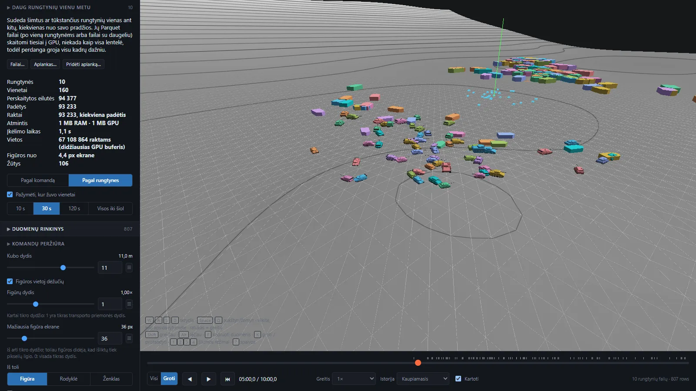

# Daug rungtynių vienu metu

**Daug rungtynių vienu metu** leidžia daugybę rungtynių viena ant kitos, todėl matote, kur paprastai eina visų rungtynių žaidėjai. Naudokite, kad palygintumėte šimtus ar tūkstančius rungtynių viename paveikslėlyje.

Kiekvienos rungtynės prasideda nuo savo pradžios, o jų vienetai juda kaip figūros. Failai eina tiesiai į vaizdo plokštę ir pilnos lentelės nekuriama, todėl veikia sklandžiai ten, kur įprastas įkėlimas baigtų atmintį.

## Kaip naudoti {#how-to-use-it}

1. Šilumos žemėlapio šoninėje juostoje atidarykite **Daug rungtynių vienu metu**.
2. Paspauskite **Failai…** (pasirinkite daug failų), **Aplankas…** (aplanką ir jo poaplankius) arba **Pridėti aplanką…** (pridėti prie to, kas įkelta).
3. Peržiūros programa persijungia į figūrų sutapdinimą ir pradeda nuo pradžios. Paspauskite **Groti**.

Kiekvienas failas yra viena rungtynės (arba jų kelios). Veikia Parquet failai ir [`.3dheat`](container.md) konteineriai. Failui reikia pozicijos, laiko ir vieneto stulpelio; pavadinimo, tipo ir pusės stulpeliai paliekami. Kiti failai ir konverterių papildomi failai (skrydis, žinutės, įvykiai, pokalbis, tikslai) praleidžiami. Įprastai lentelei žr. [Duomenų įkėlimas](getting-data-in.md).

## Nustatymai {#settings}

| Nustatymas | Ką daro |
|---|---|
| **Pagal komandą** / **Pagal rungtynes** | Spalva pagal pusę arba spalva kiekvienoms rungtynėms. |
| **Pažymėti, kur žuvo vienetai** | Žymė, kur kiekvienas vienetas žuvo, 10 s, 30 s, 120 s arba visi iki šiol. |

Skydelis rodo, kiek rungtynių, vienetų, eilučių ir pozicijų buvo perskaityta, naudotą atmintį ir įkėlimo laiką. *Vietos* – kiek daugiau pozicijų vaizdo plokštė dar galėtų priimti. *Figūros nuo* – ekrano dydis, žemiau kurio vienetas piešiamas kaip mažas strėlės formos ženklas, o ne kaip figūra.

Figūrų išvaizdai naudojami tie patys valdikliai kaip [Rungtynių pakartojime](match-replay.md#figures): **Figūrų dydis**, **Mažiausia figūra ekrane** ir **Iš toli**.

## Patarimai {#tips}

- Kai viskas netilptų atmintyje, pozicijos retinamos (paliekama tik pozicija kas kelis metrus) ir skydelis apie tai praneša.
- Šilumos režimai taip pat veikia su perdangos duomenimis.
- Statistikai apie tūkstančius rungtynių be jų piešimo žr. [Masinė analizė](mass-analysis.md).
