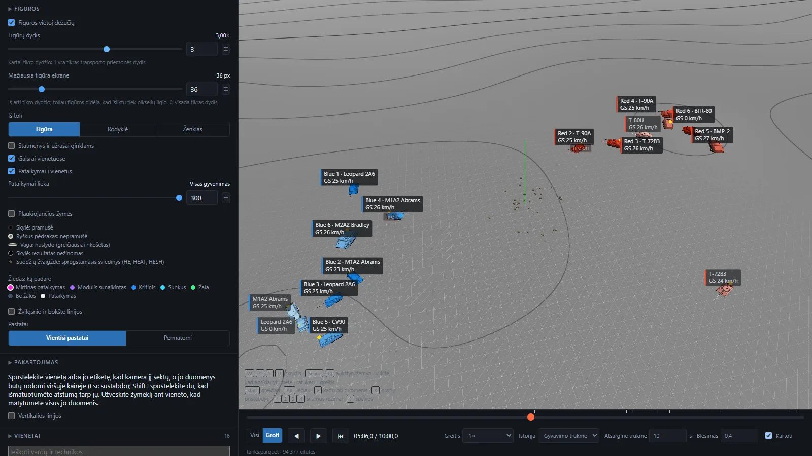
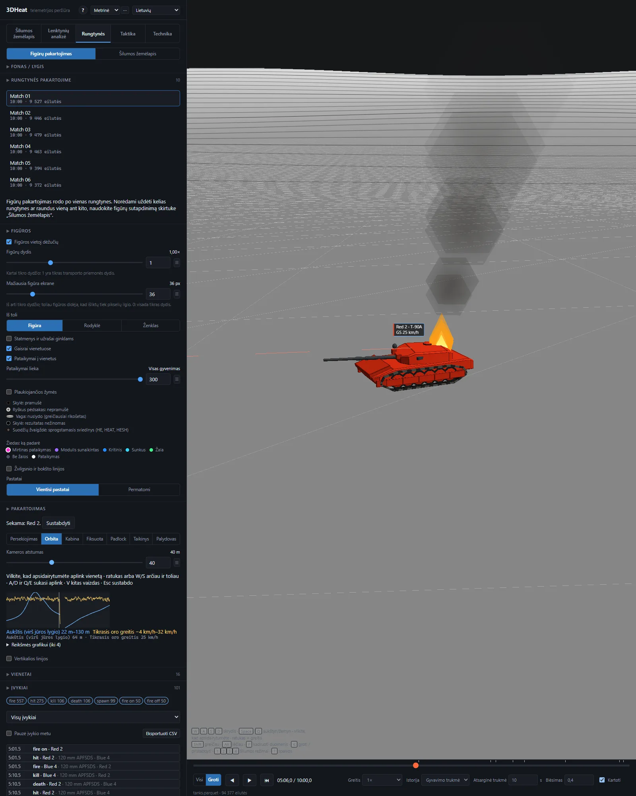
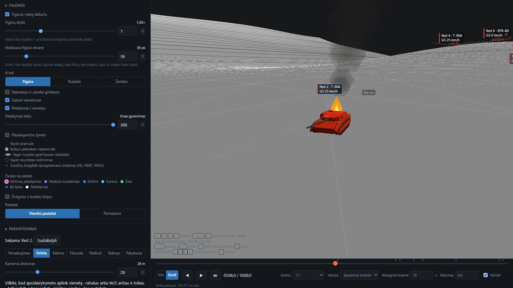
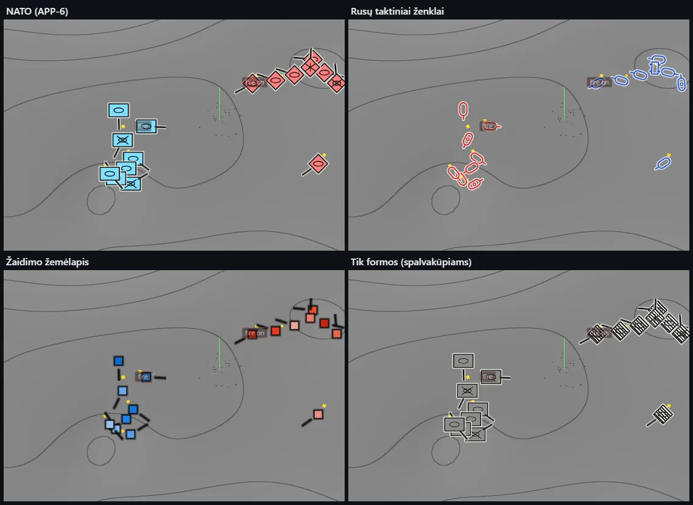
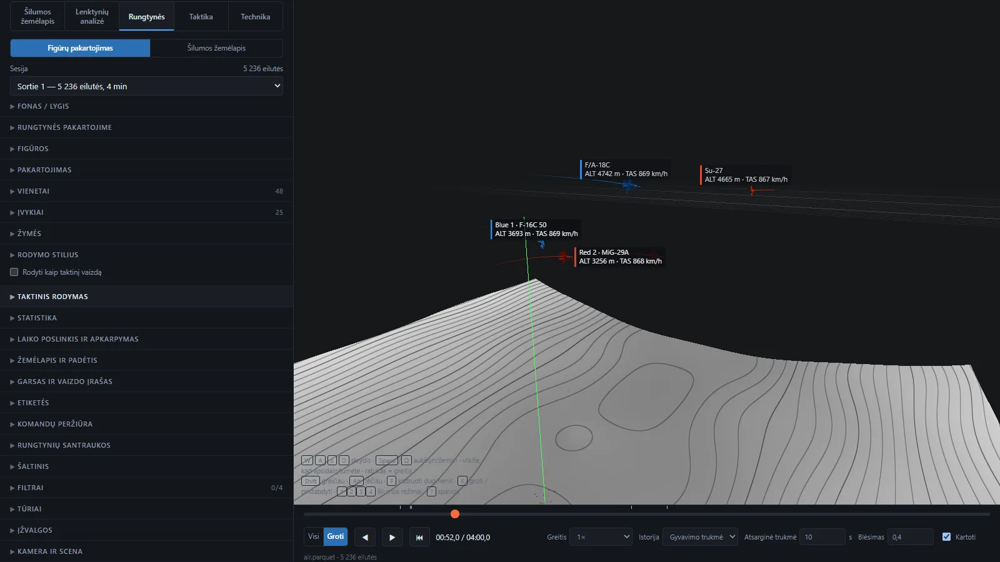

# Rungtynių pakartojimas

Pakartojimas yra rungtynių filmas, kuriame kiekvienas žaidėjas nupieštas kaip tai, ką jis vairavo. Naudokite jį, kad dar kartą pažiūrėtumėte kovą, sektumėte vieną vienetą ir matytumėte, kas kam pataikė.

Šūviai, pataikymai, gaisrai ir griuvėsiai piešiami ant vienetų ir tikslų lygyje. Kameros, žymos ir taktinis rodinys padeda skaityti kovą. Ar žinote Tacview? [Tacview paritetas](tacview-parity.md) rodo, kur yra kiekvienas jo įrankis.

## Pradėkite pakartojimą {#start-a-replay}

1. Įkelkite įrašą per **Šaltinis → Failai…** arba nuleisdami jį ant Šaltinio skydelio (bet kurią lentelę su **asmens** ir **laiko** stulpeliais, Tacview failą, konvertuotą pakartojimą, [`.3dheat`](container.md) rungtynes). Žr. [Duomenų įkėlimas](getting-data-in.md).
2. Atidarykite skirtuką **Rungtynės** ir pasirinkite **Figūrų pakartojimas**, arba Šilumos žemėlapio skirtuko režimų juostoje pasirinkite **Figūrų sutapdinimas**.
3. Skiltyje **Rungtynės pakartojime** pasirinkite vienas rungtynes, visas iškart arba kelias.
4. Laiko juostoje paspauskite **Groti** (arba `K`). Tempkite laiko juostą, kad peršoktumėte.

Figūros pakeičia dėžutes kiekvienam vienetui, kurio pavadinimas arba tipas žinomas (žr. [Figūros](figures.md)). Duomenys be pavadinimo ar tipo stulpelio piešiami kaip kareiviai.

## Figūros {#figures}

| Nustatymas (skiltis **Figūros**) | Numatytoji | Ką daro |
|---|---|---|
| **Figūros vietoj dėžučių** | įjungta | Išjungus, piešiamos paprastos dėžutės. |
| **Figūrų dydis** (kartais nuo tikro dydžio) | 1 | 1 yra tikras dydis; nuo 0,25 iki 20 kartų (logaritminė skalė). Didesnė padeda iš toli. |
| **Mažiausia figūra ekrane** | 36 px | Toli esančios figūros didėja, kad išliktų tokio dydžio, nuo 0 iki 200 px; 0 išlaiko tikrą dydį. |
| **Iš toli**: Figūra, Rodyklė, Ženklas | Figūra | Kuo virsta vienetas, esantis toli. |
| **Ženklai** | NATO (APP-6) | NATO (APP-6), Rusijos taktiniai ženklai, **Žaidimo žemėlapis** piktogramos arba **Tik formos (spalvakūpiams)**. |
| **Ženklo dydis**, **Mano pusė**, **Priešiška / Neutrali**, **Kurso brūkšneliai** | 28 px (nuo 12 iki 64), automatinė, priešiška, įjungta | Kaip atrodo ženklai ir kuri pusė yra draugiška. |
| **Vertikalios linijos** | įjungta | Linija nuo kiekvieno vieneto tiesiai žemyn iki žemės, kad aukščiai būtų aiškūs 3D. |
| **Statmenys ir užrašai ginklams** | išjungta | Linijos iki žemės ir užrašai raketoms bei bomboms. |
| **Gaisrai vienetuose** | įjungta | Liepsnos nuo to momento, kai vienetas užsidega, iki jo užgesinimo. |
| **Pataikymai į vienetus** | įjungta | Žymės, kur pataikė šūviai (žemiau). **Pataikymai lieka**: nuo 1 iki 300 sekundžių arba **Visas gyvenimas**. **Plaukiojančios žymės**: žymės, piešiamos virš paviršiaus. |
| **Žvilgsnio ir bokšto linijos** | išjungta | Brūkšninės: kur žiūri žaidėjas; ištisinės: kur nukreiptas ginklas. |
| **Pastatai** | ištisiniai | Ištisiniai arba permatomi pastatai, kai lygis juos nudažo. |

### Ženklai iš toli {#symbols-at-a-distance}

Kai vienetas būtų mažesnis už **Mažiausia figūra ekrane**, jis gali tapti ženklu, kuris lieka įskaitomas. Forma parodo rūšį (pavyzdžiui, suapvalinta dėžė su vikšro žyme šarvuotai technikai); spalva parodo pusę. Atidarykite meniu **Ženklai**, kad pakeistumėte stilių.

### Pataikymų žymės, griuvėsiai ir gaisrai {#hit-marks-wrecks-and-fires}

- **Pataikymų žymės** yra paviršiuje, į kurį pataikė šūvis, figūros mastelio. Jų išvaizda parodo, kas nutiko: skylė (prasiskverbė), ryškus šlapias pliūpsnis (neprasiskverbė), įbrėžimas (nukrypo), suodžių žvaigždė (sprogstamasis sviedinys). Spalvotas žiedas parodo, ką jis padarė: mirtinas šūvis, modulis sunaikintas, kritinis, sunkus, žala, be žalos, pataikymas. Užvedę pelę ant žymės, pamatysite sviedinio pavadinimą.
- Sunaikintas vienetas piešiamas **apanglėjęs** kaip griuvėsis nuo mirties iki atgimimo arba pašalinimo; jo ženklas perbrauktas.
- **Gaisrai** dega ant vieneto nuo to momento, kai jis užsidega, iki jo užgesinimo.
- **Bokštai** pasisuka ten, kur duomenys nurodo, kad nukreiptas ginklas (arba, jei to nėra, kur žiūri žaidėjas).

### Ginklai, masalai ir trasuotojai {#weapons-decoys-and-tracers}

Įjungus **Ginklai, šūviai ir pataikymai** (skiltyje Komandų peržiūra): raketos, raketos, bombos ir torpedos skrenda kaip savos figūros su dūmų uodega; kulkos ir sviediniai yra trasuotojai; smūgiai ir sprogimai blyksi. Trasuotojas, nupieštas **brūkšniuotai**, apskaičiuotas iš pataikymo, nes duomenyse šūvio nebuvo. Šviesos signalai ir šiaudai piešiami kaip masalai; jie paslepiami vienetų sąraše, nebent pažymėtas *Masalai ir sviediniai*.

## Kameros {#cameras}

Spustelėkite vienetą arba jo žymę, kad jį **sektumėte**; skiltis **Pakartojimas** siūlo **Persekiojimas**, **Orbita**, **Kabina** (su projekcija prieš akis, `H`), **Fiksuota**, **Padlock**, **Taikinys** ir **Palydovas**. `V` perjungia juos, **Kameros atstumas** nustato, kiek toli. Esc sustabdo.

- **Dviejų vienetų rodinys**: pasirinkite **Taikinį** (arba Ctrl / Alt spustelėkite vienetą), kad žiūrėtumėte į jį iš sekamo; **Sukeisti** juos apsikeičia.
- **Matavimas**: Shift spustelėkite du vienetus, kad gautumėte kryptį, atstumą ir aukščio skirtumą tarp jų.
- **2D žemėlapis** (`M`): kampinis arba visas rodinys su pėdsakais ir pavadinimais.
- **Žymės** (`B`): išsaugo akimirką ir kamerą; įrašo paties įrašo nužudymai, mirtys ir žymos taip pat išvardijami.
- **Įvykiai**: kiekvienas įvykis laiko tvarka; spustelėjimas nušoka ten. `Page Up` / `Page Down` peršoka tarp įvykių; **Pauzė įvykio metu** sustoja prie kiekvieno.

## Taktinis rodymas {#tactical-display}

Skiltis **Taktinis rodymas** piešia, be vieneto, pasirinktus, visus arba vieną rūšį (orlaiviai, antžeminiai, laivai, ginklai): greičio vektorius ir priekyje esantį kelią, nosies ir kėlimo linijas, radarų kūgius, užraktus, duomenų ryšius, įsitraukimo zonas ir linijas, matymo linijas, kur žiūri žaidėjai (žvilgsnio kūgiai), bokštų nukreipimą ir įrašytą kamerą.

### Rodymo stilius {#display-style}

`T` (arba jungiklis **Rodyti kaip taktinį vaizdą**) perjungia išvaizdą į radaro ekrano stilių: švytėjimas, kontūrai, kontūrų linijos, matavimo tinklelis, skenavimo linijos, nuotolio žiedai, aukščio skalės, skydeliai su nužudymais ir įvykiais bei **Režisierius**, kuris pats perkelia kamerą prie įvykių.

## Tikslai {#objectives}

Kai rungtynės turi tikslus, skiltis **Tikslai** piešia juos ant lygio: užėmimo zonas (su savininku ir užėmimo eiga), atsiradimo taškus, aerodromus, sritis ir bombardavimo taikinius, kiekvieną sluoksnį galima įjungti ar išjungti, su žymomis. Jie matomi per žemę. Įkėlus kelis žaidimo režimus, **Režimas** filtruoja rungtynes pagal režimą. Tikslai ateina iš konverterio rungtynių failo šalia įrašo arba [`.3dheat`](container.md) konteinerio viduje.

## Etiketės ir statistika {#labels-and-statistics}

- **Etiketės**: taisyklės kiekvienai rūšiai (**Pasirinkti**, **Orlaiviai**, **Antžeminiai**, **Laivai**, **Ginklai**, **DI**): rodyti ar ne, kurias reikšmes, ir **Pirmenybė**, nusprendžianti, kas gauna vietą, kai žymos persidengia. **Laikyti etiketes atskirai** perkelia žymą šalia jos vieneto, kai ji dengtų kitą, ir ją paslepia, kai vietos nėra. **Etikečių dydis** yra nuo 60 iki 250 %. **Atgal į vardą, techniką, aukštį ir greitį** atkuria taisykles.
  - Antžeminiai vienetai pradeda nuo vardo, technikos ir greičio.
  - Orlaiviai pradeda nuo vardo, technikos, aukščio ir greičio.
  - Laivai pradeda nuo vardo, technikos, greičio ir kurso.
  - Užveskite pelę ant vieneto, kad pamatytumėte visas jo reikšmes.
- **Statistika**: kiekvienai komandai ir vienetui: nužudymai, mirtys, šūviai, pataikymai, pataikymų santykis, pakilimai, nusileidimai, laikas ore, didžiausias greitis, aukštis ir G, atstumas. Eksportas į CSV.
- **Grafikai**: vieneto reikšmės laike, du vienetai palyginti arba viena reikšmė prieš kitą.

## Daug rungtynių vienu metu {#many-matches-at-once}

Norėdami sudėti šimtus ar tūkstančius rungtynių viena ant kitos, žr. [Daug rungtynių vienu metu](many-matches.md). Figūrų detalės (dūmai, gaisras, kiti laiku trunkantys efektai): [Figūros figūrų sutapdinime](figure-replay.md). Tacview funkcijų sąrašas: [Tacview paritetas](tacview-parity.md), šio puslapio poskyris.
