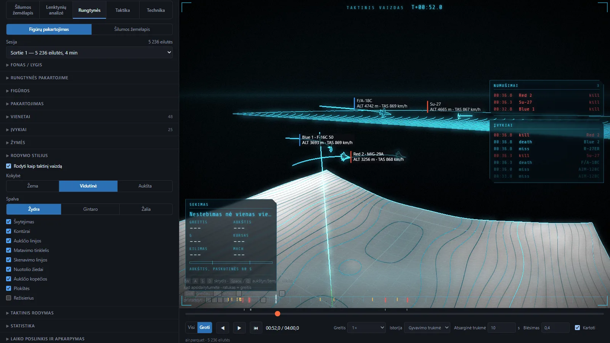

# Rungtynių pakartojimas

Pakartojimas yra rungtynių filmas, kuriame kiekvienas žaidėjas nupieštas kaip tas, ką jis valdė. Naudokite jį, kad dar kartą pažiūrėtumėte kovą, sektumėte vieną vienetą ir pamatytumėte, kas kam pataikė.

Šūviai, pataikymai, gaisrai ir sunaikinimai piešiami ant vienetų ir tikslų lygyje. Kamerų, žymų ir taktinis rodymas padeda skaityti kovą. Ar žinote Tacview? [Tacview paritetas](tacview-parity.md) parodo, kur yra kiekvienas jo įrankis.

## Pradėti pakartojimą {#start-a-replay}

1. Įkelkite įrašą per **Šaltinis → Failai…** arba nutempdami jį ant skydelio Šaltinis (bet kuri lentelė su stulpeliais **asmuo** ir **laikas**, Tacview failas, konvertuotas pakartojimas, [`.3dheat`](container.md) rungtynės). Žr. [Duomenų įkėlimas](getting-data-in.md).
2. Atidarykite skirtuką **Rungtynės** ir pasirinkite **Figūrų pakartojimas**, arba pasirinkite **Figūrų sutapdinimas** šilumos skirtuko režimų juostoje.
3. Skiltyje **Rungtynės pakartojime** pasirinkite vienas rungtynes, visas iš karto arba kelias.
4. Paspauskite **Groti** laiko juostoje (arba `K`). Vilkite laiko juostą, kad peršoktumėte.

Figūros pakeičia dėžutes kiekvienam vienetui, kurio vardas ar tipas žinomi (žr. [Figūros](figures.md)). Duomenys be vardo ar tipo stulpelio piešiami kaip kariai.

## Figūros {#figures}

| Nustatymas (skyrius **Figūros**) | Numatytoji | Ką daro |
|---|---|---|
| **Figūros vietoj dėžučių** | įjungta | Išjungta piešia paprastas dėžutes. |
| **Figūrų dydis** (kartais iš tikrojo dydžio) | 1 | 1 yra tikrasis dydis; nuo 0,25 iki 20 kartų (logaritminė skalė). Didesnė padeda matyti iš toli. |
| **Mažiausia figūra ekrane** | 36 px | Toli esančios figūros išauga, kad išliktų tiek ilgos; nuo 0 iki 200 px; 0 palieka tikrąjį dydį. |
| **Iš toli**: Figūra, Rodyklė, Ženklas | Figūra | Kuo tampa toli esantis vienetas. |
| **Ženklai** | NATO (APP-6) | NATO (APP-6), Rusijos taktiniai ženklai, **Žaidimo žemėlapio** piktogramos arba **Tik formos (spalvakūpiams)**. |
| **Ženklo dydis**, **Mano pusė**, **Priešininko / neutralūs**, **Krypties brūkšneliai** | 28 px (nuo 12 iki 64), automatinė, priešininko, įjungta | Kaip atrodo ženklai ir kuri pusė yra draugiška. |
| **Vertikalios linijos** | įjungta | Linija nuo kiekvieno vieneto tiesiai žemyn iki žemės, kad aukščiai būtų matomi 3D. |
| **Vertikalios linijos ir užrašai ginklams** | išjungta | Linijos iki žemės ir užrašai raketoms bei bomboms. |
| **Gaisrai vienetuose** | įjungta | Liepsnos nuo momento, kai vienetas užsidega, iki kol jis užgesinamas. |
| **Pataikymai į vienetus** | įjungta | Žymos, kur sviediniai pataikė (žemiau). **Pataikymai lieka**: nuo 1 iki 300 sekundžių arba **Visas gyvenimas**. **Plaukiojančios žymės**: žymos, piešiamos virš paviršiaus. |
| **Taikymo ir bokštelio linijos** | išjungta | Brūkšninė: kur žiūri žaidėjas; ištisinė: kur nukreiptas ginklas. |
| **Pastatai** | ištisinis | Ištisiniai arba permatomi pastatai, kai lygis juos nudažo. |

### Ženklai toli {#symbols-at-a-distance}

Kai vienetas būtų mažesnis už **Mažiausia figūra ekrane**, jis gali tapti ženklu, kuris lieka įskaitomas. Forma parodo rūšį (pavyzdžiui, suapvalinta dėžutė su vikšro žymeniu šarvuotai technikai); spalva parodo pusę. Atidarykite meniu **Ženklai**, kad pakeistumėte stilių.

### Pataikymų žymos, griuvėsiai ir gaisrai {#hit-marks-wrecks-and-fires}

- **Pataikymų žymos** guli ant paviršiaus, kurį pasiekė šūvis, figūros mastelyje. Jų išvaizda parodo, kas įvyko: skylė (prasiskverbė), ryški šlapelė (neprasiskverbė), įbrėžimas (nukrypo), suodžių žvaigždė (sprogstamasis sviedinys). Spalvotas žiedas parodo, ką jis padarė: mirtinas šūvis, modulis sunaikintas, kritinis, sunkus, žala, be žalos, pataikymas. Užvedę pelę ant žymos, pamatysite sviedinio pavadinimą.
- Sunaikintas vienetas nuo žuvimo iki atgimimo ar pašalinimo piešiamas **apdegęs** kaip griuvėsiai; jo ženklas perbrauktas.
- **Gaisrai** dega ant vieneto nuo momento, kai jis užsidega, iki kol užgesinamas.
- **Bokšteliai** pasisuka ten, kur duomenys rodo, kad nukreiptas ginklas (arba, jei tokių duomenų nėra, kur žiūri žaidėjas).

### Ginklai, klaidinimai ir trasavimo linijos {#weapons-decoys-and-tracers}

Įjungus **Ginklai, šūviai ir pataikymai** (skyrius Komandų peržiūra): raketos, rakečių, bombos ir torpedos skrenda kaip savos figūros su dūmų pėdsaku; kulkos ir sviediniai yra trasavimo linijos; smūgiai ir sprogimai blyksi. Trasavimo linija, nupiešta **brūkšnine**, buvo apskaičiuota iš pataikymo, nes duomenyse šūvio nebuvo. Blizgės ir pleveliai piešiami kaip klaidinimai; jie paslepiami vienetų sąraše, nebent pažymėta *Klaidinimai ir sviediniai*.

## Kameros {#cameras}

Spustelėkite vienetą ar jo žymą, kad jį **sektumėte**; skyriuje **Pakartojimas** siūlomi **Persekiojimas**, **Orbita**, **Kabina** (su galvos ekranu, `H`), **Fiksuota**, **Padlock**, **Taikinys** ir **Palydovas**. `V` perjungia juos, **Kameros atstumas** nustato, kiek toli. `Esc` sustabdo.

- **Dviejų vienetų vaizdas**: pasirinkite **Taikinys** (arba Ctrl/Alt-spustelėkite vienetą), kad žiūrėtumėte į jį iš sekamo; **Sukeisti** pakeičia juos vietomis.
- **Matuoti**: Shift-spustelėkite du vienetus, kad gautumėte kryptį, nuotolį ir aukščių skirtumą tarp jų.
- **2D žemėlapis** (`M`): kampe arba visame vaizde, su pėdsakais ir pavadinimais.
- **Žymės** (`B`): išsaugo momentą ir kamerą; įrašo paties nužudymai, mirtys ir žymos taip pat išvardijami.
- **Įvykiai**: kiekvienas įvykis laiko tvarka; spustelėjimas nuvedą ten. `Page Up` / `Page Down` peršoka tarp įvykių; **Pauzė įvykio metu** sustoja prie kiekvieno.

## Taktinis rodymas {#tactical-display}

Skyrius **Taktinis rodymas** piešia, nors vienetų nepasirinkta, pasirinktus, visus arba vieną rūšį (orlaiviai, sausuma, laivai, ginklai): greičio vektorius ir priekyje esantį kelią, nosies ir kėlimo linijas, radarų kūgius, užraktus, duomenų ryšius, įsitraukimo zonas ir linijas, regėjimo linijas, kur žiūri žaidėjai (žiūrėjimo kūgiai), bokštelių taikymą ir įrašytą kamerą.

### Rodymo stilius {#display-style}

`T` (arba jungiklis **Rodyti kaip taktinį vaizdą**) perjungia į radaro ekrano stilių: švytėjimas, kontūrai, horizontalės, matavimo tinklelis, skenavimo linijos, nuotolio žiedai, aukščio skalės, skydeliai su nužudymais ir įvykiais bei **Režisierius**, kuris pats perkelia kamerą prie įvykių.

## Tikslai {#objectives}

Kai rungtynės pateikiamos su tikslais, skyrius **Tikslai** piešia juos ant lygio: užimamas zonas (su savininku ir užėmimo eiga), gimimo vietas, aerodromus, sritis ir bombardavimo taikinius, kiekvienas sluoksnis įjungiamas atskirai, su žymomis. Jie matomi per žemę. Įkėlus kelis žaidimo režimus, **Režimas** filtruoja rungtynes pagal režimą. Tikslai ateina iš konverterio rungtynių failo šalia įrašo arba iš [`.3dheat`](container.md) konteinerio.

## Žymos ir statistika {#labels-and-statistics}

- **Žymos**: taisyklės kiekvienai rūšiai (**Pasirinkti**, **Orlaiviai**, **Sausuma**, **Laivai**, **Ginklai**, **DI**): rodyti ar ne, kokias reikšmes, ir **Pirmenybė**, nusprendžianti, kas gauna vietą, kai žymos persidengia. **Laikyti etiketes atskirai** perkelia žymą šalia vieneto, kai ji dengtų kitą, ir paslepia ją, kai vietos nėra. **Etikečių dydis** yra nuo 60 iki 250 %. **Atgal į vardą, techniką, aukštį ir greitį** atstato taisykles.
  - Sausumos vienetai pradeda nuo vardo, technikos ir greičio.
  - Orlaiviai pradeda nuo vardo, technikos, aukščio ir greičio.
  - Laivai pradeda nuo vardo, technikos, greičio ir kurso.
  - Užvedę pelę ant vieneto, pamatysite visas jo reikšmes.
- **Statistika**: pagal komandą ir vienetą: nužudymai, mirtys, šūviai, pataikymai, pataikymų santykis, pakilimai, nusileidimai, laikas ore, didžiausias greitis, aukštis ir G, nuotolis. Eksportas į CSV.
- **Grafikai**: vieneto reikšmės laike, du vienetai palyginti arba viena reikšmė prieš kitą.

## Daug rungtynių vienu metu {#many-matches-at-once}

Norėdami sudėti šimtus ar tūkstančius rungtynių viena ant kitos, žr. [Daug rungtynių vienu metu](many-matches.md). Figūrų detalės (dūmai, gaisras, kiti laiku ribojami efektai): [Figūros figūrų sutapdinime](figure-replay.md). Tacview funkcijų sąrašas: [Tacview paritetas](tacview-parity.md), šio puslapio poskyris.
