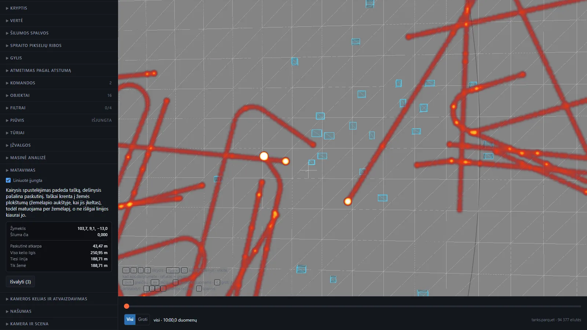

# Matavimas

**Matavimas** pelę paverčia liniuote ir parodo, kiek užimta vieta po žymekliu. Naudokite, kad sužinotumėte, kiek atstumo yra tarp dviejų vietų, arba kiek eismo vyksta vienoje vietoje.

## Išbandykite {#try-it}

1. Šoninėje juostoje atidarykite **Matavimas** ir pažymėkite **Liniuotė įjungta**.
2. Kairiuoju pelės mygtuku spustelėkite tris vietas žemėlapyje. Kiekvienas paspaudimas padeda tašką.
3. Perskaitykite **Viso kelio ilgis** (viso kelio ilgį) ir **Paskutinė atkarpa** (paskutinį ruožą).
4. Dešiniuoju pelės mygtuku spustelėkite, kad pašalintumėte paskutinį tašką, arba paspauskite **Išvalyti (3)**, kad pašalintumėte visus.

| Veiksmas | Poveikis |
|---|---|
| Kairys pelės mygtukas | Padeda tašką, kur žymeklis susitinka su žemės plokštuma. Spustelėjimas, kai tarp paspaudimo ir atleidimo pelė pajudėjo daugiau nei 4 pikseliais, yra kameros tempimas, o ne taškas. |
| Dešinys pelės mygtukas | Pašalina paskutinį tašką. |
| Judėjimas | Žymeklio padėtis ir po juo esanti šiluma atnaujinami tiesiogiai. |

Kamera veikia, kol liniuotė įjungta: tempimas vis dar apsisuka, klavišai vis dar skraido. Kol liniuotė įjungta, ji priima kiekvieną spustelėjimą, todėl [spustelėjimu pasirinkimas](camera.md#click-to-pick) lauks, kol ji bus išjungta.

**Žemės plokštuma** yra [žemėlapio vaizdo](map-images.md) aukštis, kai žemėlapio vaizdas įkeltas; kitu atveju – žemiausias duomenų rinkinio Y (be jo – 0). Taškai nusileidžia ant jos, todėl liniuotė matuoja per žemėlapį, o ne tiesiai per jį. Su 3D lygiu plokštuma vis tiek yra žemiausias duomenų rinkinio Y, o ne lygio paviršius – norėdami taško tikrame paviršiuje, išjunkite liniuotę ir spustelėkite jį ([spustelėjimu pasirinkimas](camera.md#click-to-pick)); tada koordinatės nuskaitomos iš paties lygio trikampių.

## Rodmenys {#readouts}

| Eilutė | Reikšmė |
|---|---|
| **Žymeklis** | Pasaulio X, Y, Z taško po žymekliu, plokštumoje. |
| **Šiluma čia** | Kiek šilumos yra žymeklio pikselyje. Didesnis skaičius reiškia daugiau eismo toje vietoje. Tai reikšmė, kurią spalvų skalė gauna prieš tai, kai sotis ją dalija, todėl ją galima palyginti su [Soties tašku](colour-and-exposure.md#saturation-point). |
| **Paskutinė atkarpa** | Atstumas nuo paskutinio taško iki žymeklio (arba tarp dviejų paskutinių taškų). |
| **Viso kelio ilgis** | Kelio, einančio per visus taškus ir žymeklį, ilgis. |
| **Tiesi linija** | 3D atstumas nuo pirmo taško iki žymeklio (arba paskutinio taško). |
| **Tik žemė** | Tas pats, tik X ir Z ašimis. |
| **Išvalyti (N)** | Pašalina visus taškus. |

Atstumai rodomi centimetrais, kai mažiau nei 1 vienetas, metrais, kai mažiau nei 1 000, kilometrais, kai daugiau – darant prielaidą, kad vienas pasaulio vienetas yra metras ([Ašys, vienetai ir laikas](axes-units-and-time.md#unit-scale)). Koordinatės yra pasaulio koordinatės, net kai ašis [apversta rodymui](camera.md#invert-world-axis).

Taškai ir linija tarp jų vaizde piešiami kaip perdanga, kurios dydis priklauso nuo tinklelio žingsnio. Liniuotės taškai nėra išsaugomi vaizduose; jie lieka, kai įkeliate kitus duomenis.

## Kūrėjams {#for-developers}

**Šiluma čia** nuskaitoma iš GPU ne dažniau kaip kas 120 ms, nes vieno pikselio nuskaitymas sustabdo konvejerį. Jis naudoja tą patį kelią kaip `engine.readHeatProbe()`: padalijamas iš stiprinimo, su kuriuo kadras buvo įrašytas, todėl pusiau tikslaus kaupimo kelyje (`?heat=f16`) jis yra tuose pačiuose vienetuose kaip 32 bitų tiksle ([Pusiau tikslusis kaupimas](half-float-accumulation.md)).
