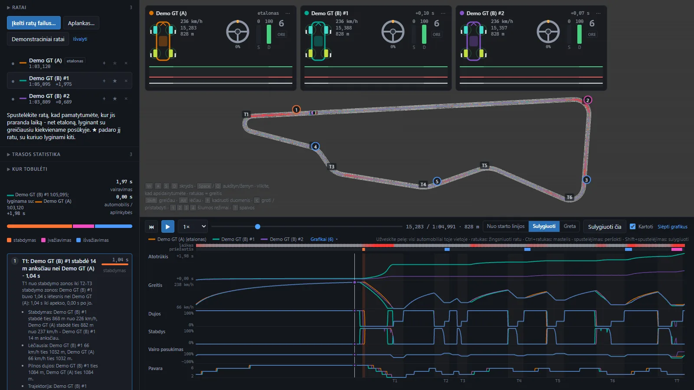

# Lenktynių analizė

Tą pačią trasą nuvažiavote du kartus. Skirtukas **Lenktynių analizė** rodo abu važiavimus kartu 3D, parodo, kur vienas ratas buvo lėtesnis, ir pasako kodėl. Ratų dar nėra? Paspauskite **Demonstraciniai ratai**.

Skirtukas palygina du ar daugiau ratų vienoje trasoje. Su Šilumos žemėlapiu jis dalijasi drobę, kamerą ir įkeltą trasos modelį (**Fonas / lygis**); viskas kita – jo paties: savo šoninė juosta ir savo juosta po vaizdu. Tokie žodžiai kaip *ratas*, *etalonas* ir *viršūnė* paaiškinti [žodynėlyje](glossary.md).

Šis puslapis yra skirtuko žemėlapis. Kiekviena dalis turi savo puslapį:

| Puslapis | Ką apima |
|---|---|
| [Ratų įkėlimas](race-loading-laps.md) | kiekvienas failo formatas, aplankai ir trasos, automobilių pavadinimai, demonstraciniai ratai, ratų sąrašas, etalonas ir fokusas |
| [Pakartojimas ir 3D scena](race-replay-and-scene.md) | atkūrimo juosta, trys pakartojimo režimai, automobilių sulyginimas, persekiojimo kamera, linijos, žemėlapiai, automobiliai, žymos, veidrodiniai pasauliai |
| [Grafikai ir HUD](race-charts-and-hud.md) | atstumo grafikai, grafiko parinkiklis, užvedimas ir artinimas, automobilių kortelės, kanalų lentelė |
| [Automobilio valdymo įvykiai](race-control-events.md) | blokavimai, sukimasis ratais, pervirtimas, sukimasis aplink ašį, nepakankamas valdymas, smūgiai, avarijos, ABS/TC, rankinis stabdys, oras – kaip kiekvienas aptinkamas, su kiekviena riba |
| [Analizė posūkis po posūkio](race-corner-analysis.md) | lygiavimas pagal atstumą, posūkiai ir ruožai, posūkio laiko balansas, kiekviena priežastis ir eilės tvarka, kuria jos tikrinamos, linijos forma ir patarimas |
| [Automobilių profiliai ir palyginimas](race-car-profiles.md) | ką kiekvienas automobilis gali, išmatuota iš jo ratų; *Palyginti automobiliai*; ką automobilis lemia kiekviename posūkyje |
| [Trasos statistika](race-course-statistics.md) | daug vienos trasos ratų: klaidos pagal posūkį ir rūšį, klaidų žemėlapis, šilumos žemėlapio eksportas, našumo ribos |
| [Lenktynių analitika: metodas](race-analytics.md) | taisyklių pagrindas su šaltiniais |
| [Kiti lenktynių žaidimai](other-games.md) | ką peržiūros programa daro su kiekvieno žaidimo ratais: slydimas ir driftas, apskaičiuoti, kai žaidimas jų nesiunčia, veidrodiniai pasauliai, papildomi kanalai |

## Ekranas {#the-screen}

**Šoninė juosta**, iš viršaus žemyn (skiltis galima sulankstyti):

1. **Ratai** – įkėlimas, sąrašas, rodymas / slėpimas, etalonas, fokusas, persekiojimas.
   Žr. [Ratų įkėlimas](race-loading-laps.md).
2. **Trasos statistika** – tik įkėlus bent tris ratus.
   Žr. [Trasos statistika](race-course-statistics.md).
3. **Kur tobulėti** – fokusuoto rato radiniai, posūkis po posūkio.
   Žr. [Analizė posūkis po posūkio](race-corner-analysis.md).
4. **Posūkis po posūkio** (arba *Posūkis po posūkio – klasė X*, kai yra kelios klasės) – greičiausias ratas per kiekvieną posūkį ir jo linija. Rodoma, kai įkelti du ar daugiau ratų.
5. **Automobilio valdymas** – fokusuoto rato blokavimai, slydimai, stūmimai ir smūgiai.
   Žr. [Automobilio valdymo įvykiai](race-control-events.md).
6. **Automobilių palyginimas** (arba **Automobilis**, kai yra vienas automobilis) – žr. [Automobilių profiliai ir palyginimas](race-car-profiles.md).
7. **Vaizdas** – kuris žemėlapis nudažomas ant trasos ir kas piešiama.
   Žr. [Pakartojimas ir 3D scena](race-replay-and-scene.md).
8. Bendri **Lygis** ir **Kamera ir scena** skydeliai (trasos modelis, ašies apvertimas, kamera) – aprašyti su Šilumos žemėlapiu ir [Kamera](camera.md).

**Vaizdas** rodo trasą, nuvažiuotas linijas, žemėlapį, automobilius, žymas, prisegtas prie trasos, ir iki šešių automobilių kortelių viršuje kairėje (žr. [Grafikai ir HUD](race-charts-and-hud.md)). Jei ratų nėra įkelta, rodoma: „Ratų neįkelta – numeskite čia du ar daugiau ratų failų arba įkelkite demonstracinius ratus iš šoninės juostos.“

**Juosta po vaizdu** turi pakartojimo valdymus ir, jei nepaslėpta, atstumo grafikus.

## Greita pradžia {#quick-start}

1. Atidarykite skirtuką **Lenktynių analizė** (šalia **Šilumos žemėlapis** šoninės juostos viršuje).
2. Įkelkite ratus. Paspauskite **Demonstraciniai ratai**, kad pamatytumėte, ką skirtukas daro su trimis išgalvotais ratais. Savo ratams pirmiausia juos įrašykite ([failų formatai ir įrašymo įrankiai](race-loading-laps.md#file-formats)), tada paspauskite **Įkelti ratų failus…** arba **Aplankas…**, arba numeskite failus ar aplankus ant vaizdo.
3. Greičiausias pilnas ratas tampa etalonu; lėčiausias kitas ratas yra fokusuojamas. Spustelėkite bet kurį rato sąraše, kad jį fokusuotumėte; ★ padaro ratą etalonu.
4. Skaitykite **Kur tobulėti**. Spustelėkite radinį: automobiliai sulyginami 40 m prieš jį, kamera jį įrėmina, pakartojimas per jį praleidžiamas ir atsidaro matavimai.
5. Užvedę pelę ant grafikų perkelsite visus automobilius į tą metrą; Shift+spustelėjimas juos sulygina ten.

## Klaviatūra {#keyboard}

Kol atidarytas Lenktynių skirtukas:

| Klavišas | Ką daro |
|---|---|
| **K** | groti / pauzė pakartojimui |
| **Home** | grįžti į pakartojimo pradžią |
| skaitmenų klavišai | nieko (Šilumos žemėlapyje jie perjungia režimus) |

Klavišai, įvesti tekstiniame lauke ar išskleidžiamajame sąraše, ignoruojami. Kameros klavišai veikia kaip Šilumos žemėlapyje (**W A S D**, **Tarpas** – aukštyn, **Q** – žemyn, **Shift** – greičiau, **Alt** – lėčiau, pelė – žiūrėti; visi [Kameroje](camera.md)); **F** įrėmina įkeltus ratus (kaip ir įkeliant ratus).

## Daug ratų {#many-laps}

- Visi įkelti ratai yra analizuojami ir suskaičiuojami; dešimtys trunka sekundę ar dvi.
- Viršijus **8** ratus (`SHOW_ALL_UP_TO`), pridėti ratai piešiami tik tada, kai jie yra etalonas, fokusuotas ratas arba geriausias fokusuoto rato klasės ratas. Jungikliai *Rodyti visus* / *Tik nagrinėjami* perjungia.
- Viršijus **10** matomų automobilių (`PLAIN_PAST`), ratai, į kuriuos nežiūrima (ne fokusas, ne persekiojamas automobilis, ne etalonas), piešiami su linijomis, retinamomis iki taško kas 6 m, o ne kas 1,5 m, ir paprastais automobiliais.
- Grafikuose piešiama daugiausia **8** ratai; HUD rodo daugiausia **6** korteles.
- Trasos statistika rodoma nuo **3** ratų.

Išsamiau: [Trasos statistika](race-course-statistics.md#performance-with-many-laps).

## Numatytieji rodinio nustatymai {#default-view-settings}

| Nustatymas | Numatytoji |
|---|---|
| Žemėlapis | Laiko žemėlapis |
| Nuvažiuotos linijos, Automobiliai, Padangos ir pakaba, Etiketės, Trasa iš ratų | įjungta |
| Visos reikšmės kortelėse | išjungta |
| Automobilio dydis | 1× |
| Grafikai | rodomi |
| Pakartojimo režimas | Nuo starto linijos |
| Pakartojimo greitis | 1× |
| Kartoti | įjungta |

Nė vienas iš jų neišsaugomas; perkrovus puslapį pradedama nuo numatytųjų. Naršyklėje prisimenama: kalba ir automobilių pavadinimai, išmokti iš ratų failų (žr. [Ratų įkėlimas](race-loading-laps.md#car-names)).

## Kūrėjams {#for-developers}

### Kas nutinka įkėlus ratus {#what-happens-when-laps-are-loaded}

Kiekvieną kartą, kai pasikeičia ratų rinkinys, etalonas ar kalba, visa analizė atliekama iš naujo (`analyse` faile [`src/race/analysis.ts`](https://github.com/Holdi601/3DHeat/blob/main/src/race/analysis.ts)):

1. Kiekvienam ratui pridedami išvesti kanalai ten, kur žaidimas jų nesiunčia: driftavimo kampas, ratų slydimas iš ratų greičių, oras, laisvas gruntas, sukimosi greitis ([`derive.ts`](https://github.com/Holdi601/3DHeat/blob/main/src/race/derive.ts)).
2. Parenkamas etalonas, ir kiekvienas ratas projektuojamas į jo kelią bei perskaičiuojamas kas 2 m ([`align.ts`](https://github.com/Holdi601/3DHeat/blob/main/src/race/align.ts)).
3. Iš ratų nustatoma, ar žaidimo pasaulis yra veidrodinis ([`handedness.ts`](https://github.com/Holdi601/3DHeat/blob/main/src/race/handedness.ts)).
4. Posūkiai randami etalone ir grupuojami į ruožus nuo vienos stabdymo zonos iki kitos ([`segments.ts`](https://github.com/Holdi601/3DHeat/blob/main/src/race/segments.ts)).
5. Kiekvienam automobiliui: jo ribos (sukibimas, stabdymas, trauka pagal greitį), profilis, padangų kreivės ([`envelope.ts`](https://github.com/Holdi601/3DHeat/blob/main/src/race/envelope.ts), [`profile.ts`](https://github.com/Holdi601/3DHeat/blob/main/src/race/profile.ts), [`control.ts`](https://github.com/Holdi601/3DHeat/blob/main/src/race/control.ts)).
6. Kiekvienam ratui ir ruožui: ką jis padarė (stabdymo taškas, lėčiausias taškas, pilnas dujų pedalas ir kt.) bei linija, kuria važiavo ([`line.ts`](https://github.com/Holdi601/3DHeat/blob/main/src/race/line.ts)).
7. Kiekvienam ratui: jo automobilio valdymo įvykiai, kiekvienas sulygintas su ratu, su kuriuo lyginama toje vietoje.
8. Kiekvienam ratui ir ruožui: laiko balansas, lyginant su palyginimo ratu, ir radinys žodžiais.
9. Laiko žemėlapis ir priežasčių žemėlapis kiekvienam ratui.

Tekstai sukuriami dabartine kalba; pakeitus kalbą analizė paleidžiama iš naujo (ir pervadinami demonstraciniai ratai). Analizės klaida rodoma po mygtukais **Ratai** kaip klaida, o ratai lieka įkelti.

### Šaltinio failai {#source-files}

| Failas | Vaidmuo |
|---|---|
| `src/race/adapters.ts`, `ibt.ts` | ratų failų skaitymas |
| `src/race/lap.ts`, `carNames.ts`, `synthetic.ts` | rato tipas, pavadinimai, demonstraciniai ratai |
| `src/race/derive.ts`, `handedness.ts` | išvesti kanalai, veidrodiniai pasauliai |
| `src/race/align.ts`, `segments.ts`, `line.ts` | atstumo ašis, posūkiai, linijos |
| `src/race/analysis.ts` | palyginti posūkiai, priežastys, radiniai |
| `src/race/envelope.ts`, `profile.ts` | ką automobilis gali |
| `src/race/control.ts`, `impacts.ts` | automobilio valdymas, smūgiai ir avarijos |
| `src/race/stats.ts` | daug ratų |
| `src/race/replay.ts`, `scene.ts`, `glyph.ts`, `geometry.ts` | pakartojimas ir piešimas |
| `src/race/schema.ts`, `graphs.ts` | kanalų lentelė, grafikų eilutės |
| `src/ui/race/*` | šoninė juosta, grafikai, HUD, žymos |
| `src/state/raceStore.ts` | skirtuko būsena ir pakartojimo laikrodis |
