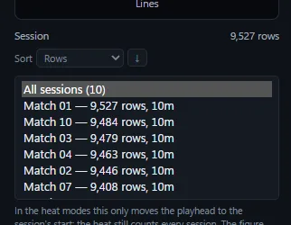

# Sesijos, asmenys ir grupės

**Asmuo** yra vienas judantis daiktas (žaidėjas, automobilis). **Komanda / grupė** yra pusė, kuriai jie priklauso. **Sesija** yra viena
rungtynės ar ratas. Žr. [žodynėlį](glossary.md).

Viena failo eilutė gali nurodyti visus tris:

| x | y | laikas | player | team | match |
|---|---|---|---|---|---|
| 10.5 | -30.2 | 12.0 | Blue 1 | Blue | Match 01 |

`player` yra asmuo, `team` yra grupė, `match` yra sesija.

Trys neprivalomi stulpeliai aprašo, *kas* ir *kurioje istorijos vietoje* priklauso eilutė. Kiekvienas įkeliant užkoduojamas žodyne: tekstinės reikšmės
tampa mažais sveikaisiais id kiekvienoje eilutėje ir vienu etikečių sąrašu, bendru visiems to įkėlimo failams.

## Asmuo {#person}

Stulpelis **Asmens ID** nurodo judantį daiktą, kuriam priklauso eilutė: žaidėją, botą, automobilį. Jis saugomas kaip 32 bitų id kiekvienai eilutei.

Su asmens ir laiko stulpeliu įkėlimas apskaičiuoja kiekvienos eilutės **gyvavimo trukmę**: laiką iki to paties asmens kito mėginio *toje pačioje sesijoje*,
arba „nėra" (žymeklis, -1), kai kito mėginio nėra - asmuo žuvo, išėjo ar žurnalas baigėsi. Gyvavimo trukmės maitina [laiko juostos](timeline.md)
**Gyvavimo trukmės** istoriją, [dėžės atkūrimo](box-replay.md) interpoliaciją ir senumą, bei [linijų šilumos](line-heat.md) kelių pertraukas. Ką daro eilutė be
tęsinio, yra rodymo nustatymas (*Atsarginė trukmė*), o ne įrašyta duomenyse.

Kiekvienas asmuo gauna savo **pirmos** laiku eilutės grupę; šis priskyrimas nudažo jo dėžutę dėžės atkūrime ir nusprendžia, kurios grupės matomumo
jungiklis jį ten paslepia. Šilumos režimai vietoj to naudoja kiekvienos eilutės pačios grupę.

### Vardai, kuriuos vienu metu nešioja keli daiktai {#names-worn-by-several-things-at-once}

Vardas ne visada yra vienas subjektas: kai kuriuose eksportuose kiekvienas kiekvienų rungtynių botas registruojamas tuo pačiu vardu. Sujungus du tokio
„asmens" mėginius - interpoliacija, pėdsaku ar keliu - žemėlapyje nubrėžiama linija tarp dviejų skirtingų padarų.

Įkeliant ([`computeLifetimes`](https://github.com/Holdi601/3DHeat/blob/main/src/data/builder.ts)) vardas pažymimas **bendru**, kai du jo įrašai

- yra toje pačioje sesijoje,
- turi tą patį laiką,
- yra tos pačios rūšies (kiekviena išsaugota kategorijų stulpelio reikšmė vienoda), ir
- yra toliau vienas nuo kito nei 1% duomenų apimties įstrižainės.

Bendri vardai piešiami kaip atskiri mėginiai - be interpoliacijos, be pėdsako, be linijų šilumos kelio. Viskas kita apie juos (jų šiluma) nepakinta.
Duomenų rinkinio skydelyje išvardijama, kiek vardų pažymėta, su iki trijų pavyzdžių, o dėžės atkūrimo skydelis kartoja skaičių.

## Sesija {#session}

Stulpelis **Sesija / rungtynės** nurodo, kurioms rungtynėms, reidui, raundui, bėgimui ar ratui priklauso eilutė. Būtent jis padaro asmens mėginius vienu
nenutrūkstamu takeliu: tikra telemetrija dažnai sumaišo vienu metu vykstančias rungtynes, ir žaidėjo mėginys prieš žymeklį bei mėginys po jo gali būti iš
skirtingų rungtynių, nutolusių šimtais metrų. Su sesijos stulpeliu:

- interpoliacija, pėdsakai ir linijų šilumos keliai niekada nekerta sesijos pakeitimo;
- eilutės gyvavimo trukmė baigiasi savo sesijos pabaigoje;
- **Sesija** pasirinkiklis atsiranda šoninės juostos viršuje, po režimų juosta.

Sesijos stulpelis labai dažnai yra *laiko žyma* - rungtynių pradžios momentas, pakartotas kiekvienoje tų rungtynių eilutėje. Dėl to automatinis
susiejimas ieško sesijos pavadinimų prieš asmenį ir grupę ([Stulpelių priskyrimas](column-mapping.md#session-person-group)). Lenktynių ratas ar
stintas taip pat yra sesija: du to paties automobilio ratai negali būti sujungti į vieną takelį.

### Sesijos pasirinkiklis {#the-session-picker}

*Dešimt rungtynių viename faile: pasirinkite vieną arba matykite visas.*

Rodomas, kai duomenų rinkinys turi išvardytas sesijas (žr. ribą žemiau).

| Dalis | Reikšmė |
|---|---|
| Etiketė dešinėje | Pasirinktos sesijos eilučių skaičius arba *visos vienu metu*. |
| Meniu | *Visos sesijos (N)*, tada kiekviena sesija, pagal užimtumą: `etiketė - N eilučių, trukmė` (trukmė sekundėmis iki 90 s, minutėmis iki 90 min, valandomis daugiau). |
| Gintaro spalvos užuomina | Rodoma *Visoms sesijoms*: pozicijos vis tiek niekada nejungiamos tarp sesijų, bet vienu metu vykstančios rungtynės žemėlapyje sudeda nesusijusius žaidėjus kartu. |
| Užuomina | Rodoma šilumos režimuose, kai pasirinkta viena sesija: pasirinkimas tik perkelia žymeklį. |

Įkėlus pasirenkama užimtiausia sesija. Pasirinkus sesiją, žymeklis nukeliamas į tos sesijos pradžią.

Ką keičia pasirinkimas:

- **[dėžės atkūrime](box-replay.md)** jis nusprendžia, kuri sesija atkuriama: nubrėžiamos tik tos sesijos dėžės ir pėdsakai, o laiko juostos ruožas tampa pačios sesijos trukme.
- **šilumos režimuose** jis neriboja šilumos, ir po pasirinkikliu esanti užuomina tai sako: *Šilumos režimuose tai tik perkelia žymeklį į sesijos pradžią; šiluma vis tiek skaičiuoja visas sesijas. Dėžės atkūrimas groja tik pasirinktą sesiją.* Norėdami apriboti šilumą viena sesija, taip pat palikite sesijos stulpelį kaip filtro stulpelį (*Išsaugoti filtravimui*) ir filtruokite pagal jį. Stulpelis gali būti ir sesijos stulpeliu, ir filtro stulpeliu: įkėlėjas skaito kiekvieną pažymėtą filtro stulpelį atskirai, kad ir koks vaidmuo jam dar tenka.

### Per daug sesijų {#too-many-sessions}

Išvardijama iki **100 000** sesijų. Daugiau - stulpelis iš tikrųjų yra id (aplankas su milijonais sesijų, kiekviena iš keleto eilučių), o tiek etikečių
siuntimas iš darbuotojo į puslapį ir yra tai, kas išstumia kortelę iš atminties. Tada įkėlimas išlaiko sesijų **id** - ribos vis tiek taikomos visur - bet
numeta etiketes ir pasirinkiklį, o duomenų rinkinio skydelis tai nurodo.

## Grupė {#group}

Stulpelis **Komanda / grupė** yra bet koks stulpelis su mažai skirtingų reikšmių: komanda, pusė, būrys, frakcija, žaidėjas-prieš-DI žymė, automobilio klasė. Jis
saugomas kaip 16 bitų id kiekvienai eilutei ir valdo:

- [Komandų sąrašą](teams-list.md) (matomumą pagal grupę, + / − pusės),
- [komandų šilumą](team-heat.md) (atspalvis kiekvienai grupei),
- [skirtumo](difference.md) skaidymą pagal grupę,
- [dėžės atkūrimo](box-replay.md) dėžučių spalvas (atspalvių šeima kiekvienai grupei, tonas kiekvienam nariui).

### Ribos {#limits}

Daugiausia **4 096** skirtingų grupių. Grupės id keliauja ketvirtuoju kiekvienos eilutės pozicijos tekselio kanalu GPU, o kiekvienai grupei reikia tekselio
4 096 pločio ženklų lentelėje, kurią šeiderys skaito, kad nuspręstų *paslėpta*, *pridėta* ar *atimta*. Stulpelis su daugiau skirtingų reikšmių yra id, o ne grupė: **įkėlimas
išlaiko kiekvieną eilutę ir numeta tik grupavimą**, su įspėjimu duomenų rinkinyje, kuris siūlo jį susieti kaip asmens stulpelį arba išsaugoti kaip filtro stulpelį.

Ta pati 4 096 riba taikoma išsaugotam *kategorijos* filtro stulpeliui; platesnis neišsaugomas, ir duomenų rinkinys tai sako. Skaitinis stulpelis (pavyzdžiui, laiko žyma)
tokios ribos kaip *ruožo* filtras neturi.

Grupės reikšmės `0`, tuščia reikšmė, `none`, `unknown`, `null` ir `-1` (nepriklausomai nuo raidžių dydžio) [komandų šilumai](team-heat.md) reiškia „nėra grupės" ir
piešiamos neutraliai pilkai, o ne kaip tvirta spalva.

## Daikto dydis {#entity-size}

Kokio dydžio yra vienas sekamas daiktas - žaidėjo susidūrimo dėžė, automobilis - lemia, kokio dydžio piešiamos [dėžės atkūrimo](box-replay.md) dėžutės ir žiūros
spinduliai. Skydelyje jam lauko nėra; jis ateina iš failo [`heat3d` užuominų](data-formats.md#the-heat3d-hints) (`entity.size`, failo paties vienetais; CS2
konverteris rašo 32). Įkėlimas jį padaugina iš vienetų mastelio.

Kiekvieno įkėlimo metu ([`calibrate`](https://github.com/Holdi601/3DHeat/blob/main/src/data/calibrate.ts)), kai *apimtis* yra didesnė iš duomenų X ir Z ruožų:

| Nustatymas | Su daikto dydžiu | Be jo |
|---|---|---|
| Kubo dydis | daikto dydis | apimtis / 500 |
| Žiūros spindulio ilgis | daikto dydis × 4 | apimtis / 200 |
| Taško spindulys | apimtis / 120 | apimtis / 120 |
| Sodrumo taškas | analitinis įvertinimas (tada matuojamas) | tas pats |
| Skrydžio greitis | apimtis / 12 | tas pats |
| Tolimoji plokštuma | apimtis × 12 | tas pats |
| Artimoji plokštuma | max(0,05; apimtis / 20 000) | tas pats |

## Duomenų rinkinio skydelis {#the-dataset-panel}

Po Šaltinio skydeliu. Įkėlus duomenų rinkinį jis rodo:

- duomenų rinkinio **pavadinimą** - pasirinkimą, eilučių skaičių, failų skaičių, žingsnį, jei jis buvo naudotas;
- **`N komandų · N asmenų · Ns trukmė`**;
- kiekvieną **įspėjimą**, kurį sukėlė įkėlimas, gintaro spalva, tol kol duomenų rinkinys įkeltas: grupės ar filtro stulpelis numesti dėl per daug reikšmių, sesijos neišvardytos,
  bendri vardai, trūkstamos eilutės, praleisti failai;
- [sintetinį generatorių](synthetic-generator.md);
- **Iškelti**, kuris pašalina duomenų rinkinį.

Eilučių skaičius rodomas skydelio antraštėje.

