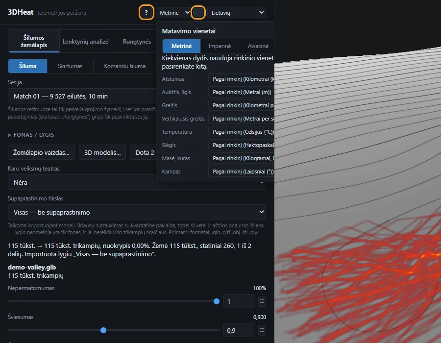
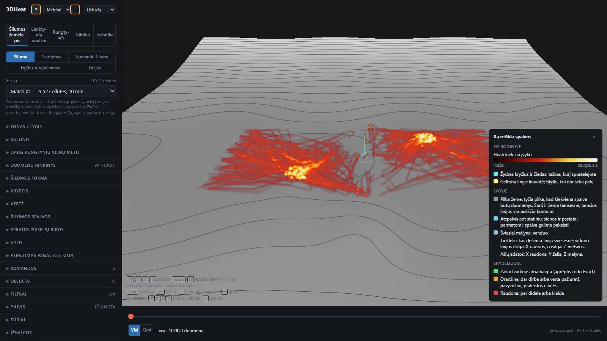
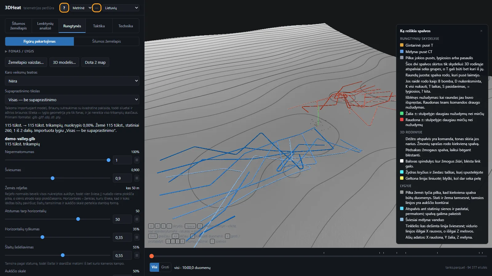

# Nustatymai, vienetai ir klavišai

Maži valdikliai šoninės juostos viršuje keičia tai, kaip peržiūros programa su jumis kalba: kalbą, vienetus (metrai ar pėdos, km/h ar mazgai) ir pagalbos režimą, kuris paaiškina spalvas. Jūsų pasirinkimai įsimenami naršyklėje.

## Antraštė {#the-header}

Šoninės juostos viršuje:

| Valdiklis | Ką daro |
|---|---|
| **?** | Pagalbos režimas: ką reiškia kiekviena spalva (taip pat `?` arba `F1`) |
| **Vienetai** meniu | Metrinė, Imperinė, Aviacinė arba Jūrinė |
| Mygtukas **...** šalia **Vienetai** | Atveria „Pasirinkite vienetą kiekvienam dydžiui“: po vieną išskleidžiamąjį sąrašą kiekvienam dydžiui |
| **Kalba** meniu | Peržiūros programos kalba: [40 kalbų](languages.md) arba naršyklės kalba |

Skaičiai, kuriuos įrašote laukeliuose, gali turėti tašką arba kablelį (`0.35` arba `0,35`). Peržiūros programa supranta abu ir rodo skaičius taip, kaip rašo jos kalba.

## Vienetai {#units}

1. Meniu **Vienetai** pasirinkite išankstinį nustatymą. Visi dydžiai persijungia kartu.
2. Jei norite pakeisti tik vieną dydį, spustelėkite šalia jo esantį mygtuką **...** ir pasirinkite tam dydžiui vienetą. Tada prie išankstinio nustatymo meniu rodo `*`.
3. Dydis, kurio nenustatėte, seka išankstinį nustatymą. Norėdami grįžti, pasirinkite „Pagal išankstinį nustatymą“.

| Dydis | Metrinė (numatytoji) | Imperinė | Aviacinė | Jūrinė |
|---|---|---|---|---|
| Atstumas | km | mi | NM | NM |
| Aukštis, ilgis | m | ft | ft | m |
| Greitis | km/h | mph | kt | kt |
| Vertikalus greitis | m/s | ft/min | ft/min | m/s |
| Temperatūra | °C | °F | °C | °C |
| Slėgis | hPa | inHg | hPa | hPa |
| Masė, kuras | kg, l | lb, gal | lb, gal | t, m³ |
| Kampas | laipsniai | laipsniai | laipsniai | laipsniai |

Kiti vienetai, kuriuos galite pasirinkti vienam dydžiui: atstumas km, mi, NM; greitis km/h, m/s, kt, mph; vertikalus greitis m/s, ft/min, m/min; temperatūra °C, °F, K; slėgis hPa, inHg, mmHg, psi; masė kg, lb, t; kampas laipsniais arba NATO milais (6400 apskritime). Vienetai visur peržiūros programoje vienodi: etiketėse, kortelėse, grafikuose, statistikoje.

## Pagalbos režimas {#help-mode}

Paspauskite `?` arba `F1` arba spustelėkite mygtuką **?**. Jis rodo *Ką reiškia spalvos*: 3D vaizdo legendas, šilumos skales, komandų spalvas, lygio spalvas, skydelių būsenos spalvas, rungtynių skydelį ir lenktynių vaizdą. Jis lieka įjungtas, kol jį išjungsite. Rungtynių skirtuke jis paaiškina ir rungtynių skydelio spalvas.

## Ką naršyklė prisimena {#what-the-browser-remembers}

Šie nustatymai išsaugomi jūsų naršyklėje tarp apsilankymų (niekur nesiunčiama):

- kalba, vienetai ir pagalbos režimas;
- pakartojimo figūros, simbolių, etikečių, kameros ir taktinio rodymo nustatymai;
- atkūrimo greitis ir veidrodinimas;
- žymės pagal įrašą, tūriai pagal duomenų rinkinį, tikslų sluoksniai;
- išoriniai DI nustatymai (raktas – tik tada, kai pažymite *Prisiminti*).

Šilumos nustatymai, filtrai ir režimas kiekvieną kartą įkeliant prasideda iš naujo. Pilnas, automatiškai sugeneruotas sąrašas: [Išsaugoti nustatymai](ref-settings-storage.md).

## Klavišai, kuriuos peržiūros programa saugo nuo naršyklės {#keys-the-viewer-keeps-from-the-browser}

Sesijai su dideliais duomenimis įkelti reikia laiko, todėl peržiūros programa neleidžia naršyklei jų atsitiktinai išmesti:

- `Ctrl`/`Cmd` + raidės, kurios spausdintų, išsaugotų, atvertų, perkrautų, uždarytų arba atvertų naujus langus, neveikia ne teksto laukeliuose; `F1`, `F3`, `F5`, `F6` ir `F7` neveikia.
- Uždarius arba perkrovus skirtuką, kai įkelti duomenys ar lygis, prieš tai klausiama.
- Viso ekrano režime peržiūros programa užrakina klavišus, kuriuos naudoja (W, T, N, S, R, P, Q, Esc), kad naršyklė jų neperimtų.

Tikslus sąrašas: [Naršyklės klavišai](ref-browser-keys.md). Visi peržiūros programos klavišai: [Klaviatūros ir pelės nuoroda](keyboard-reference.md).
