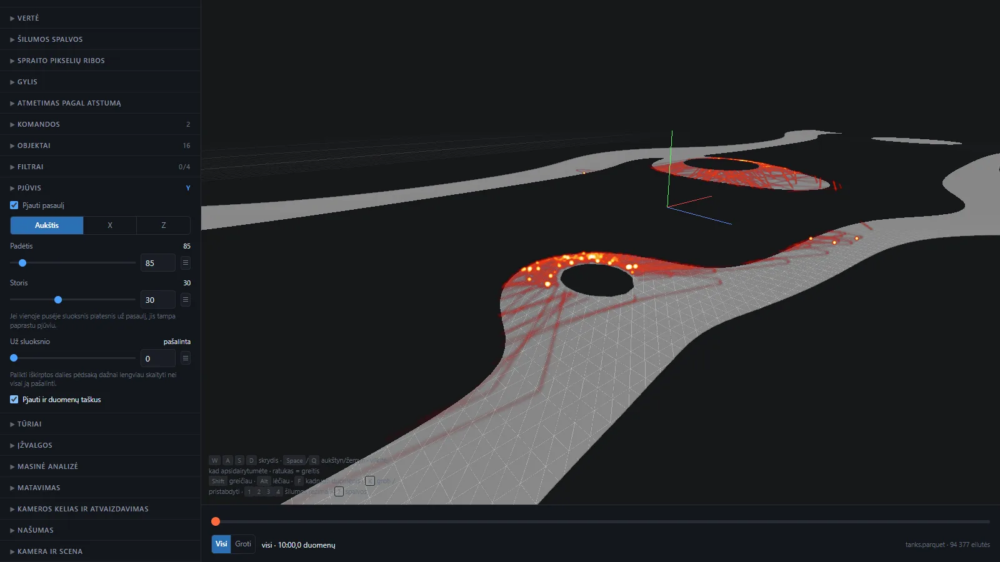

# Pjūvis

**Pjūvis** supjausto pasaulį kaip pyrago gabalą, kad galėtumėte pažiūrėti į pastatų vidų. Naudokite, kai sienos slepia įdomią šilumą, pavyzdžiui, norėdami pamatyti vieną pastato aukštą.

## Išbandykite {#try-it}

1. Įkelkite lygį ir kai kuriuos duomenis, tada atidarykite **Pjūvis**.
2. Pažymėkite **Pjauti pasaulį**. Ašis – **Aukštis**.
3. Tempkite **Padėtis** aukštyn ir žemyn: sluoksnis juda per lygį.
4. Padarykite **Storis** plonus – gausite aukšto planą, arba platų – „viskas žemiau šio“.
5. Palikite **Už sluoksnio** 0, kad pašalintumėte likusią dalį, arba pakelkite, kad liktų silpnas pėdsakas.



Sluoksnis pjauja **lygio geometriją ir duomenų taškus kartu** – vien lygį pjaunant, šiluma liktų kabėti ten, kur buvo pastatas. Tai [gylio užslėpimo](depth-and-culling.md) atitikmuo: kai lygis teisingai slepia, kas už jo, slepiamas ir pastato vidus. Skydelis rodomas, kai yra ką pjauti (duomenų rinkinys arba 3D lygis); jo antraštėje, kol jungta, rodoma ašis, kitu atveju – *išjungta*.

```
šoninis vaizdas   Padėtis = kur yra sluoksnis
 ----------       Storis = koks aukštas sluoksnis
 | 3 aukštas |
 |=========|  <--- sluoksnis (paliekamas)
 | 2 aukštas |  <--- išorėje: pašalinama (arba silpna)
 | 1 aukštas |
 ----------
```

## Valdikliai {#controls}

| Valdiklis | Numatytoji reikšmė | Reikšmė |
|---|---|---|
| **Pjauti pasaulį** | išjungta | Įjungia sluoksnį. Kol padėtis dar pradinė 0, o storis pradinis 500, įjungus jie perkeliami į ašies vidurį ir 15 % jos ilgio. |
| Ašis | **Aukštis** | *Aukštis* (Y), *X* arba *Z*. Pakeitus ašį, sluoksnis perkeliamas į naujos ašies vidurį. |
| **Padėtis** | vidurys | Sluoksnio centras pasaulio vienetais, per ašies ilgį (500 žingsnių). |
| **Storis** | 15 % ilgio | Nuo 1/500 ilgio iki dvigubo ilgio, logaritminiais žingsniais. Kai jis toks platus kaip ilgis, rodoma *už pasaulio ribų*: tada viena pusė pasiekia už pasaulio ir tai yra paprastas pjūvis, o ne sluoksnis. |
| **Už sluoksnio** | 0, *pašalinta* | Kiek to, kas yra išorėje, lieka matoma, 0–100 %. Silpnas pėdsakas to, kas nupjauta, dažnai lengviau skaitomas nei visiškai pašalinimas. |
| **Pjauti ir duomenų taškus** | įjungta | Išjungus šilumą palieka sveiką, todėl ji matosi per pjūvį – naudinga matyti, kas yra virš ir žemiau sluoksnio. |

Ašies ilgis yra 3D lygio ilgis, kai jis įkeltas; kitu atveju – duomenų rinkinio ilgis.

Pjūvis nepriklauso nuo [atstumo atrinkimo](depth-and-culling.md#distance-culling), kuris pjauna palei žiūros kryptį, o ne pasaulio ašį; abu sudaromi kartu. Pakeitus bet kurį pjūvio nustatymą, šilumos kaupimas paleidžiamas iš naujo.

## Kūrėjams {#for-developers}

Sluoksnis tikrinamas kiekvienos eilutės pasaulio padėčiai viršūnių šešėliavime: eilutės, esančios už jo, indėlis dauginamas iš *Už sluoksnio* reikšmės, todėl esant 0 ji atmetama dar prieš piešiant bet kurį fragmentą. Lygio šešėliavimo programos tą patį patikrinimą taiko kiekvienam žemės, konstrukcijų ir vandens fragmentui.
