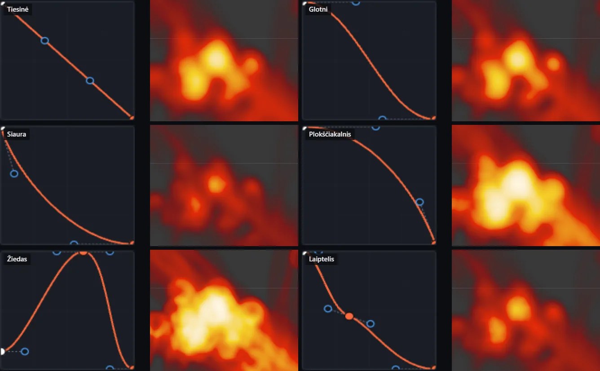

# Spraito forma

Kiekviena eilutė piešiama kaip apvalus spraitas, visada atsuktas į kamerą. Jo dydis ir profilis nuo centro iki krašto – **skalė** – lemia, ar karštas taškas atrodo kaip ryškus taškas, minkštas debesis, diskas ar žiedas. Šie valdikliai yra šoninės juostos skyriuose **Šilumos forma** ir **Spraito pikselių ribos** ir taikomi [Šilumai](heat.md), [Skirtumui](difference.md), [Komandų šilumai](team-heat.md) ir, kaip linijos pusplotis, [Linijų šilumai](line-heat.md).

Keičiant bet kurį iš jų, kaupimas paleidžiamas iš naujo (lauką reikia perpiešti su nauja forma).

Įsivaizduokite kiekvieną tašką kaip minkštą šviesos dėmę. Maža dėmė rodo pavienes vietas; didelė dėmė sujungia kaimynus į debesį. Forma lemia, koks minkštas yra kraštas.



## Spraito spindulys {#sprite-radius}

Spraito spindulys **pasaulio vienetais** (pažymėtais metrais). Numatytoji reikšmė 6; kiekvieno įkėlimo metu – duomenų horizontalus plotis / 120, kad būtų pakankamai didelis, jog gretimi mėginiai palei kelią susilietų į juostą, o ne atrodytų kaip plauko linija. Logaritminis slankiklis 0,05–2000, rankenėlė gali eiti iki 50 000.


Toli esantys dalykai atrodo mažesni, todėl spraitas ekrane mažėja su atstumu. Lygiagrečioje projekcijoje jis visur vienodas, ir dėl to lygiagreti peržiūra tinka karštoms vietoms palyginti ([Kamera](camera.md#projection)).

## Pikselių ribos {#pixel-clamps}

**Spraito pikselių ribos** (numatyta uždaryta) riboja spindulį ekrane po aukščiau aprašyto perskaičiavimo.

| Valdiklis | Numatytoji | Intervalas (vilkimas) | Kodėl |
|---|---|---|---|
| **Mažiausias pikselių spindulys** | 1 px | 0–16 (512) | Nedaro, kad tolimi duomenys dingtų mažiau nei vieno pikselio. |
| **Didžiausias pikselių spindulys** | 96 px | 2–1024, logaritminis (8192) | Perpiešimo apsauga. Spraitas, dengiantis N pikselių, kainuoja N maišymo operacijų, todėl neribotas spindulys arti kameros paverčia greitą kadrą lėtu. Viršijus rodinio aukštį, ribojimo nebetaikoma. |

**Vienodas tankis bet kokiu mastu** (skyrius Šilumos forma, numatyta įjungta) veikia kartu su ribomis. Spraitas, kurį riba padaro didesnį (toli) arba mažesnį (arti), išlaiko tokį šilumos kiekį, kokį pridėtų jo tikrasis dydis, todėl spalva reiškia tą patį eilučių skaičių ploto vienetui bet kokiu mastu. Kai tai išjungta, ribojamas spraitas prideda visą savo svorį ribotu dydžiu, ir vaizdas keičiasi, kai skrendate arčiau.

## Centro ir krašto intensyvumas {#centre-and-edge-intensity}

Šiluma, kurią spraitas prideda tiksliame centre (**Intensyvumas centre**, numatyta 1, 0–10, vilkimas 1000) ir krašte (**Intensyvumas krašte**, numatyta 0, nuo -2 iki 10, vilkimas 1000). Skalės reikšmė *t* (1 centre, 0 krašte, formuojama nuslopimo ar kreivės) sumaišo tarp jų (formulė yra [Kūrėjams](#for-developers) skyriuje).

**Neigiamas krašto intensyvumas** verčia kraštą atimti, o tai išraižo vėsią aureolę aplink kiekvieną karštą vietą ir paryškina klasterius vieną nuo kito. Matomumas apima [užslėpimą](depth-and-culling.md) ir [pjūvį](slice.md); išblukimas yra [Gyvavimo trukmės](timeline.md#history) išblukimas; ženklas yra ±1 režime [Skirtumas](difference.md).

## Skalės forma: Nuslopimas arba Kreivė {#ramp-shape-falloff-or-curve}

**Skalės forma** perjungia du būdus, kaip formuoti *t* per visą spraitą. Kai *d* yra atstumas nuo centro (0) iki krašto (1):

### Nuslopimas {#falloff}

Rodoma, kai pasirinktas *Nuslopimas* (numatytasis).

- **Nuslopimas** (numatyta 1,6, 0,1–8, vilkimas 64): `t = (1 - d) ^ nuslopimas`. 1 yra tiesi tiesinė skalė; didesnė reikšmė traukia šilumą į centrą ir sutankina karštą vietą; mažesnė nei 1 ją išlygina į diską.
- **Glotni skalė** (numatyta įjungta): taiko *t* smoothstep S kreivę, todėl spraitas krašte išnyksta, o ne baigiasi matomu kraštu.

### Kreivės redaktorius {#the-curve-editor}

Rodoma, kai pasirinkta *Kreivė*. Tai tiesioginis spraito skerspjūvis: atstumas nuo centro per visą plotį (*centras* kairėje, *kraštas* dešinėje), šiluma aukštyn. Kreivė yra gabalais tiesi kubinė Bézier kreivė per kontrolinius taškus, kiekvienas su dviem rankenėlėmis.

| Veiksmas | Poveikis |
|---|---|
| Dvigubas spustelėjimas ant grafiko | Prideda tašką tame atstumu (laikomas tarp 0,02 ir 0,98), ant kreivės ir su jos nuolydžiu tame taške, todėl jį pridėjus nieko nepasikeičia, kol jo nevilksite. |
| Vilkti tašką | Perkelia jį. Aukščiai laikomi tarp 0 ir 1. |
| Vilkti mažą apskritimą | Sulenkia šalia esantį segmentą (perkelia tą rankenėlę). |
| Alt-spustelėjimas arba dešinysis spustelėjimas ant taško | Pašalina jį. Dviejų galinių taškų pašalinti negalima. |
| Išankstinio nustatymo mygtukas | Pakeičia kreivę išankstiniu nustatymu. |

Galiniai taškai fiksuoti centre ir krašte; jų aukštis vis tiek jūsų.

**Išankstiniai nustatymai** ([`curve.ts`](https://github.com/Holdi601/3DHeat/blob/main/src/state/curve.ts)):

| Nustatymas | Forma | Kam naudoti |
|---|---|---|
| **Tiesinė** | Tiesi nuo 1 iki 0 | Tapati *Nuslopimui* 1 su išjungta *Glotnia skale*. |
| **Glotni** | S kreivė | Numatytoji kreivė; ką *Glotni skalė* duoda esant nuslopimui 1. |
| **Siaura** | Stati šerdis, ilgas silpnas kraštas | Reti duomenys. |
| **Plokščiakalnis** | Lygi, paskui greitai nusileidžianti | Atrodo kaip diskas, o ne kaip dėmė. |
| **Žiedas** | 0,15 centre, 1 prie 62 % spindulio, 0 krašte | Tuščiaviduris spraitas: rodo, kur keliai praeina, o ne kur sustoja. |
| **Laiptelis** | Dvejopas nuslopimas, 0,45 prie 35 % | Atskiria tankią šerdį nuo aplinkos. |

## Nuspausti į žemės plokštumą {#flatten-onto-ground-plane}

**Nuspausti į žemės plokštumą** (numatyta išjungta) ignoruoja kiekvienos eilutės aukštį ir piešia visą šilumą viename aukštyje – žemiausia duomenų rinkinio Y – klasikinis 2D žemėlapio šilumos žemėlapis. Kai tai įjungta, gylio užslėpimas ir *Slėpti už reljefo* išjungiami (kiekvienas taškas būtų tiksliai ant paviršiaus, su kuriuo lyginamas), ir skyrius Gylis tai nurodo.

## Kūrėjams {#for-developers}

### Formulės {#formulas}

Spindulys ekrane pikseliais: `spindulys × P[1][1] / w × rodinio aukštis / 2`, kur `P` yra projekcijos matrica, o `w` yra taško vaizdo gylis.

Šiluma, kurią prideda spraitas:

```
pridėta šiluma = mix(kraštas, centras, t) × mėginio svoris × ženklas × išblukimas × matomumas
```

### Kreivė {#the-curve}

Rankenėlės horizontaliai suspaudžiamos į savo segmentą, todėl kreivė visada yra atstumo funkcija: jei rankenėlę nutempiate toli už kito taško, ji išsilygina prie jo, o ne sulanksto kreivę atgal, nes tada rezultatas priklausytų nuo to, kurią šaknį sprendiklis atrado.

### Kaip piešiama kreivė {#how-the-curve-is-drawn}

Kreivė įdedama į 256 įrašų lentelę kiekvieną kartą, kai ji pasikeičia, įkeliama kaip 16 bitų slankiojo kablelio tekstūra ir nuskaitoma kiekviename fragmente su tiesine filtracija ir pusės tekselio įtraukimu, kad abu galai liktų tikslūs. Bézier kreivės sprendimas x atžvilgiu reikalauja iteracijos, o tai nevietoje programos karščiausiame šešėliuotojuje; be to, lentelės nuskaitymas pigesnis nei `pow()`, kurį naudoja nuslopimas. 16 bitų, o ne 8 bitų, nes 8 bitai rodo juostas, kai susumuojami tūkstančiai spraitų; 16 bitų pusiau tikslumo slankiojo kablelio yra filtruojamas pagrindiniame WebGL2, o 32 bitams reikia plėtinio.
