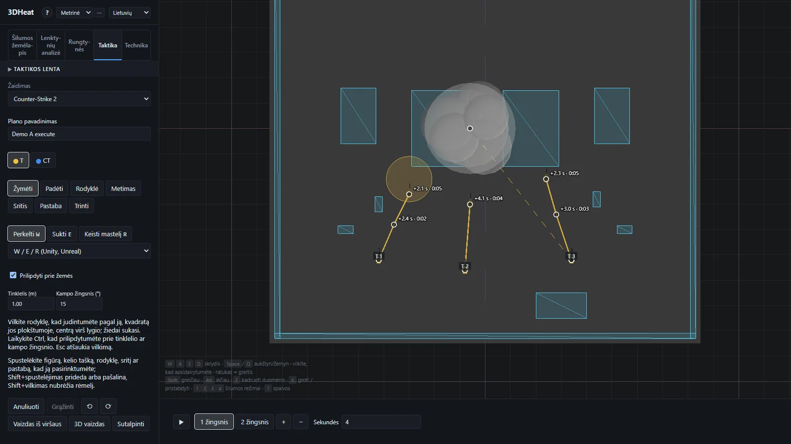

# Taktikos lenta

Skirtukas **Taktika** yra piešimo lenta komandos planui: žemėlapyje dedate figūrėles,
piešiate rodykles, kur jos turi eiti, ir spaudžiate paleidimą, kad pamatytumėte, kaip tai
vyktų. Naudokite jį kierui ar atakai suplanuoti prieš žaidžiant. Jis dalijasi drobe, kamera ir
[lygiu](levels.md) su kitais skirtukais ir nieko daugiau; planas nėra duomenys ir nepiešia
šilumos.

## Jūsų pirmas planas {#your-first-plan}

1. Atidarykite skirtuką **Taktika**. Pasirinkite **Žaidimas** (pavyzdžiui, Counter-Strike 2), o
   Valorant atveju spauskite **Įkelti Valorant žemėlapius** ir pasirinkite **Žemėlapis**. Arba
   pirmiausia įkelkite [lygį](levels.md).
2. Pasirinkite **Pusė** (ji nustato spalvą) ir spauskite **Vaizdas iš viršaus**.
3. Pasirinkite **Vieta**, **Figūros** sąraše pasirinkite figūrą (naudokite **Ieškoti figūrų**, kad ją
   rastumėte) ir spustelėkite žemėlapį. Padėkite dvi ar tris.
4. Pasirinkite **Rodyklė**, spustelėkite figūrą, spustelėkite išilgai kelio, kuriuo ji turėtų eiti, ir
   spauskite **Enter**, kad užbaigtumėte rodyklę.
5. Spauskite **+** po vaizdu, kad pridėtumėte 2 žingsnį. Kiekviena figūra prasideda ten, kur baigėsi
   jos rodyklė. Ten nubrėžkite daugiau rodyklių.
6. Spauskite **▶** (arba `K`), kad paleistumėte planą nuo rodomo žingsnio iki galo.
7. Pavadinkite planą lauke **Plano pavadinimas** ir spauskite **Įrašyti**.

## Plano pradžia {#starting-a-plan}

| Valdiklis | Ką daro |
|---|---|
| **Žaidimas** | Parenka puses ir figūras, kurias siūlo paletė: Counter-Strike 2 (T, CT; žaidėjai ir pagalbinės priemonės), Valorant (Attack, Defense; žaidėjai ir bendri gebėjimai), Battlefield, Squad, Arma (pėstininkai, sausumos transporto priemonės, orlaiviai, laivai), DCS / War Thunder / IL-2 (reaktyviniai, sraigtiniai lėktuvai, sraigtasparniai, oro gynyba, sausuma, laivai, ginklai) ir Kita. Planas, kuriame jau yra figūrų, pakeitus žaidimą išlaiko savo puses. |
| **Plano pavadinimas** | Pavadinimas, pagal kurį plane įrašomas. |
| **Žemėlapis**, **Įkelti Valorant žemėlapius** | Pasirinkus Valorant: **Įkelti Valorant žemėlapius** gauna žemėlapių sąrašą iš [valorant-api.com](https://valorant-api.com); **Žemėlapis** tada padeda pasirinkto žemėlapio mini žemėlapį kaip lygį, įrėmintą iš viršaus. Paveikslėlis parsisiunčiamas pasirinkus ir niekada nesiunčiamas kartu su programa. Riot pranešimas rodomas, kol jis matomas ekrane (žr. žemiau). |
| **Pusė** | Pusė, kuriai priklauso kita figūra, rodyklė ar sritis; ji įgauna tos pusės spalvą. |

Be lygio lenta yra plokščias žemės paviršius. Norėdami planuoti tikrame žemėlapyje, įkelkite lygį
skiltyje **Lygis**: CS2 žemėlapį, eksportuotą CS2 įrankiu, lygį iš bibliotekos arba žemėlapio
paveikslėlį.

## Įrankiai {#tools}

| Įrankis | Spustelėjimas | Pastabos |
|---|---|---|
| **Žymėti** | Figūra, tarpinis taškas, rodyklė, sritis ar pastaba pažymi ją. | Shift+spustelėjimas prideda arba pašalina; Shift+vilkimas nubrėžia stačiakampį aplink tai, ką pridėti. Pažymėtai figūrai atsiranda transformacijos įrankis (žr. žemiau); `Delete` arba `Backspace` ją pašalina. `M` perkelia pažymėtą figūrą iki kito spustelėjimo. |
| **Vieta** | Padeda pasirinktą figūrą. | Figūra pasirenkama **Figūros** paletėje (su **Ieškoti figūrų**). Kai nieko nepažymėta, `R` pasuka kitą figūrą 15° prieš ją padedant (`Shift+R` - kita kryptimi). |
| **Rodyklė** | Kiekvienas spustelėjimas prideda tašką; Enter, dukart spustelėjimas ar dešinysis spustelėjimas ją užbaigia, Esc - atmeta. | **Perkelti**, **Ataka** (platesnė galvutė) arba **Stebėjimas** (plona linija akių aukštyje). Rodyklė, pradėta ant figūros, yra tos figūros maršrutas šiame žingsnyje: paleidus figūra juo eina, o kitas žingsnis prasideda ten, kur jis baigėsi. |
| **Metimas** | Metėjas, tada kur nukrinta. | Brūkšninis lankas iš vieno į kitą, o pasirinkta priemonė (dūmai, blyksnis, molotovas, ...) atsiranda ten, kur nukrito, ir lieka nuo šio žingsnio. |
| **Sritis** | Centras, tada kraštas. | Diskas tos pusės spalva. |
| **Pastaba** | Kur eina pastaba; prašo jos teksto. | Rodoma kaip smeigtukas, o virš jo - tekstas. |
| **Trinti** | Figūrą, rodyklę, sritį ar pastabą. | Pašalina ją nuo šio žingsnio; jei tai pirmas jos žingsnis - pašalina visiškai. |

**Anuliuoti** ir **Grąžinti** (`Ctrl+Z`; `Ctrl+Y` arba `Ctrl+Shift+Z`) žengia per kiekvieną pakeitimą. Linija
po planu rodo, kiek figūrų, rodyklių ir žingsnių jis turi. **Vaizdas iš viršaus** žiūri tiesiai žemyn
(ortografinis), **3D vaizdas** grąžina perspektyvą, **Kadras** pritaiko planą, o kai planas tuščias - lygį.

**Figūrų dydis** keičia visų lentos figūrų mastelį; 1× yra tikras dydis, kuris iš labai aukštai yra kelių
taškų žmogus.

## Perkėlimas, sukimas ir keitimas mastelį {#moving-turning-and-scaling}

Viską lentoje galima perkelti kaip 3D redaktoriuje: figūras, priemones, žymeklius, atskirus tarpinius
taškus ir visas rodykles, sritis bei pastabas. Pažymėtas daiktas gauna įrankį savo viduryje:

| Režimas | Klavišai | Rankenėlės |
|---|---|---|
| **Perkelti** | W (arba G) | Rodyklė kiekvienai ašiai (X raudona, Y žalia ir aukštyn, Z mėlyna) juda išilgai jos; kvadratas juda savo plokštumoje; centras juda per lygį po žymekliu. |
| **Sukti** | E (arba R) | Žiedas kiekvienai ašiai sukasi apie ją. Vienos figūros žiedai yra jos pačios posūkis, linktelėjimas ir ripavimas; grupė sukasi apie pasaulio ašis aplink savo vidurį. |
| **Keisti mastelį** | R (arba S) | Išskleidžia arba sutraukia pasirinkimą nuo savo vidurio išilgai ašies arba visomis kryptimis; sritis spindulys auga kartu. |

**Raktai** perjungia W / E / R (Unity, Unreal) ir G / R / S (Blender) klavišus; klavišai parenka režimą tik
tada, kai kažkas pažymėta, o kitu atveju skraido kamera. Taigi `R` reiškia **Keisti mastelį** su W / E / R
klavišais ir **Sukti** su G / R / S klavišais, kai kažkas pažymėta, ir pasuka kitą figūrą, kurią reikia
padėti, kai nieko nepažymėta. Visi lentos klavišai išvardyti [klavišų žinyne](keyboard-reference.md#tactics-board).
Vilkdami laikykite **Ctrl**, kad perkėlimas prisitrauktų prie **Tinklelio** (metrai), o posūkis - prie
**Kampo žingsnio**. **Prilipdyti prie žemės** (pagal nutylėjimą įjungta) perkeltus žmones, transporto
priemones, žymeklius, tarpinius taškus ir sritis deda ant lygio paviršiaus; orlaiviai ir sraigtasparniai
išlaiko aukštį, o vilkimas išilgai Y rodyklės niekada neprisitraukia. Vilkimas per rankenėlę niekada
nejudina kameros. **Esc** nutraukia vilkimą, o kiekvienas pakeitimas yra vienas Anuliavimo žingsnis.

Tarpiniai taškai rodomi kaip taškai rodomo žingsnio rodyklėse: spustelėkite vieną, kad jį pažymėtumėte,
vilkite, kad perkeltumėte, Delete, kad pašalintumėte. Skiltyje **Pasirinkti** rodoma pasirinkimo vieta metrais,
figūros posūkis, linktelėjimas ir ripavimas laipsniais bei srities spindulys, kiekvienas įvedamas ranka.

## Laikas {#timing}

Figūros maršrutas yra laiku matuojamas: kiekvienas atkarpos ruožas trunka tiek, kiek jo ilgis per lygį -
matuojamas paviršiuje kas porą metrų, todėl kalva ar laiptai tarp dviejų taškų skaičiuojami - pagal tos
figūros judėjimo **režimo** greitį tame žaidime, pridėjus bet kokį **laukimą** tarpiniame taške. Pėstininkai
šliaužia, tupi, eina (tyliai), bėga ar sprintina; transporto priemonės ir laivai šliaužia, važiuoja atsargiai,
įprastai ar skubiai; orlaiviai ir sraigtasparniai skrenda lėtai, kreiserine, kovine ar maksimalia sparta. Režimas,
kurio žaidime nėra (CS2 nėra sprinto), pakeičiamas artimiausiu turimu. Kaip nuokalnė lėtina, priklauso nuo žaidimo:
CS2 ir Valorant skaičiuojamas tik horizontalus atstumas, kaip žaidimuose; karinės simuliacijos pėstininkus lėtina
įkalnėje (Tobler'io pėsčiųjų funkcija), o transporto priemones - pagal nuolydį.

Greičiai ateina iš kiekvieno žaidimo lentelių su jų šaltiniais (žr. [Judėjimo greičiai](tactics-speeds.md)): CS2 - pagal
laikomą ginklą, iš žaidimo ginklų aprašų; Valorant - pagal ginklą; Battlefield, Squad, Arma ir oro žaidimai - pagal
transporto priemonės tipą ir klasę. **Juda kaip** parenka figūros profilį (ginklą, transporto priemonės tipą);
**Savas (m/s)** perrašo bet kurį režimą tai figūrai. Režimai pavadinti taip, kaip lentoje: *Šliaužti*, *Tupėti*,
*Eiti (tyliai)*, *Bėgti*, *Sprintinti*; *Atsargiai*, *Įprastai*, *Skubiai*; *Lėtai*, *Kreiserine*, *Kovine*, *Maksimaliai*.

Kiekvienas tarpinis taškas rodo laiką nuo paskutinio ir laiką nuo plano pradžios („+3,9 s · 0:12"). Pažymėtos
figūros maršrutas išvardija kiekvieną atkarpą su jos režimu, ilgiu ir laiku, laukimą bei atvykimą. Skiltyje
**Atvykimai** po **Laikas** kiekviena maršrutinė figūra dedama į vieną laiko liniją, pirmas atvykimas viršuje. Su
**Leisti realiuoju laiku** (pagal nutylėjimą įjungta) žingsnis trunka tol, kol atvyksta lėčiausias maršrutas, o
kiekviena figūra juda savo greičiu; **Sekundės** tada yra mažiausias žingsnio ilgis. **Lygio vienetų metre**
nurodo, kuo lygis yra: 39,37 CS2 žemėlapiams (žaidimo vienetai), 1 metrų žemėlapiams.

## Palyginimas su rungtynių duomenimis {#compare-with-match-data}

**Įkelti rungtynių failus…** nuskaito žemėlapio CS2 rungtynių lenteles (CS2 įrankio Parquet failus, kiek norite;
tik reikalingus stulpelius, fone); **Naudoti įkeltus duomenis** paima peržiūroje įkeltus duomenis. Tada:

- **Anksčiausias atvykimas žemėlapyje** nudažo žemėlapį pagal laiką nuo raundo pradžios, per kurį žaidėjas pirmą
  kartą pasiekė kiekvieną vietą - mygtukas **Greičiausias** rodo greičiausią per visus raundus, **Tipinis (mediana)** -
  vidurinį raundą - nuo žalios anksti iki raudonos vėlai, vienai ar abiem pusėms. Tai parodo, kas įmanoma kada.
- Pažymėtas maršrutas lyginamas su tuo, ką žaidėjai pasiekė nuo jo pradžios (ar nuo raundo pradžios) iki jo galo,
  kiekvienas galas - diskas nustatytu spinduliu: „Greičiausias stebėtas 14,2 s, p10 15,0 s, mediana 18,3 s per 41
  bandymą; jūsų planas 15,1 s".
- Greičiai, kuriais žaidėjai tikrai judėjo - bėgimo, ėjimo, tupėjimo, iš lentelių ėjimo ir tupėjimo stulpelių - m/s.

## Žingsniai {#steps}

Juosta po vaizdu laiko žingsnius. Planas prasideda vienu; **+** pridedamas vienas, ir kiekviena figūra jame prasideda
ten, kur baigėsi jos maršrutas paskutiniame žingsnyje; **−** pašalina rodomą. **Sekundės** yra, kiek trunka rodomas
žingsnis paleidus. **▶** (K) paleidžia nuo rodomo žingsnio iki galo: figūros su maršrutu eina juo, figūros, perkeltos į
naują vietą kitame žingsnyje, nuslysta ten, likusios stovi. Kol rodomas žingsnis, kiekvienos figūros vieta kitame
žingsnyje nubrėžiama blyškiu šešėliu, o paskutinio žingsnio rodyklės blyškiai matomos po šio žingsnio rodyklėmis.

## Įrašymas {#saving}

Skiltyje **Failas** yra **Įrašyti**, **Atidaryti** ir **Trinti**. **Įrašyti** išsaugo planą kaip `<pavadinimas>.h3dplan.json`
(paprastas JSON: pusės, žingsniai, figūros su vieta kiekviename žingsnyje, rodyklės, sritys, pastabos); **Atidaryti**
nuskaito vieną atgal. Kito versijos failas arba failas, kuris nėra planas, atmetamas nurodant priežastį. **Trinti**
išvalo planą; Anuliuoti jį grąžina.

## Figūros {#figures}

Kiekvieną figūrą sukuria pati peržiūra: paprastos formos pagal paskelbtą tipo dydį, su savybėmis, kurios ją atskiria
nuo kaimynių - tanko kelio ratai ir bokštelis, oro gynybos transporto priemonės pabūklai, raketos ir radarai, orlaivio
sparnų planas, uodega ir varikliai, sraigtasparnio sraigtai ir trumpi sparnai. Nieko neimama iš žaidimo. Žaidimo
išrastas dizainas rodomas kaip jo klasės bendroji figūra. Kaip duomenys randa savo figūrą, žr. [Figūros](figures.md#which-figure-a-unit-gets).

## Riot pranešimas {#riots-notice}

Valorant žemėlapiai rodomi pagal Riot Games „Legal Jibber Jabber" politiką, kuri leidžia nemokamiems bendruomenės
projektams jais naudotis ir reikalauja šio pranešimo visur, kur jie pasirodo: *3DHeat sukurta pagal Riot Games „Legal
Jibber Jabber" politiką, naudojant Riot Games priklausančius išteklius. Riot Games nepritaria šiam projektui ir jo
neremia.* Lentoje esantys gebėjimai yra bendros formos, o ne Riot meno kūriniai.

