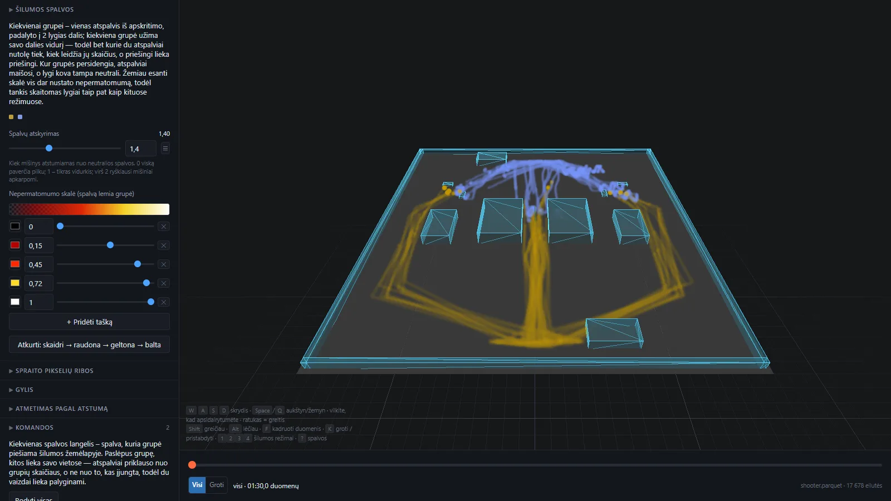

# Komandų šiluma

Komandų šiluma rodo, kur buvo kiekviena komanda, kiekviena – savo spalva. Ten, kur komandos persidengia, spalvos maišosi.

**Komandų šiluma** (klavišas 3) yra [Šilumos](heat.md) tankio laukas, kuriame kiekvienai [grupei](glossary.md) suteiktas savas atspalvis. Ten, kur grupės persidengia, jų atspalviai maišosi; lygi kova išeina neutrali. Nepermatomumas ir toliau nešą tankį taip, kaip ir kituose režimuose, todėl paveikslėlis iš karto atsako ir į *kiek*, ir į *kieno*. Jam reikia grupių stulpelio.

Tai nėra [figūrų sutapdinimas](box-replay.md): jis piešia po vieną figūrą kiekvienam asmeniui, o čia – šilumos lauką, nudažytą pagal tą patį stulpelį.

## Kaip naudoti {#how-to-use-it}

1. Paspauskite `3` (arba pasirinkite **Komandų šiluma** režimų juostoje).
2. Atidarykite **Šilumos spalvos**. Pavyzdėliai rodo kiekvienos grupės spalvą; užveskite pelę ant pavyzdėlio, kad pamatytumėte komandos pavadinimą.
3. Jei viskas atrodo pilka, padidinkite **Spalvų atskyrimas**.
4. Nuimkite grupės žymę [Komandų sąraše](teams-list.md), kad ją pašalintumėte; kitų grupių spalvos lieka savo vietose.

## Valdikliai {#controls}

Skiltyje **Šilumos spalvos**:

| Valdiklis | Numatytoji | Reiškia |
|---|---|---|
| Pavyzdėliai | | Kiekvienos grupės spalva, pirmoms 12 grupių, paskui *+N daugiau*. Užveskite pelę, kad pamatytumėte grupės pavadinimą ir spalvą. |
| **Spalvų atskyrimas** | 1,4 | Kiek mišinys stumiamas nuo neutralios spalvos, 0–4. 0 visa daro pilka; 1 yra tikras vidurkis; daugiau nei maždaug 2 ryškiausi mišiniai išeina už ekrano spalvų ribos ir kiekvienam kanalui apribojami, todėl pasislenka jų atspalvis. |
| **Nepermatomumo skalė (spalvą lemia grupė)** | numatytoji šilumos skalė | Čia naudojamas tik skalės **alfa**: permatoma, kur nieko nėra, neperregima viršuje. Jos spalvos ignoruojamos. |

Visi kiti šilumos valdikliai – forma, įsotinimas, atsakas, mažiausia šiluma, gylis, atrinkimas – veikia kaip [Šilumoje](heat.md).

[Komandų sąrašas](teams-list.md) šiame režime kiekvienos grupės komandų šilumos spalvą rodo kaip jos pavyzdėlį. Paslėpus grupę, kiekvienos kitos grupės spalva lieka savo vietoje: atspalviai priklauso nuo bendro grupių skaičiaus, o ne nuo to, kas įjungta, todėl abu vaizdai lieka palyginami.

## Paletė {#the-palette}

Iš [`colors.ts`](https://github.com/Holdi601/3DHeat/blob/main/src/render/colors.ts):

- Spalvos gyvena **Oklab** spalvų plokštumoje su fiksuotu šviesumu (0,7) ir chroma (0,115), todėl kiekviena grupė vienodai ryški ir raudona grupė neatrodo karštesnė už mėlyną.
- Su *n* grupių atspalvių ratas padalijamas į *n* lygių dalių, o *i*-oji grupė ima savo dalies **centrą**, `(i + 0,5) / n` apsisukimo. Bet kurios dvi grupės yra kuo toliau viena nuo kitos, kiek leidžia skaičius, o priešingybės lieka priešingybėmis, nepriklausomai nuo skaičiaus.
- Naudojama daugiausia **16** skirtingų atspalvių. Su daugiau grupių numeriai išdėstomi kartotiniu dalijimu per pusę (bitais apversti numeriai: 0, ½, ¼, ¾, ⅛, …), kad gretimi numeriai neturėtų to paties atspalvio; grupės už 16 būtinai dalysis.
- Grupė, kurios žymė reiškia „jokios grupės“ – `0`, tuščia, `none`, `unknown`, `null` arba `-1`, nepaisant didžiųjų ir mažųjų raidžių, – piešiama **neutralia pilka** vietoj to, kad užimtų rato dalį. Tokiu būdu traktuojama tik pirmoji tokia žymė grupių sąraše.

Numatytasis atskyrimas yra 1,4, o ne 1, nes esant 1 penkių lygiai išsidėsčiusių atspalvių mišinys *yra* pilkas: teisingai, bet nematoma. Šiek tiek daugiau nei 1 palieka lygius rezultatus sąžiningus, bet padaro 60/40 dalijimą matomą.

## Kaip tai veikia {#how-it-works}

Šiame režime šilumos tikslas turi keturis kanalus. Kiekvienas spraitas prideda savo tankį *v* į pirmą kanalą, o *v* × grupės Oklab koordinates *a* ir *b* – į antrą ir trečią. Sudėties metu pikselio mišinys yra tankiu svertinis vidurkis: *a* = G / R, *b* = B / R, pakeistas pagal spalvų atskyrimą ir paverstas į sRGB paletės šviesumu. Dalijimas iš sukaupto tankio palieka atspalvį nepriklausomą nuo duomenų kiekio, todėl kiekvienas tankio valdiklis veikia tik nepermatomumą.

Keturių kanalų tikslas kainuoja keturis kartus daugiau GPU atminties nei vieno kanalo šilumos tikslas tokia pačia raiška.
