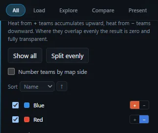

# Komandų sąrašas

Skydelis **Komandos** leidžia paslėpti komandą arba perkelti ją į vieną palyginimo pusę. Naudokite, kad pažiūrėtumėte tik Blue arba paklaustumėte „kur Blue nueina, kur Red nenueina?“.

*Grupė* yra komanda arba pusė, pavyzdžiui, Blue ir Red ([Grupės](sessions-persons-groups.md#group)). Skydelis rodomas, kai duomenų rinkinyje yra grupės stulpelis; grupių skaičius yra jo antraštėje. Komandų šilumos režime šoninėje juostoje taip pat yra skiltis, vadinama **Komandų peržiūra**, su savo nustatymais; šis puslapis aprašo **Komandos** sąrašą.

## Paslėpti komandą {#hide-a-team}

1. Šoninėje juostoje atidarykite **Komandos**.
2. Nuimkite žymėjimą langelyje (*Matoma*) komandai, kurią norite paslėpti. Vaizdas atsinaujina iš karto.
3. Spauskite **Rodyti visas**, kad grąžintumėte visas komandas.

## Kiekviena eilutė {#each-row}

| Dalis | Reikšmė |
|---|---|
| Langelis (*Matoma*) | Rodyti arba slėpti grupę. |
| Atspalvis | Grupės spalva: jos [komandų šilumos](team-heat.md) spalva komandų šilumos režime, pagrindinė spalva kituose režimuose. |
| Pavadinimas | Grupės žymė (pilna žymė užvedus pelę). |
| **+** / **-** (Skirtumo režimas) | Perkelia grupę į teigiamą arba neigiamą [skirtumo](difference.md) pusę; dar kartą spustelėję aktyvų mygtuką, nurodote, kad grupė nei vienoje pusėje. |
| `Np` (kiti režimai) | Asmenų, kurių pirma eilutė yra šioje grupėje, skaičius. |

## Mygtukai {#buttons}

| Mygtukas | Poveikis |
|---|---|
| **Rodyti visas** | Padaro visas grupes vėl matomas. |
| **Padalyti po lygiai** (Skirtumo režimas) | Pirmoji grupių pusė (suapvalinta aukštyn) į +, likusios į -; tas pats padalijimas, nuo kurio pradedama kiekvieną kartą įkeliant. |

## Ką daro grupės paslėpimas {#what-hiding-a-group-does}

- **Šiluma**, **Komandų šiluma** ir **Linijos** režimuose tos grupės eilutės nieko neprideda.
- **Skirtumas** režime paslėpta grupė nieko neprideda, kurioje pusėje ji bebūtų, taip pat esant skaidymui pagal kitą stulpelį (žr. [Skirtumas](difference.md#for-developers)).
- **Figūrų perdangoje** asmenys, kurių pirma eilutė yra toje grupėje, nepiešiami.
- **Komandų šilumoje** kitos grupės išlaiko savo spalvas: atspalviai priskiriami pagal bendrą grupių skaičių, o ne pagal tai, kas matoma, todėl du vaizdai lieka palyginami.

Pakeitus matomumą, kaupimas paleidžiamas iš naujo. Su kiekvienu nauju duomenų rinkiniu kiekviena grupė vėl matoma.

Skydelio patarimas keičiasi pagal režimą: Skirtume jis paaiškina + ir -; Komandų šilumoje – kad atspalviai yra spalvos, kuriomis piešia kiekviena grupė.
