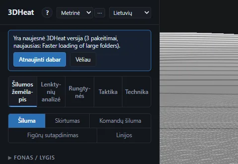

# Atnaujinimai

Peržiūros programa praneša, kai yra naujesnė versija, ir atsinaujina pati tik tada, kai jūs sutinkate. Jūsų kompiuteryje nieko nepakeičiama be jūsų atsakymo.

## Atnaujinkite peržiūros programą {#update-the-viewer}

1. **Puslapyje.** Kai yra naujesnė versija, po pavadinimu šoninės juostos viršuje pasirodo langelis: „Yra naujesnė 3DHeat versija“. Spustelėkite **Atnaujinti dabar**. Baigus puslapis persikrauna pats. **Vėliau** paslepia langelį, kol neperkrausite puslapio.
2. **Jei sakoma paleisti restart.bat**, uždarykite serverio langą (juodą langą, kurį atidarė `start.bat`) ir dukart spustelėkite `restart.bat`.
3. **Paleisdami peržiūros programą.** `start.bat` taip pat tikrina. Jei yra naujesnė versija, klausia **Atnaujinti dabar? [Y/N]**. Paspauskite `Y`, kad atnaujintumėte. Paspauskite `N` arba palaukite 60 sekundžių be atsakymo, kad paleistumėte turimą versiją.



Kopijos su jūsų pačių pakeitimais niekada neatnaujinamos automatiškai; langelis tik praneša, kad laukia atnaujinimas, ir sako įrašyti arba paslėpti pakeitimus ir paleisti `git pull`. Kopija, neįdiegta su git (pavyzdžiui, zip failas), nieko nerodo.

Kaip vyksta tikrinimas, žingsnis po žingsnio:

```
puslapis ---(po 4 s, paskui kas 6 val.)---> kūrimo serveris ---> git fetch
   atsilikusi?  ne  -> nieko nerodoma
                taip -> jūsų pakeitimai ar įrašai?  taip -> tik praneša
                                                  ne  -> [Atnaujinti dabar] -> git pull
                                                        -> perkrovimas arba „paleiskite restart.bat“
```

## Saugos taisyklės {#the-safety-rules}

- **Tik greitas perkėlimas** (`git pull --ff-only`): atnaujinimas niekada nejungia, neperkelia ir nepersirašo nieko.
- **Jokių vietinių pakeitimų**: kopija su neįrašytais stebimų failų pakeitimais (`git status --porcelain --untracked-files=no` ne tuščias) niekada neatnaujinama automatiškai – kieno nors darbo atnaujinimas neturi teisės perrašyti. Ji tik praneša, kad laukia atnaujinimas. Nestebimi failai (duomenys, eksportai) pakeitimais nelaikomi.
- **Jokių vietinių įrašų**: kopija su įrašais, kurių nėra aukštesniame šaltinyje („išsiskyrusi“), neatnaujinama – greitas perkėlimas jos nepakels, o sujungimas yra `git pull` rankiniu būdu. Puslapis ir `start.bat` sako tai tais pačiais žodžiais, o `start.bat` paleidžia turimą versiją.
- **Tik iš pačios svetainės**: kūrimo serverio atnaujinimo užklausa turi turėti tinkintą antraštę ir, kai naršyklė siunčia `Origin`, ateiti iš serverio paties pagrindinio kompiuterio (žemiau).
- Atnaujinama tik git kopija su aukštesniu šakos šaltiniu; viskas kita (kopija be `.git`, nėra git, statinė versija) paliekama ramybėje ir nieko nesako.

## Ką daro start.bat {#what-startbat-does}

`start.bat` (dukart spustelėkite; langas yra serveris) atlieka, eilės tvarka:

1. Randa Node.js – `PATH` kintamajame, kitaip `%ProgramFiles%\nodejs`, `%ProgramFiles(x86)%\nodejs` arba `%LOCALAPPDATA%\Programs\nodejs` – ir, jei jo nėra, siūlo įdiegti su `winget install -e --id OpenJS.NodeJS.LTS` (klausia, Y/N; vėliau langą reikia atidaryti iš naujo, kad Windows perskaitytų naują `PATH`).
2. **Atnaujinimai**, kai įdiegtas git ir aplankas turi `.git`:
   - `git fetch --quiet` (be tinklo arba be aukštesniojo šaltinio: praleidžiama tyliai);
   - skaičiuoja `git rev-list --count HEAD..@{u}`; nėra atsilikimo – nieko nesakoma;
   - vietiniai pakeitimai: „Yra naujesnė 3DHeat versija (N pakeitimų), bet ši kopija turi vietinių pakeitimų, todėl neatnaujinama. Įrašykite arba paslėpkite juos, tada paleiskite git pull.“ – ir paleidžiama turima versija;
   - jos pačios įrašai (`git rev-list --count @{u}..HEAD` ne 0): „Yra naujesnė 3DHeat versija (N pakeitimų), bet ši kopija turi savo įrašų, kurių naujausia versija neturi, todėl neatnaujinama. Atnaujinkite ją su git pull.“ – ir paleidžiama turima versija;
   - kitu atveju „Yra naujesnė 3DHeat versija (N pakeitimų).“ ir klausimas **Atnaujinti dabar? [Y/N]**. `N` arba jokio atsakymo 60 sekundžių – išveda „Neatnaujinta; paleidžiama turima versija.“ ir paleidžiama turima versija. Su `Y`: „Atnaujinama...“, pažymi, ar keičiasi `package.json` arba `package-lock.json`, paleidžia `git pull --ff-only` (jei ir tada nepavyksta – pvz., tinklas: „Atnaujinimas nepavyko; paleidžiama turima versija.“), tada `git submodule update --init` (fiksuoti įrankiai, žr. [Dokumentacijos priežiūra](maintaining.md#the-tools-under-exporters)), tada `npm install`, kai pakeitėsi paketo failai ir `node_modules` egzistuoja, ir „Atnaujinta.“
3. Neleidžia paleisti antro serverio: kai prievadą **5273** jau kas nors klauso, tai pasako ir nukreipia į `restart.bat` / `stop.bat`.
4. Pirmo paleidimo metu (nėra `node_modules`) klausia prieš atsisiunčiant priklausomybes (apie 300 MB į `node_modules\`, nieko visoje sistemoje).
5. Paleidžia kūrimo serverį ant `127.0.0.1:5273` (`--strictPort`) ir, kai jis pasiruošęs, atidaro naršyklę.

`restart.bat` sustabdo serverį (pagal prievadą) ir vėl paleidžia `start.bat`, todėl klausia to paties. `stop.bat` tik sustabdo.

## Kūrėjams {#for-developers}

### Kol veikia: atnaujinimo maršrutas {#while-it-runs-the-update-route}

Kūrimo serveris (Vite įskiepis `heat3d-self-update` faile `vite.config.ts`) teikia `/__heat3d/update` kelią. Jis yra tik kūrimo serveryje – statiniame sukurime ar `vite preview` jo nėra.

**`GET /__heat3d/update`** atsako, ar kopija atsilikusi:

```json
{ "checkout": true, "upstream": "origin/main", "behind": 3, "ahead": 0, "dirty": false, "latest": "the newest commit's subject" }
```

- `checkout: false`, kai aplankas nėra git kopija;
- paleidžia `git fetch --quiet` **ne dažniau kaip kas 30 minučių** (užklausos tarp tų laikų atsako pagal paskutinį atsisiuntimą);
- `behind` / `ahead` iš `git rev-list --count HEAD..@{u}` / `@{u}..HEAD`, `dirty` iš `git status --porcelain --untracked-files=no`, `latest` – aukštesniojo šaltinio naujausio įrašo tema;
- kai nėra aukštesniojo šaltinio šakos, `upstream: null` ir `behind: 0`.

**`POST /__heat3d/update/apply`** atnaujina kopiją:

1. Atmetama su `403 { ok: false, reason: "forbidden" }`, nebent užklausoje yra antraštė `X-Heat3d-Update: 1` ir, kai ji turi `Origin`, tos kilmės pagrindinis kompiuteris sutampa su užklausos `Host`. Tarpsvetainė forma be CORS išankstinio patikrinimo, kurio šis serveris niekada neduoda, negali siųsti tinkintos antraštės.
2. Nėra ką daryti (ne kopija, nėra aukštesniojo šaltinio, nėra atsilikimo): `{ ok: true, updated: false }`.
3. Vietiniai pakeitimai: `{ ok: false, reason: "dirty" }`; vietiniai įrašai: `{ ok: false, reason: "diverged" }`.
4. Kitaip: pažymi keičiamus failus (`git diff --name-only HEAD @{u}`), vykdo `git pull --ff-only` (2 min. laiko limitas), `git submodule update --init` (klaida ignoruojama), `npm install`, kai pasikeitė `package.json` ar `package-lock.json` (15 min. laiko limitas), ir atsako `{ ok: true, updated: true, restart }`. `restart` nurodo, kodėl veikiantis serveris negali pritaikyti atnaujinimo: `"dependencies"`, kai priklausomybės buvo iš naujo įdiegtos, `"config"`, kai pasikeitė tik `vite.config` failas, `false`, kai perkrauti nereikia.
5. Nepavykusi git ar npm komanda atsako `{ ok: false, reason: "<klaida, iki 300 simbolių>" }`.

Atsakymai yra JSON su `Cache-Control: no-store`. Serveris klauso tik `127.0.0.1`, todėl kelias nepasiekiamas iš tinklo.

### Pranešimas puslapyje {#the-notice-in-the-page}

`UpdateBanner`, po pavadinimu šoninės juostos viršuje:

- Klausia kelio **4 sekundes** po puslapio įkėlimo (ne pirmomis sekundėmis: puslapiui reikia įkelti duomenų rinkinį ir paleisti GPU) ir vėl **kas 6 valandas**, kol puslapis atviras.
- Nieko nerodo, kai nėra tokio kelio (statinis sukurimas), aplankas nėra kopija arba nieko naujesnio nėra – pranešimas kiekvieno paleidimo metu yra tai, ką žmonės išmoksta ignoruoti.
- Atsilikus, be vietinių pakeitimų: „Yra naujesnė 3DHeat versija (N pakeitimų, naujausias: <tema>).“ su **Atnaujinti dabar** ir **Vėliau** (*Vėliau* paslepia, kol puslapis perkraunamas).
- Atsilikus, su vietiniais pakeitimais: ta pati frazė ir „Ši kopija turi vietinių pakeitimų, todėl neatnaujinama automatiškai; įrašykite arba paslėpkite juos, tada paleiskite git pull.“ – mygtuko nėra.
- **Atnaujinti dabar** siunčia į `/apply` („Atnaujinama...“). Tada:
  - „Atnaujinta. Puslapis persikrauna.“ – ir persikrauna po 1,5 s (serveris jau teikia naujus failus);
  - kai priklausomybės buvo iš naujo įdiegtos: „Atnaujinta. Jos priklausomybės pasikeitė: uždarykite serverio langą ir baikite paleisdami **restart.bat**.“;
  - kai pasikeitė tik serverio nustatymai: „Atnaujinta. Serverio nustatymai pasikeitė: uždarykite serverio langą ir baikite paleisdami **restart.bat**.“;
  - galiausiai nieko nėra ką atnešti (`updated: false` – kopiją tuo metu jau atnaujino, pvz., `start.bat`): „Nėra ką atnaujinti: ši kopija jau naujausia versija.“ – ir be perkrovimo;
  - atmesta: *vietinių pakeitimų* sakinys, arba „Ši kopija turi savo įrašų, kurių naujausia versija neturi; atnaujinkite su git pull.“, arba „Atnaujinimas nepavyko: <priežastis>“.
