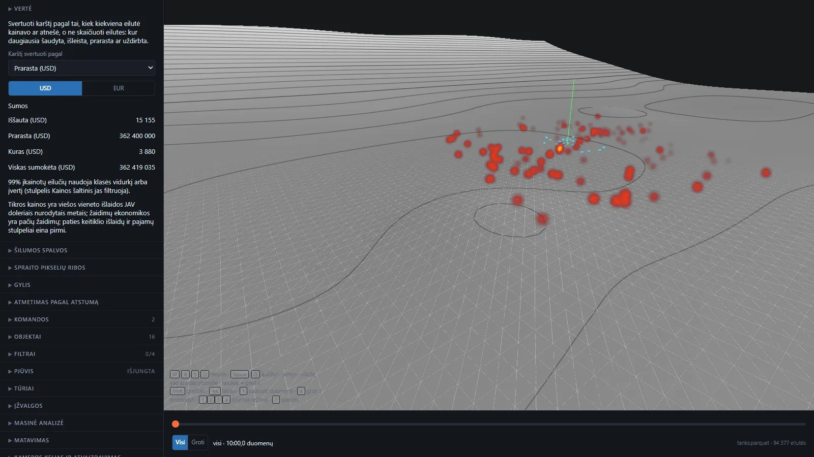

# Vertės svorinimas

Kiekvienas šūvis, amunicija, prarastas automobilis ir litras kuro turi kainą. Peržiūros programa apskaičiuoja, kiek kainavo arba uždirbo kiekviena eilutė, ir gali pagal tai svertinti šilumą, todėl žemėlapis rodo **kur dingo pinigai**, o ne kur yra eilutės.

## Kaip naudoti {#how-to-use-it}

1. Įkelkite duomenis su įvykiais (šūviais, nužudymais, žuvimais) ir automobilių ar ginklų pavadinimais.
2. Šilumos šoninėje juostoje atidarykite **Reikšmė**.
3. Pasirinkite **Karštį svertuoti pagal**, pavyzdžiui, *Prarasta (USD)*. Šiluma dabar prideda kiekvienos eilutės kainą vietoj 1.
4. Pažiūrėkite **Sumos**: visų vertės stulpelių suma tam, kas rodoma (taikomi filtrai ir laiko langas).
5. Kai kainos yra tikri pinigai, atsiranda perjungiklis **USD / EUR**.

Norėdami vėl skaičiuoti eilutes, pasirinkite tuščią pirmą meniu punktą.

## Ką galima svertuoti {#what-can-be-weighed}

Vertės stulpeliai pridedami įkeliant, po vieną kiekvienam tipui ir valiutai:

| Tipas | Eilutės, į kurias jis patenka | Kaip apkainuojama |
|---|---|---|
| **Iššauta** | šūviai ir paleidimai | ginklas, kitu atveju – amunicijos rūšies vidurkis |
| **Išleista** | pirkimas, atsiradimas | žaidimo pinigų stulpeliai (pavyzdžiui, šaudyklės pirkimo meniu) |
| **Prarasta** | mirtys, sunaikinimai | savas automobilis, kitu atveju – jo klasės vidurkis |
| **Sunaikinta** | nužudymai | priešo automobilis |
| **Padaryta žala** | pataikymai | dalis priešo vertės |
| **Kuras** | padėtys | sunaudotas kuras, iš kuro stulpelio arba įvertintas pagal klasę ir laiką |
| **Viskas sumokėta** | | iššauta + išleista + prarasta + kuras |
| **Uždirbta** | atlygiai | paties žaidimo atlygio stulpeliai (`earn_…`) |
| **Grynasis** | | uždirbta atėmus sumokėta; rodoma kaip ženklinta šiluma (teigiama skalė, kur uždirbta daugiau, neigiama, kur sumokėta daugiau) |

Stulpelių pavadinimai yra `cost_<tipas>_<valiuta>`, `earn_<valiuta>` ir `net_<valiuta>`. Konverteris, kuris žino paties žaidimo valiutą (pavyzdžiui, pakartojimo konverteris, rašantis žaidimo kreditais), nugali įmontuotas kainų lenteles.

## Kainų lentelės {#the-price-tables}

| Lentelė | Valiuta |
|---|---|
| Realūs kariniai: raketos, bombos, sviediniai, priešpriemonės, orlaiviai, sraigtasparniai, sausumos automobiliai, laivai, kuras | USD (EUR = USD × 0,92, fiksuotas `EUR_PER_USD` [`cost.ts`](https://github.com/Holdi601/3DHeat/blob/main/src/data/cost.ts) faile; tai nėra gyvas kursas) |
| Šaudyklių pirkimo meniu ir nužudymų atlygiai | žaidimo kreditai |
| Tankų ir laivų žaidimai | žaidimo kreditai |
| Strateginiai žaidimai (keli ištekliai) | po stulpelį kiekvienam ištekliui ir bendras stulpelis |
| Karo žaidimai | taškai |

Žaidimas atpažįstamas pagal duomenų pavadinimus. Realių kainų šaltiniai – viešieji (biudžeto dokumentai, enciklopedijos) arba pažymėti kaip įvertinimai; jos nekoreguojamos dėl infliacijos. Sugeneruotas lentelių sąrašas – [Reikšmių lentelės](ref-value-tables.md).

## Įvertinimai {#estimates}

Papildomas kategorijos stulpelis **Kainos šaltinis** parodo, kaip kiekviena eilutė buvo apkainuota: `table`, `class average`, `estimate` arba `none`. Skiltyje „Reikšmė“ rodoma, kokia dalis apkainuotų eilučių yra vidurkiai arba įvertinimai. Norėdami palikti tik tiksliai apkainuotas eilutes, [Filtruose](filters.md) skiltyje **Kainos šaltinis** išjunkite *estimate* ir *class average*.

## Kur dar rodoma vertė {#where-else-value-shows}

- [Įžvalgos](insights.md): *Brangi žemė* ir *Uždirbanti žemė* išvados.
- [Išskaidymas](breakdown.md): uždirbti, prarasti ir grynieji pinigai pagal komandą, žaidėją arba ginklą.
- [Tūriai](volumes.md): vertės stulpeliai statistikoje ir palyginime.
