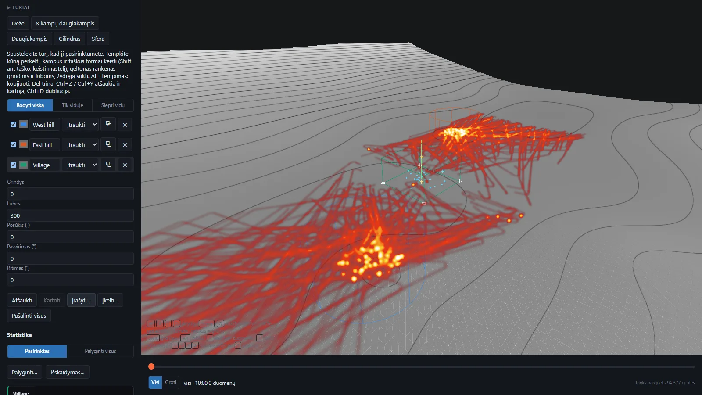
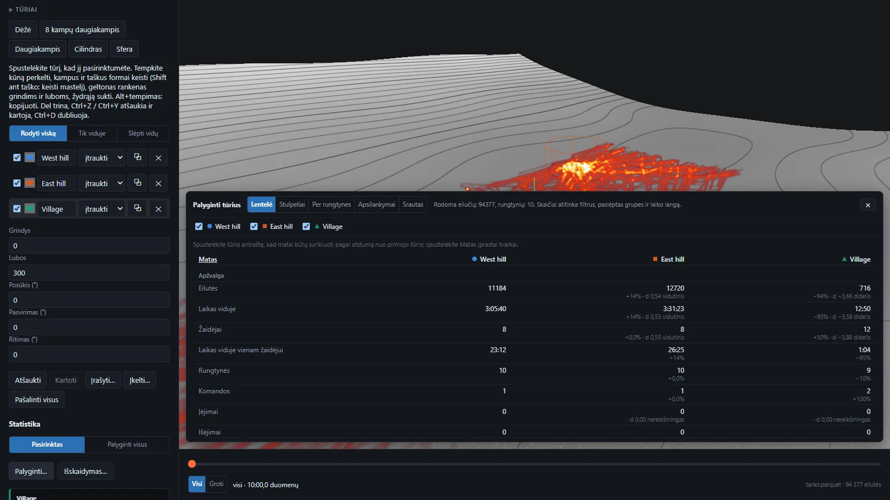
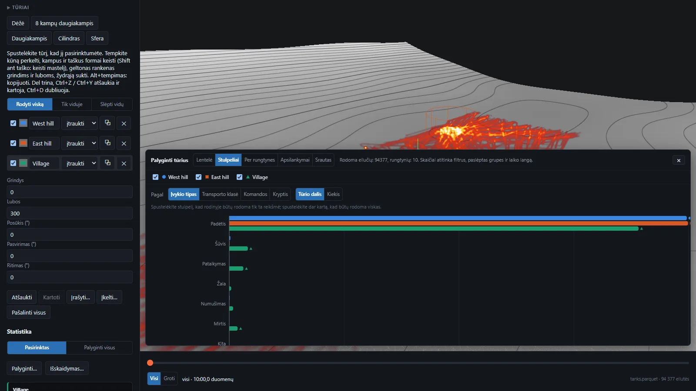

# Tūriai ir palyginimas

**Tūris** yra nematoma dėžė (arba cilindras, arba sfera), kurią braižote aplink vietą, kad paklaustumėte: kas čia įvyko? Naudokite ją, kad suskaičiuotumėte nužudymus prie tilto, palygintumėte dvi kalvas arba parodytumėte tik veiklą vienoje srityje.

```
 top view                 You draw a shape ->  the viewer counts
 +------------+           what is inside:
 |   ( A )    |            rows, players, kills, time ...
 |        [B] |           Compare A with B, side by side.
 +------------+
```



Tūriai matuoja, kas vyksta jų viduje, filtruoja vaizdą pagal juos, eksportuoja jų eilutes ir gali būti lyginami šalia vienas kito. Eilutės, asmens ir rungtynių sąvokos paaiškintos [žodynėlyje](glossary.md).

## Nubrėžkite tūrį {#draw-a-volume}

1. Šoninėje juostoje atidarykite **Tūriai**.
2. Pasirinkite įrankį ir braižykite 3D vaizde arba 2D žemėlapyje. Grindys ir lubos prasideda nuo po jomis esančių duomenų. Esc atšaukia.
3. Spustelėkite tūrį, kad jį pažymėtumėte; atsiranda jo **Statistika**.

| Įrankis | Kaip braižyti |
|---|---|
| **Dėžė** | Tempkite stačiakampį (Shift: kvadratą). Spustelėjimas padeda numatytąją dėžę. |
| **n-kampis** | Tempkite nuo centro (Shift išlaiko taisyklingumą). *Kampai* nustato n nuo 3 iki 64 (numatytoji 8, todėl mygtukas rodo **8-kampis**). |
| **Daugiakampis** | Spustelėkite kampus; užbaikite dvigubu spustelėjimu, Enter arba spustelėdami pirmą kampą. Backspace pašalina paskutinį kampą. |
| **Cilindras** | Tempkite spindulį. |
| **Sfera** | Tempkite spindulį; ji remiasi į žemę. |

## Redaguoti {#edit}

- Spustelėkite tūrį, kad jį pažymėtumėte. Tempkite jo vidurį, kad perkeltumėte, kampus – kad pakeistumėte formą (Shift ant kampo keičia mastelį).
- **Geltonos** rankenėlės nustato grindis ir lubas, **žydra** rankenėlė jį pasuka.
- Alt+tempimas kopijuoja, Del pašalina, Ctrl+Z / Ctrl+Y anuliuoja ir grąžina, Ctrl+D dubliuoja. **Pašalinti visus** ištrina visus tūrius.
- Tikslios reikšmės: Grindys, Lubos, Pasukimas / Posvyris / Riedėjimas (dėžėms), Spindulys (sferoms, cilindrams).

Kiekvienos tūrio eilutės pradžioje yra rodymo žymės langelis, spalva, pavadinimas, **įtraukti** arba **išskirti**, dubliavimas ir trynimas. Tūriai išsaugomi naršyklėje kiekvienam duomenų rinkiniui, o **Įrašyti…** / **Įkelti…** rašo ir skaito `volumes.json` failą.

## Filtruokite vaizdą {#filter-the-view}

| Filtras | Poveikis |
|---|---|
| **Rodyti viską** (numatytasis) | Tūriai tik matuoja. |
| **Tik viduje** | Šiluma, pakartojimas ir [pataikymų analizė](hit-analysis.md) piešia tik tai, kas yra įtrauktų tūrių viduje ir išskirtų tūrių išorėje. |
| **Slėpti vidų** | Priešingai. |

GPU filtras paima iki 8 tūrių su 64 kontūro taškais iš viso; „!“ žymi tūrį, esantį už šios ribos. Statistika ir eksportas jį vis dar skaičiuoja.

## Statistika {#statistics}

Sritis **Statistika** seka filtrus, laiko langą ir paslėptas grupes. *Pasirinktas* rodo pasirinktą tūrį, *Palyginti visus* padeda visus tūrius šalia vienas kito. Ji rodo:

- **Eilutės viduje (rodomos)** ir **Eilutės viduje (visi duomenys)**, **Žaidėjai**, **Komandos**, **Rungtynės**, **Laikas viduje**, **Įėjimai / išėjimai**, **Šilumos pikas**, **Vidutinė šiluma**, **Tūris / pagrindas** ir **Kada** histogramą;
- **Laimėjimų dalis**, kai duomenys sako, kas laimėjo ([rezultato stulpeliai](data-formats.md#outcome-columns)): iš raundų, kuriuose žaidėjas buvo viduje, kiekvieno žaidėjo raundą skaičiuojant vieną kartą, dalis, kurią laimėjo jo pusė - traukiant link viso rodomo dalies 4 raundais, kaip daro [išskaidymas](breakdown.md) - su laimėtais ir sužaistais raundais bei bendra dalimi;
- kiekvienam stulpeliui: kategorijas su **Pakilimas** (dalis viduje, padalyta iš dalies visuose rodomuose duomenyse) ir skaičius su intervalu, mediana ir 5–95 procentiliais.

**Statistika kaip CSV / JSON** ją išsaugo. **Eksportuoti duomenis viduje** įrašo vidinias eilutes kaip CSV arba Parquet (pagal numatytuosius – *Tik rodomos eilutes*), vieną tūrį arba visus, su stulpeliu, nurodančiu, kuriame tūryje yra kiekviena eilutė.

## Palyginkite tūrius {#compare-volumes}

Kai matomi du ar daugiau tūrių, paspauskite **Palyginti…**.

1. Nubrėžkite tris tūrius, pavyzdžiui, Vakarų kalva, Rytų kalva ir Kaimas.
2. Paspauskite **Palyginti…** po Statistika.
3. Skiltyje **Lentelė** skaitykite kiekvienos reikšmės skirtumą nuo pirmo tūrio.
4. Perjunkite į **Stulpeliai**, kad matytumėte dalis kaip stulpelius.



| Rodinys | Rodo |
|---|---|
| **Lentelė** | Eilutės, laiką viduje, žaidėjus, rungtynes, komandas, įėjimus, išėjimus, apsilankymus, apsilankymo trukmę, nužudymus, mirtis, nužudymus vienai mirčiai, nužudymus per minutę, laiką vienam žaidėjui, vertės stulpelius; sugrupuota pagal įvykius, transporto klasę, žaidėją ar DI, komandą ir kryptį. Kiekviena reikšmė rodo skirtumą nuo pirmo tūrio ir efekto dydį (nereikšmingas, mažas, vidutinis, didelis). Spustelėkite tūrio antraštę, kad surikiuotumėte pagal atstumą nuo pirmojo. |
| **Stulpeliai** | Kiekiai arba dalys pagal įvykį, klasę, veikėją, komandą ar kryptį. Spustelėkite stulpelį, kad filtruotumėte vaizdą pagal jį. |
| **Per rungtynes** | Viena diagrama kiekvienam tūriui per rungtynių minutes: buvimas, eilutės arba nužudymai. Spustelėkite, kad nušokdami ten. |
| **Apsilankymai** | Dėžių ir smuikų diagramos, rodančios, kiek trunka apsilankymai (logaritminė skalė). |
| **Srautas** | Kur keliai veda išėjus iš kiekvieno tūrio: perėjimų matrica arba srauto juostos. |



## Patarimai {#tips}

- Pradėkite nuo radinio: [Įžvalgose](insights.md) **Tūris čia** prideda cilindrą aplink radinio vietą.
- **Išskaidymas…** atidaro [Išskaidymą](breakdown.md) pasirinktam tūriui: kas ir ką geriausiai daro jo viduje.
- [Krypties šiluma](directional-heat.md) gali pavaizduoti kryptis pasirinkto tūrio viduje.
- [Technikos skirtukas](hit-analysis.md#restrict-to-an-area) naudoja tuos pačius tūrius kaip savo srities filtrą.
