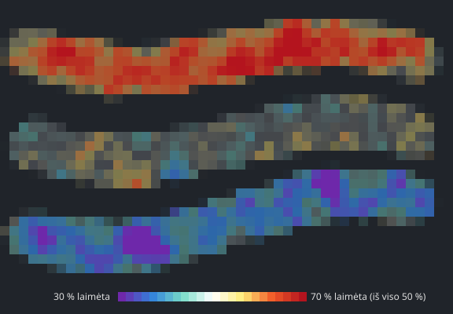

# Laimėjimų dalis: kaip dažnai vieta, maršrutas ar ėjimas laimi

Kur žaidėjas stovi, kuria kryptimi eina, kur meta savo priemones - ir kaip dažnai jo pusė paskui laimi raundą. **Laimėjimų žemėlapis** nuspalvina kiekvieną vietą pagal tai, kokia dalis ten esančių eilučių priklauso raundams, kuriuos laimėjo eilutės pusė, palyginti su dalimi visame rodomame: šilta, kur ji didesnė, šalta, kur mažesnė, nieko, kur ji tokia pati.

*Paveikslėlyje išgalvoti duomenys: trys maršrutai tuščiame lygyje, 68 %, 50 % ir 33 % jų eilučių laimėtuose raunduose.*

Tam reikia duomenų, kurie sako, kas laimėjo: [rezultato stulpelių](data-formats.md#outcome-columns) (`won`, `matchWon`, `roundEndReason`). CS2 ir War Thunder konverteriai juos rašo, Tacview konverteris - DCS serverio kampanijoms ([DCS serveriai](tacview-acmi.md#dcs-servers-who-won-and-how-each-sortie-ended)); jie gali būti bet kuriame faile.

## Išbandykite {#try-it}

1. Įkelkite mačus su rezultato stulpeliu ir paspauskite `2` (**Skirtumas**).
2. Skiltyje **Skirtumo skaidymas** paspauskite **Laimėtų raundų dalis** (arba **Laimėtų mačų dalis**). Tai laimėtus raundus perkelia į **+**, o pralaimėtus į **−** ir perjungia skydelį į **+ dalis**.
3. Perskaitykite spalvas. Skydelis nurodo bendrą dalį: *Iš viso 52,0 % iš 1 200 000 eilučių yra ant +.*
4. Susiaurinkite jį [filtrais](filters.md): viena pusė (T arba CT), vienas įvykio tipas (*Padėtis* tam, kur žmonės stovėjo, *Šūvis* arba *Paleidimas* tam, iš kur jie šovė ar metė), vienas pirkimas, vienas žemėlapis.

Vieta, kuri šilta su *Padėtis* eilutėmis, yra vieta, kurios laikytojai dažniausiai laimėdavo raundą. Su *Numušimas* eilutėmis tai vieta, kur padaryti numušimai vedė į laimėtus raundus.

## Nustatymai {#the-settings}

| Nustatymas | Ką jis daro | Numatytoji reikšmė |
|---|---|---|
| **Skirtumas** / **+ dalis** | pats skirtumas arba + pusės dalis abiejų pusių eilučių | Skirtumas |
| **Visa spalva ties** | kiek virš ar žemiau bendros dalies vieta rodoma visa spalva, procentiniais punktais | ± 20 procentinių punktų |
| **Mažiausiai eilučių vietai nuspalvinti** | vieta su mažiau eilučių nenuspalvinama; spalva pamažu atsiranda nuo pusės šio skaičiaus | 12 |
| **Traukimas link bendros dalies (eilutės)** | kiekviena vieta pradeda nuo tiek eilučių ties bendra dalimi, kad vieta su 3 eilutėmis, visomis laimėtomis, nebūtų rodoma kaip 100 % | 12 |

Visi trys veikia jau paruoštą vaizdą: juos tempiant kaupimas niekada nepradedamas iš naujo.

Dalis tinka bet kuriam skaidymui, ne tik pergalėms: *+ dalis* su skaidymu pagal pusę rodo, kur T pusė sudarė didesnę buvimo dalį, o su skaidymu pagal dviejų žemėlapių failus - kur vieno failo eilutės sveria daugiau nei kito.

## Eilutės, ne raundai {#rows-not-rounds}

Žemėlapis skaičiuoja eilutes. Žaidėjas, kuris stovi vienoje vietoje dvidešimt sekundžių, prideda eilutę už kiekvieną mėginį, visas iš vieno raundo, todėl įrodymai vietoje yra eilutės šalia jos, ne raundai. Todėl minimumas ir traukimas nurodomi eilutėmis, ir todėl jie didesni nei vieno raundo kiekis.

Patiems raundams:

- **[Išskaidymas](breakdown.md)** taške, vaizde ar tūryje: *Pergalės %* kiekvieno žaidėjo raundą skaičiuoja vieną kartą, taip pat traukiant link vietos bendros dalies (4 raundai).
- **[Tūriai](volumes.md)** statistika: *Laimėjimų dalis* - raundai, kuriuose žaidėjas buvo tūrio viduje, kiekvienas vieną kartą, traukiant link viso rodomo dalies, su skaičiais.

## Rezultato filtrai {#outcome-filters}

Skydelis [Filtrai](filters.md) rezultato stulpelius rodo iškart po peržiūros programos savųjų: **Raundo rezultatas** ir **Mačo rezultatas** (*Bet koks*, *Laimėta*, *Pralaimėta*) ir **Kaip baigėsi raundas** (Eliminacija, Bomba sprogo, Bomba nukenksminta, Baigėsi laikas, Pasidavimas, Lygiosios, Tikslas, Išlaikytos zonos, Prarasti bilietai, Prarastos visos transporto priemonės), peržiūros programos kalba.

## Kūrėjams {#for-developers}

Šilumos perėjimas įrašo tris sumas į keturių kanalų taikinį, kurį naudoja komandų šiluma: šilumą `R = Σ|v|`, + pusės šilumą `P` ir `S = Σ v²/w`, kur `w` yra perėjimo svoris (atrankos svoris kart kadro stiprinimas). Kompozicija nuskaito dalį `P/R` (branduoliu svertinis vidurkis) ir eilutes, kuriomis ji remiasi, `n = R²/S` (Kisho efektyvusis imties dydis), traukia dalį link bendros, `p = (n·P/R + m·r0)/(n + m)`, ir nuspalvina `p - r0` per intervalą skirtumo skalėmis.

`n` padalija visus veiksnius, bendrus eilutėms ties pikseliu - kadro stiprinimą, atrankos svorį, apkarpyto sprite ploto svorį - todėl vaizdas yra toks pat esant bet kokiam priartinimui ir atrankos tankiui, o kas k-tosios eilutės kadrai susilieja į visumą, spalvoms nešokinėjant. Bendra dalis gaunama iš procesoriaus pusių skaičiavimų, dešimtosios procento dalies tikslumu; iš GPU niekas nenuskaitoma atgal. Skaičiavimai ir jų patikros: [`render/rateMap.ts`](https://github.com/Holdi601/3DHeat/blob/main/src/render/rateMap.ts) ir jo testas.

Tai kainuoja tiek pat, kiek komandų šiluma: keturių kanalų taikinys keturgubai padidina šilumos perėjimo maišymo pralaidumą, tik kol *+ dalis* įjungta.
