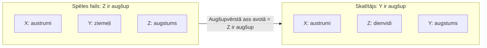

# Asis, mērvienības un laiks

Spēles un kartes nevienojas par to, kurā virzienā ir augšā, cik garš ir objekts un kā raksta laiku. Šī lapa parāda trīs iestatījumus, kas liek taviem datiem stāvēt, būt pareizā mērogā un tikt atskaņotiem pareizā virzienā.

Ja tava karte stāv kā siena, nevis guļ kā grīda, pārslēdz **Augšupvērstā ass avotā**.

Ar nepareizu **Augšupvērstā ass avotā** karte stāv kā siena; ar pareizo tā guļ kā grīda.

## Pasaule, kurā skatītājs zīmē {#the-world-the-viewer-draws-in}

Skatītāja pasaule ir **Y-augšup**: X un Z ir zemes plakne, Y ir augstums. Lielākā daļa spēļu dzinēju ir **Z-augšup**: tiem X un Y ir zeme, bet Z ir augstums. Daži dzinēji ir arī spoguļoti (kreisroku). Kartējums saka, kā pārvērst faila asis skatītāja asīs. (Tehniski skatītājs ir labroku, three.js konvencija.)

### Augšupvērstā ass {#up-axis}

**Augšupvērstā ass avotā** lapā [Kolonnu kartējums](column-mapping.md):

| Iestatījums | Fails (x, y, z) kļūst par pasauli (X, Y, Z) |
|---|---|
| *Z ir augšup (lielākā daļa spēļu dzinēju)* — noklusējums | (x, **z**, **y**): faila Z kļūst par augstumu, un faila Y kļūst par pasaules Z |
| *Y ir augšup (grafikas konvencija)* | (x, y, z) nemainās |

Z-augšup datiem trīs masīvi tiek pārmarķēti, nevis kopēti ([`remapAxesInPlace`](https://github.com/Holdi601/3DHeat/blob/main/src/data/ingest.ts)). Tas ietaupa simtiem megabaitu lielās ielādēs. Minējums tiek veikts pēc paraugu: augša ir tā no Y un Z kolonnām, kurai ir mazāka izkliede.

### Apgriešana {#flips}

**Apgriezt X**, **Apgriezt Y** un **Apgriezt Z** noliedz *faila* asi ar šo vārdu, pirms pārmarķēšanas. Tātad, ja Z ir augšup, *Apgriezt Y* noliedz to, kas beigās kļūst par pasaules Z. Apgriešana maina ielādētos datus: koordinātas, ko rāda [lineāls](measure.md), griezums un kameras poza, ir apgrieztās.

Lai zīmētu spoguļotu pasauli pareizi **bez** datu maiņas, izmanto **Kamera un aina → Invertēt pasaules asi** ([Kamera un vadība](camera.md#invert-world-axis)). Tā ir labāka izvēle spēlēm ar kreisroku pasauli, jo katra rādītā koordināta paliek paša spēles.

### Vienību mērogs {#unit-scale}

**Vienību mērogs** reizina katru pozīciju. *1 (m)* iestata 1, *0,01 (cm→m)* iestata 0,01 (Unreal Engine vienības ir centimetri, tāpēc izmanto 0,01; Source dzinēja vienības ir collas, tāpēc izmanto 0,0254; nevienā no tām nav metri). Lodziņš pieņem jebkuru vērtību. Ievadīta 0 vai vērtība, kas nav skaitlis, tiek aizstāta ar 1.

Skatītājs attālumus marķē metros (spraita rādiuss, atmešanas attāluma robežas, lineāls, lidošanas ātrums). Tas ir patiesi tikai tad, ja mērogotā pasaules vienība ir metrs. Nekas nesabojājas, ja tā nav; etiķetes vienkārši rāda "m" jebkurai vienībai.

## Laiks {#time}

### Laika vienības {#time-units}

Vispārējs noteikums: vērtības, piemēram, 17000000000 (desmit vai vairāk cipari), ir Unix laika zīmogs; vērtības, piemēram, 0, 0,25, 0,5, ir sekundes no sākuma.

| Laika vienība (izvēlnes etiķete) | Nolasa kā | Rāda pulksteņa laiku |
|---|---|---|
| *Sekundes (relatīvs)* | vērtība × 1 s | nē |
| *Milisekundes (relatīvs)* | vērtība × 0,001 s | nē |
| *Mikrosekundes (relatīvs)* | vērtība × 10^-6 s | nē |
| *Nanosekundes (relatīvs)* | vērtība × 10^-9 s | nē |
| *Unix laika zīmogs (s)* | sekundes kopš 1970-01-01 UTC | jā |
| *Unix laika zīmogs (ms)* | milisekundes kopš 1970-01-01 UTC | jā |
| *ISO-8601 datuma virkne* | teksts, piemēram, `2026-03-14T18:02:11.250Z`, parsēts ar pārlūka `Date.parse` | jā |

Ar absolūtu vienību (pēdējās trīs) datu kopa saglabā savas agrākās rindas pulksteņa brīdi, un laika skala blakus atskaņošanas galviņai rāda pašreizējo UTC diennakts laiku (`HH:MM:SSZ`).

**Parquet `TIMESTAMP` un `DATE` kolonnas** tiek atkodētas par īstiem brīžiem, tāpēc to vienības iestatījums tiek ignorēts un panelis to saka. `DATE` kolonna ir viena veselā diena: visas dienas rindas dala vienu brīdi, un atskaņošana lec pa vienai dienai, par ko panelis brīdina.

**ISO-8601 virknes darbojas gan CSV, gan Parquet.** Teksta laika kolonna ar ISO vienību tiek parsēta vienreiz katrai atšķirīgai virknei. Ja neviena nepārveidojas, ielāde neizdodas ar *Kartētajā laika kolonnā nav parsējamu ISO-8601 laika zīmogu.* Kartējums jau atsakās sākties, ja neviena no paraugu vērtībām nepārveidojas. Parquet `TIMESTAMP` kolonna tiek nolasīta kā laika zīmogs neatkarīgi no iestatītās vienības, un skaitliska Parquet kolonna ar ISO vienību tiek nolasīta kā Unix milisekundes. Teksta laika kolonna ar skaitlisku vienību tiek noraidīta pirms ielādes: katra vērtība tiktu nolasīta kā NaN.

### Kā laiks tiek glabāts {#how-time-is-stored}

Kamēr faili tiek apvienoti, laiki ir 64 bitu sekundes, tāpēc absolūtais epohas laiks saglabā arī sekundes daļu. Kad visi faili ir iekšā, visa atlases agrākais laiks kļūst par 0, un katra rinda glabā 32 bitu sekundes no tā. 32 bitu peldošajam skaitlim ir 24 mantisas biti: intervāli līdz aptuveni pusotrai dienai tiek izšķirti līdz labāk par 1/100 s, intervāli līdz pusgadam — līdz aptuveni sekundei. Rinda, kuras laiks trūkst vai nav skaitlis, tiek novietota 0, sākumā.

Rindas pēc tam tiek sakārtotas pēc laika, un tas padara laika skalu lētu: laika logu atrod ar divām bināras meklēšanas operācijām (skat. [Paraugu ņemšana un budžeti](sampling-and-budgets.md)).

### Pagājušais laiks pret pulksteņa laiku {#elapsed-time-versus-wall-clock}

Laika kolonna, piemēram, `match_time` vai `round_time`, skaita no katra mača paša sākuma. Tās izvēle liek katram mačam atrasties vienā kopējā asī — labi, lai salīdzinātu, kas notiek 3. minūtē katrā mačā, un panelis to norāda. Pulksteņa laika kolonna rāda mačus tādā secībā, kādā tie patiesi notika, un pārklājas tur, kur tie pārklājās.

## Skatīšanās virziens {#look-direction}

Skatīšanās virziens tiek izmantots tikai [kastes atkārtojumā](box-replay.md) (stari no katras kastes). Tas tiek glabāts kā divi leņķi, pagrieziens (yaw) un slīpums (pitch), radiānos.

- **Pagrieziena / slīpuma kolonnas** tiek nolasītas kā tādas, pārvērstas no grādiem, ja izvēlēts *Grādi*. Tās netiek pielāgotas augšupvērstajai asij vai apgriešanai.
- **Virziena vektora kolonnas** iet caur to pašu pārmarķēšanu un apgriešanu kā pozīcijas, pēc tam kļūst par yaw = atan2(x, -z) un pitch = atan2(y, √(x² + z²)) pasaules asīs. Tāpēc stars rāda, kurp kaste ir vērsta arī spoguļotā avota pasaulē.

Ja pēc apgriešanas, virziena vektora vai pielāgotiem leņķiem pagrieziena/slīpuma kolonnas rāda nepareizā virzienā, labojums ir tieši tas.
