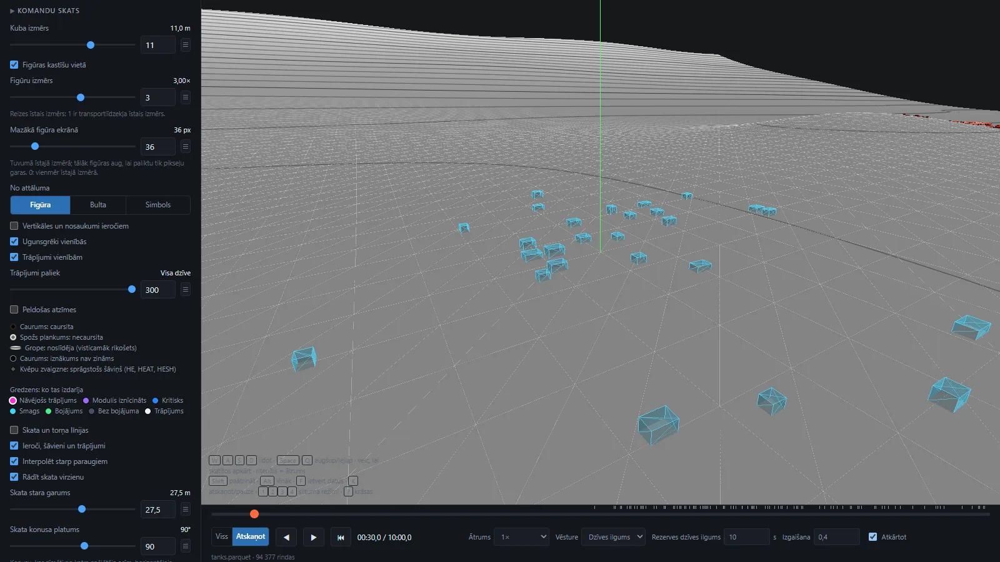

# Figūru pārklājums

Neliela filma: viena figūra katrai personai, kas kustas, kamēr laiks iet, ar asti aiz sevis.

Režīms sauc **Figūru pārklājums** režīmu joslā. Šī lapa agrāk tika saukta par "kastes atkārtojumu", jo pirms figūru ieviešanas katra persona bija kaste; "figūru atkārtojums" un "kastes atkārtojums" nozīmē to pašu. **Figūru pārklājumam** nav cipara taustiņa: izvēlies to režīmu joslā. Tas zīmē vienu figūru (vai kasti) katrai [personai](glossary.md), kas kustas pa [laika skalu](timeline.md), ar pēc izvēles skata stariem un astēm. Tas ir atskaņojums, nevis blīvums: *kas kur bija, kad*. Tam vajag personas kolonnu; bez laika kolonnas visi paraugi tiek zīmēti uzreiz.

## Kā lietot {#how-to-use-it}

1. Ielādē datus ar personas kolonnu un laika kolonnu.
2. Izvēlies **Figūru pārklājums** režīmu joslā.
3. Pārslēdz laika skalu uz **Atskaņot** un nospied atskaņot (`K`).
4. Atver **Komandu skats**, lai mainītu **Astes garumu**, figūras izmēru vai skata starus.

Šajā režīmā siltums nav zīmēts, un adaptīvais spraitu budžets ir dīkstāvē.

Pēc noklusējuma katra persona tiek zīmēta kā figūra no tā, kas tā ir, nevis kā kaste. Skat. [Figūras](figures.md), kuru figūru vienība saņem, un [Spēles atkārtojums](match-replay.md) etiķetēm, sekošanas kamerai, mērīšanai starp divām vienībām un notikumu sarakstam.

## Komandu skata panelis {#the-team-viewer-panel}

Šajā režīmā rādīts siltuma paneļu vietā.

| Vadība | Noklusējums | Diapazons (kustināšana) | Nozīme |
|---|---|---|---|
| **Figūras kastīšu vietā** | ieslēgts | | Katra persona kā figūra no tā, kas tā ir: kareivis kājām, tanks vai lidmašīna, ko nosauc dati. Tas, ko dati nepasaka, paliek kaste. |
| **Figūru izmērs** | 1× | | 1× ir patiesais izmērs. |
| **Mazākā figūra ekrānā** | 36 px | 0 = vienmēr patiesais izmērs | Patiesais izmērs tuvu; tālāk figūras aug, lai paliktu tik pikseļu garas. |
| **Ieroči, šāvieni un trāpījumi** | ieslēgts | | Ieroči lidojumā ar dūmiem, trasējošām lodēm, triecieniem, trāpījumiem un nogalinājumiem. Trasējošās lodes, kas secinātas no trāpījuma, ir punktētas. |
| **Kuba izmērs** | vienības izmērs vai izmērs / 500 ielādes brīdī | 0,05–200 m, logaritmiski (5000) | Katras kastes malas garums. Skat. [vienības izmērs](sessions-persons-groups.md#entity-size). |
| **Interpolēt starp paraugiem** | ieslēgts | | Starp diviem vienas personas paraugiem vienā sesijā novieto kasti proporcionāli starp tiem. Nekad pāri sesijas robežai. |
| **Rādīt skata virzienu** | ieslēgts | | Stars no katras kastes personas skata virzienā (vajag [skatīšanās kolonnas](axes-units-and-time.md#look-direction)). |
| **Skata stara garums** | vienības izmērs × 4 vai izmērs / 200 ielādes brīdī | 0,5–500 m, logaritmiski (20 000) | Rāda, kamēr skata virziens ir ieslēgts. |
| **Astes garums** | 8 s | 0–300 s (86 400); 0 = izslēgts | Vēstures sekundes, kas zīmētas aiz katras personas. |
| **Zīmēt katru neapstrādāto paraugu** | izslēgts | | Kaste katram saglabātajam paraugam logā, nevis viena interpolēta kaste katrai personai. Samazināts paraugu skaits, lai paliktu interaktīvs. |

Paneļa norādes skaidro, ka interpolācija un astes savieno paraugus tikai vienā sesijā, un, kad ielādē ir [kopīgi vārdi](sessions-persons-groups.md#names-worn-by-several-things-at-once), cik vārdu tiek zīmēti kā atsevišķi paraugi.

## Atskaņotā sesija {#the-session-being-played}

Ar sesijas kolonnu **Sesija** izvēlne sānjoslas augšā ([Sesijas](sessions-persons-groups.md#the-session-picker)) nosaka, kurš mačs tiek atskaņots. Ielādējot, izvēlas visaktīvāko. Kastēs un astēs tiek pārvērstas tikai šīs sesijas rindas, un laika skala iet pa šīs sesijas laika diapazonu, nevis visas datu kopas. *Visas sesijas* atskaņo visas sesijas uzreiz, arī tad nekad nesavienojot paraugus pāri sesijām.

## Kas tiek zīmēts kad {#what-is-drawn-when}

No [`TrackCursor`](https://github.com/Holdi601/3DHeat/blob/main/src/data/tracks.ts):

**Dzīvās kastes** (režīms Atskaņot, neapstrādāti paraugi izslēgti). Katrai redzamai personai — viņas pēdējais paraugs pie atskaņošanas galviņas vai pirms tās:

- Ja personai ir nākamais paraugs, tas ir tajā pašā sesijā un vārds nav kopīgs, kaste tiek novietota starp abiem paraugiem proporcionāli laikam. Pagrieziens (yaw) tiek interpolēts īsāko ceļu, slīpums (pitch) lineāri (kad *Interpolēt* ir ieslēgts).
- Citādi kaste paliek pie pēdējā parauga visu laiku **rezerves dzīvei** (noklusējums 10 s) un tad tiek nomesta, lai izslēgtie spēlētāji neuzkavētos.

**Visu režīms** ignorē atskaņošanas galviņu un zīmē katru paraugu diapazonā kā kasti.

**Neapstrādātie paraugi** zīmē kasti katram saglabātajam paraugam logā: *Diapazonu* ar *Loga* vēsturi, citādi visu līdz atskaņošanas galviņai. Vismaz 65 536 kastes; ja paraugu ir vairāk, zīmē ik *k*-to.

**Astes** (kad astes garums ir virs 0 un neapstrādātie paraugi nav zīmēti): līnija starp katriem diviem secīgiem personas paraugiem pēdējo *astes garuma* sekunžu laikā līdz atskaņošanas galviņai, izbalē no 80% necaurredzamības līdz caurspīdīgam, ar vecumu. Aste apstājas sesijas maiņā un nav zīmēta kopīgiem vārdiem. Vismaz 131 072 virsotnes; ja ir vairāk, rindas tiek izlaistas vienmērīgi.

**Kas ir redzams:** persona ir paslēpta, ja viņas grupa nav atzīmēta [Komandu sarakstā](teams-list.md) (viņas grupa ir tā, kurai pieder pirmā rinda), kad grupas filtrs to izslēdz, vai kad [Vienību](entities.md) panelī ir atlase, kas viņu neiekļauj. [Kolonnu filtri](filters.md) uz kastēm neattiecas.

## Krāsas {#colours}

Viena tonu saime katrai grupai un viens toņa variants katram dalībniekam, tāpēc viens skatiens parāda, kurā pusē kāds ir ([`teamMemberColor`](https://github.com/Holdi601/3DHeat/blob/main/src/render/colors.ts)). Grupu toņi cikliski iet cauri fiksētam sarakstam ar desmit — zils, sarkans, zaļš, dzintars, violets, ciāns, magenta, laims, oranžs, indigo —, un grupas dalībnieki ir izkliedēti pa spilgtumu 42–76% un piesātinājumu 90–65%.

## Piezīmes {#notes}

- Figūru pārklājums pārbūvē savas figūras tikai tad, kad kaut kas mainās; dīkstāves kadrs pārzīmē pēdējās.
- Statistikas pārklājuma rinda *Kubi* ([statistikas pārklājums](performance-and-stats.md)) skaita ekrānā esošās kastes.
- Figūru pārklājums zīmē tajā pašā ainā kā līmenis, tāpēc [lauka dziļums](camera.md#depth-of-field) izplūdina kastes, bet nekad siltumu.
