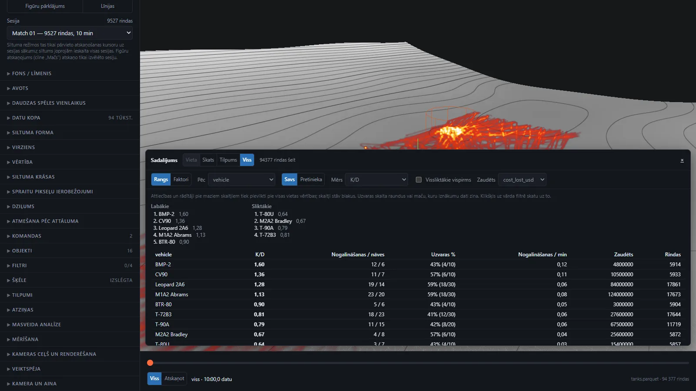
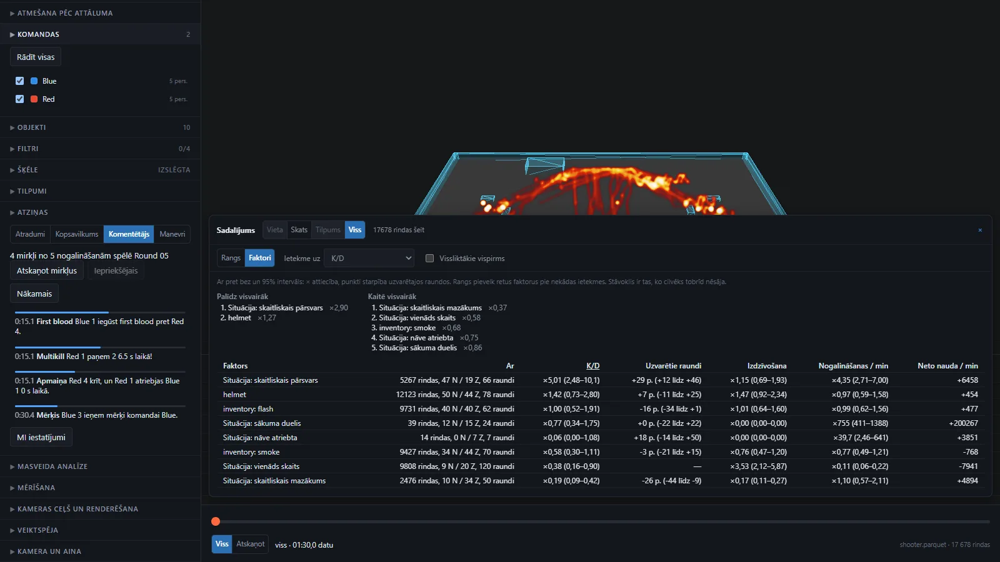

# Sadalījums: kas un kur labāk darbojas

**Sadalījums** atbild uz vienu jautājumu: šajā vietā, kura tehnika, spēlētājs vai ierocis darbojas labāk? Izmanto to, lai atrastu tanku, kas uzvar pie tilta, vai lai redzētu, vai ķivere tiešām palīdz.

Tas sarindo to, kas notiek vienā vietā (izvēlētā vieta, skats, tilpums vai viss rādītais) pēc jebkuras kategorijas, un mēra katru stāvokļa faktoru ar un bez.

## Izmēģini {#try-it}

1. Ielādē mača datus ar nogalinājumiem un nāvēm un atver **Tilpumi**.
2. Uzzīmē tilpumu ap vietu, kas tevi interesē, un atlasi to.
3. Nospied **Sadalījums…** sadaļā Statistika.
4. Sadaļā **Pēc** izvēlies *Transportlīdzeklis* un mēru *K/D* (nogalinājumi uz nāvi).
5. Izlasi sarakstu, labākais augšā. Nospied **Vissliktākie vispirms**, lai to apgrieztu. Noklikšķini uz nosaukuma, lai filtrētu skatu uz to; noklikšķini vēlreiz, lai atceltu.

## Atver to {#open-it}

| No kurienes | Reģions, ar kuru sākas |
|---|---|
| **Sadalījums…** lapā [Tilpumi](volumes.md) (Statistika) | atlasītais tilpums |
| **Sadalījums šeit** kartītē, pēc klikšķa uz punktu | sfēra ap šo punktu (**Rādiuss**, noklusējums 3% no datu izmēra) |
| **Starpība** sadalīšanas panelis | skats |

Galvene pārslēdz reģionu: **Vieta**, **Skats** (ko kamera redzēja pēdējā skaitīšanā; pēc kustēšanās — **Skaitīt vēlreiz**), **Tilpums** (izvēlies vienu) vai **Viss**. Tas skaita fonā; statusa rindā rāda, cik rindu ir reģionā.

## Rangs {#ranking}

Izvēlies, pēc kā sarindot, un mēru:

| Mērs | Ko tas ir |
|---|---|
| A, B | rindas katrā starpības kartes pusē, sadalītas tāpat kā siltums tās sadala |
| A / B, A - B, A / (A + B) | abi slāņi viens pret otru |
| K/D | nogalinājumi pret nāvēm |
| Uzvaras % | uzvarētie raundi (vai mači), kur dati saka, kurš uzvarēja |
| Nogalinājumi / min | nogalinājumi minūtē klātbūtnē (kustības paraugu spraugas) |
| Nopelnīts, Zaudēts, Neto nauda | `earn_*` un `cost_*` kolonnu summas; izvēlnē izvēlas valūtu |

Nogalinājumi, nāves, klātbūtne, uzvaras un nauda skaita katru rindu, ko skats rāda vietā, jebkurā sadalīšanas pusē vai nevienā.

Attiecības un ātrumi tiek pavilkti pretī vietas kopējai vērtībai, ja skaitļi ir mazi, tāpēc 2 nogalinājumi 1 dzīvē nepaceļ to augšā. Skaitļi ir rādīti blakus.

Var sarindot pēc grupām, spēlētājiem un mačiem, jebkuras kategorijas kolonnas (tehnikas, ieroča, puses, pirkuma veida, aģenta vai komplekta), jebkuras skaitliskās kolonnas diapazonos (bruņas, komplekta vērtība), ieroča kolonnas **klases** (šautene, snaiperis, PPŠ, pistole...) un to, cik **palīgierīču** gabalu saraksta kolonna, piemēram, `inventory`, satur.

**Savs** sarindo pēc rindas pašas vērtības. **Pretinieka** sarindo pēc otras puses vērtības: upura ieroča nogalinājumā, nogalinātāja nāvē (vajag kolonnu `other` / `victim`, kas tos nosauc).

## Stāvoklis tajā brīdī {#state-at-the-time}

Rindas vērtība ir pašas rindas, ja vien rinda neko nereģistrē (notikuma rinda bez aprīkojuma) vai tā ir nāve (kuras ieroča kolonna var nosaukt nogalinātāja ieroci). Tad tā ir tā, ko tā pati persona pēdējo reizi nesa agrāk mačā.

## Faktori: ar pret bez {#factors-with-against-without}

Pārslēdz no **Ranga** uz **Faktori**, izvēlies **Ietekme uz** un izlasi *Visvairāk palīdz* un *Visvairāk kaitē*:

Katra faktora ietekme uz K/D, uzvarētiem raundiem, izdzīvošanu (minūtes uz nāvi), nogalinājumiem minūtē un neto naudu minūtē, ar 95% intervālu: attiecības kā x, uzvarētie raundi kā punktu starpība. Rangs velk katru novērtējumu pretī nulles ietekmei atkarībā no tā nenoteiktības, tāpēc retam faktoram, lai augstu rangotu, vajag skaidru efektu. Rādītais intervāls ir neizvilkts.

Dati ar raundiem pievieno tuvcīņas **situācijas** ([Tuvcīņa un raundi](close-quarters.md)), kas aprēķinātas vienreiz katrai datu kopai: *aklots* (rindas `state_flashed`, vai ienaidnieka zibspuldze 15 m attālumā pēdējo 3 s laikā), *nāve atriebta*, *atklāšanas dueļs* un *pārspēks*, *vienāds skaits* vai *mazākums* (spēlētāji dzīvi rindas pusē pret ienaidnieku). Nāve tiek skaitīta situācijā, kādā bija tās upuris tieši pirms tās.

Vienā piegājienā mēra ne vairāk kā 256 faktorus.

## Izstrādātājiem {#for-developers}

### Mazu paraugu vilkšana {#pulling-small-samples}

Rangošanas vērtība ir `(n + m*r0) / (d + m)`: `n` un `d` ir skaitļi, `r0` ir visas vietas attiecība un `m` ir šī iepriekšējā svars.

### Konvertētāju autoriem: faktoru kolonnu nosaukšana {#for-converter-authors-naming-factor-columns}

Konvertētājs pievieno faktoru, nosaucot tā kolonnu:

| Kolonna | Faktors |
|---|---|
| `state_<name>` skaitlis | ieslēgts, kamēr nav nulle (`state_scoped`, `state_suppressor`) |
| `state_<name>` kategorija | viens faktors katrai vērtībai (`state_ammo` = AP, HE...) |
| `active_<name>` | tas pats, ieslēgtam vai nesen lietotam: spēja, ultimāts, ierīce, uzlabojums (`active_ult`, `active_stim`) |
| saraksta kolonna (`inventory`, `loadout`, `perks`, `abilities`, `attachments`, `modules`, `buffs`, `debuffs`, `upgrades`, vai `state_`/`active_` nosaukums, kas beidzas ar `s`) | viens faktors katram `a\|b\|c` vērtības elementam |
| jau izplatītie aprīkojuma karodziņi (`helmet`, `defuser`, `armor`, `scoped`, `airborne`, `duck`, `flashed`...) | ieslēgts, kamēr nav nulle |
| `ammoType`, `shellType`, `ammoName` | pēdējais izšautais kārtridžs |

Rezultāti: 0/1 kolonna `won` (rindas puse uzvarēja raundā vai mačā) un kolonna `round` - [iznākuma kolonnas](data-formats.md#outcome-columns); ja failā ir gan `won`, gan `matchWon`, *Uzvaras %* skaita raundus. Nauda: `earn_<currency>` un `cost_<kind>_<currency>`. Ienākums tikai pēc veida (`earn_round_cs2`, konvertētāja precīzās raunda atlīdzības) aizstāj tikai izmaksu modeļa ienākumu šim veidam (`round` aptver arī iestādīšanu un atmīnēšanu), un modelis apgrūtina pārējo.

Kartējums ielādē šīs kolonnas pats: katru `state_*`, `active_*`, `won`, `round` un saraksta kolonnu, izņemot tās, kuras Parquet faila statistika rāda kā vienu vērtību visā garumā (katra ielādētā kolonna ir 4 baiti uz rindu).
