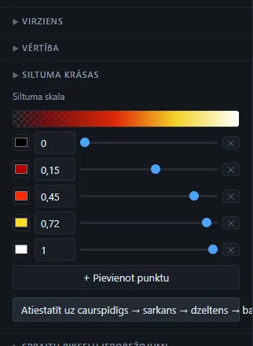

# Krāsa un ekspozīcija

Šie iestatījumi nosaka, cik liels siltums saņem kuru krāsu. **Piesātinājuma punkts** ir siltuma daudzums, kas skaitās kā baltkarsts.

## Ātri labojumi {#quick-fixes}

- Viss ir balts: paaugstini **Piesātinājuma punktu** vai nospied **Automātiska ekspozīcija pēc lauka**.
- Nekas nav redzams: pazemini **Piesātinājuma punktu** vai nospied **Automātiska ekspozīcija pēc lauka**.
- Redzami tikai daži atsevišķi punkti: paaugstini **Minimālais siltums**.

Katrs šīs lapas iestatījums darbojas, kad siltums tiek pārvērsts krāsā. Tāpēc, velkot jebkuru no tiem, skats uzreiz tiek pārzīmēts un **uzkrāšana nekad nesākas no jauna**.

## Piesātinājuma punkts {#saturation-point}

**Piesātinājuma punkts** (sadaļa Siltuma forma): uzkrātais siltums, kas atbilst krāsu skalas augšai (ar *Lineāro* reakciju; citām reakcijām skat. tālāk). Logaritmisks slīdnis 0,1–4000, rokturis velkams līdz 10 000 000, jo uzkrātais siltums aug līdz ar rindu skaitu. Noklusējums ir 24. Katrā ielādē vispirms tiek izveidota **analītiska aplēse**, pēc tam to **izmēra** pēc attēla.

Pareizs skaitlis nosaka, vai redzi siltumkarti vai tukšu (vai baltu) ekrānu. To nevar droši aprēķināt, jo telemetrija grupējas tik stipri — sākuma vieta, durvis, šaurā vieta —, ka attiecība starp maksimālo un vidējo blīvumu atšķiras vairāk nekā desmit reizes starp datu kopām un starp kameras leņķiem.

## Automātiska ekspozīcija {#auto-exposure}

**Automātiska ekspozīcija pēc lauka** izmēra lauku, ko šeideris patiesi izveidoja. Tā ignorē tukšos pikseļus, ņem 98. procentili no apgaismotajiem un novieto to 85% attālumā līdz piesātinājuma punktam. Tā skalas augšu saglabā īstajiem maksimumiem.

Panelis tad rāda *izmērīti X % kadra; 98. procentile R novietota pie skalas augšas*. Ar *Piesātinošo* reakciju vērtība 85% no piesātinājuma punkta nokrīt ap 69% skalas, nevis 85%.

Tas darbojas arī **automātiski**:

- 8 atveidotus kadrus pēc datu kopas ielādes;
- 8 kadrus pēc [filtru](filters.md) maiņas (ja katra pozīcija tiek filtrēta līdz simtam notikumu, blīvums mainās par vairākām kārtām);
- 8 kadrus pēc pārslēgšanās starp punktu siltumu un [līniju siltumu](line-heat.md) vai pēc tā, kuri maršruti tiek zīmēti līniju siltumā. Līnija atstāj daudz mazāk siltuma uz vienu paraugu nekā spraits.

Ja nekas nav apgaismots, automātiskā darbība piesātinājumu nemaina. Poga atgriežas pie analītiskās aplēses un parāda *nav apgaismots, ko mērīt — izmantota analītiska aplēse*.

### Seko skatam {#follow-the-view}

**Seko skatam** (sadaļa Siltuma forma, noklusējums ieslēgts) mēra no jauna katru reizi, kad kamera apstājas. Tāpēc reģions, kurā ielido, izmanto visu krāsu skalu, nevis skalu, kas izmērīta visai kartei. Nelielas izmaiņas tiek ignorētas, un skala slīd, nevis lec. Tas darbojas četros siltuma režīmos, bet ne figūru pārklājumā.

Izslēdz, lai bloķētu skalu un salīdzinātu vietas vienā skalā. Ja **Piesātinājuma punktu** velc ar roku, tas arī bloķējas.

## Blīvuma reakcija {#density-response}

**Blīvuma reakcija** — kā *k* (siltums / piesātinājuma punkts) tiek sasaistīts ar skalu:

| Reakcija | Formula | Izmantošana |
|---|---|---|
| **Piesātinošā** (noklusējums) | t = 1 - e^(-k) | Asimptotiski tuvojas skalas augšai, tāpat kā sakrauti caurspīdīgi spraiti. Nekas nekad nepāriet plakanā baltā, tāpēc tā ir drošā noklusējuma izvēle nepazīstamiem datiem. |
| **Lineārā** | t = k | Vienīgā kartēšana, kur vienāda krāsa nozīmē vienādu skaitu. Lieto, lai salīdzinātu divas datu kopas vai divus laika logus. |
| **Logaritmiskā** | t = log₂(1 + 7k) / 3 | Saspiež garu asti, tāpēc viens ekstrēms karsts punkts vairs nenospiež visu pārējo līdz skalas apakšai. Paceļ retas vietas. |

## Minimālais siltums {#minimum-heat}

**Minimālais siltums** (noklusējums izslēgts, 0–100%): katrs pikselis, kurā ir jebkāds siltums, tiek pacelts vismaz līdz šim skalas punktam. Paaugstini to un samazini spraita rādiusu, lai redzētu, *kur kaut kas jebkad notika*. Tad atsevišķi datu punkti kļūst skaidri redzami, nevis paliek tikko virs caurspīdīgā. Izslēdz to, ja vērtē blīvumu, jo tas pēc dizaina nolīdzina skalas apakšu. Slieksnis (k > 0,0001) patiesi tukšus pikseļus atstāj tukšus.

## Skalas redaktors {#the-ramp-editor}

Sadaļā **Siltuma krāsas**. Tās etiķete saka, kam skala paredzēta: *Siltuma skala* cilnēs Siltums un Līnijas, *Pozitīvā (pieskaitošās komandas)* sadaļā Starpība, *Necaurredzamības skala (krāsu nosaka grupa)* sadaļā [Komandu siltums](team-heat.md), kur tiek izmantots tikai tās alfa kanāls.



Augšējā josla rāda skalas priekšskatījumu. Zemāk ir viena rinda katram punktam:

| Daļa | Nozīme |
|---|---|
| Krāsas paraugs | Punkta krāsa (pārlūka krāsu izvēlnē). |
| Skaitlis | Punkta pozīcija skalā, no 0 līdz 1 (0 = nav siltuma). |
| Slīdnis | Punkta necaurredzamība, 0–100%. |
| ✕ | Noņem punktu. Nav pieejams, kad palikuši tikai divi punkti. |

**+ Pievienot punktu** pievieno punktu pusceļā starp pēdējiem diviem punktiem, ar pēdējā punkta krāsu un necaurredzamību. **Atiestatīt uz caurspīdīgs → sarkans → dzeltens → balts** atjauno noklusējumu.

Punktus var dot jebkurā secībā; tie tiek sakārtoti, kad skala tiek veidota. **Alfa** ir tas, kas sajauc siltumu ar ainu. Tāpēc noklusējuma skalas nulles gals ir pilnīgi caurspīdīgs.

### Noklusējuma skalas {#the-default-ramps}

| Pozīcija | Pozitīvā (Siltums, Līnijas, Starpība +) | Negatīvā (Starpība −) |
|---|---|---|
| 0,00 | melns, alfa 0 | melns, alfa 0 |
| 0,15 | rgb(180, 0, 0), alfa 0,55 | rgb(0, 170, 60), alfa 0,55 |
| 0,45 | rgb(255, 40, 0), alfa 0,85 | rgb(0, 190, 200), alfa 0,85 |
| 0,72 | rgb(255, 220, 40), alfa 0,95 | rgb(40, 80, 255), alfa 0,95 |
| 1,00 | balts, alfa 1 | rgb(170, 60, 255), alfa 1 |

## Kamera kustas {#while-the-camera-moves}

Kad kamera kustas, uzkrāšana katru kadru sākas no jauna. Ja **Zīmēt katru rindu katrā kadrā** ir ieslēgts (noklusējums), katrs kustīgs kadrs joprojām ir precīzs. Ja tas ir izslēgts, kustīgs kadrs rāda vienu paraugu ņemtu aplēsi — spilgtākas, svara ziņā mērogotas kopas. Apstājoties, šī aplēse konverģē uz gludāko patieso attēlu. Tas ir gaidāms; skat. [Uzkrāšana](accumulation.md).

## Izstrādātājiem {#for-developers}

### Kompozīcijas posms {#the-composite-pass}

Pēc tam, kad siltums ir uzkrāts, katra pikseļa vērtība tiek pārvērsta krāsā vienā kompozīcijas posmā ([`COMPOSITE_FS`](https://github.com/Holdi601/3DHeat/blob/main/src/render/webgl2/shaders.ts)). Soļi ir šādi:

```
k = |heat| / saturation point
t = response(k)                         clamped to 0..1
if minimum heat > 0 and k > 0.0001:  t = minimum + (1 - minimum) × t
colour, alpha = ramp(t)                  (the negative ramp when heat < 0, Difference only)
pixel = mix(scene, colour, alpha)
```

### Analītiskā aplēse {#the-analytic-estimate}

**Analītiskā aplēse** ([`estimateSaturation`](https://github.com/Holdi601/3DHeat/blob/main/src/data/calibrate.ts)) pieņem, ka rindas ir izkliedētas pa datu X-Z pamatnes laukumu: vidējais siltums = rindas × (π r² / pamatnes laukums) × 1/3 × centra intensitāte (1/3 ir lineāras nogāzes vidējais disks), reizināts ar pieņemto maksimuma un vidējā attiecību 25, ierobežots līdz 0,1–1 000 000. Tai pietiek būt precīzai vienas kārtas robežās.

### Mērīšana {#metering}

[`exposure.ts`](https://github.com/Holdi601/3DHeat/blob/main/src/render/exposure.ts):

1. siltuma mērķis tiek nolasīts atpakaļ no GPU un samazināts līdz ne vairāk kā 40 000 vērtībām;
2. tukšie pikseļi (siltums ≤ 0,0001) tiek atmesti. Lielākā daļa siltuma lauka ir tukša, un to ieskaitīšana visu nolasītu par zemu, tāpat kā kameras mērītājs, kas vērsts uz melnu fonu;
3. apgaismoto pikseļu 98. procentile ir atsauce;
4. piesātinājuma punkts kļūst par atsauci / 0,85. Tātad atsauce atrodas 85% attālumā līdz piesātinājuma punktam, un skalas augša paliek īstajiem maksimumiem.

### Krāsu tabula {#the-colour-table}

Skala tiek sagatavota 256 × 2 RGBA tabulā (pozitīvā skala pirmajā rindā, negatīvā otrajā) ([`buildColorLut`](https://github.com/Holdi601/3DHeat/blob/main/src/render/colors.ts)). Krāsas tiek interpolētas lineārā gaismā un saglabātas kā sRGB. Necaurredzamība tiek interpolēta lineāri.
