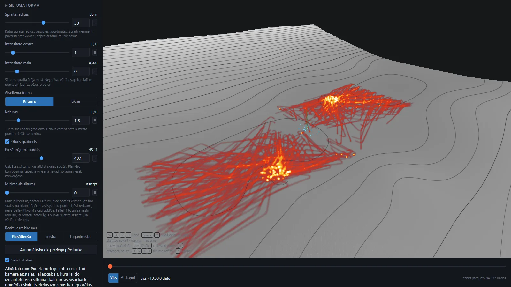
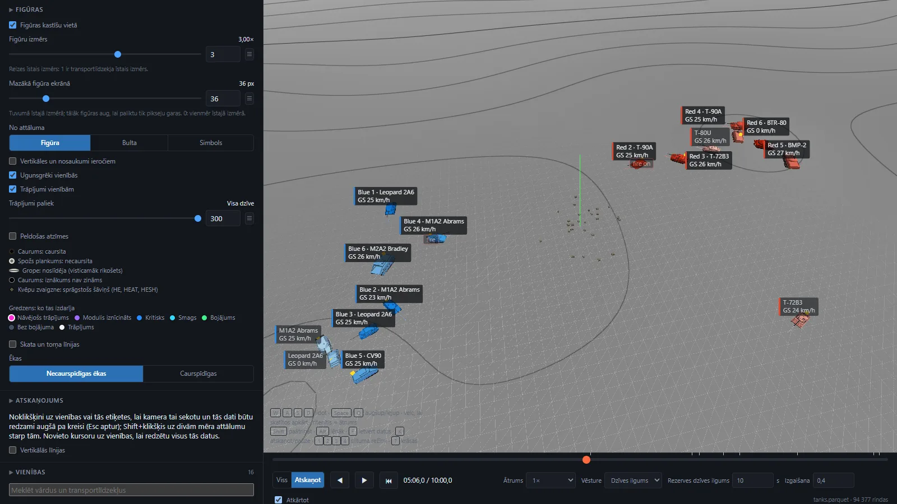

# Demonstrācijas dati: izmēģiniet skatītāju piecās minūtēs



Vai jums vēl nav savu datu? Repozitorijs tos izveido. Viss tajā ir izdomāts: ieleja, pagalms un spēles trijos izdomātos spēles stilos, ar spēlētājiem *Blue 1* vai *Red 3*. Visi šīs vietnes attēli uzņemti ar tiem.

## Izveidojiet tos {#make-it}

```bash
node tools/demo-data.mjs
```

Tas raksta mapē `tools/.shots/demo/`:

| Fails | Kas tas ir |
|---|---|
| `demo-valley.glb` | 12 km gara ieleja ar diviem kalniem un ciematu, kā 3D līmenis |
| `demo-yard.glb` | 160 m plats pagalms ar mūriem un ēkām, kā 3D līmenis |
| `tanks.parquet` | 10 tanku spēles, 8 pret 8: kustība, šāvieni, trāpījumi ar vietu uz korpusa, ugunsgrēki, nogalinājumi, sagrautas vienības, torņa mērķēšana, uzvarētāji |
| `tanks/match-NN.parquet` | tās pašas spēles, katra savā failā, [daudzas spēles vienlaikus](many-matches.md) |
| `air.parquet` | 4 pret 4 gaisa kauja ar raķetēm, uguns ķērājiem, nogalinājumiem un netrāpījumiem |
| `shooter.parquet` | 12 raundi pa 5 pret 5 kājām: šāvieni, nogalinājumi, mīnas uzstādīšana, nopelnītie un iztērētie kredīti, ķiveres un palīgierīces |
| `mass/` | mape ar maziem `.3dheat` mačiem, [masveida analīzei](mass-analysis.md) |
| apļu komplekts | divi apļi vienai automašīnai izdomātā trasē, [Sacīkšu analīzei](race-analysis.md) |

Katra tabula savas kolonnas nosauc savā kājenē, tāpēc tā ielādējas bez jebkādas saistīšanas.

## Izmēģiniet {#try-it}

1. Palaidiet skatītāju (Windows - `start.bat`, vai jebkurā sistēmā - vienreiz `npm install` un tad `npm run dev`) un atveriet `http://127.0.0.1:5273/`.
2. **Fons / līmenis → 3D modelis…** un izvēlieties `demo-valley.glb`.
3. **Avots → Faili…** un izvēlieties `tanks.parquet`.
4. Nospiediet `F`, lai ietvertu datus. Redzat desmit spēļu [siltumu](heat.md).
5. Izmēģiniet režīmu joslu: **Starpība** (Blue pret Red), **Komandu siltums**, **Līnijas**.
6. Atveriet **Atziņas** (Siltumkarte sānjoslā): tās atrod vietas, kur tika šauts, trāpīts un iznīcināts daudz vairāk nekā citur - ap abiem kalniem.
7. Atveriet cilni **Mačs**; zem **Mači atskaņojumā** izvēlieties *Match 01*; laika skalā nospiediet **Atskaņot**: [atkārtojums](match-replay.md).



Šāvējam ielādējiet `demo-yard.glb` un `shooter.parquet`; gaisa kaujai - `air.parquet` (figūras ir vieglāk saskatāmas, ja **Figūru izmērs** ir 4, slīdnis panelī **Komandu skats** Siltumkartes sānjoslā).

## Ekrānuzņēmumi {#the-screenshots}

Vietnes attēlus no šiem datiem ar skriptu izveido jebkurā no skatītāja valodām:

```bash
node tools/demo-data.mjs
HEAT3D_FIGURE_PACK=none npx vite --port 5321 --strictPort --host 127.0.0.1   # PowerShell: $env:HEAT3D_FIGURE_PACK="none"; npx vite ...
node tools/docs-shots.mjs --lang en
```

Ekrānuzņēmumu serveris darbojas bez vietējā figūru paketes, tāpēc rādīts tiek tikai publiskais figūru katalogs. Attēli tiek saglabāti `docs/assets/img/<lang>/`. Skatiet [Dokumentācijas uzturēšana](maintaining.md).
