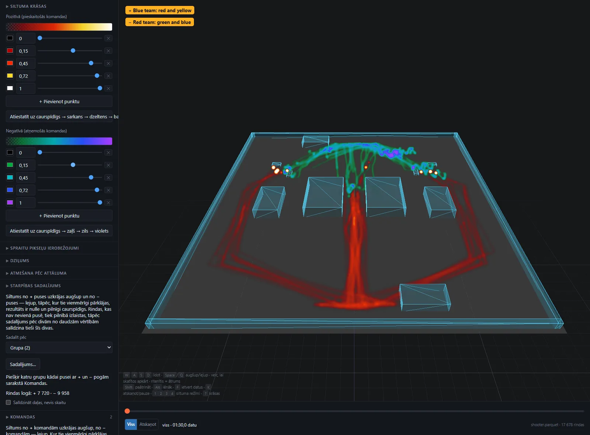

# Starpība

Sarkans, kur komanda A bija vairāk, zaļi-zils, kur bija komanda B, nekas, kur tās bija vienādas.

**Starpība** (taustiņš 2) ir ar zīmi apzīmēts siltums. Vienas populācijas rindas pieskaita siltumu; citas populācijas rindas to atņem. Kur abas pārklājas vienmērīgi, rezultāts ir nulle un pilnīgi caurspīdīgs; kur viena dominē, tas parādās tās puses krāsās — pēc noklusējuma silti (caurspīdīgs → sarkans → dzeltens → balts) **+** pusei un auksti (caurspīdīgs → zaļš → zils → violets) **−** pusei.

## Kā lietot {#how-to-use-it}

1. Nospiediet `2` (vai izvēlieties **Starpība** režīmu joslā).
2. Sānjoslā atveriet **Starpības sadalījums**.
3. Izvēlieties, ko **Sadalīt pēc**: parasti *Grupas*.
4. Viena grupa (vai vērtība) jāliek uz **+**, cita — uz **−**.
5. Lasiet krāsas: silts nozīmē + pusi, auksts — − pusi. Panelis brīdina, ja kādā pusē nav rindu (skatiet [Ziņojumi, ko var redzēt](#messages-you-may-see)).

*Kuras* divas populācijas — tas ir viss jautājums, tāpēc sadalījums var būt jebkura paturēta kolonna, ne tikai grupas. Rindas, kas nenonāk **nevienā** pusē, tiek **izlaistas**, nevis skaitītas kā nulle: tieši tāpēc sadalījums pār divām no daudzām vērtībām salīdzina tieši šīs divas, un tas saskan ar [filtriem](filters.md) — filtrējiet līdz vienai kartei, tad sadaliet to pēc versijas.

Režīmam vajag divas puses: grupu kolonnu ar vismaz divām grupām vai sadalījumu pēc kolonnas, kas paturēta filtrēšanai. Datos ar mazāk nekā divām grupām ielāde sāk ar kolonnas sadalījumu — vispirms daudzfailu ielādes kolonnu *Source file*, citādi pirmo kategoriju kolonnu ar divām vērtībām, citādi pirmo skaitlisko kolonnu ar diapazonu — tāpēc *salīdzināt divas ielādes* strādā arī datos bez grupām. Tikai dati bez nevienas no tām atstāj režīmu nepieejamu; tāpat arī kolonnas sadalījums, kurā vienā pusē nav nekā.

## Starpības sadalījuma panelis {#the-difference-split-panel}

Rāda starpības režīmā, zem siltuma paneļiem.

**Sadalīt pēc** piedāvā:

| Iespēja | Rādīts kā | Sadalīšanas noteikums |
|---|---|---|
| Grupas | *Grupa (N)* (kad ir grupu kolonna) | Katra grupa uz +, − vai nevienā, iestatīts [Komandu sarakstā](teams-list.md) |
| Kategoriju kolonna | *kolonna (N vērtības)* | Vērtības uz +, − vai nevienā |
| Skaitliska kolonna | *kolonna (skaitlisks)* | Vērtību diapazons katrai pusei |
| Izcelsmes fails | *Source file - salīdzināt divas ielādes* (kad ielādēti vairāki faili) | Faili uz +, − vai nevienā |

Piedāvā tikai kolonnas, kas ielādes laikā paturētas *Saglabāt filtrēšanai*.

### Salīdzināt daļas, nevis skaitu {#compare-shares-not-counts}

**Salīdzināt daļas, nevis skaitu** (pēc noklusējuma izslēgts) katru pusi sver ar vienu, dalītu ar tās pašas rindu skaitu, tāpēc puse ar piecreiz vairāk rindām neuzvar tikai ar skaitļiem. Krāsa tad rāda, kur katra puse ir proporcionāli biežāka nekā otra. Lietojiet to, kad abām pusēm ir ļoti atšķirīgs datu daudzums, piemēram, divas dažāda garuma sesijas.

### Ziņojumi, ko var redzēt {#messages-you-may-see}

Panelis brīdina, kad attēls nav īsta starpība:

| Ziņojums | Nozīme |
|---|---|
| *N + / M −* (vai *N + / M − / K nelietotas*) | Cik vērtību ir katrā pusē (un nevienā). |
| Logā nav neviena rindas **+** pusē | Tiek zīmēta tikai **−** puse. Pārvietojiet laika skalas logu vai mainiet sadalījumu. |
| Logā nav neviena rindas **−** pusē | Tiek zīmēta tikai **+** puse. |
| Nevienā pusē nav nevienas vērtības | Starpība nezīmē neko. Ievietojiet vismaz vienu vērtību uz **+** vai **−**. |
| *kolonnu nevar sadalīt šādi* | Izvēlētā kolonna neder šim sadalījumam. Izvēlieties kolonnu vēlreiz. |
| Sadalījuma kolonna neiederējās GPU atmiņā N no M gabaliem | Šīs rindas netiek zīmētas. Paaugstiniet GPU budžetu sadaļā Veiktspēja → Resursu budžeti vai ielādējiet mazāk rindu. |

### Pēc grupas {#by-group}

Panelis tikai norāda uz [Komandu sarakstu](teams-list.md), kur katrai grupai ir pogas **+** un **−**. Katrā ielādē pirmā grupu puse (noapaļota uz augšu) tiek likta uz +, pārējās — uz −; **Sadalīt vienmērīgi** Komandu sarakstā dara to pašu vēlreiz. Grupa, kas nav neviena pusē, vai kas paslēpta ar savu izvēles rūtiņu, nedod neko.

### Pēc kategoriju vērtībām {#by-category-values}

| Daļa | Nozīme |
|---|---|
| `a + / b − / c nelietotas` | Cik vērtību ir katrā pusē un nevienā. |
| **Notīrīt** | Visas vērtības liek uz nevienas puses. |
| Vērtību saraksts | Katra vērtība ar pogām **+** un **−** (aktīvo pogu atkal noklikšķinot, to noņem no puses). Tukša vērtība uzskaitīta kā *(trūkst)*. |
| Ierobežojuma piezīme | Uzskaitītas tikai pirmās 200 vērtības: *Rāda pirmās 200 no N vērtībām. Tik platu kolonnu labāk vispirms sašaurināt ar filtru vai sadalīt pēc diapazona, ja tās vērtības ir sakārtotas.* |

Izvēloties kolonnu, tās pirmā vērtība tiek likta uz +, otrā — uz −. Kad abās pusēs nav nevienas vērtības, sadalījums atkrīt uz grupām, nevis rāda tukšu kadru. *Source file* darbojas tāpat, pa vienai vērtībai failam — tā tiek salīdzināti divi eksporti, divi testa braucieni vai divas versijas.

### Pēc diapazona {#by-range}

| Daļa | Nozīme |
|---|---|
| Norāde | Kolonnas minimums un maksimums. |
| **Pozitīvais diapazons (+)**, **no** / **līdz** | Rindas ar vērtību šajā diapazonā, ieskaitot abus galus, pieskaita. |
| **Negatīvais diapazons (−)**, **no** / **līdz** | Rindas šajā diapazonā atņem. |
| **Sadalīt viduspunktā** | Iestata + uz [minimums, vidus] un − uz [vidus, maksimums] — tas pats, ko dara kolonnas izvēle. |

Vērtība abos diapazonos skaitās kā +. Diapazoniem nav jāpārklāj kolonna; vērtības, kas nav nevienā, tiek izlaistas. *Pirmās divas minūtes pret pēdējām divām* ir diapazona sadalījums laika tipa kolonnā.

## Krāsas {#colours}

Sadaļa **Siltuma krāsas** šajā režīmā rāda divus skalu redaktorus: **Pozitīvā (pieskaitošās komandas)** un **Negatīvā (atņemošās komandas)**, katram sava atiestatīšanas poga (*Atiestatīt uz caurspīdīgs → sarkans → dzeltens → balts*, *Atiestatīt uz caurspīdīgs → zaļš → zils → violets*). Kompozīts ņem neto siltuma absolūto vērtību caur [piesātinājuma punktu un atbildi](colour-and-exposure.md), un izvēlas negatīvo skalu, kur neto ir zem nulles. Skatiet [Krāsa un ekspozīcija](colour-and-exposure.md#the-ramp-editor).

Lietojiet *Lineāro* blīvuma atbildi, kad svarīgs ir starpības lielums: tā ir vienīgā atbilde, kurā vienāda krāsa nozīmē vienādu skaitu.

## Izstrādātājiem {#for-developers}

Katrai rindai virsotņu ēnotājā tiek dota zīme +1, -1 vai 0 ([`POINT_HEAT_VS`](https://github.com/Holdi601/3DHeat/blob/main/src/render/webgl2/shaders.ts)); 0 noraida rindu, pirms jebkurš fragments tiek zīmēts.

- Pēc grupas zīme nāk no 4096 ierakstu grupu tabulas, indeksētas pēc rindas grupas ID (grupas ID brauc ceturtajā kanālā rindas pozīcijas texel).
- Pēc kategorijas zīme nāk no otras 4096 ierakstu tabulas, kas aizpildīta katrai kategoriju vērtībai, un rindas vērtība tiek nolasīta no kolonnas filtra tekstūras; vērtība aiz tabulas beigām tiek noraidīta abos aizmugures risinājumos.
- Pēc diapazona rindas vērtība tiek salīdzināta ar abiem diapazoniem.

Mainot sadalījumu, uzkrāšana sākas no jauna.

**Paslēptās grupas paliek paslēptas ar katru sadalījumu.** Sadalījumā pēc kolonnas grupu tabula vairs nenes zīmes; tā satur 1 rādītai grupai un 0 paslēptai ([`frameSignTables`](https://github.com/Holdi601/3DHeat/blob/main/src/render/filterTables.ts)), un abas tabulas sasniedz ēnotāju kopā — divas WebGL2 zīmju tekstūras rindas, divas WebGPU krātuves bufera puses. Rinda tiek zīmēta tikai tad, kad tās grupa ir rādīta *un* tās kolonnas vērtība ir uz kādas puses. Tātad grupa, kas nav atzīmēta [Komandu sarakstā](teams-list.md) vai izlaista ar Mača cilnes puses fokusu, nedod neko neatkarīgi no tā, kā starpība ir sadalīta.
