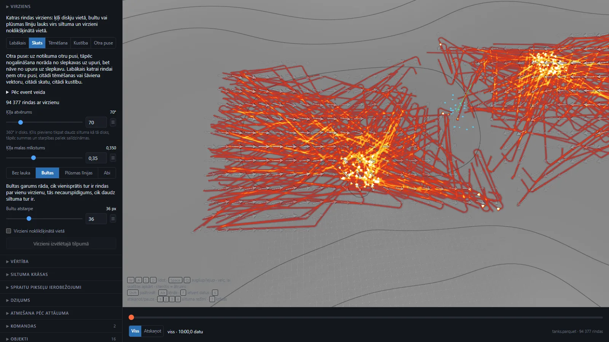

# Virziena siltums

Parastais siltums saka, **kur** lietas notiek. Virziena siltums saka arī, **kurā virzienā**: kurā virzienā cilvēki skatījās, tēmēja, kustējās vai kur atradās otra cīņas puse.

Parasts spraits ir pilns disks (360 grādi). Ar **Ķīļa atvērumu** 70 grādi tas pats spraits kļūst par šauru ķīli, kas rāda rindas virzienu, un pievieno to pašu kopējo siltumu.

## Kā lietot {#how-to-use-it}

1. Ielādē datus ar virzienu tajos (skat. [Kas dod rindai virzienu](#what-gives-a-row-a-direction)).
2. Izvēlies **Siltums**, **Starpība** vai **Komandu siltums** režīmu joslā.
3. Atver sadaļu **Virziens** sānjoslā.
4. Izvēlies **avotu** (kuru virzienu izmantot), tad ieslēdz zīmēšanu:
   - samazini **Ķīļa atvērumu** zem 360° , lai katru rindu zīmētu kā ķīli, kas rāda tās virzienu, nevis kā disku;
   - izvēlies **Lauku**, lai zīmētu bultas vai straumes līnijas pāri siltumam;
   - atzīmē **Virzieni noklikšķinātā vietā** un noklikšķini uz siltuma, lai iegūtu tās vietas polāro diagrammu.

Statusa rindā rāda, cik rindām ir virziens no izvēlētā avota.

## Iestatījumi {#settings}

| Iestatījums | Noklusējums | Ko tas dara |
|---|---|---|
| Avots: **Labākie**, **Skats**, **Tēmēšana**, **Kustība**, **Otra puse** | Labākie | Kādu virzienu katra rinda saņem. *Labākie* ņem katrai rindai otru pusi, citādi tēmēšanu, citādi skatu, citādi kustību. |
| **Pēc notikuma veida** | kā augstāk | Atšķirīgs avots katram notikuma veidam, piemēram, *Otra puse* nogalinājumiem un *Skats* pozīcijām. Rāda, ja datos ir notikumu kolonna ar ne vairāk kā 40 vērtībām. |
| **Ķīļa atvērums** | 360° | 360° ir parastais disks (izslēgts). Mazāks ir šaurāks ķīlis. Ķīlis pievieno tikpat daudz siltuma, cik tā disks, tāpēc kopsummas un starpības paliek salīdzināmas. |
| **Ķīļa malas mīkstums** | 0,35 | 0 ir ass malu ķīlis, 1 — mīksts vēdeklis. |
| **Lauks**: Nav lauka, Bultas, Straumes līnijas, Abi | Nav lauka | Bultas: bultas garums ir cik lielā mērā tur esošās rindas vienojas par vienu virzienu, necaurredzamība — cik daudz siltuma tur ir. Bultas rāda tikai tur, kur ir siltums. |
| **Bultu atstarpe** | 28 px | Attālums starp bultām ekrānā. |
| **Animēt plūsmas līnijas** | ieslēgts | Plūsmas līnijas tek, kamēr ieslēgtas. |
| **Virzieni noklikšķinātā vietā** | izslēgts | Noklikšķini uz siltuma, lai redzētu virzienus tur (zemāk). |
| **Virzieni izvēlētajā tilpumā** | | Tā pati diagramma visam izvēlētā [tilpuma](volumes.md) iekšienē. |

## Polārā diagramma vietā {#the-polar-chart-at-a-spot}

Ar ieslēgtu **Virzieni noklikšķinātā vietā** noklikšķini uz siltuma. Rindas tuvu šim punktam (1,5 spraita rādiusu robežās) tiek savāktas rozē ar 24 griezumiem pa 15°:

- **oranžas** ziedlapiņas: izejošie virzieni (kurp rindas vērstas);
- **zilas** ziedlapiņas: ienākošie virzieni (no kurienes tās nāca);
- ziedlapiņas **laukums** aug līdz ar to skaitu; bulta rāda galveno virzienu;
- līnijas zem diagrammas dod galveno azimutu, cik stipri rindas vienojas (R, 0 līdz 1), izkliedi grādos un rindu skaitu.

0° diagrammā ir augšā, kas ir pasaules −Z (ziemeļi Tacview ierakstiem). Punkts 3D skatā ir atzīmēts arī ar bultu un gredzenu.

## Kas dod rindai virzienu {#what-gives-a-row-a-direction}

| Avots | Nepieciešams datos |
|---|---|
| Skats | yaw kolonna (kartēta kā skatīšanās virziens): `yaw`, `heading`, `azimuth`, `view_yaw`, `rot_z` |
| Tēmēšana | skaitļu pāri, piemēram, `aim_x`/`aim_y`, `shot_x`/`shot_y`, `fire_x`/`fire_y`, `hit_dir_x`/`hit_dir_y` (neobligāts `…_z`) |
| Kustība | nekas papildus: solis no tās pašas personas iepriekšējā parauga (ne vairāk kā 10 s agrāk, tā pati sesija) |
| Otra puse | notikuma kolonna, kas nosauc otru pusi (`other`, `victim`, `target`, `killer`, `attacker`, `shooter`, `other_player` ...), kuras vērtības ir personu vārdi; nogalinājums rāda no slepkavas uz upuri, nāve — no upura uz slepkavu |

## Padomi {#tips}

- Ķīļiem ekrānā jābūt kādam izmēram; zem dažiem pikseļiem tie atkal tiek zīmēti kā diski.
- Izmanto *Otra puse* nogalinājumu rindām, lai redzētu, **no kurienes** cīņas tika uzvarētas, un *Skats* pozīciju rindām, lai redzētu, **kur cilvēki skatās**.
- Ar **Starpība** ķīļi no abām pusēm rāda savos virzienos, tāpēc strīdīgās uguns līnijas izceļas.
