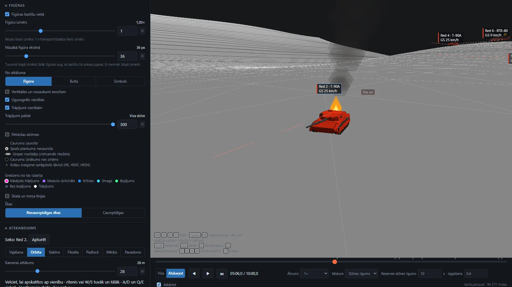

# Figūras

**Figūra** ir maza 3D modeļa forma tam, kas vienība patiesībā ir: tanks, reaktīvais lidaparāts, kuģis, karavīrs. [Atkārtojums](match-replay.md) zīmē katru vienību kā tās figūru īstajā izmērā, nevis kā vienkāršu kasti.

Ir aptuveni 2000 nosaukto transportlīdzekļu, lidaparātu, kuģu, ieroču un karavīru. Visus tos veido pats skatītājs.

## Ko katalogs satur {#what-is-in-the-catalogue}

| Joma | Piemēri |
|---|---|
| Cilvēki | karavīrs stāv, pieliecas, guļ; snaiperis, prettanku, medicīnas darbinieks, apkalpe |
| Sauszeme | tanki, kājnieku kaujas transportlīdzekļi, pretgaisa aizsardzība, artilērija, kravas automašīnas un automašīnas, vilcieni un tramvaji |
| Gaisā | iznīcinātāji, triecienlidaparāti, bumbvedēji, transporta lidaparāti, helikopteri, no divplāksnēm līdz mūsdienu reaktīvajiem |
| Jūrā | kara kuģi pēc klases, lidmašīnu nesēji, zemūdenes, laivas, tirdzniecības kuģi |
| Ieroči | raķetes, reaktīvie šāviņi, bumbas, torpēdas, signālraķetes un folija |
| Marķieri | dūmu, uzliesmojuma un uguns granātas, uzspridzināti spridzekļi, karogi, dzemdēšanas vietas, maršruta punkti |
| Tuvcīņa | karavīri bruņuvestēs ar triecienšauteni, mašīnpistoli, bisi, DMR, LMG, pistoli vai vairogu; droni, kameras, dzeloņstieple, vairogi, sienu pastiprinājums, barikādes, laušanas lādiņi, lamatas, logi, granātas, atmīnētājs |

## Kā figūras tiek veidotas {#how-the-figures-are-made}

- **Veidotas pēc publicētiem izmēriem.** Lielākā daļa figūru tiek veidotas ar paša skatītāja figūru veidotāju no publiskiem skaitļiem: garums, platums, augstums, ceļa riteņi, tornis un lielgabals, spārni un astes. To forma pēc tam tiek noregulēta pēc publiskām fotogrāfijām, zīmējumiem un publicētiem izmēriem. Nekādi spēļu modeļi netiek izmantoti.
- **Brīvi modeļi.** Dažas figūras izmanto brīvus 3D modeļus (CC0 vai CC BY), kur tie ir patiesāki, dažreiz kombinējot ar veidoto korpusu. CC BY darbu autori ir norādīti lapā [Figūru autori](figure-credits.md). CC0 darbi nepieprasa norādi, tāpēc tie tur nav uzskaitīti.
- Katrai figūrai ir pilna, rupja un tāla versija (detalizācijas līmeņi jeb LOD), tāpēc var zīmēt tūkstošus vienlaikus.

## Kuru figūru saņem vienība {#which-figure-a-unit-gets}

Skatītājs apskata datu paša kolonnas:

1. **Nosaukumi** — kolonnas, ko sauc *Name*, *Vehicle*, *Unit*, *Unit type*, *Model*, *Aircraft*, *Plane*, *Tank*, *Ship*, *Craft*, *Loadout*, *Kit* vai *Figure* — tiek salīdzinātas ar katalogu: precīzi, caur aptuveni 4000 aizstājvārdiem (vairāku spēļu vienību id), pēc garākā zināmā sākuma (`F-16C_50` ir F-16C) vai pēc īsākā figūras nosaukuma, kas ar to sākas.
2. Nosaukums, kura figūra neatbilst vienības **tipam**, netiek izmantots (kravas automašīna ar nosaukumu *Typhoon* nav iznīcinātājs).
3. **Tipi** — kolonnas, ko sauc *Type*, *Class*, *Kind*, *Category*, *Icon*, *Role* vai *Domain* — dod klases figūru: Tacview tagus (`Air+FixedWing`, `Ground+Heavy+Armor+Vehicle+Tank`, `Sea+Watercraft+Warship`, `Weapon+Missile`), kartes ikonas vai vienkāršus vārdus (tank, helicopter, infantry).
4. Dati bez abiem ir cilvēku dati: visi ir karavīri.

Tātad vieglākais veids, kā iegūt pareizās figūras, ir `vehicle` kolonna ar īstajiem nosaukumiem vai `type` kolonna ar Tacview tagiem.

**Mana vienība rādās kā kaste vai karavīrs.** Pievienojiet `vehicle` kolonnu ar īstu nosaukumu vai `type` kolonnu ar Tacview tagu. Uzvediet virsū vienībai, lai redzētu, kurš nosaukums tika atrasts. Dati, kam ir šādas kolonnas, bet kas nerunā par vienību, atstāj to kā kasti. Dati bez tām tiek zīmēti kā karavīri.

## Tuvcīņas figūras (Rainbow Six Siege) {#close-quarters-figures-rainbow-six-siege}

Tabulas, kas uzrakstītas tāpat kā Rainbow Six Siege atkārtojumu lasītāja tabulas (kolonnas `operator`, `pawn`, `primaryClass`, `side`), saņem savas figūras:

- **Spēlētāji** ir viņu operators: katram no 78 operatoriem ir sava figūra, apmēram 1,8 m gara, savā apģērbā – divas vai trīs krāsas jakai, biksēm un ekipējumam pēc viņu ierastā publiskā izskata (melna, olīvu, smilšu, pilsētas pelēka, balta, tumši zila, ar sarkanu, oranžu vai zilganzaļu ekipējumu) – un ar savām formām, par trešdaļu lielākām nekā dabā tur, kur tām jābūt redzamām no augšas: galvassega (ķiveres, sejsargs vai smaga ķivere, nagu cepures, adītas cepures, beretes, plata boonie cepure vai kažokādas cepure, kapuces, šalles, mati), seja (aizsargbrilles, gāzmaska, brilles, maska, bārda, brilles ar trim lēcām), viegla, vidēja vai smaga auguma uzbūve (smagie ir plati, ar lielām plecu plāksnēm un apkakli), garš mētelis vai uzvalks, maskēšanās tērps (ghillie), tas, ko viņi nes uz muguras (āmurs, lādiņi, droni, kanistras, degvielas tvertne, palaišanas caurule, arbalets, paneļi, traucētājs, vairogs) vai uz rokas (palaidējs, metāla roka), savs vairogs (augsts vairogs, policijas vairogs, vairogs ar gaismām) un akcenta krāsa uz pleciem. Viņi tur sava galvenā ieroča klasi. Operators, ko skatītājs nepazīst, ir vienkāršs karavīrs bruņuvestē komandas krāsā.
- **Puse** ir redzama atsevišķi no apģērba: gredzens uz zemes zem katra operatora, **dzintara krāsā uzbrukumam, gaišā ciānā aizsardzībai**, ar komandas krāsu tā iekšpusē, un roku un galvas lentes tajā pašā krāsā. Kolonna `stance` (stāv, tup, guļ) nosaka viņu stāju. Bez tās viņi stāv.
- **Atšķirami atkārtojuma attālumā:** kad figūras zīmē 48 pikseļus augstas no augšas un no trīs ceturtdaļu skata, katri divi vienas puses operatori atšķiras ar skaidru krāsas atšķirību vai citu formu (to pārbauda skatītāja testi).
- **Etiķetes** nosauc spēlētāju un tajā brīdī spēlēto operatoru, ar operatora lomu kā simbolu: ✸ cietais lauzējs, ⚒ mīkstais lauzējs, ➤ ielaušanās, ✦ uzbrucējs, ✚ atbalsts, ⬟ vairogs, ◉ izlūkošana, ◇ elastīgs, ↺ flanga sargs, ⚓ enkurs, ✕ lamatu licējs, ⇄ klejotājs, ↯ pret rīkiem, ▣ pret ielaušanos.
- **Droni** ir metams divriteņu drons, apmēram 30 cm plats. Katrs ir atsevišķs ceļš, nosaukts sava īpašnieka vārdā („Ash · drone 2“).
- **Novietotie rīki** stāv tur, kur tos nolika, no tā brīža līdz raunda beigām, katrs kā figūra tam, ko tas dara: kamera, dzeloņstieple, izvēršams vairogs, laušanas lādiņš, cietās laušanas lādiņš, mazs lipīgais lādiņš, grīdas lamatas, claymore mīna ar savu aizķeršanās lāzeru, vienvirziena logs, bruņu panelis, granāta, gāzes kanistra, traucētājs, sensors, lāzera vārti, apgādes kaste. Viena figūra kalpo visiem rīkiem, kas dara to pašu darbu. Rīks, kura veidu dati nenorāda, ir maza ierīce ar gaismu.
- **Atmīnētājs** stāv tur, kur to novietoja, savas 45 sekundes.

Katrs drons un rīks, ielādējot failu, kļūst par atsevišķu ceļu, tāpēc spēlētāja paša figūra paliek pie viņa ķermeņa. Operatori ir vienkāršotas formas pēc viņu publiskajiem aprakstiem un attēliem (ko viņi valkā, ierīce, kas ir viņu spēja), un rīki veidoti pēc tā, ko tie dara. Tie visi ir paša skatītāja dizaini lietas reālajā izmērā (claymore mīna apmēram 22 cm plata, durvju izmēra panelis 1 m reiz 2,1 m), nevis spēles modeļi.

## Iestatījumi {#settings}

Sadaļa **Figūras** atkārtojuma sānjoslā nosaka izmēru, mazāko izmēru ekrānā, to, kļūst par ko tālas vienības (figūra, bulta vai simbols), un efektus, kas uz tām zīmēti. Skatiet [Spēles atkārtojums](match-replay.md#figures). Dūmi, uguns un citi laikā ierobežoti efekti: [Figūras figūru pārklājumā](figure-replay.md).

## Neobligāts vietējais figūru komplekts {#an-optional-local-figure-pack}

Savā datorā var paturēt neobligātu savu figūru komplektu. Tā figūras aizstāj katalogā esošās figūras ar tādiem pašiem nosaukumiem. Tas nekad nav daļa no repozitorija vai publicētas versijas; bez tā nekas nemainās.
