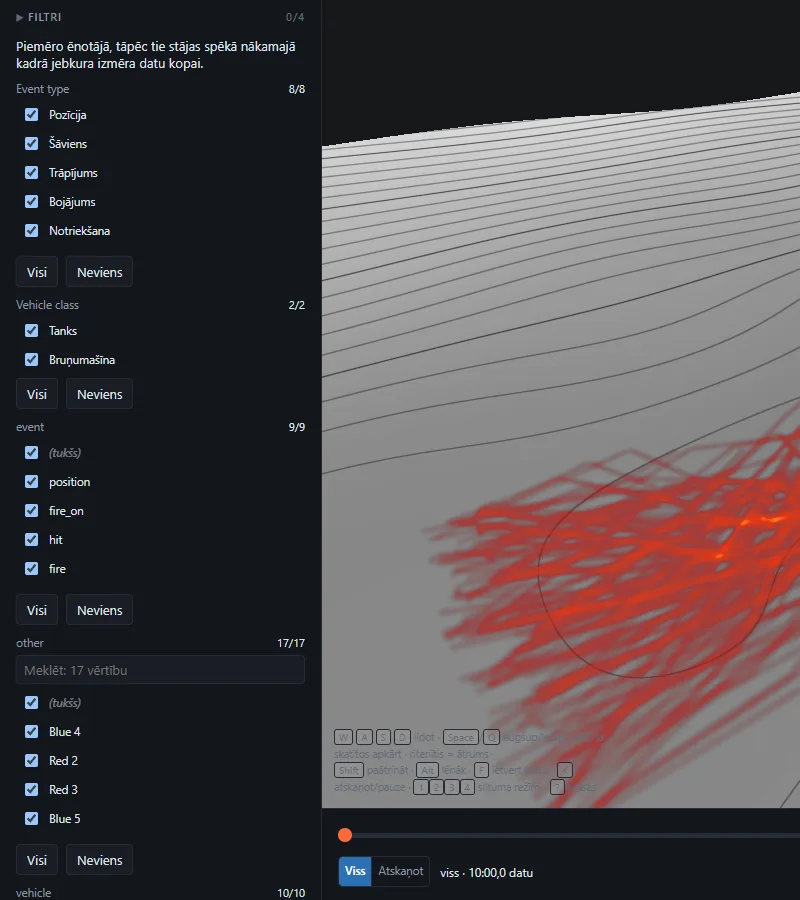
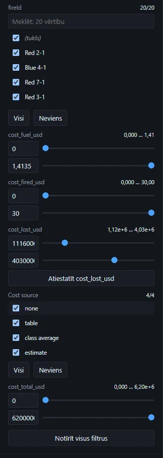

# Filtri

**Filtri** paslēpj rindas, kas jums nav vajadzīgas, piemēram, vienu transportlīdzekļu klasi vai vienu notikuma veidu, un attēls uzreiz atjaunojas. Panelis uzskaita kolonnas, kas saglabātas ielādes laikā sadaļā *Saglabāt filtrēšanai* ([Kolonnu atbilstība](column-mapping.md)), kā arī *Avota fails*, ja ielādēti vairāki faili.

## Izmēģiniet {#try-it}

1. Ielādējiet datu kopu un atveriet **Filtri** sānjoslā.
2. Sadaļā **Transportlīdzekļa klase** noņemiet atzīmi *Tanks*. Attēls uzreiz mainās.
3. Nospiediet **Notīrīt visus filtrus**, lai atsauktu.

Pirmās rindas ir skatītāja pašas kolonnas (zemāk). Pēc tām nāk kolonnas no jūsu faila.

## Kolonnas, ko pievieno skatītājs {#columns-the-viewer-adds}

Ielādējot skatītājs pats izveido četras kolonnas un uzskaita tās **pirmās**, ar nosaukumiem un vērtībām jūsu valodā, lai tas pats filtrs strādātu katrai spēlei un datu avotam:

| Kolonna | Vērtības | Izveidots no |
|---|---|---|
| **Notikuma veids** | 23 veidi: Pozīcija, Izšauts šāviens, Palaišana (raķete, šāviņš, bumba), Trāpījums, Netrāpījums (ierocis beidzās tuvu nevienam mērķim), Sprādziens, Bojājums, Nogalinājums, Nāve, Iznīcināts, Avārija, Izmešana / izlēkšana ar izpletni, Parādīšanās, Izzušana, Pacelšanās, Nolaišanās, Saskare ar zemi, Apstāšanās uz zemes, Pārbruņošana / uzpildīšana, Mērķa sasniegšana / mērķis, Mānekļis, Ziņojums, Cits | kolonna ar nosaukumu `event`, `events`, `event_type` vai `event_name`; katras spēles pašas vārdi (`shot`, `burst`, `fired`, `struck`, `flare`, `plant` ...) tiek piesaistīti šiem veidiem. Pilna tabula: [Notikumu tipi un klases](ref-event-types.md). |
| **Spēlētājs vai MI** | Spēlētājs, MI | kolonna `ai`, `is_ai`, `bot` vai `actor`; citādi `is_player` / `human`; citādi konta id (`user_id`, `steam_id`; tukšs vai 0 ir MI); Tacview ierakstiem - vai objektam ir pilots |
| **Transportlīdzekļa klase** | 17 klases: Iznīcinātājs, Triecienlidmašīna, Bumbvedējs, Citas lidmašīnas, Helikopters, Tanks, Bruņutehnika, Pretgaisa aizsardzība, Artilērija, Kravas auto / auto, Kuģis, Zemūdene, Kājnieki, Ierocis, Mānekļis, Būve, Cits | transportlīdzekļa vai vienības nosaukums (salīdzināts ar [figūru katalogu](figures.md)) un tipa kolonnas |
| **Mērķa klase** | tās pašas klases | otras puses transportlīdzeklis (`other_vehicle`, `target_vehicle`, `victim_type` ...) |

Tūlīt pēc tām nāk [iznākuma kolonnas](data-formats.md#outcome-columns), ja datos tās ir: **Raunda iznākums** un **Spēles iznākums** (*Jebkurš*, *Uzvarēts*, *Zaudēts*) un **Kā raunds beidzās**, tā vērtības tavā valodā. Filtrē pēc tām vai sadali siltumu pēc tām kā [uzvaru karti](win-rate.md).

Uzskaitīti tiek tikai veidi, kas ir sastopami. Vērtību kolonnas (`cost_*`, `earn_*`, `net_*` un *Izmaksu avots*, skatiet [Vērtības svēršana](value-weighting.md)) var filtrēt kā jebkuru skaitļu kolonnu: piemēram, noņemiet atzīmi *estimate* sadaļā *Izmaksu avots*, lai paturētu tikai novērtētās rindas.

Kategoriju sarakstam ar vairāk nekā 12 vērtībām parādās meklēšanas lodziņš (*Meklēt n vērtības*) un poga **Tikai šie**, kas atļauj tieši tās vērtības, kas atbilst.

Kuras kolonnas var filtrēt, tiek izlemts ielādes laikā, jo tās tad ir jānolasa. Ja nav saglabātas nevienas kolonnas, panelis to saka un norāda uz *Saglabāt filtrēšanai*.

## Skaitliskās kolonnas (diapazons) {#numeric-columns-range}

| Daļa | Nozīme |
|---|---|
| Nosaukums un `min ... max` | Kolonna un pašreizējais diapazons (visa kolonnas robeža, kamēr filtrs nav iestatīts). |
| Pirmā rinda: skaitļu lodziņš un slīdnis | Apakšējā robeža. Velkot slīdni virs augšējās robežas, tā stumj augšējo robežu līdzi. |
| Otrā rinda: skaitļu lodziņš un slīdnis | Augšējā robeža. Velkot zem apakšējās robežas, tā stumj arī to. |
| **Atiestatīt *kolonnu*** | Noņem šo filtru. |

Slīdņi aptver kolonnas minimumu līdz maksimumam 1000 soļos; skaitļu lodziņi pieņem jebkuru vērtību. Rinda iztur, ja tās vērtība ir diapazonā, abi gali ieskaitot. Lielas vērtības tiek rādītas eksponenciālā formā (`1.23e6`).

## Kategoriju kolonnas {#category-columns}

| Daļa | Nozīme |
|---|---|
| Nosaukums un `atļauts/kopā` | Kolonna un cik tās vērtību ir atļautas. |
| Vērtību saraksts | Izvēles rūtiņa katrai vērtībai; tukšā vērtība tiek rādīta kā *(tukšs)*. |
| **Viss** / **Neviens** | Atļaut visas vērtības / nevienu vērtību. |

Visu vērtību atļaušana noņem filtru.

## Noteikumi {#rules}

- **Četri filtri vienlaikus.** Galvenē rādīts `aktīvie/4`. Piektais filtrs netiek piemērots, un panelis to saka. Izvēle sadaļā [Vienības](entities.md) (vai Mača cilnes spēlētāja fokuss) izmanto vienu no četriem. Filtrs, kas aptver visu kolonnu, neizmanto nevienu.
- **Kategoriju kolonnai ir ne vairāk kā 4096 vērtības**; platāka ielādes laikā netiek saglabāta.
- **Filtri savienojas ar UN** un ar komandu redzamību, starpības sadalījumu, laika logu, attāluma nogriešanu un [griezumu](slice.md).
- **Filtra maiņa restartē uzkrāšanu un dažus kadrus vēlāk ekspozīciju izmēra no jauna**, jo filtrēšana var stipri mainīt blīvumu ([Krāsa un ekspozīcija](colour-and-exposure.md#auto-exposure)).
- **Notīrīt visus filtrus** noņem visus kolonnu filtrus. Komandu redzamība un citur iestatītā spēlētāju izvēle paliek.
- Kolonnu filtri maina siltuma režīmus. Tie nemaina [figūru atkārtojuma](box-replay.md) figūras, kas seko komandu redzamībai un sadaļas Vienības izvēlei. Vienības izvēle maina abus.
- [Līniju siltumā](line-heat.md) filtrs tiek pārbaudīts pret rindu, kur katrs segments *beidzas*.
- Katrā jaunā datu kopā visi filtri tiek notīrīti.

## Izstrādātājiem {#for-developers}

**Slots.** Katrs aktīvais filtrs aizņem vienu no četriem GPU slotiem ([`MAX_FILTER_SLOTS`](https://github.com/Holdi601/3DHeat/blob/main/src/render/types.ts)) - teksturu ar 4 baitiem katrā rindā. Slotus filtri saņem tādā secībā, kādā tie pēdējo reizi mainīti ([`filterSlots`](https://github.com/Holdi601/3DHeat/blob/main/src/render/filterTables.ts), kopīgs shader un abiem paneļiem). Aiz četriem kļūda saka *Tiek piemēroti tikai pirmie 4 filtri. Notīriet vienu - pārējie tiek ignorēti, nevis klusi apvienoti*, un papildu filtru nosaukumi ir *kolonna (nav piemērots)*. Filtri darbojas katrai rindai virsotņu ēnotājā, tāpēc sliekšņa maiņai nav vajadzīga atkārtota parsēšana un atkārtota augšupielāde.

**Filtri, ko panelis nerāda.** Lietojumprogrammas stāvoklī ir vēl divi veidi ([`FilterSpec`](https://github.com/Holdi601/3DHeat/blob/main/src/state/types.ts)):

- **grupu** filtrs, ko iestata Mača cilne, kad tā fokusē vienu pusi. Tas paslēpj pārējās grupas katrā režīmā, arī [starpības](difference.md) sadalījumā pa kolonnu.
- **personu** filtrs, ko iestata panelis [Vienības](entities.md) un Mača cilne, kad tā fokusē vienu spēlētāju. Tas ierobežo figūru atkārtojumu un siltuma režīmus. Siltumā tas ir kategoriju filtrs pār personu id un aizņem vienu no četriem slotiem. Tā maska satur 65 536 id ([`FILTER_MASK_CAPACITY`](https://github.com/Holdi601/3DHeat/blob/main/src/render/types.ts)); persona aiz šīs robežas aktīva filtra laikā siltumā netiek zīmēta, pat ja ir izvēlēta. Figūru atkārtojums tomēr to rāda.
