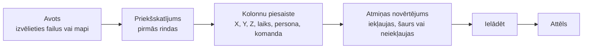

# Datu ievade

Pirms 3DHeat var kaut ko uzzīmēt, tam vajag tabulu: katra rinda saka, kur kaut kas bija un, ja jums tas ir, kad un kas tas bija. Šī sadaļa parāda, kā fails kļūst par attēlu. Vēl nav datu? Izmēģiniet [demonstrācijas datus](demo-data.md).

**Dariet to tagad:**

1. Siltumkartes sānjoslā atveriet **Avots** un nospiediet **Faili…** (vai ievelciet failu vai mapi nomešanas laukumā).
2. Paskatieties uz **Kolonnu piesaiste**: lodziņi parasti jau ir aizpildīti.
3. Pārbaudiet, vai **Atmiņas novērtējums** saka *iekļaujas*.
4. Nospiediet **Ielādēt**.

Viss, ko rāda cilne Siltumkarte, nāk no vienas **datu kopas**: rindu tabulas, kur katrai ir pozīcija un pēc izvēles laiks, persona, grupa, sesija, skatīšanās virziens un jebkurš skaits papildu kolonnu filtrēšanai. Šī sadaļa skaidro, kā datu kopa tiek veidota.

## Ceļš no failiem līdz attēlam {#the-path-from-files-to-picture}

1. **Izvēlieties failus** panelī **Avots** - vienu, vairākus, mapju koku vai ievelkot tos. Tiek pieņemti Parquet, CSV, Tacview, GPS trases un vēl citi; pilnais saraksts ir [Datu formāti](data-formats.md#files). Skatiet [Failu ielāde](loading-files.md).
2. **Priekšskatījums.** Tiek atvērts izvēlētais pirmais fails: tā kolonnu nosaukumi, pirmās 50 rindas, kuras kolonnas izskatās skaitliskas un (Parquet) katras kolonnas loģiskais tips un paša faila lasīšanas norādes, `heat3d` ieraksts kājenē.
3. **Automātiska saistīšana.** Kolonnas tiek piešķirtas lomām - X, Y, Z, laiks, persona, sesija, grupa, skatīšanās virziens - un dažas tiek saglabātas filtrēšanai. Katrs minējums ir redzams panelī **Kolonnu piesaiste** un to var mainīt. Skatiet [Kolonnu atbilstība](column-mapping.md) un [Asis, mērvienības un laiks](axes-units-and-time.md).
4. **Skaitīšana.** Tiek nolasīts katra faila rindu skaits (precīzi no Parquet kājenēm, aptuveni CSV failiem), tāpēc panelis var pateikt, pirms kaut kas ir ielādēts, cik daudz atmiņas nepieciešams un vai tā iekļaujas. Ja neiekļaujas, tas piedāvā ielādēt katru *N*-to rindu. Skatiet [Atmiņa un budžeti](memory-and-budgets.md).
5. **Ielāde.** Fona darbinieks nolasa tikai saistītās kolonnas katram failam - vairāki faili vienlaikus, līdz [parsēšanas pavedienu](memory-and-budgets.md#parser-threads) budžetam - un sapludina tos izvēles secībā vienā datu kopā: vienā kopīgā personu, grupu un sesiju vārdnīcā visiem failiem, vienā kopīgā laika sākumpunktā, visas rindas sakārtotas pēc laika. Skatiet [Sesijas, personas un grupas](sessions-persons-groups.md).
6. **Augšupielāde.** Galvenais pavediens vienam kadram paziņo "Augšupielādē N rindas GPU", tad rindas tiek ieliktas GPU atmiņā GPU budžeta robežās. Skatiet [GPU atmiņas saturs](gpu-memory.md).
7. **Pirmais attēls.** Kamera ietver datus, punktu rādiuss un piesātinājums tiek iestatīti pēc datu apjoma un rindu skaita, un pēc 8 uzzīmētiem kadriem piesātinājums tiek izmērīts no paša attēla ([Krāsa un ekspozīcija](colour-and-exposure.md)).

## Prasības, kas tiek pārbaudītas pirms ielādes {#requirements-checked-before-a-load}

| Vajadzība | Kas notiek bez tās |
|---|---|
| **Vismaz divas no X / Y / Z** | Ielāde tiek noraidīta. Ar tieši divām trešā ass ir 0 un dati tiek zīmēti kā plakana plakne 3D ainā - tieši to vēlas augšupvērsta kartes siltumkarte. |
| Laika kolonna | Pēc izvēles. Bez tās laika skala ir atspējota, skats paliek režīmā **Viss**, un sānjosla to saka. |
| Personas kolonna | Pēc izvēles. Nepieciešama [figūru pārklājumam](box-replay.md) (figūra katrai personai), [līniju siltumam](line-heat.md) (ceļš, ko katra persona gāja), interpolācijai, pēdām un vēsturei **Dzīves ilgums**. |
| Grupas kolonna | Pēc izvēles. Nepieciešama [komandu siltumam](team-heat.md) un [starpības](difference.md) režīmam (vismaz divas grupas). |

Režīms, ko ielādētie dati nevar atbalstīt, ir pelēks režīmu joslā; uzvedot virsū, parādās iemesls.

## Bez jūsu pašu datiem {#without-your-own-data}

Panelis **Datu kopa** (zem **Avots**) satur [sintētisko ģeneratoru](synthetic-generator.md), kas izveido datu kopu ar **battle royale** formu jebkurā izmērā - noderīgi skatītāja izmēģināšanai un tam, lai pārbaudītu, ko mašīna var izturēt.

## Lapas šajā sadaļā {#pages-in-this-section}

- [Failu ielāde](loading-files.md) - izvēlnes, mapes, ievilkšana un nomešana, vairāku failu sapludināšana, kustības faila noteikums, progress un atcelšana
- [Kolonnu atbilstība](column-mapping.md) - katrs lauks saistīšanas panelī, kā automātiskā saistīšana min, `heat3d` norādes
- [Asis, mērvienības un laiks](axes-units-and-time.md) - augšējā ass, apgriešana, mērvienību mērogs, laika vienības, skatīšanās virziens
- [Sesijas, personas un grupas](sessions-persons-groups.md) - ko dara katrs, ierobežojumi, kopīgi nosaukumi, vienības izmērs, panelis Datu kopa
- [Sintētiskais ģenerators](synthetic-generator.md)
- [Atmiņa un budžeti](memory-and-budgets.md) - atmiņas modelis, iekļaušanās pārbaude, decimēšana, kārtošanas griesti, resursu budžeti
