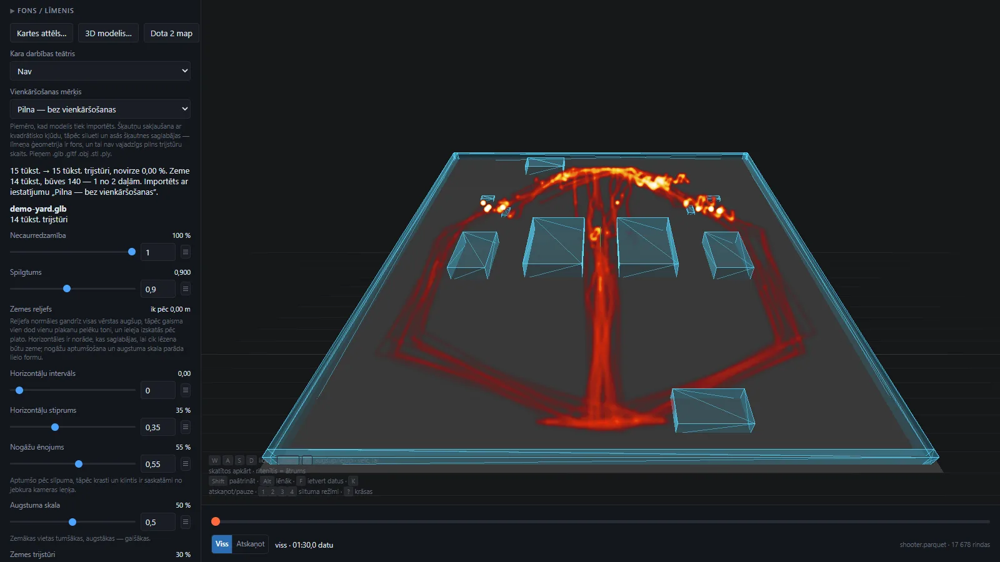
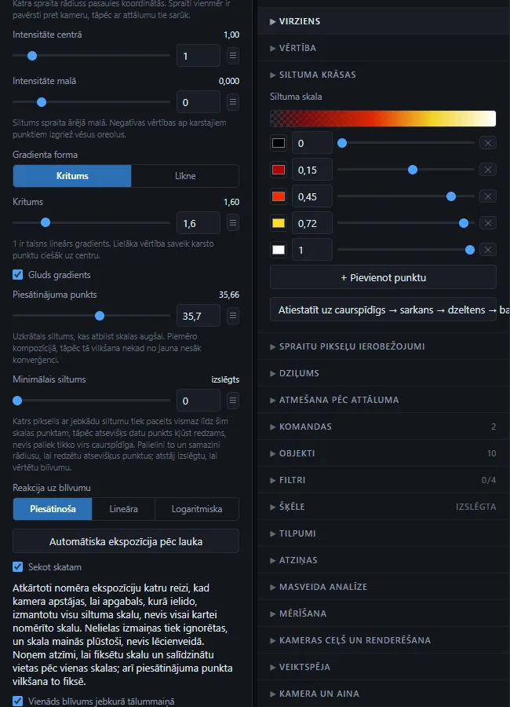

# Siltums

Siltums nokrāso vietas, kur notika daudz kas: sarkans, kur notika mazliet, baltkarsts, kur notika daudz. Tas atbild uz jautājumu "kur tas notiek un cik daudz".

**Siltums** (taustiņš 1) ir noklusējuma režīms. Katra redzamā [rinda](glossary.md) pievieno apaļu, pret kameru vērstu [sprite](glossary.md); pārklājošies sprite saskaitās peldošo punktu bufferī; summa tiek pārveidota caur krāsu skalu - pēc noklusējuma caurspīdīgs → sarkans → dzeltens → balts - un uzzīmēta pāri ainai.

Attēlā redzams šāvēja raunda siltums līmenī ar ēkām: karstās vietas atrodas istabās un uz kāpnēm, ne tikai uz zemes.

## Kā to lietot {#how-to-use-it}

1. Ielādējiet datus un nospiediet `1` (vai izvēlieties **Siltums** režīmu joslā).
2. Ja viss ir balts vai tukšs, nospiediet **Automātiska ekspozīcija pēc lauka** sadaļā **Siltuma forma**.
3. Mainiet **Spraita rādiuss**, līdz blakus esošie punkti saplūst joslās: mazāks rāda atsevišķus punktus, lielāks - laukumus.
4. Atveriet **Siltuma krāsas**, lai mainītu krāsas, vai **Dziļums**, lai kalni un sienas paslēptu siltumu aiz sevis.

Tie paši paneļi veido [Starpību](difference.md), [Komandu siltumu](team-heat.md) un [Līniju siltumu](line-heat.md); tie atšķiras pēc tā, ko pievieno (ar zīmi, krāsoti vai pa līnijām), nevis pēc veida.

## Paneļi un to noklusējumi {#the-panels-and-their-defaults}

Katra zemāk esošā vadība atbilst shader parametram, tāpēc tās maiņa neko nemaksā, izņemot pārzīmēšanu. Slīdņiem blakus ir ievadāms lauks un vilkšanas rokturis (mazais spiedziņš pa labi: vilkt uz augšu vai uz leju, tālāk ir ātrāk, Shift precizēšanai); ja slīdņa josla beidzas pirms reālās robežas, rokturis var pabīdīt tālāk līdz šeit dotajiem *vilkšanas griestiem*. Vērtības, kas atzīmētas *ielādējot*, tiek pārrēķinātas katrai jaunai datu kopai.

### Siltuma forma (atvērta) {#heat-shape-open}

| Vadība | Noklusējums | Diapazons (vilkšanas griesti) | Sīkāk |
|---|---|---|---|
| **Spraita rādiuss** | 6 m; ielādējot - apjoms / 120 | 0,05-2000 m, logaritmiski (50 000) | [Sprite forma](sprite-shape.md#sprite-radius) |
| **Intensitāte centrā** | 1 | 0-10 (1000) | [Sprite forma](sprite-shape.md#centre-and-edge-intensity) |
| **Intensitāte malā** | 0 | -2-10 (1000) | [Sprite forma](sprite-shape.md#centre-and-edge-intensity) |
| **Gradienta forma** | *Kritums* | *Kritums* / *Līkne* | [Sprite forma](sprite-shape.md#ramp-shape-falloff-or-curve) |
| **Kritums** (tikai Kritums) | 1,6 | 0,1-8 (64) | [Sprite forma](sprite-shape.md#falloff) |
| **Gluds gradients** (tikai Kritums) | ieslēgts | | [Sprite forma](sprite-shape.md#falloff) |
| Līknes redaktors (tikai Līkne) | priekšiestatījums *Gluds* | | [Sprite forma](sprite-shape.md#the-curve-editor) |
| **Piesātinājuma punkts** | 24; ielādējot - aptuvens novērtējums, pēc tam izmērīts | 0,1-4000, logaritmiski (10 000 000) | [Krāsa un ekspozīcija](colour-and-exposure.md#saturation-point) |
| **Minimālais siltums** | izslēgts (0) | 0-100% | [Krāsa un ekspozīcija](colour-and-exposure.md#minimum-heat) |
| **Reakcija uz blīvumu** | *Piesātinošs* | *Piesātinošs* / *Lineārs* / *Log* | [Krāsa un ekspozīcija](colour-and-exposure.md#density-response) |
| **Automātiska ekspozīcija pēc lauka** | | poga | [Krāsa un ekspozīcija](colour-and-exposure.md#auto-exposure) |
| **Sekot skatam** | ieslēgts | | Izmēra ekspozīciju no jauna katru reizi, kad kamera apstājas, tāpēc reģions, kurā ielidojat, izmanto visu krāsu skalu. Nelielas izmaiņas tiek ignorētas, un skala slīd. Atzīmi noņemiet vai velciet **Piesātinājuma punkts**, lai noslēgtu skalu un salīdzinātu vietas vienā skalā. [Krāsa un ekspozīcija](colour-and-exposure.md#follow-the-view) |
| **Vienāds blīvums jebkurā tālummaiņā** | ieslēgts | | Krāsa nozīmē vienu un to pašu rindu skaitu uz zemes laukuma, neatkarīgi no tā, cik tuvu esat. Sprite, ko pikseļu robežas palielina (tālu) vai samazina (tuvu), saglabā siltumu, ko pievienotu tā patiesais izmērs, tāpēc attēls, kas eksponēts no tālienes, neizbalst, kad ielidojat tajā. Ja izslēgts, sprite ar robežām pievieno pilnu savu svaru savā robežotajā izmērā. [Sprite forma](sprite-shape.md#pixel-clamps) |
| **Saplacināt uz zemes plaknes** | izslēgts | | [Sprite forma](sprite-shape.md#flatten-onto-ground-plane) |

### Siltuma krāsas (aizvērta) {#heat-colours-closed}

| Vadība | Noklusējums | Sīkāk |
|---|---|---|
| Grupu paraugkrāsas un **Krāsu atdalīšana** (tikai Komandu siltums) | 1,4 | [Komandu siltums](team-heat.md) |
| **Siltuma skala** redaktors (*Pozitīvā (pieskaitošās komandas)* režīmā Starpība, *Necaurredzamības skala* režīmā Komandu siltums) | caurspīdīgs → sarkans → dzeltens → balts | [Krāsa un ekspozīcija](colour-and-exposure.md#the-ramp-editor) |
| **Atiestatīt uz caurspīdīgs → sarkans → dzeltens → balts** | | |
| **Negatīvā (atņemošās komandas)** skala (tikai Starpība) | caurspīdīgs → zaļš → zils → violets | [Starpība](difference.md#colours) |

### Sprite pikseļu robežas (aizvērta) {#sprite-pixel-clamps-closed}

| Vadība | Noklusējums | Diapazons (vilkšanas griesti) | Sīkāk |
|---|---|---|---|
| **Min. rādiuss pikseļos** | 1 px | 0-16 (512) | [Sprite forma](sprite-shape.md#pixel-clamps) |
| **Maks. rādiuss pikseļos** | 96 px | 2-1024, logaritmiski (8192) | [Sprite forma](sprite-shape.md#pixel-clamps) |

### Dziļums (atvērts) {#depth-open}

| Vadība | Noklusējums | Sīkāk |
|---|---|---|
| **Slēpt aiz reljefa** | ieslēgts | [Dziļums un nogriešana](depth-and-culling.md#hide-behind-terrain) |
| **Paslēpts aiz ģeometrijas** | 0,8 (*par 80% tumšāks*) | [Dziļums un nogriešana](depth-and-culling.md#hidden-behind-geometry) |

### Attāluma nogriešana (aizvērta) {#distance-culling-closed}

| Vadība | Noklusējums | Diapazons (vilkšanas griesti) | Sīkāk |
|---|---|---|---|
| **Tuvā** | izslēgts (0) | 0,5-5000 m, logaritmiski; trases apakšā = izslēgts (200 000) | [Dziļums un nogriešana](depth-and-culling.md#distance-culling) |
| **Tālā** | izslēgts (0) | 1-200 000 m, logaritmiski; apakšā = izslēgts (10 000 000) | [Dziļums un nogriešana](depth-and-culling.md#distance-culling) |
| **Griezt pa plakni** | ieslēgts | | [Dziļums un nogriešana](depth-and-culling.md#distance-culling) |
| **Griezt arī līmeni** | ieslēgts | | [Dziļums un nogriešana](depth-and-culling.md#distance-culling) |

Taustiņi: `[` un `]` bīda tālo robežu iekšā un ārā, `\` to ieslēdz vai izslēdz ([Dziļums un nogriešana](depth-and-culling.md#keyboard)).

### Virziens un Vērtība {#direction-and-value}

Zem sadaļas Siltuma forma ir vēl divas sadaļas. **Virziens** zīmē katru rindu kā sektoru un pievieno bultas: skatiet [Virziena siltums](directional-heat.md). **Vērtība** svēr siltumu pēc tā, cik maksāja vai ko nopelnīja katra rinda: skatiet [Vērtības svēršana](value-weighting.md).

## Ko saglabā {#what-is-saved}

Iepriekš minētie siltuma iestatījumi starp sesijām netiek saglabāti: pārlādējot lapu, atjaunojas noklusējumi. Pārlūkā tiek glabātas divas lietas: pēdējais atskaņošanas ātrums (`heat3d.speed`, skatiet [Laika skala](timeline.md)) un [figūru pārklājuma](box-replay.md) tālo figūru iestatījumi (simbolu stils, izmērs, trāpījumu zīmes un tā tālāk). Tāpat tiek saglabāta valoda, [apgrieztās pasaules asis](camera.md#invert-world-axis), sacīkšu cilnes atcerētie auto nosaukumi un [līmeņu bibliotēka](level-library.md). Pilns saraksts ir [Saglabātie iestatījumi](ref-settings-storage.md).
