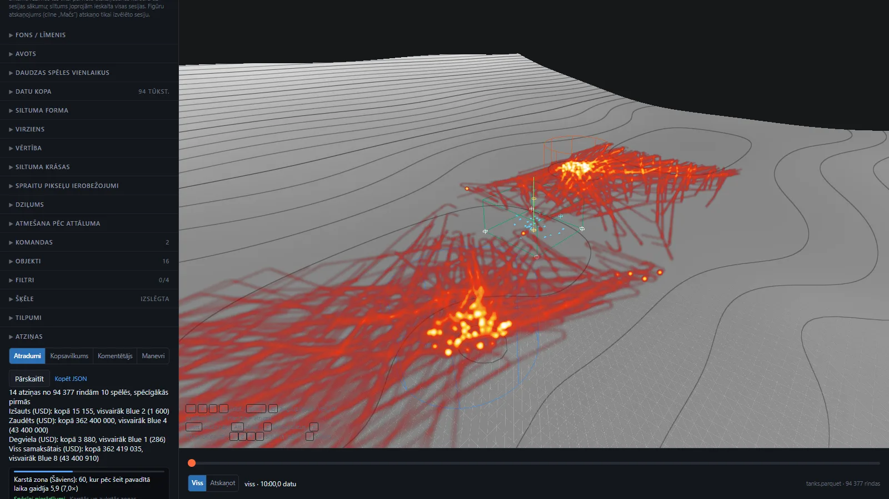
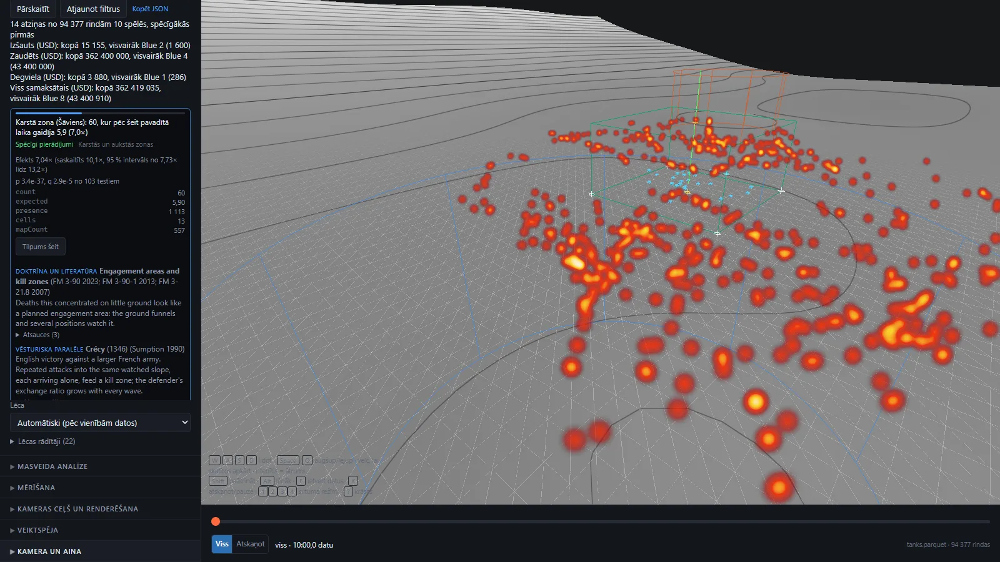
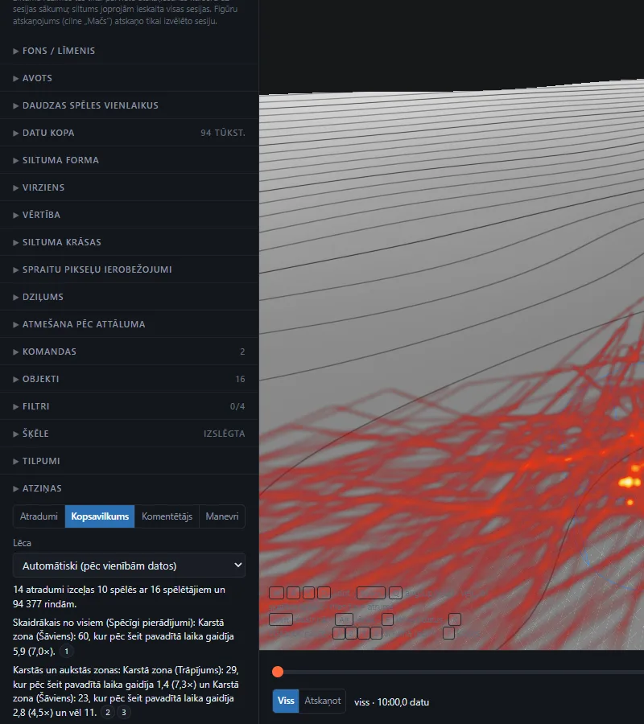
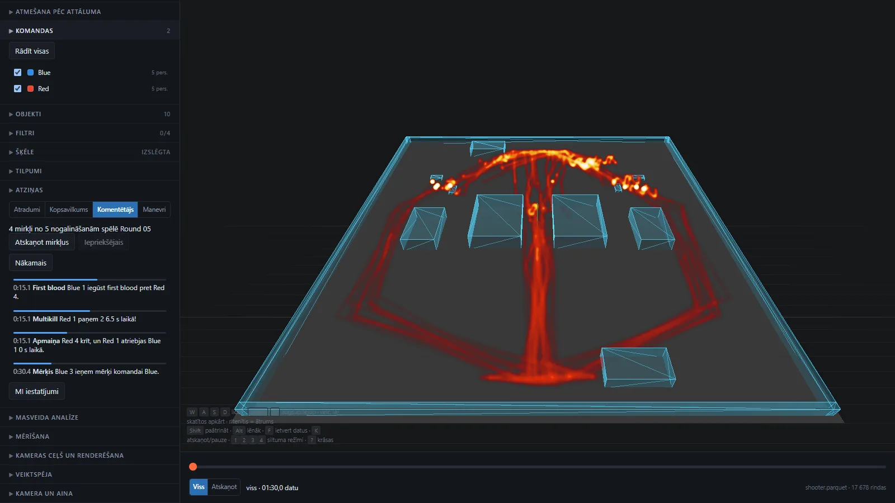

# Atziņas

**Atziņas** pārlūko ielādētos datus, meklējot to, kas izceļas - spēcīgas pozīcijas, nāvējošu zemi, spawn slazdus, sašaurinājumus, spēlētājus, kas ievērojami pārspēj savus vienaudžus - un pastāsta jums, sākot ar spēcīgāko, ar pierādījumiem. Ar to vienā minūtē var uzzināt, kur spēle tika uzvarēta vai zaudēta. Pēc tam tas var uzrakstīt kopsavilkumu, un vienas spēles atkārtojumā tas var darboties kā komentētājs, kas pārlec uz lielajiem mirkļiem.

Viss tiek skaitīts jūsu pārlūkā. Nekas neatstāj jūsu datoru, ja vien neieslēdzat ārēju MI (skatiet [Ārējais MI](#external-ai)).

Sadaļa **Atziņas** atrodas Siltumkartes un Mača cilņu sānjoslā. Tai ir trīs cilnes: **Atradumi**, **Kopsavilkums** un **Komentētājs**.

## Atradumi {#findings}

1. Ielādējiet datus un atveriet **Atziņas**. Nospiediet **Atrast atziņas** ("Skaita… n%" rāda progresu).
2. Izlasiet sarakstu. Katram atradumam ir stipruma josla, teikums, cik labi pierādījumi (*Spēcīgi pierādījumi*, *Labi pierādījumi* vai *Daži pierādījumi*), kurš detektors to atrada un transportlīdzekļa klase, kur tas ir svarīgi.
3. **Noklikšķiniet uz atradumu**: skatītājs piemēro tā filtrus, lido kameru uz vietu un pārlec uz laiku, un atver detaļas: efektu ar tā 95% intervālu, p un q vērtības, saskaitītos pierādījumus un **Tilpums šeit**, kas zīmē [tilpumu](volumes.md) ap vietu.
4. **Atjaunot filtrus** atjauno jūsu filtrus. **Kopēt JSON** kopē visu pārskatu.

Skaitīšanā tiek izmantoti pašreizējie filtri, paslēptās grupas un izvēlētā spēle visā laika diapazonā. Ja pēc tam maināt filtrus, parādās piezīme; nospiediet **Skaitīt vēlreiz**.

Saraksta augšā esošās rindas (piemēram, naudas kopsummas) apkopo visus datus pirms atradumiem.

### Detektori {#the-detectors}

| Detektors | Ko tas atrod | Kas tam vajag datos |
|---|---|---|
| **Spēka pozīcijas** | Vietas ar daudz labākām nogalinājumu un nāves attiecībām nekā pārējā kartē, un *drošu zemi*, kur mazs skaits mirst par pavadīto laiku | nogalinājumu un nāves notikumi |
| **Karstās un aukstās zonas** | Vietas, kur notikuma veids (šāvieni, trāpījumi, pārņemšanas ...) notiek daudz biežāk vai retāk, nekā tur pavadītais laiks liek domāt | notikumu kolonna |
| **Atklāta vieta un segums** | Nāves atklātā vietā pie tuvumā esošas līmeņa ģeometrijas un lēna kustība pret ātru kustību | nāves; 3D līmenis ģeometrijas daļai |
| **Spawni** | Spēcīgi spawni, spawn slazdi, drošie spawni, laiks līdz pirmajam kontaktam | laiks un personas |
| **Klase pēc vietas** | Transportlīdzekļa klase vai spēlētāji pret MI, kas apgabalā veicas daudz labāk vai sliktāk | nogalinājumi un transportlīdzekļa klases vai spēlētāja/MI kolonna |
| **Spēlētāji** | Spēlētāji, kas nogalina vai mirst daudz vairāk vai mazāk nekā citi tajā pašā klasē | personas un nogalinājumi |
| **Šaurumi un flangi** | Sašaurinājumi (daudz vairāk šķērsojumu nekā apkārtējā zemē) un flangu maršruti (reti izmantoti, bet ved uz nogalinājumiem) | personas |
| **Vērtība** | *Dārga zeme* un *Ienesīga zeme* | [vērtības kolonnas](value-weighting.md) |

Detektori, ko dati nevar palaist, ir uzskaitīti apakšā ar iemeslu.

### Kā atradumi tiek sarindoti {#how-findings-are-ranked}

Katra vieta vai grupa tiek pārbaudīta pret pārējo karti (precīzi binomiālie vai ātruma testi). Viltus atklājumu līmenis tiek turēts 5% (Benjamini-Hochberg). Nejaušība var izskatīties pēc parauga; tas samazina viltus trauksmes: starp parādītajiem atradumiem sagaidāms, ka ne vairāk kā aptuveni viens no divdesmit ir nejaušība. Efekti no maza notikumu skaita pirms sarindošanas tiek vilkti uz "nav efekta". Ne vairāk kā 60 atradumi tiek uzskaitīti, un katrs detektors iegūst dažas vietas augšā.

## Kopsavilkums {#debrief}

Cilnē **Kopsavilkums** atradumi tiek uzrakstīti kā īss teksts: ievads, skaidrākais atradums, viens par taktiku, viens par balansēšanu, pārējie grupēti pēc detektora, un cik no tiem balstās uz vājākiem pierādījumiem. Katram rindkopas punktam ir numurētas pogas, kas parāda tās atradumus. **Kopēt tekstu** to kopē.

Iebūvētais stāstītājs darbojas bezsaistē, jūsu valodā. Virs tā esošais **Lēcas** atlasītājs (skatiet [Zināšanu lēca](knowledge.md)) izlemj, kādu literatūru rindkopas citē.

### Ārējais MI {#external-ai}

**MI iestatījumi** ļauj kopsavilkumu uzrakstīt izvēlētam MI modelim:

| Iestatījums | Nozīme |
|---|---|
| **Sniedzējs** | Anthropic (Claude), OpenAI (ChatGPT), OpenRouter, Ollama (lokāls), LM Studio (lokāls), llama.cpp serveris (lokāls) vai jebkurš ar OpenAI saderīgs galapunkts |
| **Bāzes URL**, **Modelis** | Aizpilda sniedzējs; **Uzskaitīt modeļus** jautā serverim |
| **API atslēga** | Nosūtīta tikai uz bāzes URL. Nekad netiek ierakstīta žurnālā, nekad nesaglabāta skatos, eksportos vai `.3dheat` failos. Vairumam lokālo serveru tā nav vajadzīga. |
| **Atcerēties atslēgu šajā pārlūkā** | Pēc noklusējuma izslēgts: atslēga tiek aizmirsta, kad lapa aizveras |
| **Izmantot ārējo MI** | Pēc noklusējuma izslēgts |
| **Sūtīt spēlētāju vārdus** | Pēc noklusējuma izslēgts: spēlētāji tiek sūtīti kā P1, P2 ... |

Pēc tam ierakstiet neobligātu jautājumu un nospiediet **Rakstīt ar MI**. Tiek nosūtīti tikai atradumi un to skaitļi - nekad jūsu datu rindas. Atbilde ienāk pa daļām; citētie atradumi kļūst par pogām.

## Komentētājs {#caster}

Vienai **spēlei** (izvēlieties vienu, ja ielādētas vairākas) **Komentētājs** atrod mirkļus, kas vērti skatīšanās: pirmo asiņu, vairāku nogalinājumu, apmaiņas, izdzīvošanas, mērķa svārstības, atgriešanās, izcilus spēlētājus, tālus šāvienus.

- Noklikšķiniet uz mirkļa: skats pārslēdzas uz atkārtojumu, pārlec tieši pirms tā, lido tur un seko spēlētājam.
- **Atskaņot mirkļus** atskaņo katru līdz beigām un pāriet tālāk; **Iepriekšējais** / **Nākamais** pārvietojas starp tiem.
- Ar ieslēgtu ārēju MI **MI komentārs** uzraksta komentāru no mirkļu saraksta (veidi, laiki, vārdi vai pseidonīmi, komandas, klases, attālumi).

Tam vajag personas un nogalinājumu/nāves (vai pārņemšanas) notikumus; kolonna `other`/`victim` padara iespējamas apmaiņas un tālus šāvienus.

## Zināšanu lēca {#knowledge-lens}

Atradumu var lasīt caur **lēcu** no nostiprinātām zināšanām: militārā doktrīna, gaisa un jūras kauja, pilsētas operācijas, spēļu dizains un e-sports (vai *Auto*, ko izvēlas dati pēc vienībām). Atvērts atradums tad rāda tuvāko **doktrīnas un literatūras** ierakstu un **vēsturisku paralēli** ar atsaucēm, un **Lēcas rādītāji** aprēķina mērījumus no šīs literatūras pēc datiem (Lanchestera pielāgojumi, apmaiņas attiecības, spēku attiecības, uguns lauki, galvenais reljefs, apmaiņas, iniciatīva). Kopsavilkums un MI uzvedne tos iekļauj. Viss par to: [Zināšanu lēca](knowledge.md).

Lēcas rādītāji arī mēra, kā spēlētāji uzvedas kā pūlis un kā grupa - saskaņošanu un riņķošanu, maršrutu vadīšanu, joslas un takas, blīvumu, vadītājus un sekotājus, atpalikušos, lūzuma punktu zaudējumu gadījumā, risku pēc zaudētas dzīvības, sēriju, pirkumu saskaņotību un reakciju uz ienākošo uguni - katru pret savu nulles modeli: [Kolektīvā uzvedība](collective-behaviour.md).

## Dati, kas padara atziņas iespējamas {#data-that-makes-insights-work}

- pozīcijas ar **laiku**, **personas** un **komandas** kolonnu;
- **notikumu** kolonna ar nogalinājumiem un nāvēm (`kill`, `death`) un citiem (`hit`, `fire`, `capture` ...);
- **otras puses** kolonna (`other`, `victim`) apmaiņām un virzieniem;
- **transportlīdzekļa** vai **tipa** kolonna klasēm; `ai` kolonna spēlētājiem pret MI;
- **sesijas** / **spēles** / **raunda** kolonna, kad ir vairākas spēles.

[Demonstrācijas datiem](demo-data.md) ir visi šie.
