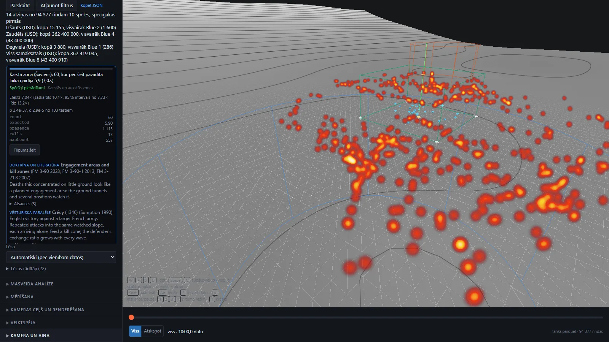

# Zināšanu lēca

Kad [Atziņas](insights.md) kaut ko atrod, šī daļa to izskaidro ar idejām no militārās vēstures, spēļu dizaina un sporta analīzes un nosauc grāmatu vai rakstu, no kura tā nāk. Izmantojiet to, lai uzzinātu *kāpēc* kāds raksturlielums ir svarīgs, nevis tikai to, ka tas pastāv.

## Izmēģiniet {#try-it}

1. Ielādējiet datus un atveriet **Atziņas**, tad nospiediet **Atrast atziņas**.
2. Noklikšķiniet uz atradumu, lai to atvērtu.
3. Izlasiet **Doktrīna un literatūra** un **Vēsturiska paralēle**; pilnās atsauces ir salocītas zem tām.
4. Mainiet **Lēca** (piemēram, uz *Militārā doktrīna*), lai izlasītu to pašu atradumu caur citu literatūras kopu.

## Kā tas darbojas {#how-it-works}

Atziņu panelis savus atradumus vērtē tā, kā to darītu profesionāls analītiķis: caur militāro doktrīnu un operāciju pētniecību, vēsturiskām kaujām un spēļu dizaina, līmeņu dizaina un analītikas literatūru. Tas to dara bezsaistē, no izvērtētas zināšanu bāzes skatītājā, un tās pašas lietas nodod ārējam modelim, kad tas raksta kopsavilkumu.

## Ko rāda panelis {#what-the-panel-shows}

- **Lēca** izvēlas literatūras kopu, caur kuru tiek lasīti atradumi: *Auto* (izvēlēts pēc datos esošo vienību veidiem: lidmašīnas, kuģi, sauszemes transportlīdzekļi, kājnieki), *Militārā doktrīna*, *Gaisa kauja*, *Jūras*, *Pilsētas kauja*, *Spēļu dizains un līdzsvars*, *E-sports*. Ieraksti ārpus izvēlētās lēcas tiek izlaisti.
- Katrs atvērtais atradums rāda tuvāko **doktrīnas un literatūras** ierakstu un tuvāko **vēsturisko paralēli**, ar pilnām atsaucēm salocītām zem tiem.
- **Lēcas rādītāji** uzskaita operāciju analīzes mērus, kas aprēķināti pār tām pašām rindām (zemāk), katru ar tā nozīmi un tā literatūru.
- **Kopsavilkums** pievieno rindas vadošajiem atradumiem un lēcas rādītājiem: "Doktrīna un literatūra: ..." un "Vēsturiska paralēle: ...", katrs ar autoru-gada citātiem un atsaucēm zem tā salocītām.
- **Rakstīt ar MI** nosūta vispiemērotākos ierakstus (kopsavilkumu, mācību, atradumus, ar kuriem tie saistīti, pilnās atsauces) kopā ar pārskatu un lūdz modeli tos citēt pēc id — `{concept.lanchester-square}` — un neizmantot citus avotus.

Etiķetes ir tulkotas; zināšanas pašas ir angliski.

## Lēcas rādītāji {#lens-metrics}

Aprēķina atziņu darbinieks tajā pašā rindu caurlaidē kā detektori (`src/insights/lensMetrics.ts`). Katrs tiek izlaists, ja dati to nevar nest.

| Rādītājs | Ko tas mēra | Vajag |
|---|---|---|
| Lančestera atbilstība | Katras puses zaudējumi uz 20 s, regresēti pēc abu pušu dzīvo spēku (Puasona, kvazi-varbūtības kļūdas); eksponenti pēc ienaidnieka un savā spēkā, pārbaudīti pret kvadrāta likumu (mērķtiecīgā uguns) un lineāro likumu (zonas uguns) | laiks, komandas, nogalinājumi un nāves |
| Apmaiņas attiecība | Nogalinājumi uz vienu nāvi pēc puses un vietas; to nāvju daļa uz visnāvīgāko zemi, kurai ir 5% no pavadītā laika, salīdzinot ar daļu, ko dod tikai nejaušība ar tik daudz nāvēm; Džinija koeficients nāvēm pret laiku; Morana I nāves biežumiem | nogalinājumi un nāves |
| Vietējā spēku attiecība | Draudzīgās un ienaidnieka vienības, kas dzīvas iesaistīšanās diapazonā ap katru nogalinājumu (diapazons no datiem: divreiz lielāks par mediānu attālumu līdz tuvākajam ienaidniekam); to nogalinājumu daļa, ko veikusi vietēji pārākā puse, un tās pārsvars pār to, ko paredz tikai skaits | laiks, komandas, personas |
| Uguns lauki | Redzamības zonas aktīvāko nogalinājumu vietās uz 2,5D šķēršļu virsmas (līmeņa ģeometrija līdz sienas augstumam vai izstaigātā zeme) pret vidējo vietu, un ranga korelācija starp skatu un nogalinājumu daļu | pozīcijas; ielādēts līmenis to padara precīzāku; nav gaisam |
| Enerģijas stāvoklis | Īpatnējā enerģija (augstums plus augstums, ko ātrums var nopirkt) gaisa nogalinātājiem un gaisa upuriem, salīdzināta ar Mann–Whitney statistiku | lidmašīnu klases, laiks, augstums |
| Stratēģiski svarīgs reljefs | Cik bieži katra vieta ir starp mača trim aktīvākajām nogalinājumu vietām | vairāki mači |
| Savstarpējs atbalsts (apmaiņas) | Nāves, uz kurām atbild biedra nogalinājums iesaistīšanās diapazonā un 5 s laikā | laiks, komandas |
| Pirmais trieciens | Iesaistīšanās — nogalinājumi, grupēti pēc mača, pēc 20 s klusuma un pēc trim iesaistīšanās diapazoniem — ko uzvar puse, kas pirmā guva punktu | laiks, komandas |
| Salvu modelis | Hjūza salvu vienādojums, pielāgots 20 s periodiem, kad kuģi ir kontaktā: kuģi, kas izslēgti no kaujas uz vienu uzbrūkošo kuģi, un izglābti uz vienu aizstāvošo kuģi; Lančestera pielāgojums tikai kuģiem | kuģu klases, laiks, komandas |
| Kaujas efektivitāte | Nogalinājumi uz vienības stundu kaujā katrai pusei un to divu lielāko attiecība (kaujas efektivitātes vērtība Dipija nozīmē) ar tās 95% intervālu, un katras puses nogalinājumu daļa vienādos vietējos skaitos | laiks, komandas |
| Iesaistīšanās diapazoni | Attālums līdz tuvākajam ienaidniekam nogalinājumos, palaišanās brīžos un katras dzīves pirmajā šāvienā (atklāšana līdz iesaistīšanās), pēc vienības veida | laiks, komandas; palaišanas, kur datiem tās ir |
| Nogalināšanas ķēde | Sekundes no nogalinātāja pēdējās palaišanas līdz nogalinājumam un no tā pirmā šāviena cīņā līdz nogalinājumam | laiks; palaišanas vai uguns notikumi |
| Koncentrācija vai izkliedēšanās | Katrā 20 s periodā — divu lielāko pušu izkliedētība un to nogalinājumu daļa, ko paņēma blīvākā no tām | laiks, komandas |
| Lidojumi | Pa pusēm: lidojumi (pacelšanās vai lidmašīnu parādīšanās), nolaišanās, zaudētās lidmašīnas un nogalinājumi ar lidmašīnām; zaudējumu biežums un nogalinājumi uz lidojumu | lidmašīnu klases; pacelšanās vai parādīšanās |

Dati ar raundiem pievieno tuvcīņas un e-sporta mērus — raunda uzvaras varbūtību, darbību vērtību, atklāšanas duelus, apmaiņas, "peeker" pret "holder", mērķi, krustuguni, palīglīdzekļus, vienu spēlētāju pārsvaru, "clutch", sagatavošanas, pēc-uzstādīšanas, nāves piltuves un spēlētāja ietekmi: skatiet [Tuvcīņa un raundi](close-quarters.md).

Trajektorijas un komandas pievieno kolektīvās uzvedības mērus no pūļu zinātnes, kolektīvās kustības, uzvedības ekonomikas un militārās psiholoģijas — saskaņošana un klaiņošana, maršruta ganīšana, joslas un takas, blīvums, līderi un sekotāji, atpalikušie, lūzuma punkts, risks pēc zaudējumiem, sērijas, pirkšanas vienošanās un apspiešana, katrs pret savu nulles modeli: skatiet [Kolektīvā uzvedība](collective-behaviour.md).

Ieroči, mānekļi un ēkas netiek skaitīti kā vienības. Kur ieroču rindās ir nosaukta to palaidējvienība (kolonna `Shooter` vai `Launcher`, kā tas ir Tacview datiem), palaišana tiek ieskaitīta šai vienībai, sakrītot ar tās vārdu vai objekta id.

## Kā atradumi satiek literatūru {#how-findings-meet-the-literature}

Ieraksti un atradumi satiekas caur **shēmu taksonomiju** (`src/insights/knowledge/patterns.ts`): koncentrācija, vietējā pārākums, mērķtiecīgā un zonas uguns, šaurās vietas, nāves zonas, uguns lauki, apgāztā nogāze, flangēšana, savstarpējs atbalsts, enerģijas pārsvars, dzemdēšanas spiediens, līdzsvars un tā tālāk. Katrs detektora veids un katrs lēcas rādītājs norāda, kuras shēmas tā skaitļi rāda (`src/insights/lens.ts`); katrs zināšanu ieraksts norāda, kuras shēmas tas skar, ar svaru. Ieraksta atbilstība atradumam ir svērtā pārklāšanās, mērogota pēc tā, cik labi ieraksta joma (sauszeme, gaiss, jūra, pilsēta) atbilst datiem, un pēc paša atradumu stipruma. Parādītais pamatojums ir atradumu skaitļi vienā teikumā, kam seko ieraksta mācība.

## Katalogs {#catalogue}

Katra shēma, koncepts, metode, vēsturisks gadījums, dizaina princips un pētījums ar bibliogrāfiju: skatiet [Zināšanu katalogs](knowledge-catalogue.md).

## Izstrādātājiem {#for-developers}

### Ierakstu pievienošana {#adding-entries}

1. Izvēlieties failu pēc veida: `concepts.ts` un `concepts-more.ts`, `methods.ts`, `cases.ts`, `cases-land.ts`, `cases-air-sea.ts`, `cases-esports.ts`, `design.ts` (dizaina principi) vai `studies.ts` mapē `src/insights/knowledge/`.
2. Dodiet tam jaunu id `<veids>.<slug>` (nekad nelietojiet atkārtoti), tā lēcas, jomas un shēmas, ar kurām tas saistās, ar svariem 0..1. Pievienojiet shēmu `patterns.ts` tikai tad, kad atradums to var parādīt, un piesaistiet to no atradums vai rādītāja `lens.ts`.
3. Uzrakstiet kopsavilkumu un mācību **savos vārdos**. Citāti tikai no publiskā domēna darbiem (`pd: true` atsaucē), un īsi.
4. Citējiet: pievienojiet katru jaunu darbu `refs.ts` ar autoriem, gadu, nosaukumu un izdevēju (žurnāls ar sējumu un lappusēm); URL vai DOI, ja ir publisks ieraksts.
5. Palaidiet `npx vitest run src/insights/lens.test.ts` (unikāli id, zināmas shēmas, atrisināmas atsauces, publiskā domēna citāti, gadījumi ar datumu un iznākumu) un `node tools/knowledge-doc.mjs`, lai atjaunotu [katalogu](knowledge-catalogue.md).
