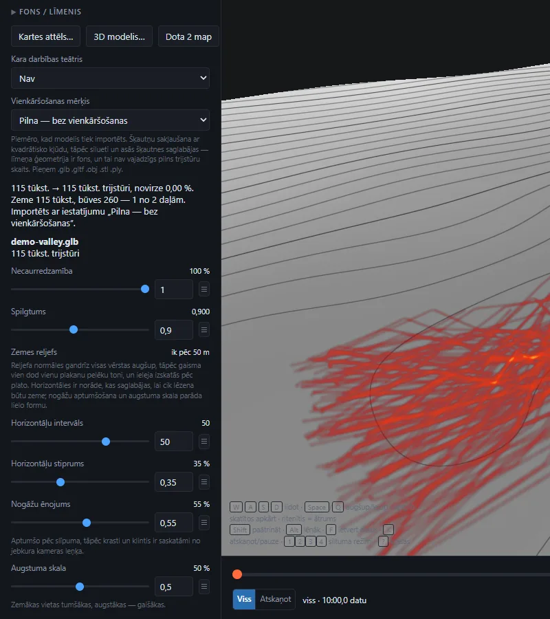

# Līmeņi un fona ģeometrija

Līmenis ir 3D vieta, kur spēle notika - karte, pilsēta, trase. Novietojiet to aiz saviem datiem, un jūs redzat, *kur* ir siltums. Panelis **Fons / līmenis** (skatiet [Glosāriju](glossary.md) vārdam "līmenis") dod trīs veidu kontekstu:

- **kartes attēlu**, ko georeferencē divi enkurpunkti - skatiet [Kartes attēli](map-images.md);
- **3D līmeni** - `.glb`, `.gltf`, `.obj`, `.stl` vai `.ply` - sadalītu zemē, struktūrās un ūdenī un vienkāršotu importējot - skatiet [3D līmeņi](model-levels.md) un [Līmeņa izskats](level-appearance.md);
- **pasaules fonu** - ierakstam, kas saka, kur uz zemes tas ir (Tacview ACMI fails), reālu reljefu, ceļus, ūdeni, lidlaukus un ēkas, lejupielādētas no atvērtiem datiem - skatiet [Pasaules fons](world-backdrop.md).

Kad nekas nav ielādēts, aina ir tumša ar režģi un krāsainām asīm (**Režģis** un **Asis** sadaļā [Kamera un aina](camera.md)), un panelis saka *Nekas nav ielādēts — ainā redzams režģis un asis. Pievieno kartes attēlu vai līmeņa tīklu, lai siltumam dotu kontekstu.*

Līmenis ir kopīgs visām trim cilnēm: trase, kas ielādēta cilnē Sacīkšu analīze, ir tas pats līmenis, ko rāda siltumkarte.

## Novietojiet līmeni aiz saviem datiem {#put-a-level-behind-your-data}

1. Vispirms ielādējiet savus datus ([Datu ievade](getting-data-in.md)), lai līmenis tiktu pielāgots tiem.
2. Sānjoslā atveriet **Fons / līmenis**.
3. Nospiediet **Kartes attēls…** attēlam vai **3D modelis…** 3D līmenim un izvēlieties failu. Reāla pasaules ieraksta gadījumā lietojiet **Reālā pasaule kā fons** vai **Kara darbības teātris**.
4. Pagaidiet, līdz progresa rinda pabeidzas. Liels modelis vispirms tiek vienkāršots (skatiet zemāk **Vienkāršošanas mērķis**).
5. Nospiediet **F** skatā, lai ietvertu visu. Lietojiet **Necaurredzamība** un **Spilgtums**, līdz siltums izceļas uz līmeņa.
6. Nospiediet **Saglabāt bibliotēkā**, ja līmeni izmantosiet atkal ([Līmeņu bibliotēka](level-library.md)).

## Ko līmenis dara siltumam {#what-a-level-does-for-the-heat}

- Tas **aizsedz**: datu punkti aiz tā tiek aptumšoti pēc virsmas, un datu punkti aiz reljefa ir paslēpti ([Dziļums un nogriešana](depth-and-culling.md)). Bez līmeņa aizsegšanas nav.
- To **griež** [Griezums](slice.md) un, ar *Griezt arī līmeni*, [attāluma nogriešana](depth-and-culling.md#distance-culling) kopā ar siltumu.
- Tas ir vienīgais, ko [lauka dziļums](camera.md#depth-of-field) izplūdina, papildus režģim un kastēm.
- 3D līmenis **paplašina kameras tālo plakni**, kad tas ir lielāks par datiem: tuvā un tālā plakne tiek kalibrētas pēc datu kopas, un eksportēta karte vairākus kilometrus platā citādi atrastos pilnībā aiz tālās plaknes un atstātu tukšu skatu. Tālā plakne kļūst par 3 × līmeņa horizontālo izmēru, ja tas ir lielāks, tuvā plakne pārvietojas līdzi (vismaz tālā / 100 000), lai saglabātu dziļuma precizitāti, no kuras atkarīga aizsegšana, un lidošanas ātrums tiek paaugstināts līdz vismaz izmērs / 12. Tā tiek tikai paplašināta, nekad sašaurināta.

## Panelis no augšas uz leju {#the-panel-top-to-bottom}

| Daļa | Sīkāk |
|---|---|
| **Kartes attēls…**, **3D modelis…** | Ielādē vienu; tas aizstāj pašreizējo līmeni. |
| **Reālā pasaule kā fons**, **Aizmirst kartes flīzes** | Tikai datu kopai ar ģeogrāfisku atsauci: uzbūvē īsto vietu zem tās kā līmeni vai dzēš lejupielādētās flīzes. [Pasaules fons](world-backdrop.md) |
| **Vienkāršošanas mērķis** | Trīsstūru budžets nākamajam modeļa importam: *Pilns - bez vienkāršošanas* (noklusējums), *Augsts - 8M*, *Vidējs - 3M*, *Zems - 800k*, *Silueta - 100k*. [3D līmeņi](model-levels.md#simplification) |
| Progress un **Atcelt** | Dekodēšanas vai importa laikā. |
| Importa piezīme | Trīsstūri pirms un pēc, zemes / struktūru / ūdens sadalījums, izmantotais detalizācijas līmenis. |
| Nosaukums un izmērs | `platums×augstums px · x × z m/px` attēlam, `N trīsstūri (no M)` modelim. |
| **Necaurredzamība**, **Spilgtums** | Abiem veidiem. |
| Attēla vadība | **Atkrāsot**, **Apmainīt ziemeļus/dienvidus**, **Novietojums** (divi enkurpunkti), **Pielāgot datu robežām**, **Augstums**. [Kartes attēli](map-images.md) |
| Modeļa vadība | Zemes reljefs, ūdens, zemes trīsstūri, rāmis, tekstūra, uztvertā krāsa, struktūras, daļu klasifikācija. [Līmeņa izskats](level-appearance.md) |
| **Saglabāt bibliotēkā**, **Noņemt** | [Līmeņu bibliotēka](level-library.md); Noņemt izņem līmeni. |
| **Bibliotēka** | Šajā pārlūkā saglabātie līmeņi. [Līmeņu bibliotēka](level-library.md) |

## Lapas šajā sadaļā {#pages-in-this-section}

- [Kartes attēli](map-images.md)
- [3D līmeņi](model-levels.md) - formāti, daļas, klasifikācija, vienkāršošana, tekstūras
- [Līmeņa izskats](level-appearance.md) - katra vadība 3D līmenim
- [Līmeņu bibliotēka](level-library.md)
- [Pasaules fons](world-backdrop.md) - reālā pasaule zem ieraksta no atvērtiem datiem

Kā iegūt līmeņus no spēlēm un dzinējiem, ir atsevišķo eksportētāju rīku darbs (skatiet repozitorija [README](https://github.com/Holdi601/3DHeat/blob/main/README.md)); līgums, uz kuru tie raksta, ir apkopots [3D līmeņi](model-levels.md#the-exporter-contract) lapā.
