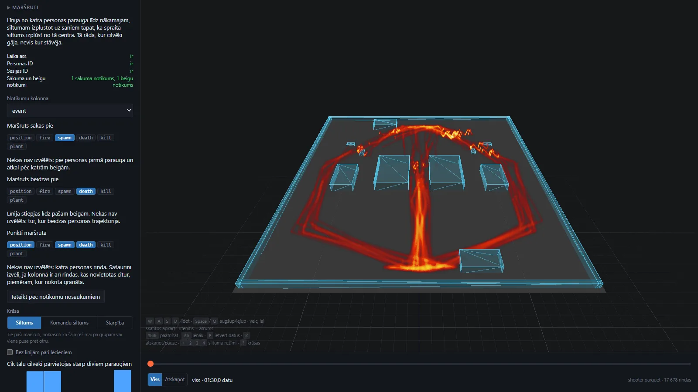

# Līniju siltums

Siltums rāda, kur cilvēki stāvēja. **Līnijas** rāda ceļus, ko tie gāja.

**Līnijas** (taustiņš 4) ir līniju siltums: līnija no katra [personas](glossary.md) parauga līdz tās nākamajam, izkliedēta ar tādu pašu izplūdi kā [sprite](glossary.md) — pāri līnijai, nevis ap punktu. Tas rāda, kur cilvēki *gāja*, nevis kur viņi stāvēja: koridors, pa kuru gāja vienu reizi, ir tikpat redzams kā istaba, kurā kāds slēpās, un ātra spēlētāja retie paraugi savienojas nepārtrauktā maršrutā, nevis punktētā takā. Tam vajag personas kolonnu un laika kolonnu.

## Kā lietot {#how-to-use-it}

1. Nospiediet `4` (vai izvēlieties **Līnijas** režīmu joslā).
2. Atveriet **Maršruti** un pārbaudiet zaļo kontrolsarakstu: jābūt laika asij un personas ID.
3. Nospiediet **Ieteikt pēc notikumu nosaukumiem**, lai aizpildītu, kur maršruti sākas un beidzas.
4. Izlasiet statistikas rindu: "N maršruti, M no tiem sasniedz beigas".
5. Ja līnijas pārlec pāri kartei, pielāgojiet **Garākais solis** (skatiet [Lēciena robeža](#the-jump-limit)).

Līnija ir jēga tikai starp sākumu un beigām, tāpēc panelis **Maršruti** saka, kas ierobežo maršrutu. Viss no [Maršruta noteikumiem](#the-rules-of-a-route) ir detaļas, ko var izlaist.

## Maršrutu panelis {#the-routes-panel}

Rāda virs siltuma paneļiem līniju režīmā.

### Ko dati satur {#what-the-data-has}

Kontrolsaraksts: zaļš, kad kas ir klāt, dzeltenīgs, kad nav:

| Rinda | Stāvoklis |
|---|---|
| **Laika ass** | *klāt* / *trūkst - vajadzīga* |
| **Personas ID** | *klāt* / *trūkst - vajadzīga* |
| **Sesijas ID** | *klāt* / *nav - visas rindas ir viena sesija* |
| **Sākuma un beigu notikumi** | *N sākumi, M beigas* / *nav izvēlēts - visas trajektorijas* (zaļš tikai ar notikumu kolonnu un vismaz vienu sākumu un vienu beigu) |

### Vadība {#controls}

| Vadība | Nozīme |
|---|---|
| **Notikumu kolonna** | Kategoriju kolonna, kuras vērtības ir notikumi (atdzimšana, nāve, pozīcija, ...). *Nav — visas trajektorijas*: katras personas trajektorija katrā sesijā ir viens maršruts, pārtraukts tur, kur trajektorijai ir caurums. Piedāvā tikai kolonnas, kas ielādes laikā paturētas filtrēšanai. |
| **Maršruts sākas pie** | Notikumu vērtības, kas sāk maršrutu (atdzimšana, atkārtota atdzimšana, izvietošana). Nav izvēlēts: maršruts sākas pie personas pirmā parauga un atkal pēc katra gala. |
| **Maršruts beidzas pie** | Notikumu vērtības, kas beidz maršrutu (nāve, evakuācija, teleportācija). Līnija iet līdz pašai beigu rindai. Nav izvēlēts: maršruts beidzas tur, kur beidzas personas trajektorija. |
| **Punkti maršrutā** | Notikumu vērtības, kuru rindas atrodas gar maršrutu. Nav izvēlēts: katra personas rinda. Sašauriniet to, kad kolonnā ir arī rindas, kas novietotas citur, piemēram, kur nokrita granāta. |
| **Ieteikt pēc notikumu nosaukumiem** | Aizpilda trīs sarakstus pēc vērtību nosaukumiem (zemāk). |
| **Krāsa** | *Siltums*, *Komandu siltums* vai *Starpība*. Tie paši maršruti ar šā režīma krāsošanu: katra grupa savā nokrāsā vai viena puse pret otru, ar grupu sarakstu, sadalījumu un skalām, kas darbojas kā tajos režīmos. Noklusējums *Siltums*. Komandu siltumam un starpībai vajag grupu kolonnu. |
| **Bez līnijām pāri lēcieniem** / **Garākais solis** | Personas nākamais paraugs, kas atrodas tālāk par šo, ir atdzimšana, teleportācija vai kritiens, nevis vieta, kur tā gāja, tāpēc neviena līnija nesavieno abus. Aizpildās ielādes laikā, kad dati rāda skaidru spraugu (zemāk), un ir izslēgts, kad to nerāda. Darbojas ar notikumu kolonnu vai bez tās. |
| Statistikas rindiņa | `N maršruti, M no tiem sasniedz beigas, K segmenti`, atjaunināta vairākas reizes sekundē. |

Katrs saraksts ir rinda pārslēgšanas mikroshēmu, pa vienai katrai vērtībai, biežākā pirmā; virs mikroshēmas uzvedot, rāda tās rindu skaitu. Piedāvā ne vairāk kā 120 vērtības (*N vēl vērtības nav rādītas*).

Izvēloties citu notikumu kolonnu, ieteikums tiek piemērots, ja ieteikums izvēlas to pašu kolonnu, citādi sākas ar tukšiem sarakstiem.

### Ieteikums {#the-suggestion}

Katrā ielādē un pēc **Ieteikt pēc notikumu nosaukumiem** ([`suggestLineSettings`](https://github.com/Holdi601/3DHeat/blob/main/src/data/lines.ts)):

- **Notikumu kolonna:** pirmā paturētā kategoriju kolonna ar nosaukumu `event`, `eventname` vai `eventtype`; citādi `kind`, `type` vai `action`; citādi jebkura, kas satur *event*, *kind*, *action* vai *type*.
- **Sākums:** vērtības, kas satur *spawn, deploy, join, enter, start, begin, respawn, revive, land/landed/landing, drop* — ja vien tās neatbilst arī beigu vārdam.
- **Beigas:** vērtības, kas satur *death, died, dead, kill/killed, eliminat…, extract, evac, teleport, leave, left, disconnect, quit, exit, end, finish, downed* — izņemot vērtības `kill` un `kills` (nogalinājums ir tas, ko dara nogalinātājs, nevis viņa maršruta beigas).
- **Punkti:** vērtības, kas ir tieši *position, location, player location, move, movement, tick, sample* vai *pos*; ja kāda atrasta, sākumi un beigas tiek pievienoti arī punktiem. Ja nav atrasta neviena, punkti paliek tukši (katra rinda).

### Lēciena robeža {#the-jump-limit}

Kur cilvēki lec, soļu garumi sadalās divās grupās ar gandrīz neko starp tām: tas, ko cilvēks noiet starp diviem paraugiem, un kartes platums. Ielādes laikā ([`suggestMaxJump`](https://github.com/Holdi601/3DHeat/blob/main/src/data/lines.ts)) soļi tiek saskaitīti pa dubultojumiem to kvadrātā garuma, līdz 16 miljoniem, un robeža tiek novietota vidū pirmajā diapazonā virs mediānas, kas ir vismaz viens garuma dubultojums plats, satur mazāk nekā 0,02% soļu katrā grupā un kuram ir soļi aiz tā. Ja šāda diapazona nav, nekas netiek griezts, jo lēcienu nevar atšķirt no ātra auto; tad robeža, ieslēgta ar roku, sākas ar desmitdaļu no datu diagonāles.

Diagramma virs robežas rāda, cik gari soļi patiesībā ir, ar līniju pie robežas: stieņi tās labajā pusē nav zīmēti. Abas ass ir logaritmiskas, jo lēcieni var būt simtdaļa no soļiem un tūkstoš reižu garāki. Uzvediet virs stieņa, lai redzētu tā diapazonu un daļu; noklikšķiniet diagrammā, lai novietotu robežu tur. Zem tās ir soļu daļa virs robežas.

## Maršruta noteikumi {#the-rules-of-a-route}

Rindas tiek apstaigātas laika secībā, pa personām ([`buildLines`](https://github.com/Holdi601/3DHeat/blob/main/src/data/lines.ts)):

1. Rindas [kopīga vārda](sessions-persons-groups.md#names-worn-by-several-things-at-once) tiek izlaistas pilnībā.
2. Ja izvēlēti punkti, rinda, kas nav ne sākums, ne beigas, ne punkts, tiek izlaista.
3. Rindas tiek sekotas pa personu un pa sesiju, tāpēc persona, kuras sesijas laikā mijas, katrā ir viens maršruts. Maršruts tiek slēgts, kad iepriekšējai rindai nebija nākamās (tās [dzīves ilgums](sessions-persons-groups.md#person) ir "nav") — maršruts nekad nešķērso sesijas robežu vai spraugu, ko ielāde nolēmusi, ka nav nākamā paraugā. Kurā maršrutā ir rinda, tiek aprēķināts vienreiz un paturēts, 4 baiti katrā rindā, tāpēc mainot garāko soli, šī daļa netiek atkārtota.
4. **Sākuma** rinda aizver jebkuru atvērtu maršrutu un atver jaunu tajā vietā.
5. Ja izvēlēti sākumi, rinda ārpus maršruta tiek ignorēta. Bez sākumiem jebkura ne-beigu rinda ārpus maršruta to atver.
6. Jebkura cita rinda maršruta iekšienē pievieno **segmentu** no iepriekšējās maršruta rindas līdz šai.
7. **Beigu** rinda, kas pagarina maršrutu, to aizver pēc sava segmenta; šis maršruts tiek skaitīts kā *sasniedzis beigas*.
8. Solis, kas garāks par **Garākais solis**, aizver maršrutu tur, kur tas bija, un jauns maršruts sākas tālākajā galā, ja vien šī rinda nav beigas. Pāri tam nekas netiek zīmēts, un statistikas rindiņa to skaita.

Katrs segments tiek glabāts savā *beigu* rindā, tāpēc segmenti paliek laika secībā, un [laika skalas](timeline.md) logs, paraugu ņēmējs, [filtri](filters.md), grupu redzamība un starpības zīme darbojas ar tiem kā ar punktiem. Filtrs tātad attiecas uz rindu, kur segments beidzas.

## Atskaņošana {#playback}

**Viss** režīmā katrs maršruts tiek zīmēts veselā. **Atskaņot** režīmā katra persona ir punkts, kas kustas starp saviem paraugiem un aiz sevis zīmē savu maršrutu:

- segments, kas sākas aiz atskaņošanas galvas, netiek zīmēts;
- segments, kurā persona atrodas vidū, tiek zīmēts līdz tās interpolētajai pozīcijai, ar gala vāciņu galvā;
- siltums izbalē **astē**: ar vēstures *Kumulatīvi* aste ir neierobežota un viss līdz šim maršruts paliek; ar *Logu* tas izbalē līdz nullei *Intervāla* (noklusējums 30 s) laikā. Ar *Dzīves ilgums* aste ir arī *Intervāls*, un līniju režīmā laika skala šai vēsturei rāda arī *Intervāla* lodziņu (vietā *Rezerves dzīves ilgumam* un *Izbalēšanai*, ko līniju siltums neizmanto).

Atskaņošanas laikā katrs kadrs tiek zīmēts vesels, nevis uzkrāts, jo galvas kustas katrā kadrā, un kustīgs vidējais tās izplūdinātu strēmelēs.

## Izstrādātājiem {#for-developers}

### Atmiņa {#memory}

Maršruti tiek veidoti galvenajā pavedienā, kad ieiet līniju režīmā (vai mainās maršruta iestatījumi), un atbrīvoti, kad no tā iziet: 5 baiti katrā rindā atmiņā un 8 baiti katrā rindā GPU (katra segmenta sākuma pozīcija, kvantēta līdz 16 bitiem uz asi datu ierobežojošajā kastē, un tā karodziņi).

### Kā tiek zīmēta līnija {#how-a-line-is-drawn}

Abi aizmugures risinājumi zīmē katru segmentu no tā beigu rindas kā **18 virsotnes** ([`lineHeatVs`](https://github.com/Holdi601/3DHeat/blob/main/src/render/webgl2/shaders.ts) un tā WGSL dublikāts):

- Pusplatums katrā galā ir [sprite rādiuss](sprite-shape.md#sprite-radius) pie šā gala attāluma, ar pikseļu robežām. Līnija šaurāka par 2,5 px tiek zīmēta 2,5 px platumā, un tās siltums tiek samazināts attiecīgi, tāpēc plānas līnijas nepazūd un nekļūst spožākas.
- Siltums izbalē **pāri** līnijai ar tādu pašu skalu kā sprite — izplūdi vai līkni, centra un malas intensitāti.
- Apaļi vāciņi tiek zīmēti **tikai** tur, kur maršruts sākas vai beidzas, lai savienojumi starp blakus esošiem segmentiem neveidotu pērļu virkni.
- Ģeometrija tiek veidota ekrāna telpā un tur lineāri interpolēta, tāpēc izplūde paliek centrēta uz līnijas, neatkarīgi no tā, kā tā ieiet dziļumā. Segments, kas šķērso tuvo plakni, tur tiek nogriezts, nevis izmests.

Punktu siltums un līniju siltums uz rindu uzliek ļoti dažādus siltuma daudzumus, tāpēc piesātinājums tiek mērīts no jauna, kad pārslēdzaties starp tiem ([Krāsa un ekspozīcija](colour-and-exposure.md#auto-exposure)).
