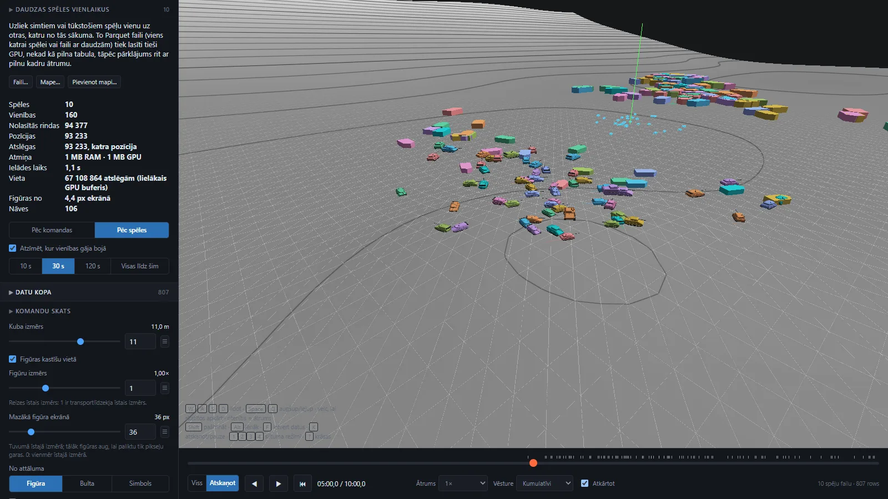

# Daudzas spēles vienlaikus

**Daudzas spēles vienlaikus** atskaņo daudzas spēles, uzliekot tās viena uz otras, lai redzētu, kur katras spēles spēlētāji parasti dodas. Lietojiet to, lai salīdzinātu simtus vai tūkstošus spēļu vienā attēlā.

Katra spēle sākas savā sākumā, un tās vienības kustas kā figūras. Faili tiek ielādēti tieši grafikas kartē, un nekāda pilna tabula netiek veidota, tāpēc tas darbojas vienmērīgi tur, kur parasta ielāde beigtos atmiņu.

## Kā to lietot {#how-to-use-it}

1. Siltumkartes sānjoslā atveriet **Daudzas spēles vienlaikus**.
2. Nospiediet **Faili…** (izvēlieties daudzus failus), **Mape…** (mape un tās apakšmapes) vai **Pievienot mapi…** (pievieno tam, kas jau ielādēts).
3. Skatītājs pārslēdzas uz figūru pārklājumu un sākas no sākuma. Nospiediet **Atskaņot**.

Katrs fails ir viena spēle (vai satur vairākas). Darbojas Parquet faili un [`.3dheat`](container.md) konteineri. Failam vajag pozīcijas, laika un vienības kolonnu; nosaukuma, tipa un puses kolonnas tiek saglabātas. Citi faili un konvertētāju blakusfaili (lidojums, ziņojumi, notikumi, tērzēšana, mērķi) tiek izlaisti. Parastai tabulai skatiet [Datu ievade](getting-data-in.md).

## Iestatījumi {#settings}

| Iestatījums | Ko tas dara |
|---|---|
| **Pēc komandas** / **Pēc spēles** | Krāsot pēc puses vai krāsa katrai spēlei. |
| **Atzīmēt, kur vienības gāja bojā** | Atzīme, kur katra vienība gāja bojā, uz 10 s, 30 s, 120 s vai visu līdz šim. |

Panelis rāda, cik spēļu, vienību, rindu un pozīciju tika nolasīts, izmantoto atmiņu un ielādes laiku. *Vieta* ir, cik vēl pozīciju grafikas karte varētu uzņemt. *Figūras no* ir izmērs ekrānā, zem kura vienība tiek zīmēta kā mazs šautriņš, nevis kā tās figūra.

Figūru izskats izmanto tās pašas vadības kā [spēles atkārtojums](match-replay.md#figures): **Figūru izmērs**, **Mazākā figūra ekrānā** un **No attāluma**.

## Padomi {#tips}

- Kad viss neietilptu atmiņā, pozīcijas tiek retinātas (tiek paturēta tikai pozīcija ik pēc dažiem metriem), un panelis to saka.
- Siltuma režīmi darbojas arī ar pārklājuma datiem.
- Statistikai par tūkstošiem spēļu, nezīmējot tās, skatiet [Masveida analīze](mass-analysis.md).
