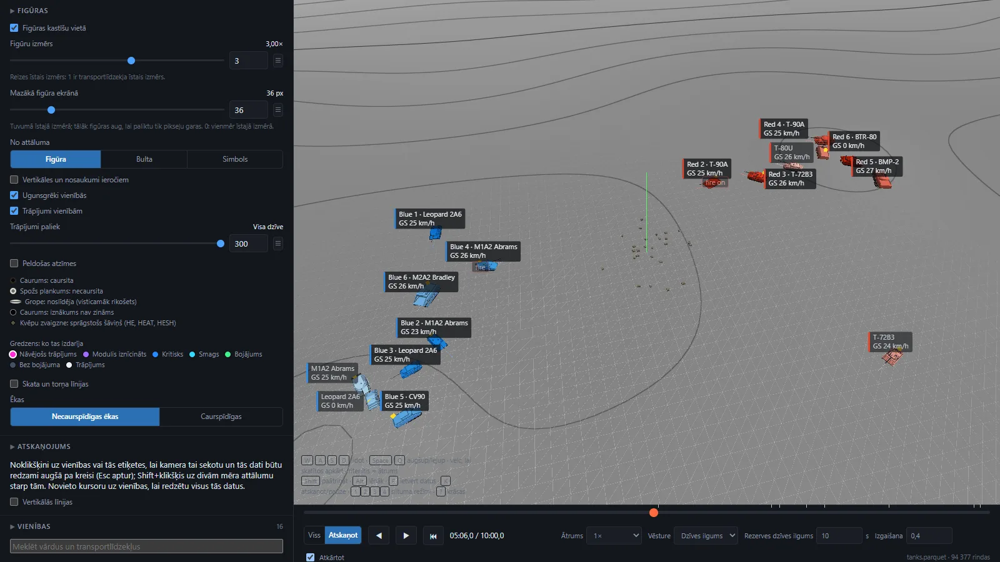
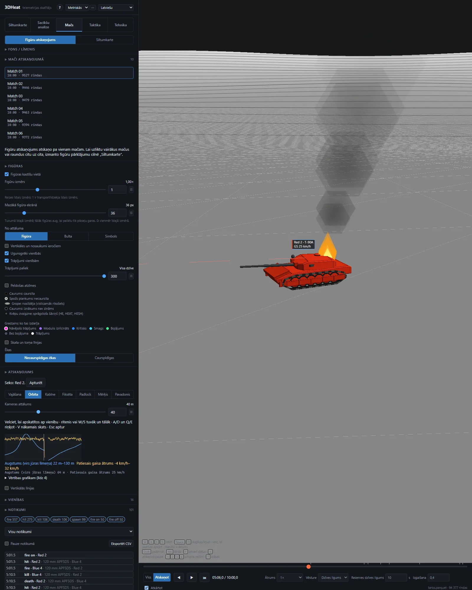
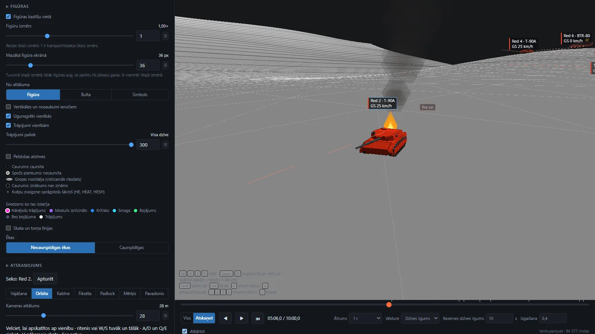
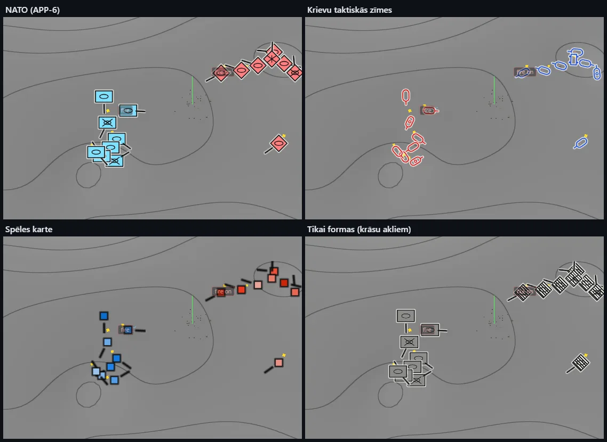
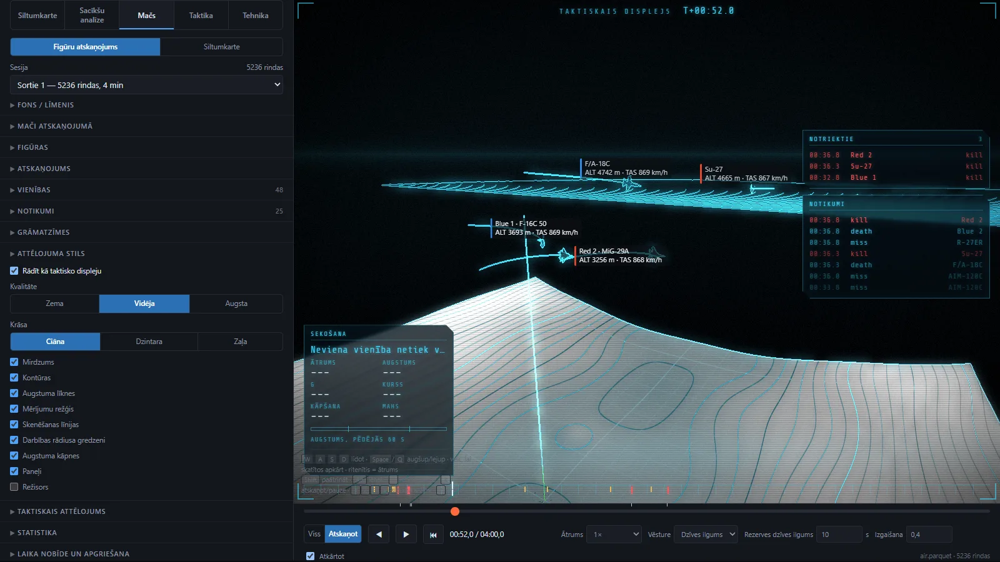
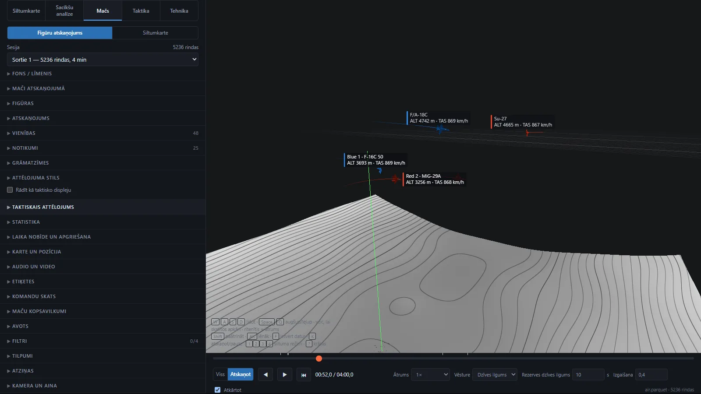

# Spēles atkārtojums

Atkārtojums ir mača filma, kurā katrs spēlētājs ir zīmēts kā tas, ko viņš vadīja. Izmanto to, lai vēlreiz noskatītos cīņu, sekotu vienai vienībai un redzētu, kas kuru trāpīja.

Šāvieni, trāpījumi, uguns un sagrautas vienības tiek zīmēti uz vienībām un mērķiem līmenī. Kameras, etiķetes un taktiskais attēlojums palīdz lasīt cīņu. Vai tu zini Tacview? [Tacview paritāte](tacview-parity.md) parāda, kur atrodas katrs no tā rīkiem.

## Sāc atkārtojumu {#start-a-replay}

1. Ielādē ierakstu ar **Avots → Faili…** vai nometot to avota panelī (jebkura tabula ar **personas** un **laika** kolonnu, Tacview fails, konvertēts atkārtojums, [`.3dheat`](container.md) mačs). Skat. [Datu ievade](getting-data-in.md).
2. Atver cilni **Mačs** un izvēlies **Figūru atskaņojums**, vai izvēlies **Figūru pārklājums** siltumkartes cilnes režīmu joslā.
3. Sadaļā **Mači atskaņojumā** izvēlies vienu maču, visus uzreiz vai vairākus.
4. Nospied **Atskaņot** laika skalā (vai `K`). Velc laika skalu, lai pārlēktu.

Figūras aizstāj kastes katrai vienībai, kuras vārds vai tips ir zināms (skat. [Figūras](figures.md)). Dati bez vārda vai tipa kolonnas tiek zīmēti kā karavīri.

## Figūras {#figures}

| Iestatījums (sadaļa **Figūras**) | Noklusējums | Ko tas dara |
|---|---|---|
| **Figūras kastīšu vietā** | ieslēgts | Izslēgts zīmē vienkāršas kastes. |
| **Figūru izmērs** (reizes patiesais izmērs) | 1 | 1 ir patiesais izmērs; 0,25 līdz 20 reizes (logaritmiska skala). Lielāks palīdz no tāluma. |
| **Mazākā figūra ekrānā** | 36 px | Tālās figūras aug, lai paliktu tik garas, 0–200 px; 0 saglabā patieso izmēru. |
| **No attāluma**: Figūra, Bulta, Simbols | Figūra | Ko kļūst vienība, kas ir tāla. |
| **Simboli** | NATO (APP-6) | NATO (APP-6), Krievijas taktiskās zīmes, **Spēles karte** ikonas vai **Tikai formas (krāsu akliem)**. |
| **Simbola izmērs**, **Mana puse**, **Pretinieks / Neitrāls**, **Kursa svītras** | 28 px (12 līdz 64), automātiski, pretinieks, ieslēgts | Kā simboli izskatās un kura puse ir draudzīga. |
| **Vertikālās līnijas** | ieslēgts | Līnija no katras vienības taisni lejup līdz zemei, lai augstumi lasās 3D. |
| **Vertikāles un nosaukumi ieročiem** | izslēgts | Līnijas līdz zemei un etiķetes uz raķetēm un bumbām. |
| **Ugunsgrēki vienībās** | ieslēgts | Liesmas no brīža, kad vienība aizdegas, līdz tā tiek nodzēsta. |
| **Trāpījumi vienībām** | ieslēgts | Atzīmes, kur trāpīja šāvieni (zemāk). **Trāpījumi paliek**: 1 līdz 300 sekundes vai **Visa dzīve**. **Peldošas atzīmes**: atzīmes, kas zīmētas virs virsmas. |
| **Skata un torņa līnijas** | izslēgts | Punktētas: kur spēlētājs skatās; cietas: kur vērsts ierocis. |
| **Ēkas** | cietas | Cietas vai caurspīdīgas ēkas, kad līmenis tās krāso. |

### Simboli attālumā {#symbols-at-a-distance}

Kad vienība būtu mazāka par **Mazākā figūra ekrānā**, tā var kļūt par simbolu, kas paliek lasāms. Forma saka veidu (piemēram, noapaļota kaste ar sliežu zīmi bruņumašīnai); krāsa saka pusi. Atver izvēlni **Simboli**, lai mainītu stilu.

### Trāpījumu atzīmes, sagrautās vienības un uguns {#hit-marks-wrecks-and-fires}

- **Trāpījumu atzīmes** atrodas uz virsmas, kur šāviens sastapa, figūras mērogā. To izskats stāsta, kas notika: caurums (caurdūra), spilgts šķidrums (neiecaurdūra), skrāpējums (atlēca), kvēpu zvaigzne (sprādzienbriesmas šāviens). Krāsains gredzens saka, ko tas izdarīja: nogalinošs šāviens, modulis iznīcināts, kritisks, smags, bojājums, bez bojājuma, trāpījums. Uzvelc peli pār atzīmi, lai redzētu šāviena nosaukumu.
- Iznīcināta vienība tiek zīmēta **apdegusi** kā atlūzas no nāves brīža līdz atdzimšanai vai noņemšanai; tās simbols ir svītrots.
- **Uguns** deg uz vienības no brīža, kad tā aizdegas, līdz tā tiek nodzēsta.
- **Torņi** pagriežas tur, kur dati saka, ka vērsts ierocis (vai, bez tā, kur spēlētājs skatās).

### Ieroči, maldinājumi un trasējošās lodes {#weapons-decoys-and-tracers}

Ar ieslēgtu **Ieroči, šāvieni un trāpījumi** (sadaļa Komandu skats): raķetes, lidojošas bumbas un torpēdas lido kā savas figūras ar dūmu asti; lodes un čaulas ir trasējošās lodes; trāpījumi un sprādzieni mirgo. Trasējošā lode, kas zīmēta **punktēta**, tika aprēķināta no trāpījuma, jo datos nebija šāviena. Uguns signāli un plēves tiek zīmēti kā maldinājumi; tie ir paslēpti no vienību saraksta, ja vien nav atzīmēts *Maldinājumi un čaulas*.

## Kameras {#cameras}

Noklikšķini uz vienības vai tās etiķetes, lai to **sekotu**. Sadaļā **Atskaņojums** piedāvā **Vajāšana**, **Orbīta**, **Kabīne** (ar galvas displeju, `H`), **Fiksēta**, **Padlock**, **Mērķis** un **Pavadonis**. `V` pārslēdz tos, **Kameras attālums** nosaka, cik tālu. Esc aptur.

- **Divu vienību skats**: izvēlies **Mērķi** (vai Ctrl/Alt-klikšķis uz vienības), lai to skatītu no sekotās; **Mainīt vietām** tās savstarpēji apmaina.
- **Mērīšana**: Shift-klikšķis uz divām vienībām, lai redzētu virzienu, attālumu un augstuma starpību starp tām.
- **2D karte** (`M`): stūris vai pilns skats, ar astēm un nosaukumiem.
- **Grāmatzīmes** (`B`): saglabā brīdi un kameru; ieraksta paša nogalinājumi, nāves un atzīmes arī ir uzskaitītas.
- **Notikumi**: katrs notikums laika secībā; klikšķis aizlec tur. `Page Up` / `Page Down` lec starp notikumiem; **Pauze notikumā** aptur pie katra.

## Taktiskais attēlojums {#tactical-display}

Sadaļa **Taktiskais attēlojums** zīmē, nevienai vienībai, izvēlētās, visas vai vienu veidu (lidaparāti, sauszemes, kuģi, ieroči): ātruma vektorus un priekšā esošo ceļu, deguna un pacelšanas līnijas, radara konusus, fiksācijas, datu saites, iesaistīšanās zonas un līnijas, redzamības līnijas, kur spēlētāji skatās (skata konusi), torņa mērķi un ierakstīto kameru.

### Attēlojuma stils {#display-style}

`T` (vai slēdzis **Rādīt kā taktisko displeju**) pārslēdz izskatu uz radara ekrāna stilu: spīdums, kontūras, horizontāļu līnijas, mērījumu režģis, skenēšanas līnijas, diapazona gredzeni, augstuma kāpnes, paneļi ar nogalinājumiem un notikumiem un **Režisors**, kas kameru pats pārvieto uz notikumiem.

## Mērķi {#objectives}

Kad mačs nāk ar saviem mērķiem, sadaļa **Mērķi** tos zīmē uz līmeņa: uztveršanas zonas (ar īpašnieku un uztveršanas progresu), atdzimšanas vietas, aerodromi, apgabali un bombardēšanas mērķi. Katrs slānis ir pārslēdzams, ar etiķetēm. Tie tiek redzēti caur zemi. Ar vairākiem spēles režīmiem ielādētus, **Režīms** filtrē mačus pēc režīma. Mērķi nāk no konvertētāja mača faila blakus ierakstam vai [`.3dheat`](container.md) konteinerā.

## Etiķetes un statistika {#labels-and-statistics}

- **Etiķetes**: noteikumi katram veidam (**Izvēlētās**, **Gaisa kuģi**, **Zeme**, **Kuģi**, **Ieroči**, **MI**): rādīt vai nē, kuras vērtības un **Prioritāte**, kurš dabū vietu, kad etiķetes pārklājas. **Turēt etiķetes atsevišķi** pārvieto etiķeti blakus tās vienībai, kad tā aizsegtu citu, un to izlaiž, kad vietas nav. **Etiķešu izmērs** ir 60 līdz 250 %. **Atpakaļ uz vārdu, transportlīdzekli, augstumu un ātrumu** atiestata noteikumus.
  - Sauszemes vienības sākas ar nosaukumu, transportlīdzekli un ātrumu.
  - Lidaparāti sākas ar nosaukumu, transportlīdzekli, augstumu un ātrumu.
  - Kuģi sākas ar nosaukumu, transportlīdzekli, ātrumu un virzienu.
  - Uzvelc peli pār vienību, lai redzētu visas tai esošās vērtības.
- **Statistika**: pa komandām un vienībām: nogalinājumi, nāves, šāvieni, trāpījumi, trāpījumu attiecība, pacelšanās, nolaišanās, laiks gaisā, maksimālais ātrums, augstums un G, attālums. CSV eksports.
- **Diagrammas**: vienības vērtības laikā, divas vienības salīdzinātas vai viena vērtība pret citu.

## Daudzi mači uzreiz {#many-matches-at-once}

Lai novietotu simtus vai tūkstošus maču vienu virs otra, skat. [Daudzi mači uzreiz](many-matches.md). Figūru detaļas (dūmi, uguns, citi laikotie efekti): [Figūras figūru pārklājumā](figure-replay.md). Tacview iespēju saraksts: [Tacview paritāte](tacview-parity.md), šīs lapas apakšlapa.
