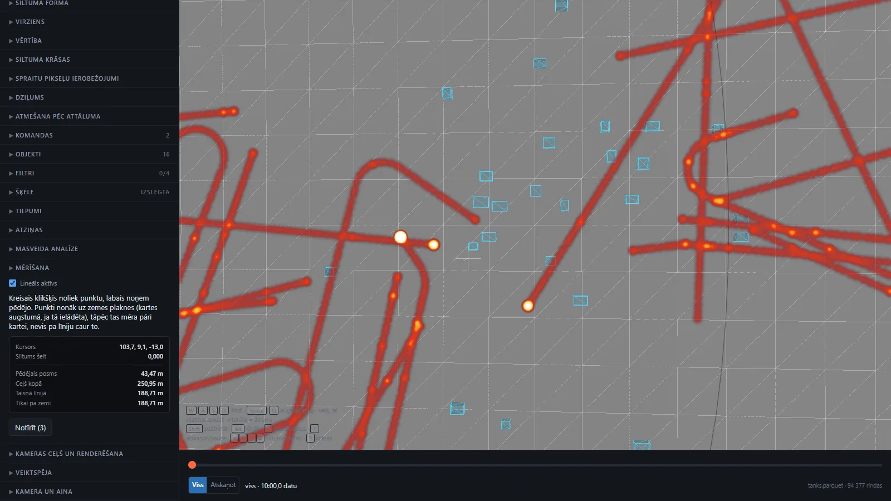

# Mērīšana

**Mērīšana** pārvērš peli par lineālu un parāda, cik aizņemta ir vieta zem kursora. Izmantojiet to, lai uzzinātu, cik tālu viena no otras atrodas divas vietas, vai cik lielu satiksmi redz kāda vieta.

## Izmēģiniet {#try-it}

1. Atveriet **Mērīšana** sānjoslā un atzīmējiet **Lineāls aktīvs**.
2. Kreisā klikšķa trīs vietas kartē. Katrs klikšķis nomet punktu.
3. Skatiet **Ceļš kopā** (visa ceļa garums) un **Pēdējais posms** (pēdējais posms).
4. Labais klikšķis noņem pēdējo punktu, vai nospiediet **Notīrīt (3)**, lai noņemtu visus.

| Darbība | Iedarbība |
|---|---|
| Kreisais klikšķis | Nomet punktu, kur kursors saskaras ar zemes plakni. Klikšķis, kas starp nospiešanu un atlaišanu pārvietojās vairāk nekā par 4 pikseļiem, ir kameras vilkšana, nevis punkts. |
| Labais klikšķis | Noņem pēdējo punktu. |
| Kustība | Kursora pozīcija un siltums zem tā atjaunojas tiešraidē. |

Kamera turpina darboties, kamēr lineāls ir ieslēgts: vilkšana joprojām ļauj skatīties apkārt, taustiņi joprojām ļauj lidot. Kamēr lineāls ir ieslēgts, tas pārņem katru klikšķi, tāpēc [klikšķis-izvēlei](camera.md#click-to-pick) jāgaida, līdz tas tiks izslēgts.

**Zemes plakne** ir [kartes attēla](map-images.md) augstums, ja kartes attēls ir ielādēts, citādi datu kopas zemākais Y (0, ja nav). Punkti nolaižas uz tās, tāpēc lineāls mēra pāri kartei, nevis pa līniju caur to. Ar 3D līmeni plakne joprojām ir datu kopas zemākais Y, nevis līmeņa virsma. Punktam uz īstās virsmas izslēdziet lineālu un noklikšķiniet uz tā ([klikšķis-izvēlei](camera.md#click-to-pick)). Tas nolasa koordinātas no paša līmeņa trijstūriem.

## Rādījumi {#readouts}

| Līnija | Nozīme |
|---|---|
| **Kursors** | Pasaules X, Y, Z punktam zem kursora, plaknē. |
| **Siltums šeit** | Cik daudz siltuma ir kursora pikselī. Lielāks skaitlis nozīmē vairāk satiksmes šajā vietā. Tā ir vērtība, ko krāsu skala saņem pirms piesātinājuma punkta dalīšanas, tāpēc to var salīdzināt ar [Piesātinājuma punkts](colour-and-exposure.md#saturation-point). |
| **Pēdējais posms** | Attālums no pēdējā punkta līdz kursoram (vai starp pēdējiem diviem punktiem). |
| **Ceļš kopā** | Līnijas garums caur katru punktu un kursoru. |
| **Taisnā līnijā** | 3D attālums no pirmā punkta līdz kursoram (vai pēdējam punktam). |
| **Tikai pa zemi** | Tas pats, tikai pa X un Z. |
| **Notīrīt (N)** | Noņem visus punktus. |

Attālumi tiek rādīti centimetros zem 1 vienības, metros zem 1000 un kilometros virs tā, pieņemot, ka viena pasaules vienība ir metrs ([Asis, mērvienības un laiks](axes-units-and-time.md#unit-scale)). Koordinātas ir pasaules koordinātas, arī tad, kad ass ir [apgriezta attēlošanai](camera.md#invert-world-axis).

Punkti un līnija starp tiem tiek zīmēti kā pārklājums skatā, izmērā atkarībā no režģa soļa. Lineāla punkti netiek saglabāti skatos; tie paliek, kad ielādējat citus datus.

## Izstrādātājiem {#for-developers}

**Siltums šeit** tiek nolasīts no GPU ne biežāk kā reizi 120 ms, jo viena pikseļa nolasīšana aptur cauruļvadu. Tas izmanto to pašu ceļu kā `engine.readHeatProbe()`: dalīts ar pieaugumu, ar kādu kadrs tika ierakstīts. Tāpēc pusprecizitātes uzkrāšanas ceļā (`?heat=f16`) tas ir tajās pašās vienībās kā 32 bitu mērķī ([Pusprecizitātes uzkrāšana](half-float-accumulation.md)).
