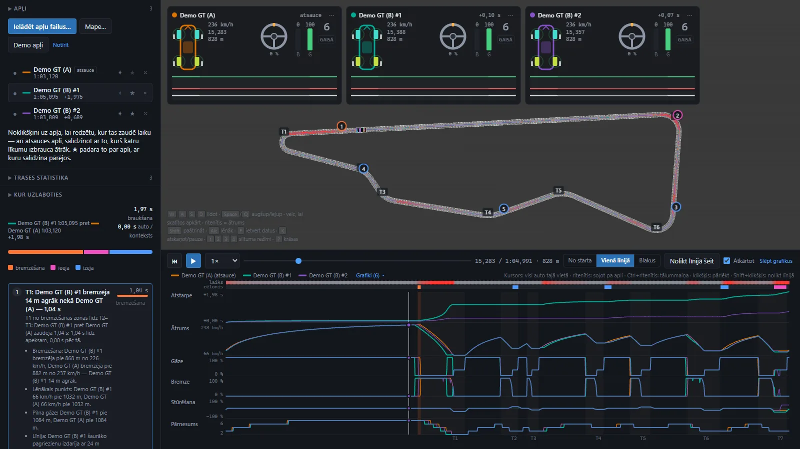

# Sacīkšu analīze

Jūs braucāt pa to pašu trasi divreiz. Cilne **Sacīkšu analīze** atskaņo abus braucienus kopā 3D, parāda, kur viens aplis bija lēnāks, un pastāsta, kāpēc. Vēl nav apļu? Nospiediet **Demo apļi**.

Cilne salīdzina divus vai vairākus vienas trases apļus. Tā dala audeklu, kameru un ielādēto trases modeli (**Fons / līmenis**) ar siltumkarti; viss pārējais ir savs: sava sānjosla un sava josla zem skata. Tādi vārdi kā *aplis*, *atsauce* un *apex* ir [glosārijā](glossary.md).

Šī lapa ir cilnes karte. Katrai daļai ir sava lapa:

| Lapa | Ko aptver |
|---|---|
| [Apļu ielāde](race-loading-laps.md) | katrs failu formāts, mapes un trases, automašīnu nosaukumi, demo apļi, apļu saraksts, atsauce un fokuss |
| [Atkārtojums un 3D aina](race-replay-and-scene.md) | transporta josla, trīs atkārtojuma režīmi, automašīnu izlīdzināšana, vajāšanas kamera, līnijas, kartes, automašīnas, etiķetes, spoguļotas pasaules |
| [Diagrammas un HUD](race-charts-and-hud.md) | attāluma diagrammas, diagrammu izvēle, peldošais skats un tuvināšana, automašīnu kartītes, kanālu tabula |
| [Auto vadības notikumi](race-control-events.md) | bloķēšanās, riteņu slīdēšana, pārsteers, apgriešanās, nedersteers, trāpījumi, avārijas, ABS/TC, rokas bremze, gaiss - kā katrs tiek atklāts, ar katru slieksni |
| [Līkums pa līkumam analīze](race-corner-analysis.md) | izlīdzināšana pēc attāluma, līkumi un segmenti, līkuma laika bilance, katrs cēlonis un secība, kādā tie tiek pārbaudīti, līnijas forma un padoms |
| [Automašīnu profili un salīdzinājums](race-car-profiles.md) | ko katra automašīna var, izmērīts no tās apļiem; *Auto salīdzinājums*; ko automašīna izlemj katrā līkumā |
| [Trases statistika](race-course-statistics.md) | daudzi vienas trases apļi: kļūdas pa līkumiem un pa veidiem, kļūdu karte, siltumkartes eksports, veiktspējas robežas |
| [Sacīkšu analītika: metode](race-analytics.md) | pētījums aiz noteikumiem, ar avotiem |
| [Citas sacīkšu spēles](other-games.md) | ko skatītājs dara ar apļiem no katras spēles: slīdēšana un drifts, ko aprēķina tur, kur spēle to nenosūta, spoguļotas pasaules, papildu kanāli |

## Ekrāns {#the-screen}

**Sānjosla**, no augšas uz leju (sadaļas var salocīt):

1. **Apļi** - ielāde, saraksts, rādīšana/paslēpšana, atsauce, fokuss, vajāšana.
   Skatiet [Apļu ielāde](race-loading-laps.md).
2. **Trases statistika** - tikai no trim ielādētiem apļiem.
   Skatiet [Trases statistika](race-course-statistics.md).
3. **Kur uzlaboties** - fokusētā apļa atradumi, līkums pa līkumam.
   Skatiet [Līkums pa līkumam analīze](race-corner-analysis.md).
4. **Līkums pa līkumam** (vai *Līkums pa līkumam - klase X*, ja vairākas klases) - ātrākais aplis katrā līkumā un tā līnija. Rāda ar diviem vai vairākiem apļiem.
5. **Auto vadība** - fokusētā apļa bloķēšanās, slīdēšanas, pārsteera un trāpījumi.
   Skatiet [Auto vadības notikumi](race-control-events.md).
6. **Auto salīdzinājums** (vai **Auto** ar vienu automašīnu) - skatiet [Automašīnu profili un salīdzinājums](race-car-profiles.md).
7. **Skats** - kura karte tiek uzkrāsota uz trases un kas tiek zīmēts.
   Skatiet [Atkārtojums un 3D aina](race-replay-and-scene.md).
8. Kopīgie paneļi **Līmenis** un **Kamera un aina** (trases modelis, asu apgriešana, kamera) - aprakstīti kopā ar siltumkarti un [Kamera](camera.md).

**Skats** rāda trasi, nobraukto līniju, karti, automašīnas, etiķetes, kas piestiprinātas trasei, un līdz sešām automašīnu kartītēm augšā pa kreisi (skatiet [Diagrammas un HUD](race-charts-and-hud.md)). Ja apļi nav ielādēti, tas saka: "Nav ielādētu apļu - ievelc šeit divus vai vairāk apļu failus vai ielādē demonstrācijas apļus no sānjoslas."

**Josla zem skata** satur atkārtojuma transporta vadību un, ja nav paslēpts, attāluma diagrammas.

## Ātrs starts {#quick-start}

1. Atveriet cilni **Sacīkšu analīze** (blakus **Siltumkarte** sānjoslas augšā).
2. Ielādējiet apļus. Nospiediet **Demo apļi**, lai redzētu, ko cilne dara ar trim izdomātiem apļiem. Saviem apļiem vispirms ierakstiet tos ([failu formāti un ierakstītāji](race-loading-laps.md#file-formats)), tad nospiediet **Ielādēt apļu failus…** vai **Mape…**, vai ievelciet failus vai mapes skatā.
3. Ātrākais pilnais aplis kļūst par atsauci; lēnākais cits aplis tiek fokusēts. Noklikšķiniet uz jebkura apļa sarakstā, lai to fokusētu; ★ padara apli par atsauci.
4. Izlasiet **Kur uzlaboties**. Noklikšķiniet uz atraduma: automašīnas tiek izlīdzinātas 40 m pirms tā, kamera ietver to, atkārtojums atskaņo cauri tam un atveras mērījumi.
5. Uzvediet virsū diagrammām, lai pārvietotu katru automašīnu uz šo metru; Shift+klikšķis, lai tās izlīdzinātu tur.

## Taustiņi {#keyboard}

Kamēr cilne Sacīkšu analīze ir atvērta:

| Taustiņš | Dara |
|---|---|
| **K** | atskaņo / aptur atkārtojumu |
| **Home** | atpakaļ uz atkārtojuma sākumu |
| cipartaustiņi | nekā (siltumkartē tie pārslēdz režīmus) |

Taustiņi, kas ierakstīti teksta laukā vai nolaižamajā sarakstā, tiek ignorēti. Kameras taustiņi darbojas kā siltumkartē (**W A S D**, **Space** uz augšu, **Q** uz leju, **Shift** ātrāk, **Alt** lēnāk, pele, lai skatītos; viss [Kamerā](camera.md)); **F** ietver ielādētos apļus (kā dara apļu ielāde).

## Daudzi apļi {#many-laps}

- Visi ielādētie apļi tiek analizēti un saskaitīti; desmiti prasa sekundi vai divas.
- Pāri **8** apļiem (`SHOW_ALL_UP_TO`) pievienotie apļi tiek zīmēti tikai tad, ja tie ir atsauce, fokusētais aplis vai labākais fokusētā apļa klases aplis. Pārslēdz *Rādīt visus* / *Tikai tos, uz kuriem skatās*.
- Pāri **10** redzamām automašīnām (`PLAIN_PAST`) apļi, uz kuriem neskatās (ne fokuss, ne vajātā automašīna, ne atsauce), tiek zīmēti ar līnijām, kas retinātas līdz punktam ik 6 m, nevis 1,5 m, un ar vienkāršām automašīnām.
- Diagrammas zīmē ne vairāk kā **8** apļus; HUD rāda ne vairāk kā **6** kartītes.
- Trases statistika parādās no **3** apļiem.

Sīkāk: [Trases statistika](race-course-statistics.md#performance-with-many-laps).

## Noklusējuma skata iestatījumi {#default-view-settings}

| Iestatījums | Noklusējums |
|---|---|
| Karte | Laika karte |
| Izbrauktās līnijas, Automašīnas, Riepas un piekare, Etiķetes, Trase no apļiem | ieslēgts |
| Visas vērtības kartītēs | izslēgts |
| Automašīnas izmērs | 1× |
| Diagrammas | redzamas |
| Atkārtojuma režīms | No starta |
| Atkārtojuma ātrums | 1× |
| Atkārtot | ieslēgts |

Nekas no tā netiek saglabāts; pārlādējot, sākas no noklusējumiem. Pārlūkā tiek atcerēts: valoda un automašīnu nosaukumi, kas iegūti no apļu failiem (skatiet [Apļu ielāde](race-loading-laps.md#car-names)).

## Izstrādātājiem {#for-developers}

### Kas notiek, kad apļi tiek ielādēti {#what-happens-when-laps-are-loaded}

Katru reizi, kad mainās apļu kopa, atsauce vai valoda, viss analīzes process tiek atkārtots (`analyse` [`src/race/analysis.ts`](https://github.com/Holdi601/3DHeat/blob/main/src/race/analysis.ts)):

1. Katram aplim tiek pievienoti atvasinātie kanāli tur, kur spēle tos nenosūta: drifta leņķis, riteņu slīdēšana no riteņu ātrumiem, gaisā, irdena zeme, griešanās ātrums ([`derive.ts`](https://github.com/Holdi601/3DHeat/blob/main/src/race/derive.ts)).
2. Atsauce tiek izvēlēta, un katrs aplis tiek projicēts uz sava ceļa un pārparaugots ik pēc 2 m ([`align.ts`](https://github.com/Holdi601/3DHeat/blob/main/src/race/align.ts)).
3. No apļiem tiek noteikts, vai spēles pasaule ir spoguļota ([`handedness.ts`](https://github.com/Holdi601/3DHeat/blob/main/src/race/handedness.ts)).
4. Līkumi tiek atrasti atsaucē un grupēti segmentos no vienas bremzēšanas zonas līdz nākamajai ([`segments.ts`](https://github.com/Holdi601/3DHeat/blob/main/src/race/segments.ts)).
5. Katrai automašīnai: tās apvalks (saķere, bremzēšana, pievilkšana pēc ātruma), tās profils, tās riepu līknes ([`envelope.ts`](https://github.com/Holdi601/3DHeat/blob/main/src/race/envelope.ts), [`profile.ts`](https://github.com/Holdi601/3DHeat/blob/main/src/race/profile.ts), [`control.ts`](https://github.com/Holdi601/3DHeat/blob/main/src/race/control.ts)).
6. Katram aplim un segmentam: ko tas darīja (bremzēšanas punkts, lēnākais punkts, pilna gāze, ...) un līnija, ko tas brauca ([`line.ts`](https://github.com/Holdi601/3DHeat/blob/main/src/race/line.ts)).
7. Katram aplim: tā auto vadības notikumi, katrs salīdzināts ar to apli, ar kuru tas tur tiek salīdzināts.
8. Katram aplim un segmentam: laika bilance pret tā salīdzināšanas apli un atradums vārdos.
9. Laika karte un cēloņu karte katram aplim.

Teksti tiek veidoti pašreizējā valodā; valodas maiņa atkārto analīzi (un pārdēvē demo apļus). Analīzes kļūda tiek parādīta zem pogām **Apļi** kā kļūda, un apļi paliek ielādēti.

### Avota faili {#source-files}

| Fails | Loma |
|---|---|
| `src/race/adapters.ts`, `ibt.ts` | apļu failu nolasīšana |
| `src/race/lap.ts`, `carNames.ts`, `synthetic.ts` | apļa tips, nosaukumi, demo apļi |
| `src/race/derive.ts`, `handedness.ts` | atvasinātie kanāli, spoguļotas pasaules |
| `src/race/align.ts`, `segments.ts`, `line.ts` | attāluma ass, līkumi, līnijas |
| `src/race/analysis.ts` | salīdzinātie līkumi, cēloņi, atradumi |
| `src/race/envelope.ts`, `profile.ts` | ko automašīna var |
| `src/race/control.ts`, `impacts.ts` | auto vadība, trāpījumi un avārijas |
| `src/race/stats.ts` | daudzi apļi |
| `src/race/replay.ts`, `scene.ts`, `glyph.ts`, `geometry.ts` | atkārtojums un zīmēšana |
| `src/race/schema.ts`, `graphs.ts` | kanālu tabula, diagrammu rindas |
| `src/ui/race/*` | sānjosla, diagrammas, HUD, etiķetes |
| `src/state/raceStore.ts` | cilnes stāvoklis un atkārtojuma pulkstenis |
