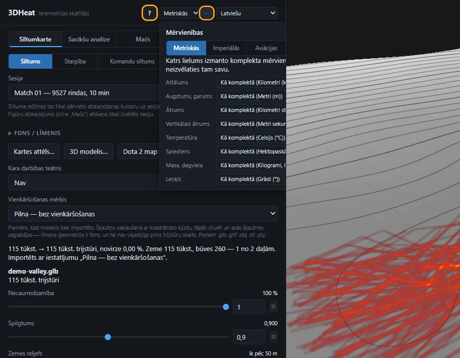
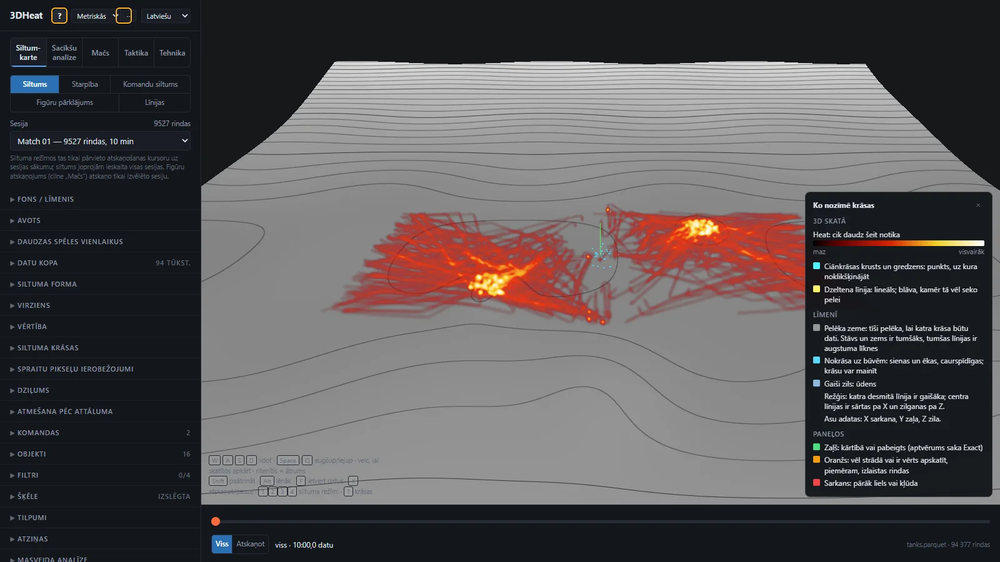
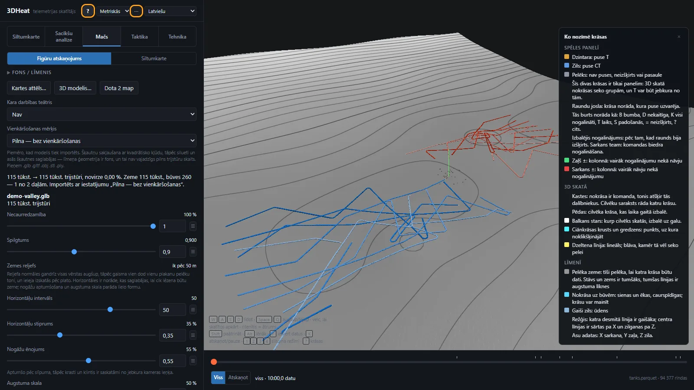

# Iestatījumi, mērvienības un taustiņi

Mazās vadības pogas sānjoslas augšdaļā maina to, kā skatītājs ar jums sazinās: valodu, mērvienības (metri vai pēdas, km/h vai mezgli) un palīdzības režīmu, kas izskaidro krāsas. Jūsu izvēles tiek saglabātas jūsu pārlūkā.

## Galvene {#the-header}

Sānjoslas augšdaļā:

| Vadība | Ko tā dara |
|---|---|
| **?** | Palīdzības režīms: ko nozīmē katra krāsa (arī `?` vai `F1`) |
| Izvēlne **Vienības** | Metriskā, Angļu, Aviācijas vai Jūras |
| Poga **...** blakus **Vienības** | Atver "Izvēlieties mērvienību katram lielumam": katram lielumam atsevišķs nolaižamais saraksts |
| Izvēlne **Valoda** | Skatītāja valoda: [40 valodas](languages.md), vai pārlūka valoda |

Skaitļus, ko ierakstāt lodziņā, var rakstīt ar punktu vai komatu (`0.35` vai `0,35`). Skatītājs saprot abus un parāda skaitļus tā, kā tos raksta skatītāja valoda.

## Vienības {#units}

1. Izvēlieties iepriekšējo iestatījumu izvēlnē **Vienības**. Visi lielumi mainās kopā.
2. Lai mainītu tikai vienu lielumu, noklikšķiniet uz pogas **...** blakus tam un izvēlieties mērvienību šim lielumam. Izvēlne pēc tam rāda `*` aiz iepriekšējā iestatījuma.
3. Lielums, ko neesat iestatījis, seko iepriekšējam iestatījumam. Izvēlieties "Kā iepriekšējais iestatījums", lai atgrieztos.

| Lielums | Metriskā (noklusējums) | Angļu | Aviācijas | Jūras |
|---|---|---|---|---|
| Attālums | km | mi | NM | NM |
| Augstums, garums | m | ft | ft | m |
| Ātrums | km/h | mph | kt | kt |
| Vertikālais ātrums | m/s | ft/min | ft/min | m/s |
| Temperatūra | °C | °F | °C | °C |
| Spiediens | hPa | inHg | hPa | hPa |
| Masa, degviela | kg, l | lb, gal | lb, gal | t, m³ |
| Leņķis | grādi | grādi | grādi | grādi |

Citas mērvienības, ko var izvēlēties vienam lielumam: attālums km, mi, NM; ātrums km/h, m/s, kt, mph; vertikālais ātrums m/s, ft/min, m/min; temperatūra °C, °F, K; spiediens hPa, inHg, mmHg, psi; masa kg, lb, t; leņķis grādi vai NATO mils (6400 uz apli). Mērvienības ir vienādas visur skatītājā: uzrakstos, kartītēs, diagrammās un statistikā.

## Palīdzības režīms {#help-mode}

Nospiediet `?` vai `F1` vai noklikšķiniet uz pogas **?**. Tas parāda *Ko nozīmē krāsas*: leģendas 3D skatam, siltuma skalām, komandu krāsām, līmeņa krāsām, paneļu statusa krāsām, spēles paneli un sacensību skatu. Tas paliek ieslēgts, līdz to izslēdzat. Cilnē Mačs tas izskaidro arī spēles paneļa krāsas.

## Ko pārlūks atceras {#what-the-browser-remembers}

Šie iestatījumi tiek glabāti jūsu pārlūkā starp apmeklējumiem (nekas netiek nosūtīts nekur):

- valoda, mērvienības un palīdzības režīms;
- atkārtojuma figūru, simbolu, etiķešu, kameras un taktiskā displeja iestatījumi;
- atskaņošanas ātrums un spoguļošana;
- grāmatzīmes katram ierakstam, tilpumi katrai datu kopai, mērķu slāņi;
- ārējie MI iestatījumi (atslēga tikai tad, ja atzīmējat *Atcerēties*).

Siltuma iestatījumi, filtri un režīms ar katru ielādi sākas no jauna. Pilnais, ģenerētais saraksts: [Saglabātie iestatījumi](ref-settings-storage.md).

## Taustiņi, ko skatītājs patur no pārlūka {#keys-the-viewer-keeps-from-the-browser}

Sesija ar lieliem datiem ielādējas ilgi, tāpēc skatītājs neļauj pārlūkam to nejauši izmest:

- `Ctrl`/`Cmd` + burti, kas drukātu, saglabātu, atvērtu, pārlādētu, aizvērtu vai atvērtu jaunus logus, ārpus teksta lodziņiem neko nedara; `F1`, `F3`, `F5`, `F6` un `F7` neko nedara.
- Cilnes aizvēršana vai pārlādēšana ar ielādētiem datiem vai līmeni vispirms jautā.
- Pilnekrāna režīmā skatītājs bloķē taustiņus, ko tas izmanto (W, T, N, S, R, P, Q, Esc), lai pārlūks tos neņemtu.

Precīzs saraksts: [Pārlūka taustiņi](ref-browser-keys.md). Visi paša skatītāja taustiņi: [Tastatūras un peles uzziņa](keyboard-reference.md).
