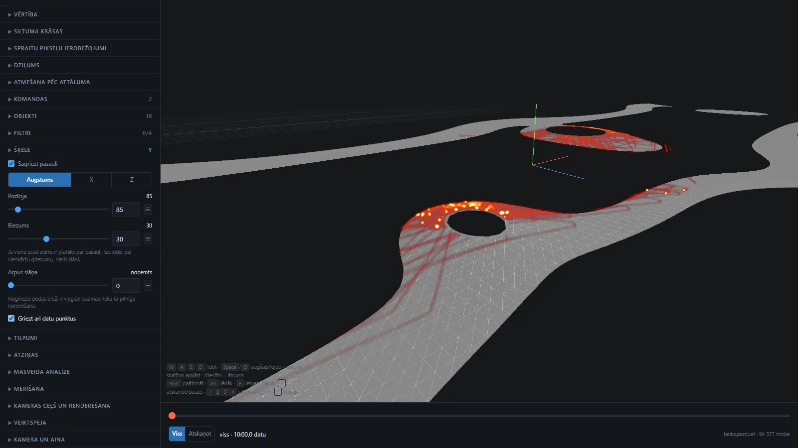

# Griezums

**Griezums** sagriež pasauli kā kūkas šķēli, lai varētu paskatīties ēku iekšienē. Izmantojiet to, kad sienas paslēpj interesantu siltumu, piemēram, lai redzētu vienu ēkas stāvu.

## Izmēģiniet {#try-it}

1. Ielādējiet līmeni un datus un atveriet **Griezums**.
2. Atzīmējiet **Sagriezt pasauli**. Ass ir **Augstums**.
3. Velciet **Pozīcija** augšup un lejup: slānis kustas cauri līmenim.
4. Padariet **Biezumu** plānu plāna stāvam vai platu "viss zem šīs vietas".
5. Turiet **Ārpus slāņa** 0, lai noņemtu pārējo, vai paaugstiniet, lai paturētu vāju pēdu.



Slānis griež **līmeņa ģeometriju un datu punktus kopā**. Tikai līmeņa griešana atstātu siltumu peldam tur, kur bija tā ēka. Tas ir [dziļuma aizsegšanas](depth-and-culling.md) pretstats: kad līmenis pareizi paslēpj to, kas aiz tā, paslēpta ir arī ēkas iekšpuse. Panelis tiek rādīts, kad ir ko griezt (datu kopa vai 3D līmenis). Tā galvene rāda asi, kad ieslēgts, citādi *izslēgts*.

```
side view         Position = where the slab is
 ----------       Thickness = how tall the slab is
 | floor 3 |
 |=========|  <--- slab (kept)
 | floor 2 |  <--- outside: removed (or faint)
 | floor 1 |
 ----------
```

## Vadība {#controls}

| Vadība | Noklusējums | Nozīme |
|---|---|---|
| **Sagriezt pasauli** | izslēgts | Ieslēdz slāni. Kamēr pozīcija vēl ir sākotnējā 0 un biezums sākotnējā 500, ieslēgšana pārvieto tos uz ass vidu un 15% no tās apjoma. |
| Ass | **Augstums** | *Augstums* (Y), *X* vai *Z*. Ass maiņa pārvieto slāni uz jaunās ass vidu. |
| **Pozīcija** | vidus | Slāņa centrs pasaules vienībās pa ass apjomu (500 soļi). |
| **Biezums** | 15% no apjoma | No 1/500 apjoma līdz divkāršam apjomam logaritmiskos soļos. Rāda *aiz pasaules*, kad tas ir tikpat plats kā apjoms: viena puse tad sniedzas aiz pasaules, un tas ir vienkāršs griezums, nevis slānis. |
| **Ārpus slāņa** | 0, *noņemts* | Cik daudz no tā, kas atrodas ārpusē, paliek redzams: 0–100%. Vāja pēda no nogrieztā bieži ir vieglāk lasāma nekā pilnīga noņemšana. |
| **Griezt arī datu punktus** | ieslēgts | Izslēgts atstāj siltumu veselu, tāpēc tas rādās caur griezumu. Tas ir noderīgi, lai redzētu, kas ir virs un zem slāņa. |

Ass apjoms ir 3D līmeņa apjoms, ja tāds ir ielādēts, citādi datu kopas apjoms.

Griezums nav atkarīgs no [attāluma nogriešanas](depth-and-culling.md#distance-culling), kas griež pa skatīšanās virzienu, nevis pa pasaules asi. Abi apvienojas. Jebkuras griezuma iestatījuma izmaiņa restartē siltuma uzkrāšanu.

## Izstrādātājiem {#for-developers}

Slānis tiek pārbaudīts katras rindas pasaules pozīcijā virsotņu shaderī: rindas ieguldījums, kas atrodas ārpus tā, tiek reizināts ar *Ārpus* vērtību. Pie 0 tā tiek noraidīta, pirms jebkurš fragments tiek zīmēts. Līmeņa shaderi piemēro to pašu pārbaudi katram zemes, struktūru un ūdens fragmentam.
