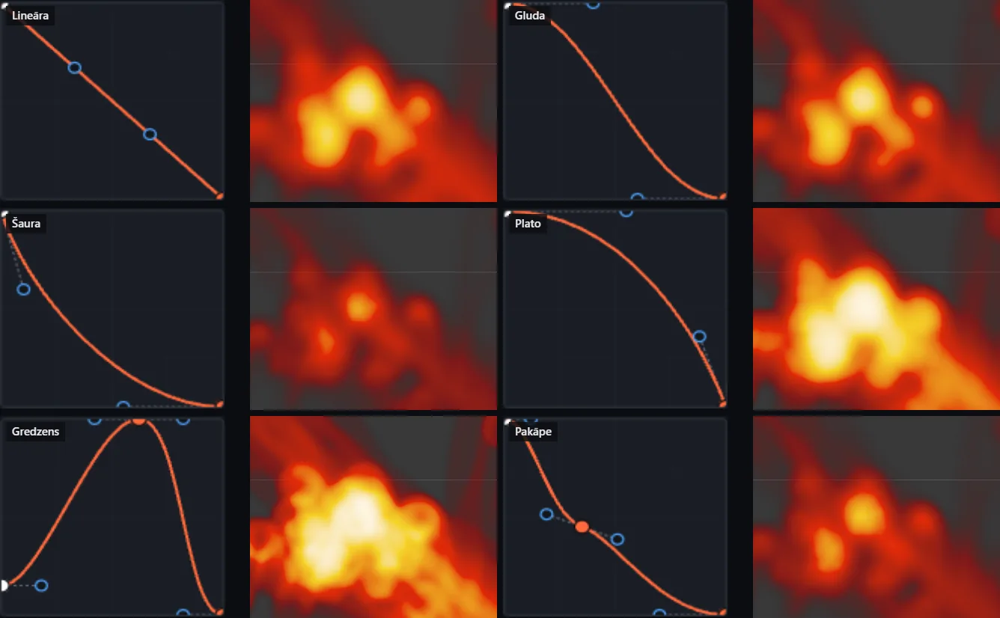

# Sprite forma

Katra rinda tiek zīmēta kā apaļš spraits, kas vienmēr ir vērsts pret kameru. Tā izmērs un profils no centra līdz malai — **gradients** — nosaka, vai karsta vieta izskatās kā šaurs punkts, mīksts mākonis, disks vai gredzens. Šīs vadības ir sānjoslas sadaļās **Siltuma forma** un **Spraitu pikseļu ierobežojumi**. Tās attiecas uz [Siltums](heat.md), [Starpība](difference.md), [Komandu siltums](team-heat.md) un, kā līnijas pusplatums, uz [Līniju siltums](line-heat.md).

Mainot jebkuru no tām, uzkrāšana sākas no jauna, jo lauks jāzīmē no jauna ar jauno formu.

Domā par katru punktu kā mīkstu gaismas plankumu. Mazs plankums rāda atsevišķus punktus, bet liels plankums saplūst ar kaimiņiem mākonī. Forma nosaka, cik mīksta ir mala.



## Spraita rādiuss {#sprite-radius}

Spraita rādiuss ir **pasaules vienībās** (apzīmēts kā metri). Noklusējums ir 6. Katrā ielādē tas tiek iestatīts uz datu horizontālo izmēru / 120, lai blakus esošie paraugi pa ceļu saplūstu joslā, nevis izskatītos kā matu līnija. Logaritmisks slīdnis 0,05–2000, rokturis velkams līdz 50 000.


Lietas tālu prom izskatās mazākas, tāpēc spraits ekrānā sarūk ar attālumu. Paralēlās projekcijas gadījumā tas ir vienāds visur. Tāpēc paralēlais skats ir pareizais karsto punktu salīdzināšanai ([Kamera un vadība](camera.md#projection)).

## Pikseļu ierobežojumi {#pixel-clamps}

**Spraitu pikseļu ierobežojumi** (pēc noklusējuma aizvērti) ierobežo ekrānā redzamo rādiusu pēc iepriekšējās pārvēršanas.

| Vadība | Noklusējums | Diapazons (kustināšana) | Kāpēc |
|---|---|---|---|
| **Min. rādiuss pikseļos** | 1 px | 0–16 (512) | Attālie dati neizzūd zem viena pikseļa. |
| **Maks. rādiuss pikseļos** | 96 px | 2–1024, logaritmiski (8192) | Pārzīmēšanas aizsargs. Spraits, kas aizņem N pikseļus, maksā N sajaukšanas operāciju. Tāpēc neierobežots rādiuss tuvu kamerai ir tas, kas padara ātru kadru lēnu. Pārsniedzot skata loga augstumu, tas vairs neko neierobežo. |

**Vienāds blīvums jebkurā tālummaiņā** (sadaļā Siltuma forma, noklusējums ieslēgts) darbojas kopā ar ierobežojumiem. Spraits, ko ierobežojums padara lielāku (tālu) vai mazāku (tuvu), saglabā siltumu, ko pievienotu tā patiesais izmērs. Tāpēc krāsa nozīmē vienādu rindu skaitu uz zemes laukuma vienību jebkurā tālummaiņā. Ja tas ir izslēgts, ierobežots spraits pievieno savu pilno svaru savā ierobežotajā izmērā, un attēls mainās, kamēr lido iekšā.

## Centra un malas intensitāte {#centre-and-edge-intensity}

Siltums, ko spraits pievieno tieši savā centrā (**Intensitāte centrā**, noklusējums 1, 0–10, kustināšana 1000), un siltums malā (**Intensitāte malā**, noklusējums 0, −2–10, kustināšana 1000). Gradienta vērtība *t* (1 centrā, 0 malā, veidota ar kritumu vai līkni zemāk) saista starp tām. Formula ir sadaļā [Izstrādātājiem](#for-developers).

Negatīva **intensitāte malā** padara malu atņemošu, kas izgriež vēsu ēnu ap katru karsto vietu un asina kopas viena pret otru. Redzamība ietver [aizsegšanu](depth-and-culling.md) un [griezumu](slice.md). Izbalēšana ir [Dzīvildze](timeline.md#history) izbalēšana. Zīme ir ±1 [Starpībā](difference.md).

## Gradienta forma: Kritums vai Līkne {#ramp-shape-falloff-or-curve}

**Gradienta forma** pārslēdz divus veidus, kā veidot *t* pāri spraitam. Ar *d* kā attālumu no centra (0) līdz malai (1):

### Kritums {#falloff}

Redzams, kad izvēlēts *Kritums* (noklusējums).

- **Kritums** (noklusējums 1,6, 0,1–8, kustināšana 64): `t = (1 - d) ^ falloff`. 1 ir taisna lineāra nogāze. Augstāk velk siltumu uz centru un sašaurina karsto vietu. Zem 1 to saplacina diskā.
- **Gluds gradients** (noklusējums ieslēgts): piemēro smoothstep S-līkni *t*, tāpēc spraits izbalē malā, nevis beidzas redzamā malā.

### Līkņu redaktors {#the-curve-editor}

Redzams, kad izvēlēta *Līkne*. Tas ir burtisks spraita šķērsgriezums: attālums no centra pāri (*centrs* pa kreisi, *mala* pa labi), siltums augšup. Līkne ir pa daļām kubiska Bezjē līkne caur kontrolpunktiem. Katram punktam ir divi rokturi.

| Darbība | Efekts |
|---|---|
| Dubultklikšķis uz grafika | Pievieno punktu šajā attālumā (paturēts starp 0,02 un 0,98), uz līknes un ar tās slīpumu šeit. Tāpēc pievienošana neko nemaina, kamēr to nevelk. |
| Vilkt punktu | Pārvieto to. Augstumi tiek turēti starp 0 un 1. |
| Vilkt mazu apli | Saliec blakus esošo posmu (pārvieto to roktura). |
| Alt-klikšķis vai labais klikšķis uz punkta | Noņem to. Galapunktus nevar noņemt. |
| Priekšiestatījuma poga | Aizvieto līkni ar priekšiestatījumu. |

Galapunkti ir fiksēti centrā un malā. To augstums joprojām ir tavs.

**Priekšiestatījumi** ([`curve.ts`](https://github.com/Holdi601/3DHeat/blob/main/src/state/curve.ts)):

| Priekšiestatījums | Forma | Lietošana |
|---|---|---|
| **Lineāra** | Taisni no 1 līdz 0 | Tāda pati kā *Kritums* 1 ar *Gluds gradients* izslēgtu. |
| **Gluda** | S-līkne | Noklusējuma līkne. To dod *Gluds gradients* pie kritumu 1. |
| **Šaura** | Stāvs kodols, gars vājš apkārtnes gals | Reti dati. |
| **Plato** | Līdzena, tad ātra nogāze | Izskatās kā disks, nevis plankums. |
| **Gredzens** | 0,15 centrā, 1 pie 62% rādiusa, 0 malā | Dobs spraits: rāda, kur ceļi iet garām, nevis kur tie beidzas. |
| **Pakāpe** | Divpakāpju kritums, 0,45 pie 35% | Atdala blīvu kodolu no apkārtnes. |

## Saplacināt uz zemes plaknes {#flatten-onto-ground-plane}

**Saplacināt uz zemes plaknes** (noklusējums izslēgts) ignorē katras rindas augstumu un zīmē visu siltumu vienā augstumā — zemākajā datu Y. Tā ir klasiskā 2D kartes siltumkarte. Ja tas ir ieslēgts, dziļuma aizsegšana un *Slēpt aiz reljefa* ir izslēgti (katrs punkts atrastos tieši uz virsmas, pret ko tas tiek pārbaudīts), un dziļuma sadaļa to saka.

## Izstrādātājiem {#for-developers}

### Formulas {#formulas}

Ekrāna rādiuss pikseļos: `radius × P[1][1] / w × skata loga augstums / 2`, kur `P` ir projekcijas matrica un `w` ir punkta skata dziļums.

Siltums, ko spraits pievieno:

```
heat added = mix(edge, centre, t) × sample weight × sign × fade × visibility
```

### Līkne {#the-curve}

Rokturi horizontāli tiek ierobežoti līdz savam posmam. Tāpēc līkne vienmēr ir attāluma funkcija: ja rokturis tiek vilkts tālu aiz nākamā punkta, tas saplacinās pret to, nevis salocīs līkni atpakaļ. Citādi rezultāts būtu atkarīgs no tā, kuru sakni atrisinātājs atrada.

### Kā līkne tiek zīmēta {#how-the-curve-is-drawn}

Līkne tiek iepriekš sagatavota 256 ierakstu tabulā katru reizi, kad tā mainās. Tā tiek augšupielādēta kā 16 bitu pusprecīzā peldošā tekstūra un katrā fragmentā paraugota ar lineāru filtrēšanu un pusteksela ievilkumu, lai abi gali paliktu precīzi. Bezjē risināšana pēc x prasa iterāciju, kas nepieder programmas karstākajam šeiderim. Tabulas nolasījums ir arī lētāks par `pow()`, ko izmanto kritums. 16 biti, nevis 8, jo 8 biti rāda joslas, kad summējas tūkstošiem spraitu. 16 bitu pusprecīzais peldošais ir filtrējams pamata WebGL2, kur 32 biti prasa paplašinājumu.
