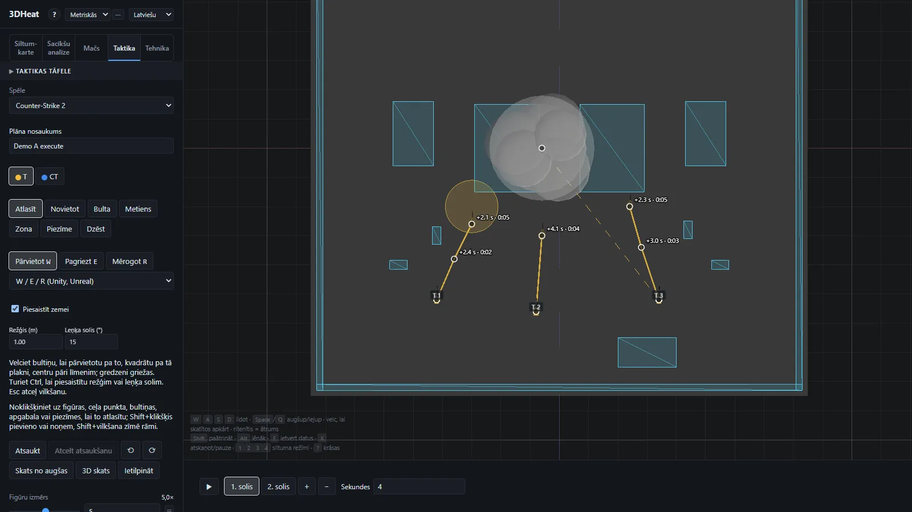

# Taktikas tāfele

Cilne **Taktika** ir zīmēšanas tāfele komandas plānam: jūs novietojat mazas figūras uz kartes, zīmējat bultas, kur tās iet, un nospiežat atskaņot, lai to redzētu. Izmantojiet to, lai plānotu raundu vai uzbrukumu, pirms spēlējat. Tā dala audeklu, kameru un [līmeni](levels.md) ar pārējām cilnēm un nekā citu; plāns nav dati un nezīmē siltumu.

## Jūsu pirmais plāns {#your-first-plan}

1. Atveriet cilni **Taktika**. Izvēlieties **Spēle** (piemēram, Counter-Strike 2) un Valorant gadījumā nospiediet **Ielādēt Valorant kartes** un izvēlieties **Karte**. Vai vispirms ielādējiet [līmeni](levels.md).
2. Izvēlieties **Puse** (tā nosaka krāsu) un nospiediet **Skats no augšas**.
3. Izvēlieties **Vieta**, izvēlieties figūru sarakstā **Figūras** (izmantojiet **Meklēt figūras**, lai to atrastu) un noklikšķiniet uz kartes. Novietojiet divas vai trīs.
4. Izvēlieties **Bulta**, noklikšķiniet uz figūras, noklikšķiniet gar ceļu, pa kuru tai jāiet, un nospiediet **Enter**, lai beigtu bultu.
5. Nospiediet **+** zem skata, lai pievienotu 2. soli. Katra figūra sākas tur, kur beidzās tās bulta. Tur zīmējiet vairāk bultu.
6. Nospiediet **▶** (vai `K`), lai atskaņotu plānu no rādītā soļa līdz beigām.
7. Nosauciet plānu laukā **Plāna nosaukums** un nospiediet **Saglabāt**.

## Plāna sākšana {#starting-a-plan}

| Vadība | Ko tā dara |
|---|---|
| **Spēle** | Izvēlas puses un figūras, ko piedāvā paleta: Counter-Strike 2 (T, CT; spēlētāji un palīglīdzekļi), Valorant (Uzbrukums, Aizsardzība; spēlētāji un vispārīgas spējas), Battlefield, Squad, Arma (kājnieki, sauszemes transportlīdzekļi, lidmašīnas, laivas), DCS / War Thunder / IL-2 (reaktīvās lidmašīnas, propelleru lidmašīnas, helikopteri, pretgaisa aizsardzība, sauszeme, kuģi, ieroči) un Cits. Plāns, kuram jau ir figūras, paturē savas puses, kad spēle mainās. |
| **Plāna nosaukums** | Nosaukums, ar kuru plāns tiek saglabāts. |
| **Karte**, **Ielādēt Valorant kartes** | Ar izvēlētu Valorant: **Ielādēt Valorant kartes** iegūst karšu sarakstu no [valorant-api.com](https://valorant-api.com); **Karte** tad uzliek izvēlētās kartes minikarti kā līmeni, ietvertu no augšas. Attēls tiek ielādēts, kad izvēlas, un nekad netiek piegādāts kopā ar skatītāju. Riot paziņojums tiek rādīts, kamēr tas ir ekrānā (skatiet zemāk). |
| **Puse** | Puse, kurai pieder nākamā figūra, bulta vai apgabals; tā iegūst puses krāsu. |

Bez līmeņa tāfele ir plakana zemes plakne. Ielādējiet līmeni zem **Līmenis**, lai plānotu uz īstas kartes: CS2 karti, kas eksportēta ar CS2 rīku, bibliotēkas līmeni vai kartes attēlu.

## Rīki {#tools}

| Rīks | Klikšķis | Piezīmes |
|---|---|---|
| **Atlasīt** | Figūra, ceļa punkts, bulta, apgabals vai piezīme to atlasa. | Shift+klikšķis pievieno vai noņem; Shift+vilkšana zīmē kastīti ap to, ko pievienot. Atlasītajai daļai ir pārveidošanas rīks (skatiet zemāk); `Delete` vai `Backspace` to noņem. `M` pārvieto atlasīto figūru uz nākamo klikšķi. |
| **Vieta** | Novieto izvēlēto figūru. | Figūra tiek izvēlēta paletē **Figūras** (ar **Meklēt figūras**). Kad nekas nav atlasīts, `R` pagriež nākamo figūru par 15° pirms novietošanas (`Shift+R` — otrā virzienā). |
| **Bulta** | Katrs klikšķis pievieno punktu; Enter, dubultklikšķis vai labais klikšķis to beidz, Esc to atmet. | **Pārvietot**, **Uzbrukums** (platāka galva) vai **Novērošana** (plāna līnija acu augstumā). Bulta, kas sākas uz figūras, ir šīs figūras maršruts šajā solī: atskaņojot, figūra to iet, un nākamais solis sākas, kur tas beidzās. |
| **Metiens** | Metējs, tad vieta, kur tas nokrīt. | Punktēts loks no viena uz otru, un izvēlētais palīglīdzeklis (dūmi, zibinātājs, molotovs, ...) parādās, kur tas nokrīt, un paliek no šā soļa uz priekšu. |
| **Apgabals** | Centrs, tad mala. | Disks puses krāsā. |
| **Piezīme** | Kur piezīme ir; prasa tās tekstu. | Rāda kā piespraudi, un virs tās — tās teksts. |
| **Dzēst** | Figūra, bulta, apgabals vai piezīme. | Noņem to no šā soļa uz priekšu; pirmajā solī — noņem to pilnībā. |

**Atsaukt** un **Atcelt atsaukšanu** (`Ctrl+Z`; `Ctrl+Y` vai `Ctrl+Shift+Z`) soļo caur katru izmaiņu. Līnija zem plāna rāda, cik figūru, bultu un soļu tam ir. **Skats no augšas** skatās tieši uz leju (ortogrāfiski), **3D skats** atgriež perspektīvu, **Kadrs** ietver plānu kadrā vai līmeni, kad plāns ir tukšs.

**Figūru izmērs** mērogo katru figūru tāfelē; 1× ir patiesais izmērs, un no tālas augstuma cilvēks ir dažu pikseļu liels.

## Pārvietošana, pagriešana un mērogošana {#moving-turning-and-scaling}

Visu uz tāfeles var pārvietot kā 3D redaktorā: figūras, palīglīdzekļus, marķierus, atsevišķus ceļa punktus un visas bultas, apgabalus un piezīmes. Atlasītajai daļai ir rīks tās vidū:

| Režīms | Taustiņi | Rokturi |
|---|---|---|
| **Pārvietot** | W (vai G) | Bulta katrai asij (X sarkana, Y zaļa un uz augšu, Z zila) pārvieto pa to; kvadrāts pārvieto pa savu plakni; centrs pārvieto pa līmeni zem rādītāja. |
| **Pagriezt** | E (vai R) | Gredzens katrai asij pagriež ap to. Vienas figūras gredzeni ir tās pašas pagrieziens, slīpums un rullis; grupa pagriežas ap pasaules asīm ap savu vidu. |
| **Mērogot** | R (vai S) | Izplešas vai saspiež atlasīto no tās vidus pa asi vai visos virzienos; apgabala rādiuss aug kopā ar to. |

**Taustiņi** pārslēdz starp W / E / R (Unity, Unreal) un G / R / S (Blender); taustiņi izvēlas režīmu tikai tad, kad kaut kas ir atlasīts, un citādi lido ar kameru. Tātad `R` nozīmē **Mērogot** ar taustiņiem W / E / R un **Pagriezt** ar taustiņiem G / R / S, kad kaut kas ir atlasīts, un pagriež nākamo novietojamo figūru, kad nekas nav atlasīts. Visi tāfeles taustiņi ir uzskaitīti [taustiņu uzziņā](keyboard-reference.md#tactics-board). Turiet **Ctrl** velkot, lai pārvietojumu piesaistītu **Režģim** (metri) vai pagriezienu **Leņķa solim**. **Piesaistīt zemei** (pēc noklusējuma ieslēgts) novieto pārvietotos cilvēkus, transportlīdzekļus, marķierus, ceļa punktus un apgabalus uz līmeņa virsmas; lidmašīnas un helikopteri saglabā savu augstumu, un vilkšana pa Y bultu nekad nepiesaista. Rokturu velkot, kamera nekad nepārvietojas. **Esc** atceļ vilkšanu, un katra izmaiņa ir viens solis Atsaukt.

Ceļa punkti redzami kā punkti uz rādītā soļa bultām: noklikšķiniet uz viena, lai to atlasītu, velciet, lai pārvietotu, un Delete, lai to izņemtu. Sadaļa **Izvēlētās** rāda atlasītās daļas vietu metros, figūras pagriezienu, slīpumu un rulli grādos, un apgabala rādiusu, katru ar ievades lauku.

## Hronometrāža {#timing}

Figūras maršruts ir laikots: katrs posms prasa tik laika, cik ir tā garums pa līmeni — paraugots virsmā ik pēc pāris metriem, tāpēc kalns vai kāpnes starp diviem punktiem tiek ieskaitītas — ar ātrumu tās figūras kustības **režīmā** šajā spēlē, plus jebkuru **gaidīšanu** pie ceļa punkta. Kājnieki ropo, tupas, iet (klusi), skrien vai sprintē; transportlīdzekļi un laivas ropo, brauc piesardzīgi, normāli vai steidzas; lidmašīnas un helikopteri lido lēni, kreiserā ātrumā, kaujas ātrumā vai maksimālajā. Režīms, kuru spēlē nav (CS2 nav sprinta), ņem tuvāko, kāds tai ir. Kā nogāze bremzē, atkarīgs no spēles: CS2 un Valorant skaitās tikai horizontālais attālums, kā spēlēs; militārajās simulācijās kājnieki kalnā palēninās (Toblera pārgājiena funkcija), transportlīdzekļi — pēc slīpuma.

Ātrumi nāk no spēļu tabulām ar to avotiem (skatiet [Kustības ātrumi](tactics-speeds.md)): CS2 — pēc turētā ieroča, no spēles ieroču definīcijām; Valorant — pēc ieroča; Battlefield, Squad, Arma un gaisa spēles — pēc transportlīdzekļa veida un klases. **Pārvietojas kā** izvēlas figūras profilu (ieroci, transportlīdzekļa veidu); **Savs (m/s)** pārraksta jebkuru režīmu šai figūrai. Režīmi nosaukti tā, kā tāfele tos rāda: *Ropošana*, *Tupēšanās*, *Iet (klusi)*, *Skriet*, *Sprintēt*; *Piesardzīgi*, *Normāli*, *Steidzas*; *Lēni*, *Kreiserā ātrumā*, *Kaujā*, *Maksimāli*.

Katrs ceļa punkts rāda laiku no pēdējā un laiku kopš plāna sākuma ("+3,9 s · 0:12"). Atlasītās figūras maršruts uzskaita katru posmu ar tā režīmu, garumu un laiku, gaidīšanu un ierašanos. **Ierašanās** zem **Hronometrāžas** novieto katru ar maršrutu figūru uz vienas laika līnijas, pirmā ierašanās augšā. Ar **Atskaņot reālajā laikā** (pēc noklusējuma ieslēgts) solis ilgst, līdz pienāk lēnākais maršruts, un katra figūra kustas ar savu ātrumu; **Sekundes** tad ir soļa mazākais garums. **Līmeņa vienības uz metru** saka, kas līmenis ir: 39,37 CS2 kartēm (spēles vienības), 1 metru kartēm.

## Salīdzināt ar mača datiem {#compare-with-match-data}

**Ielādēt mača failus…** nolasa kartes CS2 mača tabulas (CS2 rīka Parquet failus, cik vēlaties; tikai nepieciešamās kolonnas, fonā); **Izmantot ielādētos datus** ņem datus, kas ielādēti skatītājā. Tad:

- **Agrākā ierašanās kartē** nokrāso karti pēc laika kopš raunda sākuma, kad spēlētājs pirmo reizi sasniedza katru vietu — poga **Ātrākais** rāda ātrāko pār visiem raundiem, **Tipisks (mediāna)** — vidējo raundu — zaļš agri, sarkans vēlu, vienai pusei vai abām. Tā rāda, kas ir iespējams un kad.
- Izvēlētais maršruts tiek salīdzināts ar to, ko spēlētāji sasniedza no tā sākuma (vai no raunda sākuma) līdz tā beigām, katrs gals kā disks ar uzstādīto rādiusu: "Ātrākais novērotais 14,2 s, p10 15,0 s, mediāna 18,3 s no 41 braucienu; jūsu plāns 15,1 s".
- Ātrumi, ar kādiem spēlētāji patiešām kustējās — skrienot, ejot, tupoties, no tabulu ejas un tupēšanās kolonnām — m/s.

## Soļi {#steps}

Josla zem skata satur soļus. Plāns sākas ar vienu; **+** pievieno vienu, un katra figūra tajā sākas, kur tās maršruts pēdējā solī beidzās; **−** noņem rādīto. **Sekundes** ir, cik ilgi rādītais solis aizņem, atskaņojot. **▶** (K) atskaņo no rādītā soļa līdz beigām: figūras ar maršrutu iet pa to, figūras, kas nākamajā solī pārvietotas uz jaunu vietu, tur slīd, pārējās stāv. Kamēr solis ir rādīts, katras figūras vieta nākamajā solī tiek zīmēta kā bāls spoks, un pēdējā soļa bultas bāli zem šā soļa.

## Saglabāšana {#saving}

Sadaļā **Fails** ir **Saglabāt**, **Pirm.** un **Notīrīt**. **Saglabāt** raksta plānu kā `<nosaukums>.h3dplan.json` (vienkāršs JSON: puses, soļi, figūras ar vietu katrā solī, bultas, apgabali, piezīmes); **Pirm.** nolasa vienu atpakaļ. Citas versijas fails vai fails, kas nav plāns, tiek noraidīts ar iemeslu. **Notīrīt** iztukšo plānu; Atsaukt to atgriež.

## Figūras {#figures}

Katru figūru veido pats skatītājs: vienkāršas formas līdz veida publicētajam izmēram, ar pazīmēm, kas to atšķir no kaimiņiem — tanka ceļa riteņi un tornis, pretgaisa transportlīdzekļa ieroči, raķetes un radari, lidmašīnas spārna plāns, astes un dzinēji, helikoptera rotori un īsie spārni. Nekas nav ņemts no spēles. Dizains, ko izdomājusi spēle, tiek rādīts kā tās klases vispārīgā figūra. Skatiet [Figūras](figures.md#which-figure-a-unit-gets), lai redzētu, kā dati atrod savu figūru.

## Riot paziņojums {#riots-notice}

Valorant kartes tiek rādītas saskaņā ar Riot Games politiku "Legal Jibber Jabber", kas ļauj bezmaksas kopienas projektiem tās izmantot un prasa šo paziņojumu tur, kur tās parādās: *3DHeat was created under Riot Games' "Legal Jibber Jabber" policy using assets owned by Riot Games. Riot Games does not endorse or sponsor this project.* Tāfeles spējas ir vispārīgas formas, nevis Riot māksla.
