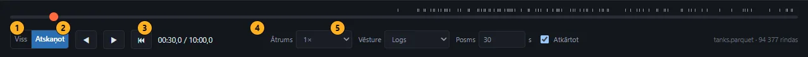

# Laika skala un atskaņošana

Josla zem attēla darbojas kā video atskaņotājs: datus var atskaņot kā filmu, apturēt, pārlēkt uz citu vietu un mainīt ātrumu.

Josla zem skata ir laika skala ([`Timeline.tsx`](https://github.com/Holdi601/3DHeat/blob/main/src/ui/Timeline.tsx)). Tā nosaka, kuras rindas ir redzamas katrā brīdī. Tai vajag laika kolonnu; bez tās visa josla ir atspējota, skats paliek režīmā **Viss**, un sānjosla saka *Šajos datos nav laika kolonnas - laika skala ir atspējota, un visi datu punkti tiek rādīti uzreiz.*

## Viss un Atskaņot {#all-and-play}

Divi augstākā līmeņa režīmi, jo tie atbild uz dažādiem jautājumiem.

- **Viss** (noklusējums katrā ielādē) pilnībā ignorē atskaņošanas rādītāju un rāda katru rindu, kas iztur filtrus. Tas ir skats "kur tas notiek", un tas nav tas pats, kas pārvietoties līdz beigām. Skrubers ir atspējots, un pulkstenis rāda `viss ·  no datiem`.
- **Atskaņot** palaiž datus kā laika ritinājumu. Parādās skrubers, vadība un vēstures iestatījumi.

Izvēloties **Viss**, atskaņošana tiek arī apturēta.

## Vadība {#the-controls}

| Vadība | Noklusējums | Nozīme |
|---|---|---|
| Skrubers | sākums | Atskaņošanas rādītājs. Velciet, lai pārietu; 20 000 soļi visā diapazonā. |
| **Viss** / **Atskaņot** | Viss | Skatiet augstāk. |
| ▶ / ❚❚ | apturēts | Atskaņot vai apturēt; arī `K`. |
| ◀ **Atskaņot atpakaļ (J)** | | Atskaņo datus pretējā virzienā. Rādīts tikai režīmā **Figūru pārklājums**; tas pats taustiņš `J` darbojas arī tur (skatiet [Taustiņi](#keyboard)). |
| ⏮ | | Atpakaļ uz diapazona sākumu. |
| Pulkstenis | | `pagājis / kopā` kā `mm:ss.s` (vai `h:mm:ss`), un, ja laika kolonna ir absolūts laikspiedols, arī atskaņošanas rādītāja pulksteņa laiks dienā kā `HH:MM:SSZ` (UTC). |
| **Ātrums** | 1× | Datu sekundes uz reālu sekundi. Izvēlnē ir 17 soļi no 0,01× līdz 1800× (0,01, 0,02, 0,05, 0,1, 0,25, 0,5, 1, 2, 4, 8, 16, 32, 64, 128, 256, 600, 1800), plus **Pielāgots…**: ierakstiet jebkuru ātrumu no 0,001× līdz 3600× (piemēram, 0,3 vai 12) un nospiediet Enter; Esc paliek pie pašreizējā ātruma. Pēdējais ātrums tiek atcerēts nākamajai reizei (skatiet [Saglabātie iestatījumi](ref-settings-storage.md)). |
| **Vēsture** | Kumulatīvi | Kas tiek uzskatīts par redzamu atskaņošanas rādītājā: *Kumulatīvi*, *Logs* vai *Dzīves ilgums* (zemāk). |
| **Posms** (Logs; Līniju režīmā arī Dzīves ilgums) | 30 s | Loga garums, kas beidzas atskaņošanas rādītājā; vismaz 0,01 s. [Līniju siltumā](line-heat.md#playback) tas ir astes garums. |
| **Rezerves dzīves ilgums** (tikai Dzīves ilgums, ne Līniju režīmā) | 10 s | Cik ilgi datu punkts bez nākamā paraugu punkta tās pašas personas paliek redzams. |
| **Izgaišana** (tikai Dzīves ilgums, ne Līniju režīmā) | 0,4 | Daļa no katra datu punkta dzīves, ko pavada izgaišanā, 0-1. |
| **Atkārtot** | ieslēgts | Beigās sākt no jauna; izslēgts - apstājas beigās. |
| Labā puse | | Datu kopas nosaukums. |

**Diapazons** ir datu kopas laika posms - vai, [figūru pārklājumā](box-replay.md) ar izvēlētu sesiju, šīs sesijas laika posms.

## Vēsture {#history}

Režīmā Atskaņot:

- **Kumulatīvi** - viss no diapazona sākuma līdz atskaņošanas rādītājam. Siltums veidojas, kamēr tas atskaņojas.
- **Logs** - fiksēts vēstures posms, kas beidzas atskaņošanas rādītājā (*Posms*).
- **Dzīves ilgums** - katrs datu punkts dzīvo līdz **tās pašas personas nākamajam paraugam** (tajā pašā sesijā), tāpēc katrā brīdī ir tieši viena pozīcija katrai personai. Datu punkts, kura persona vairs nekad nepaliek, - nāve, atvienošanās, žurnāla beigas - nākamā parauga nav, un tas dzīvo *Rezerves dzīves ilgumu*, nevis pazūd uzreiz vai paliek mūžīgi. Datu punkti **izgaist** pēdējā *Izgaišanas* daļā no dzīves, nevis pazūd pēkšņi: ja katrai personai ir viens dzīvs paraugs, datu punkts, kas pazūd starp vienu kadru un nākamo, liek visam laukam mirgot ar paraugu ātrumu. *Izgaišana* 0 atjauno cieto griezumu.

Dzīves ilgumam vajag gan personas kolonnu, gan laika kolonnu; bez personas kolonnas vēsture ielādējot atgriežas pie Kumulatīvi. [Līniju siltumā](line-heat.md#playback) vēsture nosaka, cik ilgi maršruta aste paliek redzama; [figūru pārklājumā](box-replay.md) *Rezerves dzīves ilgums* ir, cik ilgi tiek turēta persona bez turpmākiem paraugiem.

## Atskaņošanas uzvedība {#playback-behaviour}

No kadru cikla ([`engine.ts`](https://github.com/Holdi601/3DHeat/blob/main/src/render/engine.ts)):

- Atskaņošanas rādītājs virzās par *kadra laiks × ātrums*. Kadra laiks ir ierobežots līdz 0,1 s, tāpēc cilņu pārslēgšana neaizved rādītāju uz citu vietu.
- Nospiežot atskaņot diapazona beigās, atskaņošana sākas no sākuma, kā to dara multivides atskaņotājs. Katrā ielādē rādītājs tiek novietots sākumā, tāpēc pirmais atskaņošanas nospiediens atskaņo.
- Diapazona beigās rādītājs atlec atpakaļ uz sākumu (Atkārtot ieslēgts) vai apstājas tur, un atskaņošana beidzas (Atkārtot izslēgts).
- Skrubers nolasa dzinēja atskaņošanas rādītāju tieši katrā kadrā; lietotnes stāvoklis tiek atjaunināts pārlēkšanas, sākšanas, apturēšanas un atkārtošanas brīžos.
- Izvēloties sesiju izvēlnē, rādītājs pārlec uz šīs sesijas sākumu.

## Kāpēc atskaņošana ir vienmērīga un lēta {#why-playback-is-smooth-and-cheap}

Rindas ir saglabātas sakārtotas pēc laika, tāpēc laika logs ir divi binārie meklējumi pa laika kolonnu: virzot atskaņošanas rādītāju, pārvietojas divi veseli skaitļi un neviena rinda netiek aizskarta, un atskaņošanas izmaksas seko rindu skaitam logā, nevis datu kopas izmēram.

Kā siltums paliek stabils, kamēr logs pārvietojas, atkarīgs no vēstures ([Uzkrāšana](accumulation.md)):

- **Kumulatīvi** tikai aug, tāpēc katrs kadrs pievieno tikai tās rindas, kas kļuvušas redzamas kopš iepriekšējā, pilnā svarā. Lauks veidojas monotoni, un pauzēšana neko nemaina, jo nekas vairs nenāk klāt. (Pārvērtēšana tā vietā katrā kadrā apgaismotu citu nejaušu apakškopu un tad to izgaismotu, kas izskatās kā uzliesmojumi, kas pazūd.)
- **Logs** un **Dzīves ilgums** patiesi mainās katrā kadrā, un tie tiek pārvērtēti, sajaukti kā eksponenciāla slīdošā vidējā vērtība (svars 0,34 jaunajam kadram), kas stacionārā stāvoklī ir nenovirzīta un daudz mierīgāka nekā sākt no nulles.
- Dzīves ilguma režīmā kandidātu rindas ir tās no *atskaņošanas rādītāja - maks(garākais starplaiks datos, Rezerves dzīves ilgums)* līdz atskaņošanas rādītājam; tad shader izmet katru rindu, kuras dzīve ir beigusies, un piemēro izgaišanu.

Pārslēdzoties starp Viss un Atskaņot vai mainot vēsturi, uzkrāšana tiek restartēta.

## Taustiņi {#keyboard}

| Taustiņš | Darbība |
|---|---|
| `K` | Atskaņot / apturēt |
| `J` | Atskaņot atpakaļ; nospiežot vēlreiz, aptur (tikai Figūru pārklājums) |
| `L` | Atskaņot uz priekšu; nospiežot vēlreiz, aptur (tikai Figūru pārklājums) |

`J` un `L` arī pārslēdz laika skalu uz **Atskaņot**. Taustiņi tiek ignorēti, kamēr fokuss ir teksta lodziņā vai izvēlnē. Sacīkšu analīzes cilnē `K` vada šīs cilnes pašas atkārtojumu.
