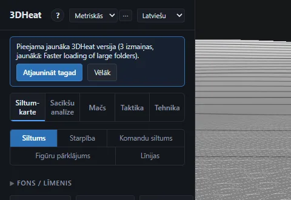

# Atjauninājumi

Skatītājs jums pateiks, kad ir jaunāka versija, un atjaunināsies pats tikai tad, kad jūs teiksiet jā. Jūsu datorā nekas netiek mainīts bez jūsu atbildes.

## Skatītāja atjaunināšana {#update-the-viewer}

1. **Lapā.** Kad ir jaunāka versija, virs nosaukuma sānjoslas augšdaļā parādās kastīte: "Pieejama jaunāka 3DHeat versija". Noklikšķiniet uz **Atjaunināt tagad**. Kad tas ir pabeigts, lapa pati pārlādējas. **Vēlāk** paslēpj kastīti līdz lapas pārlādēšanai.
2. **Ja tiek teikts palaist restart.bat**, aizveriet servera logu (melno logu, ko atvēra `start.bat`) un divreiz noklikšķiniet uz `restart.bat`.
3. **Kad palaižat skatītāju.** `start.bat` pārbauda arī. Ja ir jaunāka versija, tas jautā **Update now? [Y/N]**. Nospiediet `Y`, lai atjauninātu. Nospiediet `N` vai pagaidiet 60 sekundes bez atbildes, lai palaistu jūsu esošo versiju.



Kopiju ar jūsu pašu izmaiņām nekad neatjaunina jūsu vietā; kastīte tikai saka, ka gaida atjauninājums, un liek saglabāt vai paslēpt savas izmaiņas un palaist `git pull`. Kopija, kas nav instalēta ar git (piemēram, zip fails), nerāda neko.

Kā pārbaude darbojas, soli pa solim:

```
lapa ---(pēc 4 s, tad ik pēc 6 h)---> izstrādes serveris ---> git fetch
   aiz? nē  -> nekas netiek rādīts
          jā -> jūsu pašu izmaiņas vai revīzijas? jā -> tikai paziņo
                                                  nē  -> [Atjaunināt tagad] -> git pull
                                                        -> pārlādē, vai "palaidiet restart.bat"
```

## Drošības noteikumi {#the-safety-rules}

- **Tikai uz priekšu** (`git pull --ff-only`): atjauninājums nekad nesapludina, nepārbāzē un nepārraksta neko.
- **Nav vietējo izmaiņu**: kopija ar nesaglabātām izmaiņām izsekotajos failos (`git status --porcelain --untracked-files=no` nav tukšs) nekad netiek atjaunināta automātiski — kāda paša darbu atjauninājumam nav jāpārraksta. Tai tikai saka, ka gaida atjauninājums. Neizsekoti faili (dati, eksporti) nav uzskatāmi par izmaiņām.
- **Nav vietējo revīziju**: kopija ar revīzijām, kuru augštecim nav ("atšķirījusies"), netiek atjaunināta — uz priekšu tā nevar tikt, un sapludināšana ir paredzēta `git pull` ar roku. Lapa un `start.bat` to saka vienos un tajos pašos vārdos, un `start.bat` palaiž to versiju, kāda ir.
- **Tikai no pašas lapas**: izstrādes servera atjaunināšanas pieprasījumam jābūt ar pielāgotu galveni un, ja pārlūks sūta `Origin`, tam jānāk no servera pašas saimnieka (zemāk).
- Atjaunina tikai git kopiju ar augšteces atzaru; viss pārējais (kopija bez `.git`, nav instalēts git, statiskā versija) tiek atstāts nepieskarts un neko neteic.

## Ko dara start.bat {#what-startbat-does}

`start.bat` (divreiz noklikšķiniet uz tā; logs ir serveris) dara, pēc kārtas:

1. Atrod Node.js — `PATH` vai `%ProgramFiles%\nodejs`, `%ProgramFiles(x86)%\nodejs` vai `%LOCALAPPDATA%\Programs\nodejs` — un, ja tas trūkst, piedāvā to instalēt ar `winget install -e --id OpenJS.NodeJS.LTS` (jautā, Y/N; pēc tam logs jāatver atkal, lai Windows paņem jauno `PATH`).
2. **Atjauninājumi**, kad git ir instalēts un mapē ir `.git`:
   - `git fetch --quiet` (bez tīkla vai bez augšteces: klusi izlaists);
   - saskaita `git rev-list --count HEAD..@{u}`; nekas nav aiz: nekas netiek teikts;
   - vietējās izmaiņas: "A newer version of 3DHeat is available (N changes), but this copy has local changes, so it is not updated. Commit or stash them, then run git pull." — un tas palaiž esošo versiju;
   - savas revīzijas (`git rev-list --count @{u}..HEAD` nav 0): "A newer version of 3DHeat is available (N changes), but this copy has commits of its own that the newest version does not, so it is not updated. Update it with git pull." — un tas palaiž esošo versiju;
   - citādi "A newer version of 3DHeat is available (N changes)." un jautājums **Update now? [Y/N]**. `N` vai nekāda atbilde 60 sekundes izdrukā "Not updated; starting the version you have." un palaiž esošo versiju. Ar `Y`: "Updating...", pasaka, vai mainās `package.json` vai `package-lock.json`, palaiž `git pull --ff-only` (ja tas vēl neizdodas — piemēram, tīkla dēļ: "The update did not go through; starting the version you have."), tad `git submodule update --init` (piespraustie rīki, skatiet [Dokumentācijas uzturēšana](maintaining.md#the-tools-under-exporters)), tad `npm install`, ja pakotņu faili mainījās un `node_modules` eksistē, un "Updated."
3. Atsaka sākt otru serveri: ja kaut kas jau klausās portu **5273**, tas to saka un norāda uz `restart.bat` / `stop.bat`.
4. Pirmajā palaišanā (nav `node_modules`) jautā, pirms lejupielādē atkarības (apmēram 300 MB mapē `node_modules\`, nekas sistēmā netiek instalēts).
5. Palaiž izstrādes serveri `127.0.0.1:5273` (`--strictPort`) un atver pārlūku, kad tas ir gatavs.

`restart.bat` aptur serveri (pēc porta) un vēlreiz palaiž `start.bat`, tāpēc tas uzdod to pašu jautājumu. `stop.bat` tikai aptur.

## Izstrādātājiem {#for-developers}

### Kamēr tas darbojas: atjaunināšanas maršruts {#while-it-runs-the-update-route}

Izstrādes serveris (Vite spraudnis `heat3d-self-update` failā `vite.config.ts`) apkalpo `/__heat3d/update`. Tas pastāv tikai izstrādes serverī — ne statiskā versijā un ne `vite preview`.

**`GET /__heat3d/update`** atbild, vai kopija ir aiz:

```json
{ "checkout": true, "upstream": "origin/main", "behind": 3, "ahead": 0, "dirty": false, "latest": "the newest commit's subject" }
```

- `checkout: false`, kad mape nav git kopija;
- tas palaiž `git fetch --quiet` **ne biežāk kā reizi 30 minūtēs** (pieprasījumi starp tiem atbild pēc pēdējā ielādētā);
- `behind` / `ahead` no `git rev-list --count HEAD..@{u}` / `@{u}..HEAD`, `dirty` no `git status --porcelain --untracked-files=no`, `latest` ir augšteces jaunākās revīzijas virsraksts;
- bez augšteces atzara `upstream: null` un `behind: 0`.

**`POST /__heat3d/update/apply`** atjauno kopiju:

1. Noraidīts ar `403 { ok: false, reason: "forbidden" }`, ja pieprasījumā nav galvenes `X-Heat3d-Update: 1` un, ja tam ir `Origin`, tā saimnieks nav pieprasījuma `Host`. Starpvietņu forma nevar sūtīt pielāgotu galveni bez CORS priekšpārbaudes, ko šis serveris nekad nedod.
2. Nav ko darīt (nav kopija, nav augšteces, nav aiz): `{ ok: true, updated: false }`.
3. Vietējās izmaiņas: `{ ok: false, reason: "dirty" }`; vietējās revīzijas: `{ ok: false, reason: "diverged" }`.
4. Citādi: pieraksta failus, kas mainās (`git diff --name-only HEAD @{u}`), `git pull --ff-only` (2 min noildze), `git submodule update --init` (kļūda tiek ignorēta), `npm install`, kad mainās `package.json` vai `package-lock.json` (15 min noildze), un atbild `{ ok: true, updated: true, restart }` — `restart` saka, kāpēc darbošais serveris nevar paņemt atjauninājumu: `"dependencies"`, kad tās ir pārinstalētas, `"config"`, kad mainījās tikai `vite.config` fails, `false`, kad restartēšana nav vajadzīga.
5. Neizdevusies git vai npm komanda atbild `{ ok: false, reason: "<kļūda, līdz 300 rakstzīmēm>" }`.

Atbildes ir JSON ar `Cache-Control: no-store`. Serveris klausās tikai `127.0.0.1`, tāpēc maršruts nav sasniedzams no tīkla.

### Paziņojums lapā {#the-notice-in-the-page}

`UpdateBanner`, zem nosaukuma sānjoslas augšdaļā:

- Tas pieprasa maršrutu **4 sekundes** pēc lapas ielādes (ne pirmajās sekundēs: lapai ir jāielādē datu kopa un jāpalaiž GPU) un atkal **ik pēc 6 stundām**, kamēr lapa paliek atvērta.
- Tas neko nerāda, kad šāda maršruta nav (statiska versija), mape nav kopija vai nekas nav jaunāks — paziņojums katrā palaišanā ir tāds, ko cilvēki iemācās ignorēt.
- Aiz, bez vietējām izmaiņām: "A newer version of 3DHeat is available (N changes, the newest: <subject>)." ar **Atjaunināt tagad** un **Vēlāk** (*Vēlāk* paslēpj to līdz lapas pārlādēšanai).
- Aiz, ar vietējām izmaiņām: tas pats teikums un "This copy has local changes, so it is not updated automatically; commit or stash them, then run git pull." — bez pogas.
- **Atjaunināt tagad** nosūta pieprasījumu uz `/apply` ("Updating..."). Tad:
  - "Updated. The page reloads." — un lapa pārlādējas 1,5 s vēlāk (serveris jau apkalpo jaunos failus);
  - kad atkarības tika pārinstalētas: "Updated. Its dependencies changed: close the server window and run **restart.bat** to finish.";
  - kad mainījās tikai servera iestatījumi: "Updated. Its server settings changed: close the server window and run **restart.bat** to finish.";
  - nav ko ienest (`updated: false` — kopiju jau atjaunoja, piemēram, `start.bat`): "Nothing to update: this copy is already the newest version." — un bez pārlādēšanas;
  - noraidīts: vai *dirty* teikums, vai "This copy has commits of its own that the newest version does not; update it with git pull.", vai "The update did not go through: <reason>".
