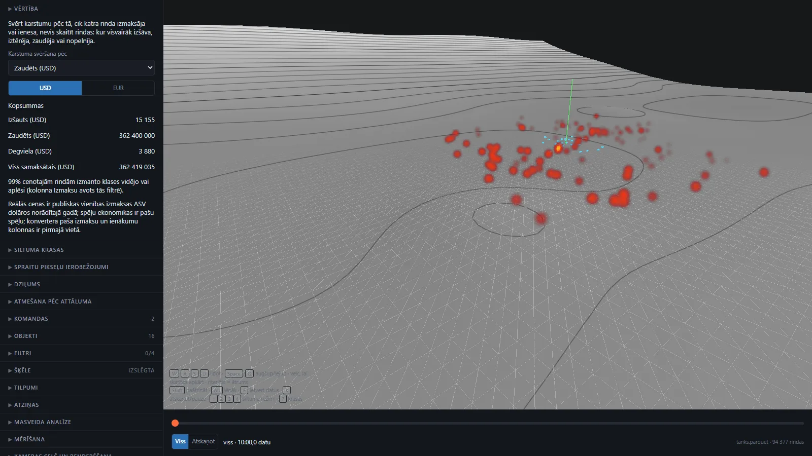

# Vērtības svēršana

Katrai šāvienai, munīcijai, zaudētai mašīnai un litram degvielas ir cena. Skatītājs aprēķina, cik maksāja vai ko nopelnīja katra rinda, un var svērt siltumu pēc tās. Tā karte rāda **kur aizgāja nauda**, nevis kur ir rindas.

## Kā to lietot {#how-to-use-it}

1. Ielādējiet datus ar notikumiem (šāvieni, nogalinājumi, nāves) un transportlīdzekļu vai ieroču nosaukumiem.
2. Atveriet **Vērtība** siltuma sānjoslā.
3. Izvēlieties **Svērt siltumu pēc**, piemēram, *Zaudēts (USD)*. Siltums tagad pieskaita katras rindas cenu, nevis 1.
4. Skatiet **Kopsummas**: katras vērtību kolonnas summu tam, kas tiek rādīts (piemēro filtri un laika logs).
5. Ja cenas ir reālā naudā, parādās pārslēgs **USD / EUR**.

Lai rindas skaitītu atkal, izvēlieties izvēlnes tukšo pirmo ierakstu.

## Ko var svērt {#what-can-be-weighed}

Vērtību kolonnas tiek pievienotas ielādes laikā, pa vienai katram veidam un valūtai:

| Veids | Rindas, kurās tas nonāk | Kā tas tiek cenots |
|---|---|---|
| **Izšauts** | šāvieni un palaišanas | ierocis, citādi vidējā vērtība šāda veida munīcijai |
| **Iztērēts** | pirkšana, dzemdēšana | spēles naudas kolonnas (piem., šāvējspēles pirkšanas izvēlne) |
| **Zaudēts** | nāves, iznīcināts | pats transportlīdzeklis, citādi tā klases vidējā vērtība |
| **Iznīcināts** | nogalinājumi | mērķa transportlīdzeklis |
| **Nodarītie bojājumi** | trāpījumi | daļa no mērķa vērtības |
| **Degviela** | pozīcijas | izmantotā degviela no degvielas kolonnas vai aprēķināta no klases un laika |
| **Viss samaksātais** | | izšauts + iztērēts + zaudēts + degviela |
| **Nopelnīts** | atlīdzības | spēles pašas atlīdzību kolonnas (`earn_…`) |
| **Neto** | | nopelnītais mīnus samaksātais; zīmēts kā parakstīts siltums (pozitīva skala, kur nopelnīts vairāk, un negatīva, kur samaksāts vairāk) |

Kolonnu nosaukumi ir `cost_<kind>_<currency>`, `earn_<currency>` un `net_<currency>`. Konvertētājs, kas zina spēles pašu valūtu (piem., atkārtojuma konvertētājs, kas raksta spēles kredītus), ir svarīgāks par iebūvētajām cenu tabulām.

## Cenu tabulas {#the-price-tables}

| Tabula | Valūta |
|---|---|
| Reāla militārā: raķetes, bumbas, šāviņi, pretpasākumi, lidaparāti, helikopteri, sauszemes transportlīdzekļi, kuģi, degviela | USD (EUR = USD × 0,92, fiksētais `EUR_PER_USD` failā [`cost.ts`](https://github.com/Holdi601/3DHeat/blob/main/src/data/cost.ts); tas nav tiešās valūtas kurss) |
| Šāvējspēļu pirkšanas izvēlnes un nogalinājumu atlīdzības | spēles kredīti |
| Tanku un kuģu spēles | spēles kredīti |
| Stratēģijas spēles (vairāki resursi) | viena kolonna katram resursam un viena apvienotā |
| Kara spēles | punkti |

Spēle tiek atpazīta pēc nosaukumiem datos. Reālo cenu avoti ir publiski (budžeta dokumenti, enciklopēdijas) vai atzīmēti kā aplēses. Tās nav koriģētas inflācijai. Ģenerētais tabulu saraksts ir lapā [Vērtību tabulas](ref-value-tables.md).

## Aplēses {#estimates}

Papildu kategorijas kolonna **Cost source** saka, kā katra rinda tika cenota: `table`, `class average`, `estimate` vai `none`. Sadaļa Vērtība rāda, kāda daļa cenoto rindu ir vidējās vērtības vai aplēses. Lai paturētu tikai precīzi cenotās rindas, noņemiet atzīmi no *estimate* un *class average* sadaļā **Cost source** lapā [Filtri](filters.md).

## Kur vērtība vēl parādās {#where-else-value-shows}

- [Atziņas](insights.md): atradumi *Dārga zeme* un *Pelnoša zeme*.
- [Sadalījums](breakdown.md): nopelnītā, zaudētā un neto nauda pa komandām, spēlētājiem vai ieročiem.
- [Tilpumi](volumes.md): vērtību kolonnas statistikā un salīdzinājumā.
